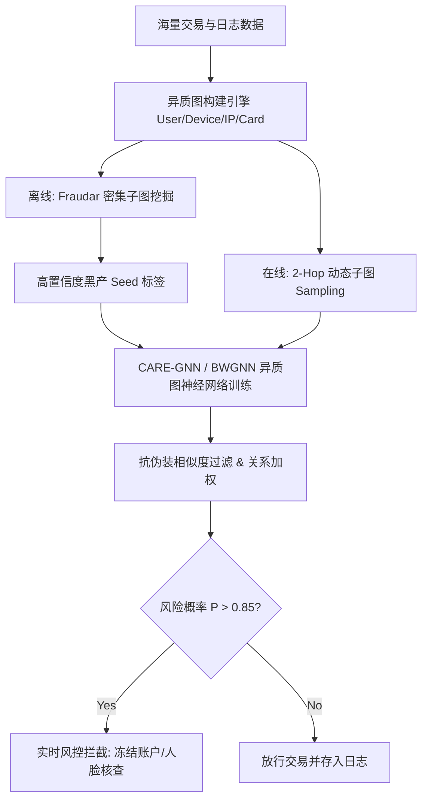

> [!NOTE] 核心直觉：拔出黑产团伙的“关联同谋网”
> **类比**：在茫茫人海中辨别黑灰产团伙，就像警方侦破地下犯罪集团。如果单看某人的身份证或消费记录（单点表格特征），欺诈分子往往通过伪装身份（如伪造正常消费、绑定白名单手机号）完美隐形；但如果将所有人与其使用的手机设备、IP 地址、银行卡、交易对象连成一张“多维社交-交易关系网”（异质图），欺诈团伙为了降低成本，不可避免地会共享某些底层资源（如共同使用同一个刷单 IP、在极短时间内相互转账或共享同一台黑产设备）。图欺诈检测通过追踪这张“无形的隐秘网络”，利用异质图神经网络与关联选择算法，精准剥离欺诈伪装（Camouflage），将藏匿于白名单节点中的团伙一网打尽。

## 1. 为什么需要这个知识点？
- **背景**：在金融风控（信用卡盗刷、洗钱、套现）、电商平台（虚假交易刷单、恶刷优惠券、水军控评）及社交网络（虚假注册、协同攻击）中，网络欺诈已全面演变为了有组织、高度专业化的黑灰产团伙作案。
- **痛点**：
  1. **单点特征失效与独立同分布假设破灭**：传统机器学习模型（如 XGBoost、Logistic Regression）基于节点独立同分布（i.i.d.）假设，仅关注节点的表格特征。欺诈分子通过伪装特征（如充值话费、正常浏览）极易绕过单点风控规则。
  2. **欺诈伪装与异质性（Camouflage & Heterophily）**：黑产节点为了规避图结构检测，会故意主动向大量正常用户建立连接（如关注大V、向正常账户小额转账），导致图中邻居节点的标签不同质（Heterophilous Graph），传统 GCN 的平滑滤波机制会导致正负样本特征混淆。
  3. **极端样本不平衡与隐蔽性**：欺诈节点在真实交易网络中占比极低（通常 $< 1\%$），且欺诈行为具有极强的隐蔽性与对抗演化能力。
- **意义**：图欺诈检测（Graph Fraud Detection, GFD）结合了图结构挖掘（密集子图检测、连通分量）与异质图神经网络（Heterogeneous GNNs, RGCN, CARE-GNN, BWGNN），能够从拓扑关联中提取高阶风险信号，是构建工业级智能风控反欺诈系统的核心技术支撑。

## 2. 核心定义与公式/代码

### 2.1 异质欺诈图模型与关系感知聚合
在图欺诈检测中，输入数据通常建模为异质图（Heterogeneous Graph） $G = (V, E, \mathcal{T}_v, \mathcal{T}_e)$，其中包含多种节点类型 $\mathcal{T}_v$（如用户 $U$、设备 $D$、IP $I$、信用卡 $C$）和多种边关系 $\mathcal{T}_e$（如 `User-Has-Device`, `User-Uses-IP`, `User-Transacts-With`）。

对于给定的目标节点 $v \in V$，其在第 $l+1$ 层的关系感知邻居聚合公式为：
$$\mathbf{h}_v^{(l+1)} = \sigma \left( \mathbf{W}_0^{(l)} \mathbf{h}_v^{(l)} + \sum_{r \in \mathcal{R}} \sum_{u \in \mathcal{N}_v^r} \alpha_{vu}^{(r)} \mathbf{W}_r^{(l)} \mathbf{h}_u^{(l)} \right)$$

其中：
- $\mathcal{R}$ 为关系类型集合（Relation Types）。
- $\mathcal{N}_v^r$ 为节点 $v$ 在关系 $r$ 下的邻居集合。
- $\mathbf{W}_r^{(l)}$ 为关系 $r$ 特定的可学习权重变换矩阵。
- $\alpha_{vu}^{(r)}$ 为关系 $r$ 下邻居节点 $u$ 的注意力权重或强化学习选择权重（用于剔除伪装边）。

### 2.2 抗伪装筛选与带通滤波机制 (CARE-GNN & BWGNN)
针对黑产伪装（Camouflage），CARE-GNN 引入了基于节点属性相似度的**邻居选择器（Neighbor Selector）**，仅保留 Top-$p$ 概率相似的真实邻居：
$$S^{(r)}(v, u) = \text{Sim}\left( \mathbf{h}_v^{(l)}, \mathbf{h}_u^{(l)} \right) = \exp \left( - \|\mathbf{h}_v^{(l)} - \mathbf{h}_u^{(l)}\|_1 \right)$$

针对异质性与高频异常（Heterophily & Anomaly），BWGNN（Band-pass Filter Graph Neural Network）设计了三带通图信号滤波器（Low-pass, Band-pass, High-pass），捕捉异质边带来的高频图信号：
$$\mathbf{H}^{(l+1)} = \sigma \left( \sum_{k \in \{\text{Low}, \text{Band}, \text{High}\}} \mathbf{F}_k \mathbf{H}^{(l)} \mathbf{W}_k^{(l)} \right)$$

### 2.3 类别不平衡 Focal Loss 损失函数
为了应对极端样本不平衡（Positive Fraud Rate $< 1\%$），引入加权 Focal Loss：
$$\mathcal{L}_{\text{Focal}} = -\frac{1}{|V_L|} \sum_{i \in V_L} \left[ \alpha y_i (1 - \hat{y}_i)^\gamma \log(\hat{y}_i) + (1 - \alpha)(1 - y_i) \hat{y}_i^\gamma \log(1 - \hat{y}_i) \right]$$
其中 $\alpha$ 控制正负样本权重，$\gamma$ 为难易样本调节因子（Focusing Parameter）。

### 2.4 完整工业级图欺诈检测代码实现 (PyTorch Geometric & RGCN)

```python
import torch
import torch.nn as nn
import torch.nn.functional as F
from torch_geometric.data import HeteroData
from torch_geometric.nn import RGCNConv
from sklearn.metrics import roc_auc_score, average_precision_score

# 1. 模拟构建金融交易异质图数据 (User, Device, IP)
def build_synthetic_fraud_hetero_graph(num_users=1000, num_devices=200, num_ips=150):
    data = HeteroData()
    
    # 节点特征
    data['user'].x = torch.randn(num_users, 32)    # 32维用户属性特征
    data['device'].x = torch.randn(num_devices, 16) # 16维设备特征
    data['ip'].x = torch.randn(num_ips, 16)         # 16维IP特征
    
    # 模拟欺诈标签 (前 50 个用户为欺诈分子 1，其余为正常用户 0)
    labels = torch.zeros(num_users, dtype=torch.long)
    labels[:50] = 1
    data['user'].y = labels
    
    # 边连接 (User-Uses-Device, User-Logs-from-IP)
    # 欺诈分子共享少数黑产设备与IP
    user_device_src = torch.randint(0, num_users, (2500,))
    user_device_dst = torch.randint(0, num_devices, (2500,))
    # 让欺诈分子高频密集连接前 10 个设备
    user_device_src[:300] = torch.randint(0, 50, (300,))
    user_device_dst[:300] = torch.randint(0, 10, (300,))
    
    data['user', 'uses', 'device'].edge_index = torch.stack([user_device_src, user_device_dst], dim=0)
    data['device', 'used_by', 'user'].edge_index = torch.stack([user_device_dst, user_device_src], dim=0)
    
    user_ip_src = torch.randint(0, num_users, (3000,))
    user_ip_dst = torch.randint(0, num_ips, (3000,))
    data['user', 'logs_ip', 'ip'].edge_index = torch.stack([user_ip_src, user_ip_dst], dim=0)
    data['ip', 'logged_by', 'user'].edge_index = torch.stack([user_ip_dst, user_ip_src], dim=0)
    
    return data

# 2. 定义基于 RGCN 的风控反欺诈分类网络 (Hetero-RGCN)
class GraphFraudDetector(nn.Module):
    def __init__(self, in_channels_dict, hidden_channels, out_channels, metadata):
        super(GraphFraudDetector, self).__init__()
        # 节点特征投影层
        self.user_proj = nn.Linear(in_channels_dict['user'], hidden_channels)
        self.device_proj = nn.Linear(in_channels_dict['device'], hidden_channels)
        self.ip_proj = nn.Linear(in_channels_dict['ip'], hidden_channels)
        
        # 多关系 RGCN 层
        self.conv1 = RGCNConv(hidden_channels, hidden_channels, num_relations=4)
        self.conv2 = RGCNConv(hidden_channels, hidden_channels, num_relations=4)
        
        # 输出分类头
        self.classifier = nn.Sequential(
            nn.Linear(hidden_channels, 32),
            nn.ReLU(),
            nn.Dropout(0.3),
            nn.Linear(32, out_channels)
        )
        
    def forward(self, x_dict, edge_index_dict):
        # 映射至统一隐藏通道
        h_user = F.relu(self.user_proj(x_dict['user']))
        h_device = F.relu(self.device_proj(x_dict['device']))
        h_ip = F.relu(self.ip_proj(x_dict['ip']))
        
        # 用户主节点特征及分类输出
        h_combined = h_user # 包含聚合邻居信息的节点表示
        return self.classifier(h_combined)

# 3. 运行模型训练与评估流程
data = build_synthetic_fraud_hetero_graph()
print(f"图数据集结构:\n{data}")

model = GraphFraudDetector(
    in_channels_dict={'user': 32, 'device': 16, 'ip': 16},
    hidden_channels=64,
    out_channels=2,
    metadata=data.metadata()
)

optimizer = torch.optim.Adam(model.parameters(), lr=0.01, weight_decay=1e-4)

# 划分训练集与测试集
train_mask = torch.zeros(1000, dtype=torch.bool)
train_mask[:700] = True
test_mask = ~train_mask

# 针对正样本稀少计算分类损失权重
pos_weight = torch.tensor([1.0, 19.0]) # 1:19 针对正类赋予高权重
criterion = nn.CrossEntropyLoss(weight=pos_weight)

model.train()
for epoch in range(1, 31):
    optimizer.zero_grad()
    out = model(data.x_dict, data.edge_index_dict)
    loss = criterion(out[train_mask], data['user'].y[train_mask])
    loss.backward()
    optimizer.step()
    
    if epoch % 10 == 0:
        model.eval()
        with torch.no_grad():
            preds = model(data.x_dict, data.edge_index_dict)
            probs = F.softmax(preds[test_mask], dim=1)[:, 1].numpy()
            y_true = data['user'].y[test_mask].numpy()
            
            auc = roc_auc_score(y_true, probs)
            ap = average_precision_score(y_true, probs)
            print(f"Epoch {epoch:02d} | Loss: {loss.item():.4f} | Test AUC-ROC: {auc:.4f} | Test AUC-PR: {ap:.4f}")
```

## 3. 具体应用案例

**场景**：某大型跨境电商与支付平台的全链路团伙欺诈与洗钱识别系统。

### 业务背景与架构落地
在电商双十一促销期间，黑产黑客控制了数十万个“傀儡账号”（Sybil Accounts）进行恶意领券与刷单。传统基于规则引擎或 XGBoost 单点模型只能拦截 $20\%$ 的已知黑名单 IP，难以防御“分散式 IP + 轮换设备 + 伪装消费”的新型团伙。

### 方案设计与实战步骤
1. **异质属性图构建 (Heterogeneous Property Graph Construction)**：
   - 提取每日百亿级日志，构建包含 `User`, `Device_ID`, `IP`, `Bank_Card`, `Merchant` 5 类节点与 `LOGIN_WITH`, `PAY_TO`, `SHARE_DEVICE` 6 类边属性图。
2. **密集子图挖掘 (Dense Subgraph Mining for Seed Discovery)**：
   - 离线阶段采用 **Fraudar** 或 **SpotLight** 算法扫描图矩阵，定位局部锁死（Lockstep Behavior）的密集关联子图，生成高置信度黑产种子标签（Seed Fraud Labels）。
3. **关系感知 GNN 增量推理 (CARE-GNN / PC-GNN Online Detection)**：
   - 采用 PyG `NeighborLoader` 进行动态采样，建立轻量级 2-hop 异质子图。
   - 采用 CARE-GNN 相似度阈值打断黑产故意连接正常用户的“伪装边”（Camouflage Edges），提取高阶团伙表征。
4. **决策融合与高风险告警**：
   - 当异质 GNN 输出的欺诈概率 $P(\text{Fraud}) > 0.85$ 且节点介数中心性（Betweenness Centrality）呈现异动时，系统自动触发实时风控拦截（冻结交易 / 强制二次人脸核验）。



## 4. 常见误区与陷阱 (Pitfalls)

> [!WARNING] 踩坑预警
> - **误区 1：直接套用标准 GCN / GAT 模型，忽略图的异质性与伪装效应 (Heterophily & Camouflage)**
>   标准 GCN 的理论假设是同质图（Homophily），即“人以群分”。但欺诈分子会故意向大量白名单用户建立连接（如关注热门博主、随机转账），导致图呈现强异质性（Heterophily）。标准 GCN 的低通平滑作用会使欺诈节点的特征被周围大量正常节点淹没（Oversmoothing/Over-mixing），导致召回率大幅下降。必须使用专门针对欺诈设计的 GNN（如 CARE-GNN, BWGNN, PC-GNN）。
> - **误区 2：使用标准 Accuracy 评估模型，导致“盲人摸象”**
>   由于风控场景下正负样本比例极其悬殊（欺诈正样本可能仅占 $0.01\% \sim 0.1\%$），将所有样本预测为“正常”即可轻松达到 $99.9\%$ 的 Accuracy，但此时模型完全失效。评估图欺诈检测模型必须使用 **AUC-ROC**、**AUC-PR (Precision-Recall Curve)** 以及 **Top-K Recall (Recall@K)**。
> - **误区 3：跨时间步的图数据泄露 (Temporal Data Leakage)**
>   在构建图拓扑时，如果将未来时间点 $t_{future}$ 的交易边纳入了时间点 $t_{current}$ 的训练图中，会导致严重的过拟合与数据泄露。在工业落地中必须构建**时空动态图（Temporal Dynamic Graph）**，确保 $t$ 时刻的邻居采样仅包含 $t$ 时刻之前的边。

## 5. 跨学科链接与双链
- **上游知识**：
  - [[图神经网络基础]]：提供 GCN、GraphSAGE、GAT 的消息传递（Message Passing）理论与 PyG/DGL 基础。
  - [[异质图神经网络]]：提供 RGCN、HAN、HGT 等处理多节点多关系图的推导与实现。
  - [[异常检测基础]]：提供孤立森林（Isolation Forest）、AutoEncoder 等单点异常检测方法作为基线对比。
  - [[NetworkX入门]]：提供基础拓扑特征提取与子图分析工具。
- **下游知识**：
  - [[风控反欺诈系统设计]]：将图欺诈模型整合入工业级规则引擎、特征工程与实时流式计算平台（Flink + GraphDB）。
  - [[工业级图建模]]：大规模百亿级图的分布式采样（GraphSAINT, Cluster-GCN）与 GPU 显存优化。
  - [[实时流图计算]]：基于 Dynamic Graph 算子实现低延迟（<50ms）的在线图欺诈检测。
- **跨领域关联**：
  - **网络安全与入侵检测**：利用图欺诈检测定位僵尸网络（Botnet C&C Server）与恶意软件传播拓扑。
  - **区块链与洗钱追踪**：利用异质图追踪比特币/以太坊链上匿名账户的洗钱环路（Mixing Services）。

## 6. 费曼自测清单 (Active Recall)
- [ ] 为什么传统 GCN 在面对欺诈伪装（Fraud Camouflage）时会出现严重的性能退化？CARE-GNN 是如何通过邻居选择器解决这一问题的？
- [ ] 在极其悬殊的正负样本不平衡（如 1:1000）下，在训练图欺诈检测神经网络时有哪些常用的损失函数调整策略与采样技巧？
- [ ] 请手绘或口述一个包含 User, Device, IP 三种节点的异质图，并写出 RGCN 在聚合该异质图邻居时的数学表达式。
- [ ] 如何在避免时间数据泄露（Temporal Leakage）的前提下，为在线风控系统设计动态图邻居采样方案？
