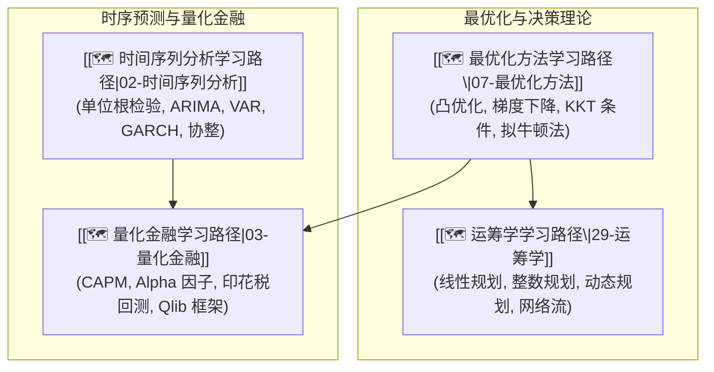

# 主线-金融与时序

> 🧭 **主线宗旨**：整合时间序列分析、量化金融、最优化方法与运筹学 4 门硬核课程。打通从平稳性检验、ARIMA/GARCH 预测到 Alpha 因子回测、凸优化理论与运筹约束决策的完整闭环。

---

## 🗺️ 4 门子线路径逻辑递进图



---

## 🔑 全库唯一 Master 概念卡

时序与量化核心理论统一收拢至基础课程 Master 卡，领域应用建立后缀卡（如 `ARIMA模型-量化应用.md`）：

1. **单位根检验与平稳性**：[[单位根检验与 ADF 检验 (Unit Root & Augmented Dickey-Fuller Test)]]
2. **ARIMA 模型与 Box-Jenkins 范式**：[[ARIMA模型]] ($\Phi(B)(1-B)^d X_t = \Theta(B)\epsilon_t$)
3. **凸优化与 KKT 对偶条件**：[[🗺️ 最优化方法学习路径|最优化方法学习路径]] ($\nabla f_0(x^*) + \sum \lambda_i^* \nabla f_i(x^*) + \sum \nu_i^* \nabla h_i(x^*) = 0$)
4. **夏普比率与因子回测评估**：[[策略评价指标]] ($\text{Sharpe} = \frac{\mathbb{E}[R_p - R_f]}{\sigma_p}$)
5. **线性规划与单纯形法**：[[最优化方法-单纯形法与线性规划|单纯形法与线性规划]] ($\max \mathbf{c}^T\mathbf{x} \text{ s.t. } \mathbf{A}\mathbf{x} \le \mathbf{b}$)

---

## 📊 包含子路径看板 (Dataview)

```dataview
TABLE course AS "课程名称", status AS "状态", importance AS "优先级", updated AS "最近更新"
FROM "02-Knowledge/🧠 学习系统"
WHERE type = "index" AND track = "金融与时序"
SORT file.name ASC
```

---

*主线更新时间：2026-07-30 | 状态：active*
