# 量化金融学习路径

> [!important] 唯一学习入口
> 不确定下一步时只回到本页。当前进度只由 [[01-Active Sprint/🚀 Active Sprint|Active Sprint]] 决定；本页负责显示路线，不维护第二份进度。

## 现在做什么

![[01-Active Sprint/🚀 Active Sprint#🎯 当前指针]]

按当前指针只执行下面五步：

1. 打开“当前知识点”，先完成 3-5 分钟闭卷先测。
2. 学习该卡的最小定义、手算和代码，不扩展阅读。
3. 完成该周对应练习中的一题独立题。
4. 把手算、代码、测试或审计结果写入“当前阶段作业”。
5. 未通过闸门就留在本周；通过后只在 Active Sprint 更新指针。

> [!warning] 防止路径漂移
> `01/02/04` 是存储目录，`Kxx/HWxx/Phase` 是内部编号，都不是并列学习路线。学习顺序只认下方 Week 0-9。

## 一眼看懂主线

```mermaid
flowchart LR
    S["先修诊断"] --> W0["Week 0 补底与环境"]
    W0 --> W1["Week 1 收益与数据"]
    W1 --> W2["Week 2 时间与面板"]
    W2 --> W3["Week 3 滚动与泄漏"]
    W3 --> W4["Week 4 组合与 CAPM"]
    W4 --> W5["Week 5 平稳性与 GARCH"]
    W5 --> W6["Week 6 VaR 与 ES"]
    W6 --> W7["Week 7 BSM 与对冲"]
    W7 --> W8["Week 8 PCA 与树模型"]
    W8 --> W9["Week 9 Capstone"]
    W9 --> E["选修：因子 / 微观结构 / HFT / RL"]
```



## Week 0-9 必修路线

> 每周的完整目标、证据要求和复习节奏见 [[知识地图/00-每周学习执行卡\|每周执行卡]]。本表只负责快速定位。

| 周 | 主题 | 核心入口 | 实作与解锁 |
| :---: | :--- | :--- | :--- |
| **0** | 诊断与环境 | [[00-课程说明与先修诊断#2. 20 分钟先修诊断\|先修诊断]] → [[01-夯实基础/00-零基础补救-数学统计与Python\|按需补底]] | [[03-Projects/开源课程课后习题/PS01-线性代数与概率基础\|PS01 题1-2]]；每维 ≥3/4，Python 可运行 |
| **1** | 收益率与数据 | [[01-夯实基础/收益率与对数收益率\|收益率]] → [[01-夯实基础/OHLCV字段清洗与复权\|OHLCV 清洗]] | [[03-Projects/Capstone-AAPL/README\|AAPL 基线]]；测试捕获拆股错误 |
| **2** | 时间与面板 | [[01-夯实基础/时间索引与频率（量化）\|时间协议]] → [[01-夯实基础/Pandas分组聚合与透视表\|面板操作]] | [[03-Projects/开源课程课后习题/PS02-回归与CAPM\|PS02 题1]]；测试捕获跨资产污染 |
| **3** | 滚动与泄漏 | [[01-夯实基础/滚动窗口与波动率特征\|滚动特征]] → [[02-量化核心技能/样本泄漏\|样本泄漏]] | [[01-夯实基础/量化金融-Level0-累计交错测验\|Level 0]]；首测和 48h 重测 ≥80% |
| **4** | 组合与 CAPM | [[02-量化核心技能/相关系数、协方差与资产组合分散化 (Covariance, Correlation & Diversification)\|协方差与分散化]] → [[02-量化核心技能/CAPM 资本资产定价模型\|CAPM]] | [[03-Projects/HW01-CAPM/README\|HW01]]；正确解释 Alpha、Beta 和统计边界 |
| **5** | 平稳性与 GARCH | [[02-量化核心技能/单位根检验与 ADF 检验 (Unit Root & Augmented Dickey-Fuller Test)\|ADF]] → [[02-量化核心技能/量化金融-波动率-GARCH家族模型\|GARCH]] | [[03-Projects/Phase2-GARCH/README\|GARCH 实验]]；未来扰动不改变训练参数 |
| **6** | VaR 与 ES | [[02-量化核心技能/参数法VaR（方差-协方差法）\|VaR]] → [[02-量化核心技能/量化金融-风险管理-期望损失分解与ES理论\|ES]] | [[03-Projects/HW06-DynamicVaR/README\|动态 VaR]]；完成覆盖率检验 |
| **7** | BSM 与对冲 | [[04-深入精通/量化金融-随机过程-伊藤引理与随机微分方程\|伊藤引理与 SDE]] → [[02-量化核心技能/Black-Scholes 期权定价模型 (Black-Scholes Option Pricing Model)\|Black-Scholes]] | [[03-Projects/HW05-BSM/README\|BSM 实验]]；闭卷推导且解释误差边界 |
| **8** | 基线与验证 | [[01-夯实基础/马科维茨有效前沿\|有效前沿]] → [[02-量化核心技能/树模型基线\|树模型]] → [[02-量化核心技能/时间序列验证\|时序验证]] | [[03-Projects/Tree-Model-Baseline/README\|树模型基线]]；公平比较简单基线 |
| **9** | 综合交付 | [[03-Projects/Capstone-统一标的贯穿实战项目\|Capstone]] | README、测试、产物和报告齐全；总评 ≥75 |

每周更细的当天、24h、72h 和 7d 操作见 [[00-每周学习执行卡]]。课程范围与诊断判分见 [[00-课程说明与先修诊断]]。

## 编号只做翻译，不做导航

| 编号 | 含义 | 什么时候看 |
| :--- | :--- | :--- |
| `K01-K06` | Week 1-3 的基础知识闸门 | Active Sprint 指向某个 K 时 |
| `PS01-PS05` | MIT OCW 改编课后练习 | 对应周“练习与实验”列 |
| `HW01-HW17` | 专题作业或工程扩展 | 主线要求时必做，其余作为选修 |
| `Phase 1-4` | Capstone 交付阶段 | Week 9 整合时 |
| `Pillar / Level` | 全栈知识地图的查阅分类 | 完成 Week 9 后选方向时 |

## 卡住时只走这一条回路

```text
本周闸门失败
  → 标记错因（概念 / 条件 / 计算 / 代码 / 过度自信）
  → 只打开一张补救卡
  → 24 小时后闭卷重做
  → 仍失败则进入 flow: review
  → 通过后返回 Active Sprint，不跨周补进度
```

## Week 9 后再选方向

| 方向 | 入口 | 适合目标 |
| :--- | :--- | :--- |
| 因子与策略 | [[02-量化核心技能/价值因子与 HML 账面市值比溢价 (Value Factor & HML)]]、[[02-量化核心技能/趋势跟踪策略框架与 CTA 交易哲学 (Trend-Following Framework & CTA Trading)]]、[[02-量化核心技能/配对交易与统计套利 (Pairs Trading & Statistical Arbitrage)]] | 因子研究、统计套利 |
| 风险深化 | [[02-量化核心技能/极值理论 EVT 与 POT 超过门槛模型 (Extreme Value Theory & POT Model)]]、[[04-深入精通/HRP分层风险平价]] | 风险模型、资产配置 |
| 执行与 HFT | [[04-深入精通/买卖价差及其微观结构拆解 (Bid-Ask Spread & Microstructure Decomposition)]]、[[04-深入精通/Almgren-Chriss最优拆单]]、[[04-深入精通/限价订单簿数据与 L1_L2_L3 盘口重建 (Limit Order Book Data & Reconstructing L1_L2_L3)]] | 算法执行、微观结构 |
| 随机控制与 RL | [[04-深入精通/量化金融-动态最优化-1-贝尔曼方程直觉与离散推导]]、[[02-量化核心技能/金融MDP设计与奖励函数工程 (Financial MDP & Reward Engineering)]] | 连续时间控制、交易环境 |

> [!info] 查资料而不是学主线
> 找全部知识资产用 [[知识地图/🗺️ 量化金融全栈终极框架 (Academic + AFML + HFT)|全栈知识地图]]；查教材许可用 [[📚 教材挂载索引]]；查 HW 编号用 [[🧭 开源作业体系-量化金融]]。这些页面不决定下一步。
