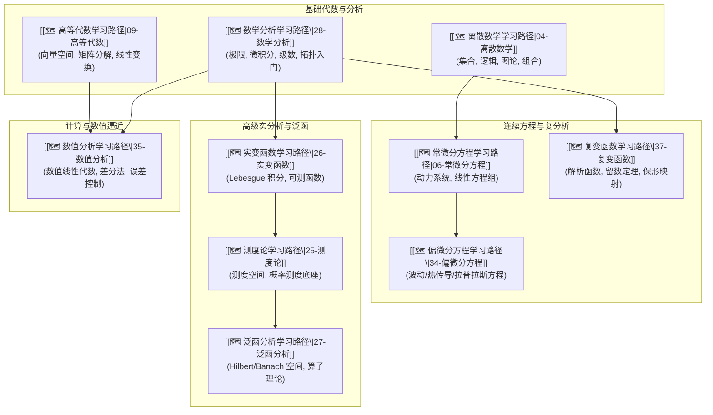

# 📐 主线：数学底座 (Mathematical Foundations Track)

> 🧭 **主线宗旨**：为人工智能、机器学习、控制理论与量化金融提供严密的数学支撑。收拢代数、分析、几何与数值方法，遵循 `AGENTS.md` 唯一主卡规则，建立从离散/连续结构到无限维泛函空间的递进学习路径。

---

## 🗺️ 10 门子线路径逻辑递进图



---

## 🔑 全库唯一 Master 概念卡

所有数学定义、定理与推导统一收拢至基础数学路径中的 canonical 主卡，禁止在应用课程中复制大段定义：

1. **特征值与奇异值分解**：[[奇异值分解SVD]] ($\mathbf{A} = \mathbf{U} \mathbf{\Sigma} \mathbf{V}^T$)
2. **泰勒展开与极值条件**：[[泰勒公式与Hessian矩阵]] ($\mathbf{H}_{ij} = \frac{\partial^2 f}{\partial x_i \partial x_j}$)
3. **Lebesgue 积分与控制收敛**：[[Lebesgue控制收敛定理]]
4. **Hilbert 空间与正交投影**：[[Hilbert空间与内积]] ($\langle f, g \rangle$)
5. **常微分线性系统与矩阵指数**：[[矩阵指数与状态转移矩阵]] ($e^{\mathbf{A}t}$)

---

## 📊 包含子路径看板 (Dataview)

```dataview
TABLE course AS "课程名称", status AS "状态", importance AS "优先级", updated AS "最近更新"
FROM "02-Knowledge/🧠 学习系统"
WHERE type = "index" AND track = "数学底座"
SORT file.name ASC
```

---

*主线更新时间：2026-07-30 | 状态：active*
