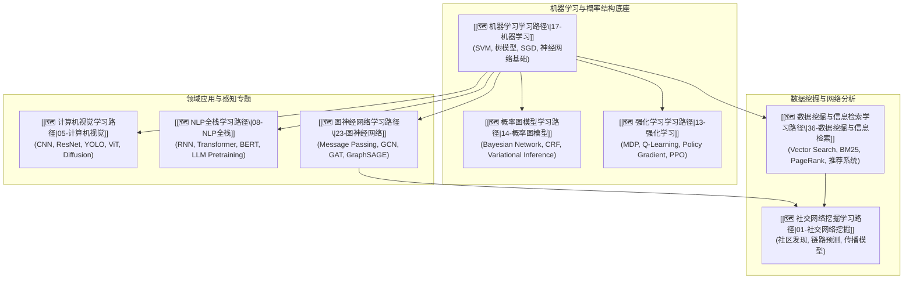

# 🤖 主线：机器学习与 AI 应用 (Machine Learning & AI Applications Track)

> 🧭 **主线宗旨**：整合经典机器学习、概率图模型、强化学习以及计算机视觉 (CV)、自然语言处理 (NLP)、图神经网络 (GNN) 与数据挖掘等前沿应用。严格收拢通用 ML/DL 算法主卡，构建从监督/无监督基础到多模态与序贯决策的现代化 AI 知识网络。

---

## 🗺️ 8 门子线路径逻辑递进图



---

## 🔑 全库唯一 Master 概念卡

通用机器学习算法与深度学习核心架构统一收拢至 `17-机器学习` 与 `08-NLP全栈` 中的 canonical 主卡：

1. **梯度下降与反向传播**：[[反向传播算法BP]] ($\frac{\partial \mathcal{L}}{\partial \mathbf{W}}$)
2. **Transformer 自注意力机制**：[[Transformer自注意力机制]] ($\text{Attention}(Q,K,V) = \text{softmax}\left(\frac{QK^T}{\sqrt{d_k}}\right)V$)
3. **马尔可夫决策过程 MDP**：[[马尔可夫决策过程MDP]] ($\langle \mathcal{S}, \mathcal{A}, \mathcal{P}, \mathcal{R}, \gamma \rangle$)
4. **图卷积与消息传递**：[[图卷积网络GCN]] ($\mathbf{H}^{(l+1)} = \sigma\left(\tilde{\mathbf{D}}^{-\frac{1}{2}} \tilde{\mathbf{A}} \tilde{\mathbf{D}}^{-\frac{1}{2}} \mathbf{H}^{(l)} \mathbf{W}^{(l)}\right)$)
5. **KL 散度与变分推断**：[[KL散度]] ($D_{\text{KL}}(P || Q)$)

---

## 📊 包含子路径看板 (Dataview)

```dataview
TABLE course AS "课程名称", status AS "状态", importance AS "优先级", updated AS "最近更新"
FROM "02-Knowledge/🧠 学习系统"
WHERE type = "index" AND track = "机器学习与AI应用"
SORT file.name ASC
```

---

*主线更新时间：2026-07-30 | 状态：active*
