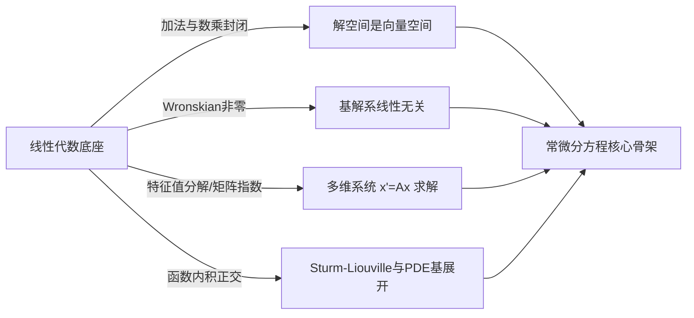

# 常微分方程必要线性代数工具

> 所属路径：[[🗺️ 常微分方程学习路径|常微分方程学习路径]]  
> 所属阶段：[[🧭 常微分方程-前置知识|00-前置知识]]  
> 定位：**最小充分线性代数桥梁卡**——本卡不重抄整本抽象代数教材，而是精准提炼常微分方程在求解高阶线性方程、多维一阶系统、相平面分析与函数空间展开时**唯一必需的 4 大代数武器**。

---

## 0. 学习边界与图景

在常微分方程中，线性代数不是选修课，而是解析求解与定性分析的**底层语法**：
1. **函数解空间的代数本质**：线性微分算子 $L[y] = y'' + p(t)y' + q(t)y$ 是线性映射，齐次方程 $L[y]=0$ 的所有解构成一个向量空间（核空间 $\ker L$）。$n$ 阶齐次方程的解空间维数**严格等于 $n$**。
2. **多维系统演化的对角化**：一阶线性系统 $\vec{x}' = A\vec{x}$ 的解由矩阵 $A$ 的特征值与特征向量决定。若 $A$ 可对角化，解沿特征向量方向解耦为独立的指数演化。
3. **函数空间的正交基展开**：边值问题（Sturm-Liouville）与傅里叶级数展开，本质上是无穷维函数内积空间中正交基投影的推广。



---

## 1. 核心工具 1：向量空间与解空间的代数结构

### 1.1 什么是函数向量空间？
在代数上，只要一组对象满足**加法封闭**与**数乘标量封闭**（并满足 8 条基本公理），它就是一个向量空间。
所有定义在区间 $I$ 上的实值连续函数集合 $C(I)$ 是一个典型的向量空间。

### 1.2 为什么齐次微分方程的解构成向量空间？
考虑 $n$ 阶线性齐次微分方程：
$$ L[y] = y^{(n)} + a_{n-1}(t)y^{(n-1)} + \dots + a_1(t)y' + a_0(t)y = 0 $$
因为微分是线性算子，满足：
$$ L[c_1 y_1 + c_2 y_2] = c_1 L[y_1] + c_2 L[y_2] $$
如果 $y_1, y_2$ 都是解（即 $L[y_1]=0, L[y_2]=0$），那么其任意线性组合 $c_1 y_1 + c_2 y_2$ 也必然满足 $L[c_1 y_1 + c_2 y_2] = 0$。
> 💡 **叠加原理（Principle of Superposition）**：齐次线性微分方程的解集构成 $C(I)$ 的一个线性子空间！

---

## 2. 核心工具 2：线性无关、基与 Wronskian 判别法

### 2.1 线性无关与基解系
一组解 $\{y_1(t), y_2(t), \dots, y_n(t)\}$ 称为在区间 $I$ 上**线性无关**，当且仅当：
$$ c_1 y_1(t) + c_2 y_2(t) + \dots + c_n y_n(t) \equiv 0 \implies c_1 = c_2 = \dots = c_n = 0 $$
- 对于 $n$ 阶齐次线性微分方程，解空间的维数严格为 $n$。
- 任意 $n$ 个线性无关的解构成该空间的一组**基（基解系，Fundamental Set of Solutions）**。
- 通解即可写为基解系的任意线性组合：
  $$ y(t) = c_1 y_1(t) + c_2 y_2(t) + \dots + c_n y_n(t) $$

### 2.2 Wronskian 行列式判别
为了判断 $n$ 个解是否线性无关，我们构造 **朗斯基行列式 (Wronskian Determinant)**：
$$
W(y_1, \dots, y_n)(t) = \det \begin{pmatrix}
y_1(t) & y_2(t) & \dots & y_n(t) \\
y_1'(t) & y_2'(t) & \dots & y_n'(t) \\
\vdots & \vdots & \ddots & \vdots \\
y_1^{(n-1)}(t) & y_2^{(n-1)}(t) & \dots & y_n^{(n-1)}(t)
\end{pmatrix}
$$
- **Abel 定理**：对于微分方程 $y^{(n)} + p_{n-1}(t)y^{(n-1)} + \dots = 0$ 的解，$W(t) = W(t_0) \exp\left(-\int_{t_0}^t p_{n-1}(s)ds\right)$。
- **判别准则**：在区间 $I$ 上，$W(t)$ 要么**处处为 0**（解线性相关），要么**处处不为 0**（解线性无关）。只要在任一点 $t_0$ 算得 $W(t_0) \neq 0$，即可确证它们构成基解系！

---

## 3. 核心工具 3：特征值、特征向量与矩阵对角化

### 3.1 一阶线性系统与特征方程
对于多维线性动力系统：
$$ \frac{d\vec{x}}{dt} = A \vec{x}, \quad \vec{x} \in \mathbb{R}^n, A \in \mathbb{R}^{n \times n} $$
我们寻找指数形式的特解 $\vec{x}(t) = e^{\lambda t} \vec{v}$（其中 $\vec{v} \neq \vec{0}$ 为常数向量）。
代入方程可得：
$$ \lambda e^{\lambda t} \vec{v} = A (e^{\lambda t} \vec{v}) \implies A \vec{v} = \lambda \vec{v} $$
这正是线性代数中的**特征值问题**！
1. **特征多项式**：$\det(A - \lambda I) = 0$，解出 $n$ 个特征值 $\lambda_i$。
2. **特征向量**：求解核空间 $(A - \lambda_i I)\vec{v}_i = \vec{0}$。

### 3.2 几何直觉与解的形态
- **实特征值 $\lambda$**：状态点沿特征向量 $\vec{v}$ 所在的直线纯粹做指数增长（$\lambda > 0$）或指数衰减（$\lambda < 0$）。
- **复共轭特征值 $\lambda = \alpha \pm i\beta$**：由欧拉公式 $e^{(\alpha + i\beta)t} = e^{\alpha t}(\cos\beta t + i\sin\beta t)$，实部 $\alpha$ 控制幅值增长/衰减，虚部 $\beta$ 控制相空间中的旋转角速度（振荡）。
- **矩阵指数 $e^{At}$**：若 $A = V \Lambda V^{-1}$ 可对角化，则：
  $$ e^{At} = V \text{diag}(e^{\lambda_1 t}, \dots, e^{\lambda_n t}) V^{-1} $$
  多维耦合系统在特征基下完全解耦为 $n$ 个独立的一阶标量方程。

---

## 4. 核心工具 4：内积空间与函数正交性

### 4.1 函数内积定义
在区间 $[a, b]$ 上带权函数 $w(x) > 0$ 的平方可积函数空间 $L^2_w[a, b]$ 中，定义两个函数 $f(x), g(x)$ 的内积为：
$$ \langle f, g \rangle_w = \int_a^b f(x) g(x) w(x) \, dx $$
- **范数（模长）**：$\|f\| = \sqrt{\langle f, f \rangle_w}$
- **正交性**：若 $\langle f, g \rangle_w = 0$，则称函数 $f$ 与 $g$ 在加权内积下**正交**。

### 4.2 应用场景：Sturm-Liouville 边值问题与傅里叶展开
自伴随微分算子 $L$（如 $-y'' = \lambda y$）的本征函数族 $\{ \phi_n(x) \}$ 构成函数空间的一组**正交基**。
任意函数 $f(x)$ 可以在该正交基下唯一展开：
$$ f(x) = \sum_{n=1}^\infty c_n \phi_n(x), \quad c_n = \frac{\langle f, \phi_n \rangle}{\|\phi_n\|^2} $$
这正是高等解析方法、傅里叶级数以及偏微分方程分离变量法的代数基石。

---

## 5. 易混概念与常见误区

| 常见误区 | 正确认知与纠正 |
| :--- | :--- |
| **误区 1**：非齐次方程的解集也是向量空间 | ❌ 错误。非齐次方程解集不包含零元（零函数代入等号不成立），也不满足数乘封闭。非齐次解集是**仿射空间**（通解 = 齐次通解 + 一个特解 $y = y_h + y_p$）。 |
| **误区 2**：$W(t)=0$ 必然说明任意函数线性相关 | ⚠️ 警惕：对于**一般函数**，$W(t_0)=0$ 不一定线性相关；但对于**线性齐次 ODE 的解**，Abel 定理保证 $W(t)$ 要么恒为 0 要么处处非 0，因此成立。 |
| **误区 3**：矩阵 $A$ 只要有重特征值就无法求解 | ❌ 错误。重特征值若几何重数不足，可通过构造**广义特征向量（Generalized Eigenvectors）** 或 Jordan 块求解，解中会出现形如 $t e^{\lambda t}$ 的项。 |

---

## 6. 自检与闭卷验收清单

- [ ] 能否脱稿说明为什么齐次线性 ODE 的解满足叠加原理，而非齐次方程不满足？
- [ ] 给定两个函数 $y_1(t)=e^t, y_2(t)=e^{-t}$，能否在 30 秒内算出其 Wronskian 并判定是否线性无关？
- [ ] 能否从几何直观解释：矩阵特征值的实部和虚部分别对应动力系统的什么运动特征？
- [ ] 能否写出连续函数内积的积分公式，并说明它与向量点积 $\vec{u}\cdot\vec{v}$ 的对应关系？

---

## 学完后可以完成

```dataview
LIST
FROM "03-Projects/06-常微分方程"
WHERE contains(requires, this.file.link)
SORT assignment_level ASC, file.name ASC
```
