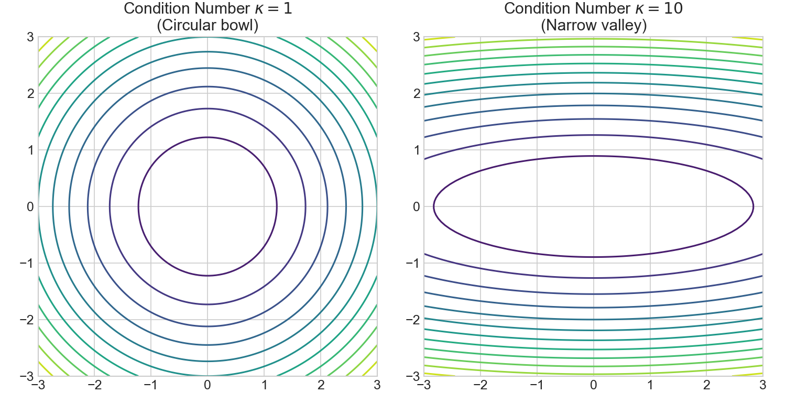
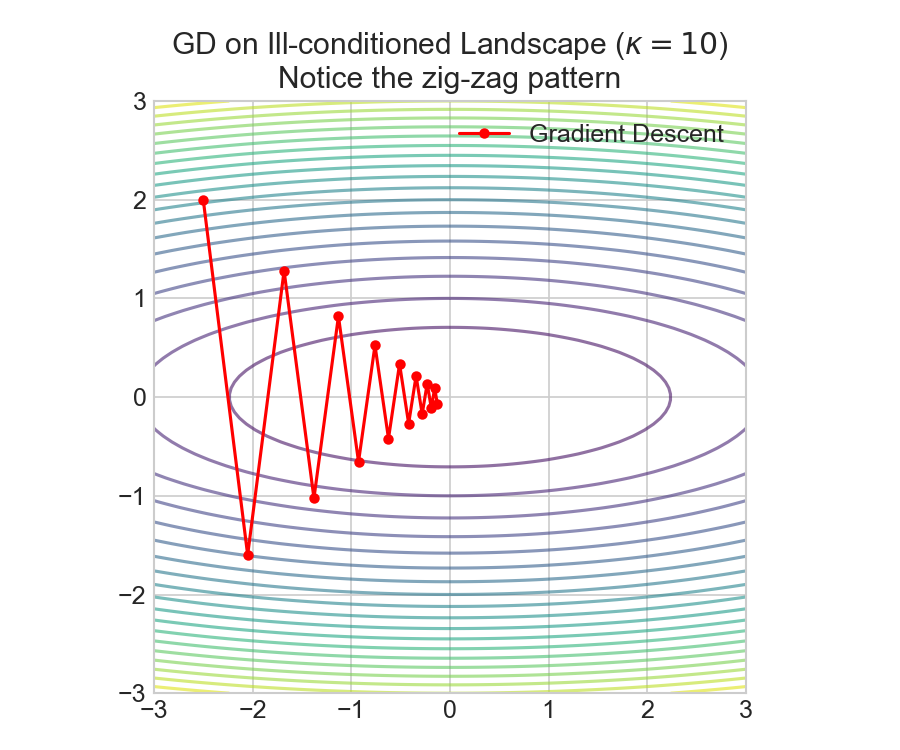

# 一阶方法收敛性分析

---
## 0. 先判断它值不值得深挖
- **类别**：**A 类（核心概念，必须深挖）**
- **判断理由**：收敛性分析是"算法能保证多快收敛"的**唯一定量语言**：HW05 验收明确要求"三种一阶方法收敛曲线对比（对数坐标）+ 定量说明收敛阶"；不学它就看不懂 SGD/动量/Nesterov 的加速动机，也无法回答"为什么梯度下降在这个问题上这么慢"。

---
## 1. 这个知识点解决什么问题？
> **我们遇到了什么麻烦**：
> 梯度下降 $x_{k+1} = x_k - t \nabla f(x_k)$ 谁都会写，但运行起来问题一堆：在有的问题上几步就收敛，在有的问题上（如 $x_1^2 + 10^6 x_2^2$）走之字形、几百步还在磨蹭；步长 $t$ 调大一点就发散，调小一点又太慢。以前的办法是"凭经验试步长、跑完看效果"，但无法回答：**这个算法到底会不会收敛？保证收敛需要什么条件？收敛速度是线性的还是更慢？为什么换一个函数就差这么多？** 因此需要一套**收敛性理论**：用函数的两个可计算常数——Lipschitz 常数 $L$（梯度变化上限）与强凸常数 $m$（曲率下限）——精确刻画收敛率，并指导步长选择。

---
## 2. 为什么它重要？它有什么用？
- **连接大图景**：收敛性分析是"算法选择"的判据：内点法（[[内点法原理]]）每步贵但迭代数 $O(\sqrt n \log)$；一阶法每步便宜（$O(n)$）但线性收敛——这个"精度 vs 成本"权衡必须用收敛率定量比较。它也是 [[SGD收敛推导]]、动量、Nesterov 加速的理论起点。
- **实际应用场景**：机器学习/深度学习中几乎所有优化器（SGD、Adam、L-BFGS）都继承这套语言：Lipschitz 常数对应"学习率上限"，条件数 $\kappa = L/m$ 对应"特征值分散程度"，线性收敛对应"每轮误差除以固定因子"。
- **高频题型/任务**：给定 $f$ 求 $L, m, \kappa$ 并给出收敛率；比较固定步长/回溯/最速下降；证明 $f(x_k) - f^* \le (1 - m/L)^k (f_0 - f^*)$；HW05 画收敛曲线并报告观察到的收敛阶。

---
## 3. 学它之前需要哪些前置知识？
1. **[[凸集与凸函数]]**：凸函数定义、Hessian 半正定；强凸（$mI \preceq \nabla^2 f$）与光滑（$\nabla^2 f \preceq LI$）是"凸 + 二阶信息"的自然量化。
2. **[[最速下降收敛推导]]**：梯度下降 = 用 $\ell_2$ 范数的最速下降；该笔记给出二次函数情形的精确收缩因子 $(L-m)/(L+m)$。
3. **微积分**：泰勒展开与 Lipschitz 条件——$L$-光滑的等价形式 $f(y) \le f(x) + \nabla f(x)^T(y-x) + \frac{L}{2}\|y-x\|^2$ 就是"带余项的泰勒"。

---
## 4. 用直觉语言解释它
> «梯度下降像"蒙眼下坡"：你只能感觉脚下坡度（梯度），每步沿最陡方向走固定距离。收敛快慢由山的两个性质决定：**坡度变化有多快**（$L$：山坡是平滑球面还是锯齿状）和**谷底有多尖**（$m$：是深碗还是长峡谷）。$L$ 决定你敢走多大步（$t \le 1/L$），$m$ 决定你离谷底近时还能不能"感到方向"（峡谷底部近乎平地，梯度微弱，越走越慢）。两者的比值 $\kappa = L/m$（条件数）是"山的形状有多恶劣"的度量：$\kappa$ 越接近 1（圆碗），几步就到底；$\kappa$ 越大（细长峡谷），就 zigzag 磨蹭。线性收敛的意思是：**每走一步，离最优的距离（误差）乘以同一个小于 1 的因子**——比如 $\times 0.9$，误差从 1 降到 $10^{-6}$ 需要约 $\log_{0.9}(10^{-6}) \approx 131$ 步。"»
- **直觉类比/几何图像**：$L$-光滑 = "坡度平缓"；$m$-强凸 = "谷底尖锐"。条件数 $\kappa = L/m$ 对应了等高线的“扁平程度”。

*(左图是理想的 $\kappa=1$，梯度直指圆心；右图是病态的 $\kappa=10$，等高线变成峡谷。)*

*(在这个峡谷中，如果使用梯度下降，会因为方向在两壁之间来回横跳而形成 Z 字形 (Zig-zag) 轨迹，导致收敛极慢。这就是条件数带来的直观恶果。)*
- **为什么很自然**：$L$-光滑保证"沿负梯度走 $t = 1/L$ 至少下降 $\|\nabla f\|^2/(2L)$"（二次上界），$m$-强凸保证"离最优多远就有多大的梯度"（Polyak–Łojasiewicz 不等式 $f - f^* \le \|\nabla f\|^2/(2m)$）——两者一乘，误差每步收缩 $1 - m/L$。
- **一句话直觉本质**：**收敛性 = 山坡形状（$L$、$m$、$\kappa$）决定步长上限与每步收缩率；$L$、$m$ 可算、$\kappa$ 可测，于是"这个算法在这个问题上多快"变成一道算术题。**

---
## 5. 正式定义、核心公式、符号解释
### 1. 最核心定义
- **$L$-光滑（Lipschitz 梯度）**：$\|\nabla f(x) - \nabla f(y)\|_2 \le L\|x - y\|_2,\ \forall x, y$；二阶可微时等价于 $\nabla^2 f(x) \preceq LI$。关键推论（二次上界）：$f(y) \le f(x) + \nabla f(x)^T(y - x) + \frac{L}{2}\|y - x\|^2$。
- **$m$-强凸**：$f(y) \ge f(x) + \nabla f(x)^T(y - x) + \frac{m}{2}\|y - x\|^2$；等价于 $\nabla^2 f(x) \succeq mI$ 与 Polyak–Łojasiewicz 不等式 $f(x) - f^* \le \frac{1}{2m}\|\nabla f(x)\|^2$。
- **条件数**：$\kappa = L/m \ge 1$（二次函数 = 特征值比 $\lambda_{\max}/\lambda_{\min}$）。
- **梯度下降**：$x_{k+1} = x_k - t_k \nabla f(x_k)$；步长策略：固定 $t = 1/L$、精确线搜索或回溯线搜索（Armijo：$f(x - t\nabla f) \le f(x) - \alpha t\|\nabla f\|^2$，$\alpha \in (0, 0.5)$，$t$ 从 1 起按 $\beta$ 衰减）。
### 2. 核心公式
固定步长 $t = 1/L$ 的梯度下降，在 $L$-光滑 + $m$-强凸（$0 < m \le L$）下的线性收敛：
$$f(x_k) - f^* \le \left(1 - \frac{m}{L}\right)^{k}\left(f(x_0) - f^*\right) = \left(1 - \frac{1}{\kappa}\right)^{k}\left(f(x_0) - f^*\right)$$
达到精度 $\varepsilon$（$f(x_k) - f^* \le \varepsilon$）所需迭代数：$k \ge \kappa \log\!\left(\frac{f(x_0) - f^*}{\varepsilon}\right)$
仅凸（$m = 0$）时次线性：$f(x_k) - f^* \le \frac{L\|x_0 - x^*\|^2}{2k}$；Nesterov 加速凸：$O(1/k^2)$；加速强凸：$\left(1 - \sqrt{\frac{m}{L}}\right)^k$
### 3. 符号说明表

| 符号 | 含义 | 取值范围 / 量纲 | 备注 |
| :--- | :--- | :--- | :--- |
| $L$ | 梯度 Lipschitz 常数 | $L > 0$ | 步长上限 $t \le 1/L$；$\nabla^2 f \preceq LI$ |
| $m$ | 强凸常数 | $m > 0$（凸时 $m = 0$） | $\nabla^2 f \succeq mI$ |
| $\kappa = L/m$ | 条件数 | $\ge 1$ | 越大越难优化 |
| $t_k$ | 步长（学习率） | $0 < t_k \le 1/L$（保证） | 回溯：Armijo + 衰减 $\beta$ |
| $\rho = 1 - m/L$ | 线性收缩因子 | $(0, 1)$ | 每步误差乘 $\rho$ |
| $\varepsilon$ | 目标精度 | $> 0$ | 迭代数 $\sim \kappa \log(1/\varepsilon)$ |

### 4. 常见变体与适用条件
- **变体**：最速下降（精确线搜索，二次函数收缩因子 $(L-m)/(L+m)$，见 [[最速下降收敛推导]]）；动量/重球法（强凸时 $(1 - \sqrt{m/L})$）；Nesterov 加速（凸 $O(1/k^2)$ 最优）；SGD/随机变体（见 [[SGD收敛推导]]）；近端梯度（非光滑项）。
- **适用条件**：收敛率公式需要 $f$ 凸（线性收敛还需强凸）；$L, m$ 未知时用回溯线搜索自适应。
- **限制条件**：$L$ 很大（如 $\kappa > 10^4$）时一阶法极慢——换共轭梯度（[[线性共轭梯度法]]）、牛顿类（[[拟牛顿法BFGS]]）或内点法；非凸问题只有"收敛到稳定点"的局部保证。

---
## 6. 推导思路和思想来源
- **最初困难**：梯度下降的收敛速度依赖函数形状，无法用"每步下降量"直接刻画。
- **直接方法局限**：逐点泰勒分析只能给出单步下降，无法累积成全局迭代数上界。
- **关键"转念"**：把函数用两个**全局常数**夹住：$L$-光滑给出"下降量的下界"（$\frac{\|\nabla f\|^2}{2L}$），$m$-强凸给出"误差与梯度的联系"（$f - f^* \le \frac{\|\nabla f\|^2}{2m}$，PL 不等式）。两者结合：$f_{k+1} - f^* \le f_k - f^* - \frac{\|\nabla f_k\|^2}{2L} \le (1 - \frac{m}{L})(f_k - f^*)$——**每步误差乘一个常数因子**，递归展开即得 $(1 - m/L)^k$。这是"李雅普诺夫函数收缩"思想的雏形。
- **推导主线与动机**：Lipschitz 梯度（Ch.9.1.2）→ 二次上界 → 固定步长 $t = 1/L$ 的下降引理 → 强凸 + PL 不等式（Ch.9.1.2 引理）→ 线性收敛定理 → 迭代数 $\kappa \log(1/\varepsilon)$；Nesterov 加速通过"外推点 $y_k = x_k + \beta_k(x_k - x_{k-1})$"利用历史方向，把 $\kappa$ 换成 $\sqrt{\kappa}$。
- **为什么自然得到此结论**：因为"误差收缩"是最自然的收敛度量——只要每步误差乘以 $\rho < 1$，迭代数就是 $\log(1/\varepsilon)$ 级别；而 $L, m$ 恰好是能同时控制"下降量"与"误差-梯度关系"的一对常数。

---
## 7. 例子：基础 → 中等 → 实际应用
### 例子 1：基础例子（可手算）
- **题目**：$f(x) = \frac12 x_1^2 + x_2^2$，求 $L, m, \kappa$，用固定步长 $t = 1/L$ 从 $x_0 = (1, 0)$ 迭代 2 步并验证线性收敛因子。
- **解题思路与关键步骤**：$\nabla^2 f = \mathrm{diag}(1, 2)$，故 $m = 1$，$L = 2$，$\kappa = 2$；$t = 1/L = 0.5$。迭代：$\nabla f(x) = (x_1, 2x_2)$；$x_1 = x_0 - 0.5(1, 0) = (0.5, 0)$；$x_2 = (0.25, 0)$。
- **最终答案**：$f(x_0) = 0.5$，$f(x_2) = 0.5 \times 0.25^2 = 0.03125$；比率 $\sqrt{f_2/f_0} = 0.25$，而理论因子 $1 - 1/\kappa = 0.5$（对误差 $\|x_k - x^*\|$ 每步乘 $0.5$，$x_2 = 0.25 x_0$ 恰吻合）。
- **易错点**：$L$ 取 Hessian 最大特征值而非"看起来最大的系数"；收敛因子是对**误差**（$\|x - x^*\|$ 或 $f - f^*$）而非函数值本身。
- **🤔 追问**：若 $f = \frac12 x_1^2 + 100 x_2^2$？——$\kappa = 100$，因子 $0.99$，从误差 1 到 $10^{-3}$ 需 $\approx 688$ 步（这就是"病态二次型"的 zigzag）。
### 例子 2：中等例子（条件判断与多步推理）
- **题目**：$f(x) = \frac12 x_1^2 + 10 x_2^2$（$\kappa = 20$）。比较固定步长 $t = 1/L$、回溯线搜索（$\alpha = 0.2, \beta = 0.5$）在前 3 步的行为，说明为何回溯更稳。
- **解题思路与完整解答**：$L = 20, m = 1$。固定步长 $t = 0.05$：从 $(1, 1)$ 出发，$x_1 = (1, 1) - 0.05(1, 20) = (0.95, 0)$——$x_2$ 分量一步清零（沿最大曲率方向），之后只剩 $x_1$ 方向以因子 $1 - m/L = 0.95$ 慢收敛。回溯线搜索：第一步先试 $t = 1$，Armijo 检查 $f(x - \nabla f) = f(0, -19) = 0 + 3610 > f(0) - 0.2 \times 401$，拒绝，$t$ 依次减半到 $t = 0.1$ 左右接受——**每步自适应地"测坡度"**，不依赖 $L$ 先验。
- **关键推理**：固定步长的效率依赖 $L$ 估计的准确度（$t = 1/L$ 是保证上界，实际最优步长可能更大）；回溯在 $L$ 未知时自动逼近 $1/L$，且对估计过小的 $t$ 有鲁棒性。HW05 中两者收敛曲线应几乎重合，但回溯无需调参。
- **易错点**：Armijo 用 $f(x - t\nabla f) \le f(x) - \alpha t\|\nabla f\|^2$（充分下降条件），不是"新函数值小于旧函数值"（后者允许过小步长）。
### 例子 3：实际应用例子（真实场景/代码）
- **实际价值与转化**：HW05 验收——对 $f(x) = \frac12 x^T P x$（$P$ 特征值 $10^{-2} \sim 10^2$，$\kappa = 10^4$）画收敛曲线：
```python
import numpy as np
def gd(f, grad, x0, t, n_iter):
    xs = [x0]
    for _ in range(n_iter):
        xs.append(xs[-1] - t * grad(xs[-1]))
    return np.array(xs)

# f(x) = 0.5 x^T P x,  P = diag(1e-2, ..., 1e2), kappa = 1e4
P = np.diag(np.logspace(-2, 2, 50)); L, m = P.max(), P.min()
xs = gd(lambda x: 0.5*x@P@x, lambda x: P@x, np.ones(50), 1/L, 500)
errs = [0.5*(x - x_star)@P@(x - x_star) for x in xs]   # f - f*
# 对数坐标画 errs：斜率 = log10(1 - 1/kappa) ≈ -4.3e-5 → 500 步仅降 ~5%
# 换 Nesterov 加速：斜率 ≈ log10(1 - 1/sqrt(kappa)) ≈ -4.3e-3 → 500 步降 ~99%
print(f"kappa={L/m:.0e}, 500步固定步长残差比={errs[-1]/errs[0]:.2e}")
```
**与理论对照**：固定步长斜率 $\log_{10}(1 - 1/\kappa) \approx -4.3\times 10^{-5}$（几乎水平）；Nesterov 斜率 $\log_{10}(1 - 1/\sqrt{\kappa}) \approx -4.3\times 10^{-3}$（快 100 倍）——这就是 HW05 "定量说明收敛阶"的实操：**在对数坐标上量斜率 = 读收敛阶**。随机化后即 [[SGD收敛推导]] 的设定（用噪声梯度替换 $\nabla f$，收敛率退化）。

---
## 8. 常见误区和易混概念
### 误区 1：以为"步长越大收敛越快，调大点没关系"
- **错误直觉**：梯度下降嘛，步子迈大点，走得快。
- **为什么错**：$t > 2/L$ 时 $1 - t(2m - tL)$ 类因子可能为负（发散/振荡）；即使 $t \in (1/L, 2/L)$ 收敛也未必比 $1/L$ 快（保证上界在 $t = 1/L$ 最优）。
- **正确理解**：$t = 1/L$ 是**理论最优保证**；实际可用回溯（从 $t = 1$ 减半）或对二次型做精确线搜索；发散时先检查 $t$ 是否超过 $2/L$。
### 误区 2：把"线性收敛"理解成"很慢"或与"二次收敛"混淆
- **错误直觉**：线性收敛 = 指数慢；梯度下降没用。
- **为什么错**：线性收敛（误差乘 $\rho < 1$）意味着迭代数 $\sim \kappa \log(1/\varepsilon)$——对 $\kappa = 10$ 的问题 100 步内到 $10^{-6}$，非常实用；次线性（$O(1/k)$）才是"慢"（需要 $\sim 1/\varepsilon$ 步）。二次收敛（牛顿法）是 $\log\log$ 级别，但每步代价 $O(n^3)$。
- **正确理解**：收敛阶是"误差随迭代数下降的速率"：次线性 $O(1/k^\alpha)$ < 线性 $\rho^k$ < 超线性 < 二次 $O(\rho^{2^k})$；选算法 = 权衡每步代价与收敛阶。
### 概念对比表

| 概念 | 核心问题 | 关键区别 | 典型使用场景 |
| :--- | :--- | :--- | :--- |
| 梯度下降（本概念） | 只用一阶信息 | 每步 $O(n)$，线性收敛（强凸） | 大规模问题、深度学习基线 |
| 最速下降 | 范数选择 | $\ell_2$ 即梯度下降；其他范数改变方向 | [[最速下降收敛推导]] |
| 牛顿法/拟牛顿 | 用二阶信息 | 二次收敛但每步 $O(n^3)$ 或 $O(n^2)$ | 中小规模高精度，[[拟牛顿法BFGS]] |
| 共轭梯度 | 免 Hessian 的二次加速 | $n$ 步内精确（无病态累积） | 大规模稀疏二次型，[[线性共轭梯度法]] |
| SGD | 随机梯度 | 期望意义收敛，噪声限制精度 | 海量数据，[[SGD收敛推导]] |
| 内点法 | 约束处理 | 迭代 $O(\sqrt n \log(1/\varepsilon))$，每步 $O(N^3)$ | 高精度凸规划，[[内点法原理]] |

---
## 9. 相关知识点与 Obsidian 双链建议
### 上游依赖
- [[凸集与凸函数]]：$L$-光滑、$m$-强凸的定义基础（Hessian 的上下界、凸性不等式）。
- [[最速下降收敛推导]]：精确线搜索情形的 $(L-m)/(L+m)$ 收缩因子，比固定步长更精细。
- [[凸优化问题标准形式]]：收敛性分析针对标准形式中的凸目标 $f_0$。
### 下游延伸
- [[SGD收敛推导]]：把 $\nabla f$ 换成无偏噪声梯度后，收敛率退化（强凸下 $O(1/k)$ 期望），步长需衰减——本笔记是其确定性特例。
- [[线性共轭梯度法]]、[[非线性共轭梯度法]]：一阶信息的"记忆化"升级，消除 zigzag。
- [[投影梯度法]]：一阶方法 + 约束投影，收敛率保持。
### 横向关联
- [[内点法原理]] ↔ 本知识点：内点法牛顿步 = 二次收敛但每步贵；一阶法线性收敛但每步便宜——HW03/HW05 两条算法链的对比轴。
- [[拟牛顿法BFGS]] ↔ 本知识点：拟牛顿用梯度差逼近 Hessian，收敛率介于线性与二次之间，HW03 对照验证。
### 应用场景
- [[🧭 开源作业体系-最优化方法]]：HW05 验收 = 三种一阶方法收敛曲线 + 定量收敛阶。
- [[项目-优化器对比]]、[[项目-优化对比]]：真实数据上 GD/SGD/Adam 收敛曲线对比（本笔记是理论基准）。
- [[项目-DL调参]]：学习率（步长）选择 = $1/L$ 估计 + 回溯/调度。

---
## 10. 闭卷复现任务

合上笔记后，请独立回答以下 10 个问题：
- [ ] 1. 用一句话说清楚收敛性分析解决什么问题。
- [ ] 2. 用直觉语言解释它（«"蒙眼下坡"»）。
- [ ] 3. 写出 $L$-光滑与 $m$-强凸的定义与等价形式。
- [ ] 4. 写出固定步长梯度下降的线性收敛公式。
- [ ] 5. 解释 $L$、$m$、$\kappa$、$\rho$、$t$ 的含义。
- [ ] 6. 讲出"二次上界 + PL 不等式 ⟹ 误差每步乘 $1 - m/L$"的推导主线。
- [ ] 7. 手算 $f = \frac12 x_1^2 + x_2^2$ 的 $L, m, \kappa$ 与两步迭代。
- [ ] 8. 说出两个误区（步长越大越好、线性收敛=慢）。
- [ ] 9. 说出梯度下降与最速下降、共轭梯度、牛顿法、SGD 的关系。
- [ ] 10. 说出一个真实应用场景（HW05 对数坐标量斜率）。

---
## 11. 自测题：5 道

| 题号 | 类型 | 难度 | 考查点 |
| :--- | :--- | :--- | :--- |
| 1 | 概念辨析 | 基础 | $L$-光滑与 $m$-强凸的几何含义 |
| 2 | 公式运用 | 基础 | 求 $L, m, \kappa$ 并算收敛因子 |
| 3 | 条件判断 | 中等 | 步长选择与发散边界 |
| 4 | 变式/综合 | 中等 | Nesterov 加速与动量直觉 |
| 5 | 开放/证明/建模 | 较难 | 证明线性收敛定理主线 |

### 题目与解析
#### 1. 用几何语言解释：为什么 $L$ 决定步长上限、$m$ 决定收敛快慢？$\kappa = L/m$ 大意味着什么？
> [!question]- 答案解析
> - **答案**：$L$ 是"坡度变化率"上限——梯度方向在距离 $\|y-x\|$ 内最多偏转 $L\|y-x\|$，沿负梯度走 $t$ 步的下降量有保证的前提是 $t \le 1/L$（二次上界 $f(y) \le f(x) + \nabla f^T(y-x) + \frac L2 \|y-x\|^2$ 在 $t = 1/L$ 时给出最大保证下降）。$m$ 是"谷底曲率"下限——离最优越远梯度越大（PL 不等式），保证每步误差能按比例收缩。$\kappa$ 大 = 等高线椭圆细长（如 $x_1^2 + 10^6 x_2^2$），方向交替震荡，收敛因子 $1 - 1/\kappa$ 接近 1。
> - **解析**：$L$ 是"全局地形光滑度"，$m$ 是"全局强凸度"；二者都来自 Hessian 的谱界（$mI \preceq \nabla^2 f \preceq LI$），所以条件数 $\kappa$ 就是"特征值铺开的倍数"。
> - **易错原因**：把 $L$ 当"梯度大小"（那是 $\|\nabla f\|$）而非"梯度变化率"。
> - **对应误区**：误区 1 的理论根源。
> - **Obsidian 标签建议**：`#自测题/基础`
#### 2. $f(x) = \frac12 x_1^2 + 5 x_2^2$。求 $L, m, \kappa$ 与固定步长 $t = 1/L$ 的收敛因子 $\rho$；若要求 $f(x_k) - f^* \le 10^{-6}(f(x_0) - f^*)$，估计迭代数。
> [!question]- 答案解析
> - **答案**：$L = 10$，$m = 1$，$\kappa = 10$，$\rho = 1 - 1/10 = 0.9$；迭代数 $k \ge \kappa \ln(10^6) \approx 10 \times 13.8 \approx 138$。
> - **解析**：$\nabla^2 f = \mathrm{diag}(1, 10)$；$f(x_k) - f^* \le \rho^k (f_0 - f^*)$，令 $\rho^k \le 10^{-6}$ 得 $k \ge \ln(10^6)/\ln(1/\rho) = 13.8/0.105 \approx 131$（$\kappa \ln(1/\varepsilon)$ 是渐近近似）。
> - **易错原因**：把 $L$ 当 $10$ 误取为 $2$ 个特征值之和；忘记 $\rho$ 是对数坐标里的直线斜率来源。
> - **对应误区**：误区 2（线性收敛的量级感）。
> - **Obsidian 标签建议**：`#自测题/基础`
#### 3. 已知 $f$ 满足 $L$-光滑 + $m$-强凸但 $L$ 未知。固定步长 $t = 3/L$ 会怎样？若不测 $L$，工程上如何保证收敛？
> [!question]- 答案解析
> - **答案**：$t = 3/L > 2/L$ 时梯度下降对二次型发散（或剧烈振荡）：收缩因子 $|1 - t(2m - tL)|$ 在 $t > 2/L$ 时可能大于 1。工程上用**回溯线搜索**：从 $t = 1$ 开始，Armijo 条件 $f(x - t\nabla f) \le f(x) - \alpha t\|\nabla f\|^2$ 不满足就 $t := \beta t$（$\beta = 0.5$），最终 $t$ 自动落在 $\approx 1/L$ 附近且无需知道 $L$。
> - **解析**：回溯的终止时刻恰好给出 $t \ge \min(1, \beta/L)$ 型保证——它"在线估计 $L$"；这也解释了为什么实践中回溯是默认选择。
> - **易错原因**：以为"不发散就说明步长合适"——$t \in (1/L, 2/L)$ 收敛但可能比 $1/L$ 慢且无保证。
> - **对应误区**：误区 1。
> - **Obsidian 标签建议**：`#自测题/中等`
#### 4. 为什么 Nesterov 加速能把收敛因子从 $1 - m/L$ 提升到 $1 - \sqrt{m/L}$？动量（重球法）的直觉是什么？
> [!question]- 答案解析
> - **答案**：梯度下降每步只看当前点，在细长峡谷中方向反复横跳；动量维护历史方向 $v_k = \gamma v_{k-1} + \nabla f(x_k)$，像"滚球"沿峡谷长轴积累速度，抑制横向震荡。Nesterov 更进一步：先在**外推点** $y_k = x_k + \beta_k(x_k - x_{k-1})$ 处取梯度（"先看一步再刹车"），数学上利用 $L$-光滑的二次上界做"预测-校正"，把条件数依赖从 $\kappa$ 降到 $\sqrt{\kappa}$（对凸问题给出不可超越的 $O(1/k^2)$）。
> - **解析**：$\kappa = 10^4$ 时 $1 - 1/\kappa \approx 0.9999$ 而 $1 - 1/\sqrt{\kappa} = 0.99$——同样 500 步，误差比分别为 $e^{-0.05} \approx 0.95$ 与 $e^{-5} \approx 0.007$，差两个数量级（例子 3 的代码验证）。
> - **易错原因**：把动量与 Nesterov 混为一谈（后者多了外推点取梯度的"预测"）；加速仅对凸/强凸问题有理论保证。
> - **对应误区**：误区 2 的进阶。
> - **Obsidian 标签建议**：`#自测题/中等`
#### 5. 证明：$f$ 满足 $L$-光滑 + $m$-强凸时，固定步长 $t = 1/L$ 的梯度下降满足 $f(x_{k+1}) - f^* \le (1 - m/L)(f(x_k) - f^*)$。
> [!question]- 答案解析
> > [!tip]- 📐 数学微型复习卡：用导数寻找二次函数极值
> > 在遇到形如 $h(t) = a t^2 - b t + c$ (其中 $a > 0$) 的二次函数求最小值时，通常有两种做法：
> > 1. **配方法**：$a(t^2 - \frac{b}{a}t) + c = a(t - \frac{b}{2a})^2 + c - \frac{b^2}{4a}$，显然当 $t = \frac{b}{2a}$ 时，取最小值 $c - \frac{b^2}{4a}$。
> > 2. **求导法**：令 $h'(t) = 2at - b = 0 \implies t = \frac{b}{2a}$。代回原式即得最小值。
> > 
> > 在多元函数中，如果遇到 $H(y) = \frac{m}{2}\|y - x\|^2 + g^T(y - x) + f(x)$，把 $y - x$ 整体看作变量，令导数 $m(y-x) + g = 0 \implies y-x = -\frac{1}{m}g$。代回原式，极小值就是 $f(x) - \frac{1}{2m}\|g\|^2$。接下来的推导将反复用到这个“配平方/求导”技巧！
> 
> - **答案与完整代数推导**：
>   ① **基于 $L$-光滑的单步下降量 (配平方求极值)**：
>   由二次上界：$f(x - t \nabla f(x)) \le f(x) - t \|\nabla f(x)\|^2 + \frac{L t^2}{2} \|\nabla f(x)\|^2$
>   提出共同项：$= f(x) - (t - \frac{L t^2}{2}) \|\nabla f(x)\|^2$
>   我们要最大化下降量，即最大化 $t - \frac{L t^2}{2}$。对其求导令为 0，得到 $1 - L t = 0 \implies t = \frac{1}{L}$。
>   代入 $t = \frac{1}{L}$，括号内变为 $\frac{1}{L} - \frac{L}{2L^2} = \frac{1}{2L}$。
>   因此，单步迭代满足：$f(x_{k+1}) \le f(x_k) - \frac{1}{2L}\|\nabla f(x_k)\|^2$。
>
>   ② **利用 $m$-强凸建立误差联系 (PL 不等式)**：
>   强凸性告诉我们：$f(y) \ge f(x_k) + \nabla f(x_k)^T(y-x_k) + \frac{m}{2}\|y-x_k\|^2$
>   在这个不等式中，右边是一个关于 $y$ 的二次函数。对右边求 $y$ 的最小值（令导数为 0 得到 $y = x_k - \frac{1}{m}\nabla f(x_k)$ 并代入），右边的最小值为 $f(x_k) - \frac{1}{2m}\|\nabla f(x_k)\|^2$。
>   由于 $f(y)$ 的全局最小值 $f^*$ 肯定大于等于右边的最小值，我们得到 **PL不等式**：
>   $f^* \ge f(x_k) - \frac{1}{2m}\|\nabla f(x_k)\|^2 \implies \|\nabla f(x_k)\|^2 \ge 2m(f(x_k) - f^*)$
>
>   ③ **代入结合**：
>   将 ② 中的梯度下界代入 ① 中的函数上界：
>   $f(x_{k+1}) \le f(x_k) - \frac{1}{2L} [2m(f(x_k) - f^*)] = f(x_k) - \frac{m}{L}(f(x_k) - f^*)$
>   两边同减 $f^*$：
>   $f(x_{k+1}) - f^* \le (1 - \frac{m}{L})(f(x_k) - f^*)$
>
>   ④ **递归展开**：
>   应用 $k$ 次即得 $f(x_k) - f^* \le (1 - \frac{m}{L})^k (f(x_0) - f^*)$。
>
> - **解析**：这就是最优化证明的标准三板斧：用 $L$-平滑配平方找下降量下界，用 $m$-强凸配平方找误差与梯度的桥梁，两者结合得出递推不等式。
> - **易错原因**：不会自己推导二次函数极值（配平方）；忘记 $x^*$ 处 $\nabla f(x^*) = 0$ 与 PL 不等式方向。
> - **对应误区**：推导主线（第 6 节）。
> - **Obsidian 标签建议**：`#自测题/较难`

---
## 12. 我的主动回忆区
### 我的闭卷复述
> 不看上文，用自己的话解释这个知识点：
### 我的推导复现
> 不看上文，尝试写出核心公式或推导主线：
### 我的错误与卡点
-
### 下次复习日期
- [ ] 明天
- [ ] 3 天后
- [ ] 7 天后
- [ ] 14 天后

---
## 13. 给 Obsidian 的归档建议
- **适合文件夹**：`02-Knowledge/🧠 学习系统/07-最优化方法/`
- **关联已有笔记**：[[凸集与凸函数]]、[[最速下降收敛推导]]、[[SGD收敛推导]]、[[线性共轭梯度法]]、[[投影梯度法]]、[[拟牛顿法BFGS]]、[[内点法原理]]、[[🧭 开源作业体系-最优化方法]]
- **建议标签**：`#学习` `#最优化方法` `#收敛性分析` `#梯度下降` `#概念`
- **拆分建议**：若 HW05 收敛曲线画不出理论斜率，可拆出"收敛阶测量题型卡"（题型笔记）；Nesterov 的完整证明可另立推导笔记。
