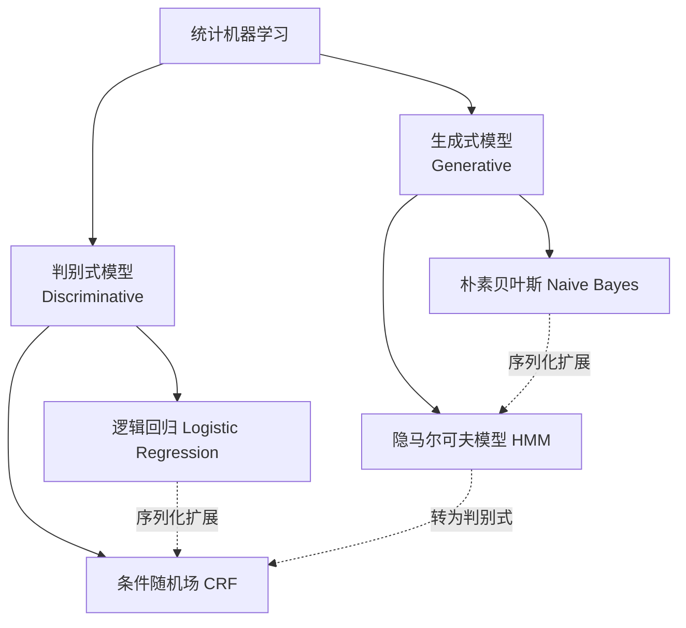

# 📜 第二阶段：传统 NLP 方法 (Traditional NLP)

> "在深度学习之前，统计方法是NLP的主流。理解它们，是理解现代NLP的基础。"

---

## 📊 阶段进度

```dataviewjs
const total = dv.pages('"02-Knowledge/🧠 学习系统/08-NLP全栈/02-传统NLP方法"').length - 1;
const completed = dv.pages('"02-Knowledge/🧠 学习系统/08-NLP全栈/02-传统NLP方法"').where(p => p.status === "completed").length;
const progress = total > 0 ? Math.round((completed / total) * 100) : 0;
dv.paragraph(`**阶段进度: ${progress}%** (${completed}/${total} 模块)`);
```

---

## 🗺️ 认知地图：传统NLP的宿命对决



---

## 🔪 文本预处理与标注流水线

| 核心主题 | 涵盖概念 (一句话直觉) | 状态 | 综合笔记 |
|:---|:---|:---:|:---|
| **分词与词法分析** | 词典最大匹配、统计分词、子词切分 (BPE：用更小的拼图拼凑未登录词) | ⬜ | [[分词与词法分析]] |
| **词性标注与命名实体** | POS、NER、关系抽取 (Relation Extraction：找出实体间的纽带) | ⬜ | [[序列标注与命名实体识别]] |
| **依存句法分析** | 依存关系、转移图算法基础 (分析词与词间的修饰关系) | ⬜ | [[依存句法分析基础]] |

---

## 📊 传统文本表示与语言模型

| 核心主题 | 涵盖概念 (一句话直觉) | 状态 | 综合笔记 |
|:---|:---|:---:|:---|
| **词袋模型与TF-IDF** | BoW、TF、IDF、BM25 (工业界召回核心：考虑了词频饱和度) | ⬜ | [[词袋模型与TF-IDF]] |
| **N-gram 语言模型** | N-gram、平滑方法 (Add-one / Kneser-Ney：给没见过的词留活路) | ⬜ | [[N-gram语言模型]] |

---

## 📈 统计机器学习基石

| 核心主题 | 涵盖概念 (一句话直觉) | 状态 | 综合笔记 |
|:---|:---|:---:|:---|
| **生成式分类器** | 朴素贝叶斯 (假设特征相互独立，简单粗暴但有效) | ⬜ | [[朴素贝叶斯分类器]] |
| **隐马尔可夫模型** | HMM要素、Viterbi解码、Baum-Welch (基于隐状态转移概率预测序列) | ⬜ | [[隐马尔可夫模型HMM]] |
| **最大熵原理** | MaxEnt (在已知约束下，保留最大的不确定性) | ⬜ | [[最大熵原理与模型]] |
| **条件随机场** | CRF (考虑全局上下文和相邻标签特征的完美判别式序列模型) | ⬜ | [[条件随机场CRF]] |

---

## 📚 传统主题模型 (Topic Modeling)

| 核心主题 | 涵盖概念 (一句话直觉) | 状态 | 综合笔记 |
|:---|:---|:---:|:---|
| **主题降维与发现** | LSA (SVD找潜在语义)、LDA (狄利克雷分布：文档是主题的混合) | ⬜ | [[主题模型LDA与LSA]] |

---

## 🛠️ 阶段项目 (Output Loop)

| 项目名称 | 核心目标 | 涉及知识点 | 状态 |
|:---|:---|:---|:---:|
| **垃圾邮件分类器** | 实现并对比 TF-IDF + 朴素贝叶斯 分类效果 | 文本表示、朴素贝叶斯 | ⬜ |
| **HMM 中文分词器** | 实现 Viterbi 解码与 Baum-Welch，跑通简易分词 | HMM解码、参数估计 | ⬜ |

---

## 🔗 阶段导航

| ⬅️ 上一阶段 | 📋 总览 | 下一阶段 ➡️ |
|:---:|:---:|:---:|
| [[📚 第一阶段：基础准备\|返回第一阶段]] | [[🗺️ NLP全栈学习路径\|返回总览]] | [[🧠 第三阶段：深度学习NLP基础\|进入第三阶段]] |

---

*阶段创建：2026-04-11*
