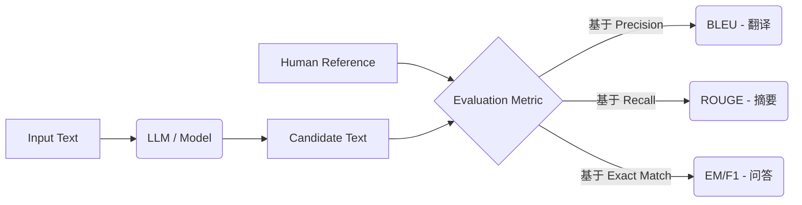

## 0. 先判断它值不值得深挖

- **类别**：**A 类（核心概念，必须深挖）**
- **判断理由**：在 NLP 领域，“怎么评价模型好坏”和“怎么训练模型”几乎同等重要。一个好的评测指标能指引模型优化的方向。如果不理解 BLEU、ROUGE 或 PPL，你甚至无法看懂论文里的实验结果表格。而到了大模型时代，MMLU、Elo rating 更是成了衡量模型能力的绝对标准，是每个从业者的必修课。

---

## 1. 这个知识点解决什么问题？

> **我们遇到了什么麻烦**：
> 在分类问题中，我们可以简单地用准确率（Accuracy）来评估模型。但在自然语言生成任务（如翻译、摘要、对话）中，输出是一段非结构化的文本，标准答案可能有多种表达方式。比如机器翻译翻成了“我爱你”，标准答案是“我非常喜欢你”，传统分类的准确率会判定为完全错误（0%），这显然不合理。我们需要一套能衡量文本相似度、生成质量和模型能力的“刻度尺”。

---

## 2. 为什么它重要？它有什么用？

- **连接大图景**：它是所有 NLP 任务的终点和起点。没有评测，就无法优化。它是模型迭代路上的指南针。
- **实际应用场景**：在模型选型、调参实验、论文复现中，我们需要对比不同模型的性能；在上线部署前，我们需要卡指标门槛。
- **高频题型/任务**：常出现在机器翻译（BLEU）、摘要提取（ROUGE）、问答系统（EM/F1）以及最近的大模型综合能力评估中。

---

## 3. 学它之前需要哪些前置知识？

最小必要背景（各 200 字以内）：

1. **[[语言模型基础]]**：需要理解语言模型是在计算句子的概率分布（Next-token prediction），这是理解困惑度（Perplexity, PPL）的基础。
2. **[[概率论基础]]**：基本的交叉熵（Cross Entropy）和概率乘积概念，因为 PPL 本质上是交叉熵的指数形式。

---

## 4. 用直觉语言解释它

> «“这东西其实就像……”»

- **直觉类比/几何图像**：
  - **BLEU** 就像是一个“查重软件”，它看你的作文里有多少个词组（n-gram）在范文里出现过，更偏向于“精确率”。
  - **ROUGE** 像是老师检查背诵，它看范文里的核心词有多少被你写出来了，更偏向于“召回率”。
  - **Perplexity (PPL)** 就像是模型在做选择题时的“犹豫程度”。PPL=10 表示模型每次预测下一个词时，都觉得有 10 个词可能性一样大。PPL 越低，模型越自信，越准确。
- **为什么很自然**：因为人类评价句子相似度，本来就是看它们重合的词句多不多；评价模型语言能力，就是看它对接下来的话有多“胸有成竹”。
- **一句话直觉本质**：指标就是一套算法化、标准化的“考卷”，用来量化不同模型在特定任务上的表现。

> **评测流程图示**：


---

## 5. 正式定义、核心公式、符号解释

### 1. 最核心定义
- **BLEU (Bilingual Evaluation Understudy)**：基于 n-gram 的精确率（Precision）来评估机器翻译质量。
- **ROUGE (Recall-Oriented Understudy for Gisting Evaluation)**：基于 n-gram 的召回率（Recall）来评估文本摘要质量。
- **Perplexity (PPL)**：语言模型对测试集的预测概率的反向平均，衡量模型对语言的预测能力。
- **Exact Match (EM) & F1**：问答系统常用指标。EM 要求预测答案与真实答案完全一致；F1 将答案视为词袋，计算字词级别的精确率和召回率。

### 2. 核心公式与 Tensor 维度追踪
**困惑度 PPL**：
$$ \text{PPL}(W) = P(w_1, w_2, ..., w_N)^{-\frac{1}{N}} = \exp\left( \frac{1}{N} \sum_{i=1}^N -\log P(w_i | w_{<i}) \right) $$

> **PyTorch Tensor 维度追踪 (PPL Calculation)**
> - `Input_ids`: `[B, L]` (Batch size $B$, Seq length $L$)
> - `Logits`: `[B, L, V]` (经过 Transformer 输出映射到词表大小 $V$)
> - `Target_ids`: `[B, L]` (相当于 `Input_ids` 向左平移一位)
> - `Loss` 计算: `CrossEntropyLoss(Logits.view(B*L, V), Target_ids.view(B*L))` 得到标量 Loss (即平均 Negative Log-Likelihood)
> - `PPL`: `torch.exp(Loss)` 标量。

**BLEU (简化的 n-gram Precision)**：
$$ p_n = \frac{\sum_{C \in \{Candidates\}} \sum_{n\text{-gram} \in C} \text{Count}_{clip}(n\text{-gram})}{\sum_{C \in \{Candidates\}} \sum_{n\text{-gram} \in C} \text{Count}(n\text{-gram})} $$
$$ \text{BLEU} = \text{BP} \cdot \exp\left(\sum_{n=1}^N w_n \log p_n\right) $$
*(BP 为简短惩罚因子)*

### 3. 符号说明表

| 符号 | 含义 | 取值范围 / 量纲 | 备注 |
| :--- | :--- | :--- | :--- |
| $N$ | 序列长度 | $\mathbb{N}^+$ | 句子的 token 数量 |
| $W$ | 词序列 | 文本序列 | $W = (w_1, w_2, ..., w_N)$ |
| $p_n$ | n-gram 精确率 | $[0, 1]$ | 生成结果中 n-gram 命中的比例 |
| $\text{BP}$ | Brevity Penalty | $(0, 1]$ | 惩罚过短的生成序列，防止作弊 |

### 4. 常见变体与适用条件
- **适用条件**：BLEU 适用于机器翻译，ROUGE 适用于文本摘要；PPL 适用于生成式语言模型的内在评估。
- **限制条件**：BLEU 和 ROUGE 无法理解同义词和语义，字面不重合但意思相近时得分极低。这也是为什么近年来引入了 BERTScore 以及基于 LLM 的评测（LLM-as-a-Judge）。

---

## 6. 推导思路和思想来源

- **最初困难**：人工评测生成文本的成本太高、速度太慢且标准不统一。
- **直接方法局限**：只看逐字准确率（Accuracy）无法容忍表达方式的多样性。
- **关键“转念”**：用“片段重合度”（n-gram）来代替“逐词比对”。翻译需要译文用词准确（Precision），所以用 BLEU；摘要需要不遗漏重点（Recall），所以用 ROUGE。
- **推导主线与动机**：为了防止模型在 BLEU 中只生成少数确定正确的词来作弊，引入了长度惩罚因子（BP）；为了防止某个词在参考答案中只出现一次，却在预测答案中大量重复得分，引入了截断计数（Clipped Count）。

---

## 7. 例子：基础 → 中等 → 实际应用

### 例子 1：基础例子（可手算）
- **题目**：计算 BLEU-1 的分子（不带惩罚项）。
  - Reference: "The cat is on the mat"
  - Candidate: "The the the the the the"
- **解题思路与关键步骤**：
  - Candidate 长度为 6。
  - "the" 在 Reference 中最多出现 2 次（Clipped Count）。
  - 普通 Precision: 6/6 = 1.0 (100%)。
  - Clipped Precision: 2/6 = 0.33。
- **最终答案**：$p_1 = 1/3$。
- **易错点**：忘记使用截断计数，导致一直重复高频词的模型获得异常高分。
- **🤔 追问**：如果这里引入 BP 惩罚，结果会怎样？（因为 Candidate 长度与 Reference 接近，BP 接近 1）。

### 例子 2：中等例子（条件判断与多步推理）
- **题目与完整解答**：计算 PPL。假设模型预测两个句子，句子 A 概率为 0.1（长度 5），句子 B 概率为 0.01（长度 10）。哪个句子的困惑度低？
  - $PPL_A = (0.1)^{-1/5} = 10^{0.2} \approx 1.58$
  - $PPL_B = (0.01)^{-1/10} = (10^{-2})^{-0.1} = 10^{0.2} \approx 1.58$
  - 解答：两者的平均 Token 困惑度相同。

### 例子 3：实际应用例子（真实场景/代码）
- **实际价值与转化**：
  - **大模型评测（LLM Evaluation）**：现代评估中，除了传统指标，更看重真实任务。比如 **MMLU** 评估模型在 57 个学科的 4 选 1 单选题准确率；**Human Evaluation / Chatbot Arena** 采用盲测，由人类判断两个模型谁答得好，通过 **Elo Rating** 体系（类似国际象棋积分）给各大模型排座次，真实反映了人类偏好。

---

## 8. 常见误区和易混概念

### 误区 1：BLEU 和 ROUGE 的混淆
- **错误直觉**：认为它俩差不多，随便用哪个都行。
- **为什么错**：侧重点完全相反。
- **正确理解**：翻译任务不容忍乱翻译，所以注重精确率（BLEU）；摘要任务不容忍漏掉核心事实，所以注重召回率（ROUGE）。

### 概念对比表

| 概念 | 核心问题 | 关键区别 | 典型使用场景 |
| :--- | :--- | :--- | :--- |
| BLEU | 生成文本的精确率如何 | 基于 n-gram Precision | 机器翻译 |
| ROUGE | 生成文本的召回率如何 | 基于 n-gram Recall | 文本摘要 |
| EM (Exact Match) | 答案是否完全正确 | 字符串严格匹配 | 抽取式问答 (SQuAD) |
| F1-score (QA) | 答案是否覆盖核心内容 | 综合词级别的精确率与召回率 | 问答系统 |

---

## 9. 相关知识点与 Obsidian 双链建议

### 上游依赖
- [[语言模型基础]]：PPL 的理论根基。
- [[N-gram 模型]]：理解 BLEU 和 ROUGE 计算的基础。

### 下游延伸
- [[机器翻译]]：最广泛使用 BLEU 的领域。
- [[提示工程 (Prompt Engineering)]]：优化大模型在 MMLU 等评测集上的表现。

### 横向关联
- [[BERTScore]] ↔ [[数据集与评测指标]]：传统指标无法匹配同义词，BERTScore 引入了预训练模型的语义相似度计算。

---

## 10. 闭卷验收（工程/应用模式）

合上笔记，独立完成以下 4 项：

- [ ] **直觉复述**：用大白话解释 BLEU、PPL 和 Elo rating 分别在衡量什么。
- [ ] **核心公式默写**：写出 PPL 的定义式和与交叉熵的关系。
- [ ] **关键推导复现**：解释为什么 BLEU 需要截断计数和长度惩罚。
- [ ] **典型例子复现**：独立计算一个极端错误翻译（全重复词）的 BLEU 截断分数。

---

## 11. 分级习题与实践

题目来源标注教材章节、项目或作业。

| 题号 | 类型 | 难度 | 来源 | 考查点 |
| :--- | :--- | :--- | :--- | :--- |
| 1 | 概念理解 | 基础 | CS224N | PPL 的直观含义 |
| 2 | 公式推导 | 中等 | CS224N | BLEU 截断计算 |
| 3 | 代码实现 | 中等 | 项目 | 调用 evaluate 库计算 ROUGE |
| 4 | 场景应用 | 较难 | 论文 | MMLU 和 Chatbot Arena 的评测差异 |
| 5 | 优化探索 | 挑战 | 研究 | 如何设计无法被 LLM 刷榜的评测指标 |

### 题目与解析

#### 1. 为什么更低的 PPL 意味着模型更好？
> [!question]- 答案与解析（复盘阶段查看）
> - **答案**：因为 PPL 是模型分配给真实测试数据概率的倒数。
> - **解析**：模型越好，越能准确预测下一个词，给正确句子的概率越高，其倒数及指数结果（PPL）就越小。
> - **易错原因**：容易把 PPL 当作错误率，实际上它是“平均每个分支的等效候选数量”。

#### 2. 在问答任务中，预测答案为 "George Washington"，真实答案为 "Washington"，计算 F1 分数。
> [!question]- 答案与解析（复盘阶段查看）
> - **答案**：Precision=0.5, Recall=1.0, F1=0.67。
> - **解析**：预测词袋 {George, Washington}，真实 {Washington}。匹配了 1 个词。精确率=1/2，召回率=1/1。F1 = 2 * 0.5 * 1 / (0.5 + 1) = 2/3 ≈ 0.67。

#### 3. 如何使用 Hugging Face 的 evaluate 库计算 BLEU？
> [!question]- 答案与解析（复盘阶段查看）
> - **答案**：
> - **代码片段**：
> ```python
> import evaluate
> bleu = evaluate.load("bleu")
> predictions = ["the cat is on the mat"]
> references = [["the cat is playing on the mat"]]
> results = bleu.compute(predictions=predictions, references=references)
> print(results["bleu"])
> ```

#### 4. 为什么大语言模型评测越来越依赖 LLM-as-a-Judge 和 Elo Rating？
> [!question]- 答案与解析（复盘阶段查看）
> - **答案**：传统指标无法衡量自由文本生成。
> - **解析**：大模型的回答极具创造性和多样性，不再有单一标准答案，n-gram 重合度失效。强大的 LLM（如 GPT-4）判断语义的能力已接近人类水平；Elo Rating 则是基于众包的人类偏好盲测，更能反映真实用户体验。

#### 5. MMLU 评测的主要机制是什么？
> [!question]- 答案与解析（复盘阶段查看）
> - **答案**：单选题准确率评测。
> - **解析**：涵盖人文、社科、STEM 等数十个领域的英文多选题。通过比较模型预测选项 A/B/C/D 的 token 概率大小，选择概率最大的作为预测答案，最终统计 Accuracy。

---

## 12. 我的主动回忆区 (Active Recall)

- **Q1**: 在计算困惑度（PPL）时，如果模型的 Logits 维度是 `[B, L, V]`，目标标签（Target_ids）的维度是 `[B, L]`，CrossEntropyLoss 在内部是如何把它们对齐并计算最终标量 Loss 的？PPL 和这个 Loss 是什么数学关系？
- **A1**: _________________________________________________
- **Q2**: 为什么在计算机器翻译的 BLEU 时，必须引入截断计数（Clipped Count）？如果只用普通的 n-gram Precision，模型可以通过什么样的方式作弊？
- **A2**: _________________________________________________
- **Q3**: 填空题：BLEU 更偏向于衡量生成结果的 _______（精确率 / 召回率），因此常用于 _______ 任务；而 ROUGE 更偏向于 _______（精确率 / 召回率），因此常用于 _______ 任务。
- **Q4**: 填空题：简短惩罚因子（Brevity Penalty, BP）的引入是为了惩罚 _______ 的生成结果，防止模型通过输出极短的、绝对正确的词汇来骗取高分。
- **Q5**: 衍生思考题：当评估大模型（如 GPT-4）进行开放式生成时，为什么传统的 BLEU 和 ROUGE 会失效？现阶段主流的替代方案是什么？
- **A5**: _________________________________________________


---

## 13. 给 Obsidian 的归档建议

- **适合文件夹**：`02-Knowledge/🧠 学习系统/08-NLP全栈/评测与方法论/`
- **关联已有笔记**：`[[机器翻译]]`, `[[N-gram 模型]]`
- **建议标签**：`#学习` `#NLP` `#CS224N` `#大模型评测`
- **拆分建议**：PPL 推导和 LLM-as-a-Judge 可考虑在未来扩展成独立卡片。
