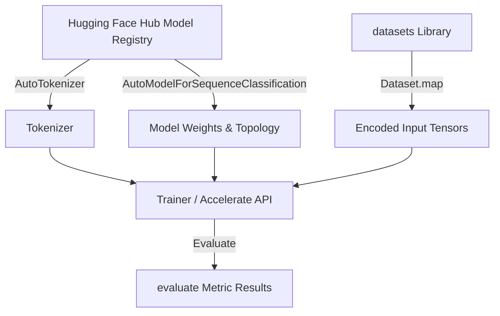

# 08-NLP全栈-HuggingFace生态系统

---

## 1. 这个知识点解决什么问题？

> **我们遇到了什么麻烦**：
> 在过去，加载预训练模型（如 BERT / GPT）需要下载几十个权重文件并手动搭建网络模型拓扑，代码高度繁琐且缺乏跨框架统一性。Hugging Face 建立了全球最大的开源 AI 社区生态（Hub, `transformers`, `datasets`, `peft`, `accelerate`），提供了工业级的 API 规范。

---

## 2. 为什么它重要？它有什么用？

- **连接大图景**：它是现代 NLP 与 LLM 研发的标准“基础设施与操作系统”。
- **核心四大件**：
  1. `transformers`：标准化模型拓扑与 API。
  2. `datasets`：零拷贝、高效内存映射的大规模数据集流式加载。
  3. `accelerate`：一行代码实现单机多卡/分布式 DDP / FSDP / DeepSpeed 训练。
  4. `peft`：LoRA / QLoRA 参数高效微调核心库。

---


### 3.1 形式化抽象与向量调度数学表示

在 HuggingFace 生态中，`Tokenizer` 将离散文本映射为离散 Token ID 序列，并生成 Attention Mask：
$$T: \mathcal{S} \to \mathbb{Z}^L, \quad \text{Mask}(i) = \begin{cases} 1, & \text{valid token} \\ 0, & \text{padding} \end{cases}$$

模型的前向传播计算定义为：将 Token ID 序列 $\mathbf{x} \in \mathbb{Z}^L$ 映射到高维连续表示空间，并求取 Cross-Entropy 损失：
$$\mathbf{H} = \text{Model}(\mathbf{x}) \in \mathbb{R}^{L \times d_{\text{model}}}, \quad \mathcal{L}_{\text{LM}} = -\frac{1}{N} \sum_{i=1}^{N} \log P(x_i \mid x_{<i}; \Theta)$$


## 3. Hugging Face 核心类关系与架构



---

## 4. Python 代码示例：极简 Pipeline 与 Trainer 规范

```python
from transformers import pipeline, AutoTokenizer, AutoModelForSequenceClassification, Trainer, TrainingArguments
from datasets import Dataset

# 1. 极简 Pipeline (一键推断)
classifier = pipeline("sentiment-analysis")
res = classifier("Hugging Face makes NLP accessible to everyone!")
print("Pipeline Output:", res)

# 2. 标准微调 Workflow 抽象
tokenizer = AutoTokenizer.from_pretrained("distilbert-base-uncased")
model = AutoModelForSequenceClassification.from_pretrained("distilbert-base-uncased", num_labels=2)

# 假数据集
ds = Dataset.from_dict({
    "text": ["I love this product", "This is terrible"],
    "label": [1, 0]
})
ds_encoded = ds.map(lambda x: tokenizer(x["text"], padding="max_length", truncation=True), batched=True)

training_args = TrainingArguments(
    output_dir="./results",
    num_train_epochs=1,
    per_device_train_batch_size=2,
    logging_steps=10,
    save_strategy="no"
)

trainer = Trainer(
    model=model,
    args=training_args,
    train_dataset=ds_encoded
)
print("Trainer Engine Ready:", trainer.args.output_dir)
```

---


## 5. 常见误区与对比矩阵

| 核心组件 | 职责与功能 | 核心抽象类/API | 常见性能瓶颈与优化手段 |
| :--- | :--- | :--- | :--- |
| **Transformers** | 模型加载、前向推理与微调 | `AutoModel`, `AutoTokenizer` | 显存占用高；使用 FlashAttention-2 / BitsAndBytes |
| **Datasets** | 高效数据集加载与预处理 | `load_dataset`, `map(batched=True)` | 内存溢出；使用 Memory-Mapping (Arrow) 与 streaming |
| **Accelerate** | 零代码改动分布式并行 | `Accelerator`, `prepare()` | 多卡通信延迟；启用 DeepSpeed ZeRO-3 / FSDP |
| **PEFT** | 参数高效微调 (LoRA/Prefix) | `get_peft_model`, `LoraConfig` | 权重合并耗时；推理时调用 `merge_and_unload()` |


## 6. 闭卷自测与验收入口

请在不查阅资料的前提下尝试解答以下问题，或完成对应关联作业：
1. 本知识点的核心定义与推导公式是什么？
2. 相比传统方法，它的核心优势与工程选型 Trade-offs 是什么？
3. 如何在 PyTorch / Python 中实现并校验其关键张量维度与运算逻辑？


---

## 🛠️ 我的主动回忆区 (Guided Recall)

- [ ] **问题 1**：请不看笔记，口述《HuggingFace生态系统》的核心核心定义与求解动机。
- [ ] **问题 2**：算法或推导的核心计算公式是什么？其中关键变量代表什么物理含义？
- [ ] **问题 3**：在实际工程落地或模型训练中，该方法最常见的 2 个踩坑点或退化场景是什么？


---

## 🃏 闭卷提取练习 (Self-Quiz)

1. **概念自测**：说明《HuggingFace生态系统》的核心机制及其与上下游模块的连接逻辑。
2. **代数/代码自测**：手写关键代数推导步骤或 PyTorch/Python 核心实现伪代码。
3. **防错自测**：如果输入数据出现极小值或极大值离群点，该模块会发生什么异常？如何做数值稳定防护？


---

## 🛠️ 学完后可以完成

```dataview
LIST
FROM "03-Projects"
WHERE contains(requires, this.file.link)
SORT assignment_level ASC, file.name ASC
```
