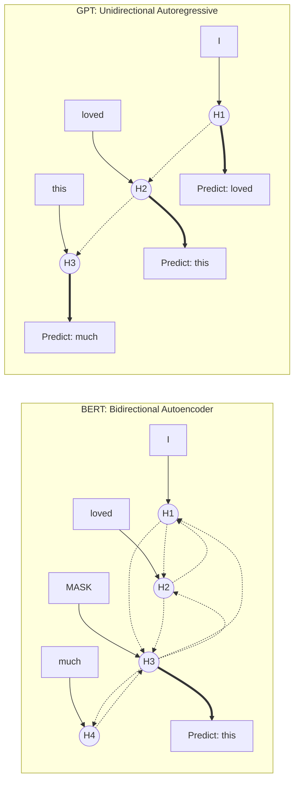

## 0. 先判断它值不值得深挖

- **类别**：**A 类（核心概念，必须深挖）**
- **判断理由**：BERT和GPT代表了自然语言处理（NLP）预训练模型中最核心的两大流派（自编码与自回归）。理解它们的底层差异，是掌握大语言模型（LLM）演进路线、选择合适模型解决实际业务问题的基础。绝对必须深挖。

---

## 1. 这个知识点解决什么问题？

> **我们遇到了什么麻烦**：
> 在Transformer提出后，大家都在想怎么用海量的无标注文本预训练一个强大的语言模型，然后再微调到下游任务上。但是，语言有上下文之分。如果我们想做阅读理解，我们需要看到整个句子；如果我们想做对话生成，我们只能看到之前的话，不能“偷看”未来的词。以前的方法要么只能单向看，要么拼接双向RNN但效果有限，到底该如何设计预训练任务来让模型最好地理解语言？BERT和GPT给出了两种截然不同但又极其成功的答案。

---

## 2. 为什么它重要？它有什么用？

- **连接大图景**：不学它，就无法理解为什么现在的对话大模型（如ChatGPT）都基于GPT架构，而很多文本分类、信息抽取任务还依然能用BERT。它是理解整个预训练语言模型（PLM）时代的钥匙。
- **实际应用场景**：在NLP算法工程师的面试中是必考题。在实际建模中，决定了你是用BERT做文本分类/NER，还是用GPT做文本生成。
- **高频题型/任务**：文本分类、序列标注、问答系统（BERT类）；文本摘要、机器翻译、对话生成（GPT类）。

---

## 3. 学它之前需要哪些前置知识？

最小必要背景（各 200 字以内）：

1. **[[Transformer]]**：理解自注意力机制（Self-Attention）是如何工作的，特别是如何通过掩码（Mask）来控制信息流动的。
2. **[[语言模型]]**：理解什么是语言模型（Language Model），即计算一个句子出现概率的模型，或者说根据上文预测下一个词的任务。

---

## 4. 用直觉语言解释它

> «“这东西其实就像……”»

- **直觉类比/几何图像**：
  - **BERT（自编码）** 就像做**英语完形填空**。给你一个完整的句子，抠掉几个词，让你根据上下文猜抠掉的词是什么。因为它能看到词的左边和右边，所以叫“双向”。
  - **GPT（自回归）** 就像做**英语句子接龙**。给你前半句话，让你猜下一个词是什么，猜对了再猜下下个词。它只能看到左边的历史，不能看右边的未来，所以叫“单向”。

**BERT (双向掩码) vs GPT (单向自回归) 直观图解**：


- **为什么很自然**：要想真正理解一句话，当然需要结合前后文（BERT）；但人类说话写字，总是一个字一个字往外蹦的（GPT）。两种方式各自捕捉了语言的一种本质特征。
- **一句话直觉本质**：BERT通过“掩码双向看”擅长理解，GPT通过“从左到右单向猜”擅长生成。

---

## 5. 正式定义、核心公式、符号解释

### 1. 最核心定义
- **BERT (Bidirectional Encoder Representations from Transformers)**：属于自编码语言模型（Autoencoder, AE），核心预训练任务是 Masked Language Modeling (MLM)，利用双向上下文重构被掩盖的输入。
- **GPT (Generative Pre-trained Transformer)**：属于自回归语言模型（Autoregressive, AR），核心预训练任务是 Causal Language Modeling (CLM)，利用单向（历史）上下文预测下一个词。

### 2. 核心公式与张量流转 (Tensor Tracking)
- **GPT (自回归语言模型, Autoregressive MLE)** 优化目标：
  $$ \mathcal{L}_{GPT} = - \sum_{i=1}^{n} \log P(x_i | x_1, x_2, \dots, x_{i-1}; \Theta) $$
  *(注意：目标是最小化负对数似然。预测依赖于严格的单向上下文历史。)*

- **BERT (自编码语言模型, Autoencoder MLM)** 优化目标：
  $$ \mathcal{L}_{BERT} = - \sum_{i \in \mathcal{M}} \log P(x_i | \tilde{\mathbf{x}}; \Theta) $$
  其中 $\mathcal{M}$ 是被掩码的词的索引集合，$\tilde{\mathbf{x}}$ 是被破坏（部分 token 替换为 `[MASK]`）的输入序列。模型全局可见整个序列。

- **注意力层的张量维度追踪 (PyTorch-style)**:
  设 Batch Size 为 $B$，序列长度为 $L$，隐藏层维度为 $d_{model}$，多头数量为 $h$，每个头的维度 $d_k = d_{model} / h$。
  - **Input Embedding**: $\mathbf{X} \in \mathbb{R}^{B \times L \times d_{model}}$
  - **Q, K, V 投影**:
    $\mathbf{Q} = \mathbf{X}\mathbf{W}^Q \in \mathbb{R}^{B \times L \times d_{model}}$， reshape/transpose 为 $\mathbb{R}^{B \times h \times L \times d_k}$
    $\mathbf{K}, \mathbf{V}$ 同理。
  - **Scaled Dot-Product Attention**:
    $$ \text{Attention}(\mathbf{Q}, \mathbf{K}, \mathbf{V}) = \text{softmax}\left(\frac{\mathbf{Q}\mathbf{K}^T}{\sqrt{d_k}} + \mathbf{M}\right)\mathbf{V} $$
    其中 $\mathbf{Q}\mathbf{K}^T$ 形状为 $\mathbb{R}^{B \times h \times L \times L}$。
    *(缩放因子 $\frac{1}{\sqrt{d_k}}$ 极度重要：因为 $\mathbf{Q}$ 和 $\mathbf{K}$ 若各分量独立同分布且均值为 0，方差为 1，其点积方差会放大到 $d_k$。除以 $\sqrt{d_k}$ 可让方差恢复至 1，避免 Softmax 进入梯度极小的饱和区。)*
  - **Masking 机制矩阵 $\mathbf{M} \in \mathbb{R}^{L \times L}$**:
    - **BERT**: $\mathbf{M}_{ij} = 0$ (除 `[PAD]` 以外，全通)
    - **GPT**: 因果掩码 (Causal Mask)。对于 $j > i$ (即试图看未来信息), $\mathbf{M}_{ij} = -\infty$; 否则 $\mathbf{M}_{ij} = 0$。
  - **Output Context**: 聚合后重新变换为 $\mathbb{R}^{B \times L \times d_{model}}$，喂给 FFN。

### 3. 符号说明表

| 符号 | 含义 | 取值范围 / 量纲 | 备注 |
| :--- | :--- | :--- | :--- |
| $x_i$ | 序列中的第 i 个词 | 词表大小 $V$ | 真实标签 |
| $P(\cdot)$ | 预测概率 | $[0, 1]$ | 模型输出的概率分布 |
| $\Theta$ | 模型参数 | $\mathbb{R}^p$ | Transformer网络的权重 |
| $\mathcal{M}$ | 被掩码词的索引集 | 子集 | 通常占序列长度的 15% |

### 4. 常见变体与适用条件
- **适用条件**：BERT适用于NLU（自然语言理解）任务；GPT适用于NLG（自然语言生成）任务。
- **限制条件**：BERT在预训练时有[MASK]标签，但在下游微调时没有，存在预训练-微调不一致的问题（Mismatch）；GPT受限于单向注意力，在纯理解任务上可能提取的信息不够丰富（早期版本）。

---

## 6. 推导思路和思想来源

- **最初困难**：早期的词向量（Word2Vec, GloVe）是静态的，无法解决多义词问题。ELMo引入了动态词向量，但它是简单的双向LSTM拼接，特征融合不够深。
- **直接方法局限**：如果直接在Transformer上做标准语言模型（从左到右预测），就无法让模型利用到下文信息，这对阅读理解这类任务非常吃亏。
- **关键“转念”**：
  - GPT的转念：坚持从左到右预测，只要模型够大，数据够多，单向也能学到足够好的通用表示，而且完美契合生成任务。
  - BERT的转念：既然标准语言模型不能看下文，那我就不猜下一个词了，我把句子中间的词遮住（Mask），让模型结合两边去猜这个词（完形填空），这样就可以放心大胆地使用Transformer的全局注意力（没有掩码限制下文）了！
- **推导主线与动机**：为了解决“双向信息提取”与“语言模型预测”之间的冲突，BERT引入了MLM；而GPT则坚持纯粹的自回归，为后来统一所有NLP任务到生成范式（Prompt）埋下了伏笔。
- **为什么自然得到此结论**：因为理解任务需要全局视野，生成任务必须符合因果律（不能穿越到未来）。

---

## 7. 例子：基础 → 中等 → 实际应用

### 例子 1：基础例子（可手算）
- **题目**：输入句子为 "I loved this movie very much"，假设要做BERT和GPT的预训练，输入和预测目标分别是什么？
- **解题思路与关键步骤**：
  - **GPT**：输入 `[SOS] I loved this movie very`。对于位置为 `loved` 的时刻，输入是 `[SOS] I`，预测目标是 `loved`。只能看左边。
  - **BERT**：随机 Mask 掉 "movie"。输入变为 `I loved this [MASK] very much`。模型可以全局看到所有词，目标是预测 `[MASK]` 位置的词是 `movie`。
- **最终答案**：GPT按序预测下一个词；BERT结合双向信息预测被Mask的词。
- **易错点**：混淆了两者能否看到下文。
- **🤔 追问**：如果这里换成做机器翻译，应该用哪个思路？（目前多用Encoder-Decoder，或用GPT式的自回归直接生成）

### 例子 2：中等例子（条件判断与多步推理）
- **题目与完整解答**：为什么 BERT 在做文本生成（如写诗）时不擅长？
  - **解答**：因为BERT在预训练时假设各个被Mask的词是相互独立预测的（给定剩余上下文）。在生成时，如果你想生成一首完整的诗，你需要一个字一个字生成，上一个生成的字决定了下一个字。BERT缺乏这种严格的自回归（从左到右依次生成）的预训练经验，它的结构是双向看齐的，不适合这种有因果依赖的连续生成。

### 例子 3：实际应用例子（真实场景/代码）
- **实际价值与转化**：在实际公司业务中，如果要对用户评论做情感分析（好评/差评），一般首选加载 `bert-base-chinese`，在最顶层加一个线性分类器进行微调，速度快且效果极好。如果要开发一个智能客服聊天机器人，则首选基于GPT架构的模型（如开源的 Llama, Qwen），因为它们天然适合“一问一答”的生成模式。

---

## 8. 常见误区和易混概念

### 误区 1：认为 BERT 一定比 GPT 好
- **错误直觉**：BERT既然是双向的，信息更多，肯定比单向的GPT强。
- **为什么错**：这仅在NLU（理解）任务上成立。在NLG（生成）任务上，自回归结构的单向注意力是必须的，否则模型会“作弊”看到未来信息，导致在真实推理时无法工作。
- **正确理解**：两者定位不同。BERT是优秀的阅读理解者，GPT是优秀的创作者。随着模型体积增大（LLM时代），GPT证明了只要单向模型足够深，它也能做好理解。

### 概念对比表

| 概念 | 核心问题 | 关键区别 | 典型使用场景 |
| :--- | :--- | :--- | :--- |
| **自编码 (BERT)** | 怎样最深入地理解给定文本？ | 双向注意力，完形填空 (MLM) | 文本分类、实体识别、抽取式问答 |
| **自回归 (GPT)** | 怎样根据上文最流畅地生成下文？ | 单向注意力（因果掩码），接龙预测 (CLM) | 对话生成、文本摘要、翻译、续写 |

---

## 9. 相关知识点与 Obsidian 双链建议

### 上游依赖
- [[Transformer]]：BERT和GPT都是基于Transformer的变体（BERT是Encoder，GPT是Decoder）。
- [[自注意力机制]]：区别在于BERT用完整的Self-Attention，GPT用Masked Self-Attention（防止看未来）。

### 下游延伸
- [[Prompt Engineering]]：GPT架构催生了通过提示词来控制模型生成的范式。
- [[Fine-tuning]]：BERT时代的核心范式。

### 横向关联
- [[T5]] / [[BART]] ↔ [[BERT与GPT对比]]：Encoder-Decoder架构是如何结合BERT和GPT优点的。

---

## 10. 闭卷验收（工程/应用模式）

合上笔记，独立完成以下 4 项：

- [ ] **直觉复述**：用大白话解释BERT的完形填空与GPT的接龙的区别。
- [ ] **核心公式默写**：写出自回归语言模型和Masked语言模型的概率连乘公式。
- [ ] **关键推导复现**：讲清楚为什么生成任务必须用单向（因果）注意力。
- [ ] **典型例子复现**：举例说明在情感分析和文本摘要任务中该如何选择架构。

---

## 11. 分级习题与实践

题目来源标注教材章节、项目或作业 (CS224N A4-A5)。

| 题号 | 类型 | 难度 | 来源 | 考查点 |
| :--- | :--- | :--- | :--- | :--- |
| 1 | 概念理解 | 基础 | CS224N | BERT与GPT对注意力的掩码机制有何不同？ |
| 2 | 公式推导 | 中等 | CS224N | 写出GPT自回归目标的对数似然形式。 |
| 3 | 代码实现 | 中等 | 项目 | 在Hugging Face中加载BERT和GPT2进行特征提取的区别。 |
| 4 | 场景应用 | 较难 | 业务实践 | 如果要抽取发票信息，该选谁？为什么？ |
| 5 | 优化探索 | 挑战 | 论文 | 如何让双向模型也具备较强的生成能力？（如UniLM） |

### 题目与解析

#### 1. [BERT与GPT对注意力的掩码机制有何不同？]
> [!question]- 答案与解析（复盘阶段查看）
> - **答案**：BERT不使用下三角掩码，注意力矩阵是全通的；GPT使用下三角掩码（Causal Mask），确保第 $i$ 个位置只能注意到 $1 \dots i$ 的位置。
> - **解析**：因为GPT要严格按照时间步生成，不能提前看到未来的词。
> - **易错原因**：混淆了BERT预训练中的[MASK] token和Transformer架构内部的Attention Mask。

#### 2. [写出GPT自回归目标的对数似然形式。]
> [!question]- 答案与解析（复盘阶段查看）
> - **答案**：$\sum_i \log P(x_i | x_{<i})$
> - **解析**：标准的从左到右预测语言模型的极大似然估计。

#### 3. [在Hugging Face中加载两者进行特征提取的区别。]
> [!question]- 答案与解析（复盘阶段查看）
> - **答案**：BERT通常使用 `[CLS]` token对应的最后一层输出作为整个句子的表示；GPT通常取最后一个词对应的输出作为整个句子的表示。
> - **代码片段**：
> ```python
> # BERT
> outputs = bert_model(inputs)
> cls_repr = outputs.last_hidden_state[:, 0, :]
> # GPT
> outputs = gpt_model(inputs)
> last_token_repr = outputs.last_hidden_state[:, -1, :]
> ```

#### 4. [如果要抽取发票信息，该选谁？为什么？]
> [!question]- 答案与解析（复盘阶段查看）
> - **答案**：传统上选 BERT。
> - **解析**：信息抽取（如NER）是典型的理解任务，需要综合考虑实体前后的语境。BERT的双向视野能提取更准确的边界和类别特征。当然，现代大模型也可以用GPT通过Few-shot Prompt搞定，但特定任务微调仍是BERT更高效。

#### 5. [如何让双向模型也具备较强的生成能力？]
> [!question]- 答案与解析（复盘阶段查看）
> - **答案**：通过改变Attention Mask。
> - **解析**：如UniLM，前缀部分使用双向全通Mask，生成部分使用单向下三角Mask，用一套参数统一下游任务。

---

## 12. 我的主动回忆区 (Active Recall)

### 填空与核心维度推演
1. **Q: 为什么缩放点积注意力 (Scaled Dot-Product Attention) 需要除以 $\sqrt{d_k}$？** 
   A: 因为 $\mathbf{Q}$ 和 $\mathbf{K}$ 发生点积时，如果各维度独立同分布（方差为1），点积结果的方差会扩大为 __________。除以 $\sqrt{d_k}$ 能将方差拉回1，防止输入到 __________ 函数时落入梯度消失的饱和区。
2. **Q: BERT 与 GPT 在预训练任务的损失函数设计上最根本的差异是什么？写出 GPT 的对数似然公式。**
   A: BERT 是自编码 (MLM)，给定被破坏的全局文本预测被 Mask 掉的词；GPT 是自回归，公式为 $\mathcal{L}_{GPT} = $ ____________________，只能基于 $x_{<i}$ 预测 $x_i$。
3. **Q: 在 PyTorch 中实现 Multi-Head Attention 时，输入 $\mathbf{X}$ 维度为 `[B, L, d_model]`。经过线性映射并划分 $h$ 个头后，$\mathbf{Q}$ 的张量形状会先被 reshape 然后 permute 为 __________。** 
   A: `[B, h, L, d_k]`，其中 $d_k =$ __________。
4. **Q: 在 Transformer 注意力分数的计算 $\mathbf{Q}\mathbf{K}^T + \mathbf{M}$ 中，掩码 $\mathbf{M}$ 形状为 `[L, L]`。为了让 GPT 无法看到未来的词，当 $j > i$ 时，$\mathbf{M}_{ij}$ 应该被设置为 __________？**
   A: __________，这样经过 softmax 后，对应位置的权重就变成了 0。

### 我的卡点与代码 bug
- [在此记录实现 Causal Mask 时的索引越界问题，或者 BERT [CLS] 提取维度的易错点]


---

## 13. 给 Obsidian 的归档建议

- **适合文件夹**：`02-Knowledge/🧠 学习系统/08-NLP全栈/03-预训练模型/`
- **关联已有笔记**：`[[Transformer]]`, `[[Attention]]`
- **建议标签**：`#学习` `#NLP` `#CS224N` `#BERT` `#GPT`
- **拆分建议**：可以考虑将 HuggingFace 代码调用细节单独分出一张技巧卡片。
