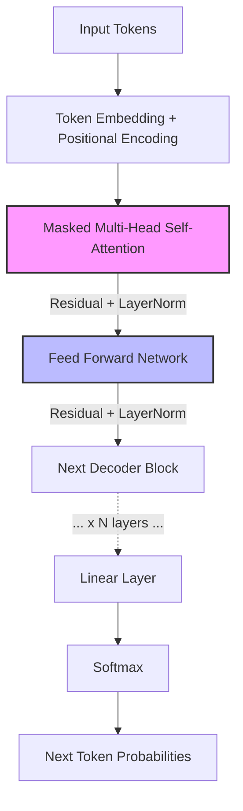

# GPT系列 (GPT-1, GPT-2, GPT-3)
---

## 0. 先判断它值不值得深挖

- **类别**：**A 类（核心概念，必须深挖）**
- **判断理由**：GPT系列是现代大语言模型（LLMs）的基石。从预训练+微调（GPT-1），到多任务学习/Zero-shot（GPT-2），再到Few-shot In-context Learning（GPT-3），其证明了简单的因果语言建模（Causal Language Modeling）结合Decoder-only架构和海量数据，足以涌现出极强的通用任务处理能力。不理解GPT，就无法理解当下的大模型时代。

---

## 1. 这个知识点解决什么问题？

> **我们遇到了什么麻烦**：
> 在前深度学习时代或早期的神经网络时代，NLP各个子任务（翻译、摘要、问答等）通常需要单独设计特定的模型架构并使用带标签的特定任务数据进行监督训练。这导致两个巨大麻烦：一是标注数据昂贵且稀缺；二是模型不具备泛化能力，只能在特定任务上“各管一摊”。我们亟需一种能够利用海量无标注文本进行通用知识学习，并能轻松迁移到各类下游任务的模型框架。

---

## 2. 为什么它重要？它有什么用？

- **连接大图景**：GPT系列确立了当前大模型最主流的“预训练+提示/微调”范式。不学它，后续的InstructGPT、ChatGPT、Llama等大模型架构和In-context Learning机制就无从谈起。
- **实际应用场景**：文本生成、代码补全、对话机器人、多任务通用处理等各类生成式AI核心应用。
- **高频题型/任务**：语言模型（LM）困惑度计算、Decoder-only的Masked Attention机制、Few-shot/Zero-shot提示词设计。

---

## 3. 学它之前需要哪些前置知识？

最小必要背景（各 200 字以内）：

1. **[[Transformer]]**：GPT系列的核心骨干网络。GPT使用的是Transformer的Decoder部分，保留了Masked Multi-Head Self-Attention机制，但去除了Encoder-Decoder Cross Attention。
2. **[[自回归语言模型 (Autoregressive LM)]]**：根据前文预测下一个词的概率模型，即计算 $P(w_t | w_1, w_2, ..., w_{t-1})$。这是GPT进行预训练的唯一核心任务。

---

## 4. 用直觉语言解释它

> «“这东西其实就像文字接龙游戏”»

- **直觉类比/几何图像**：就像一个人读了全世界的书，然后你给他一句话的开头，他就能凭借庞大的阅读经验，猜出下一个最合理的字是什么。GPT就是把“接下茬”（文字接龙）这项任务练到了极致。当你给它“翻译英文：你好 ->”时，它顺理成章接出“Hello”。
- **为什么很自然**：任何NLP任务都可以被框定为文本生成任务。问答是生成答案，翻译是生成目标语言文本，摘要是生成短文。因此，只要能完美预测下一个词，就能解决所有自然语言问题。
- **一句话直觉本质**：用海量无标注数据训练一个超大参数的Decoder-only Transformer来玩“预测下一个词”的游戏，从而获得通用理解和生成能力。

### 核心架构图：Decoder-Only 结构


---

## 5. 正式定义、核心公式、符号解释

### 1. 最核心定义
GPT (Generative Pre-trained Transformer) 是一种基于Transformer Decoder架构的自回归语言模型，通过最大化海量语料上的无监督对数似然进行预训练。

### 2. 核心公式
语言建模预训练目标（Causal Language Modeling, CLM）：
$$ L_1(U) = \sum_{i} \log P(u_i | u_{i-k}, \dots, u_{i-1}; \Theta) $$

下游微调目标（对于带标签数据 $(x, y)$，GPT-1时代常用）：
$$ L_2(C) = \sum_{(x,y)} \log P(y | x^1, \dots, x^m; \Theta) $$
最终目标函数可以结合两者：$L_3(C) = L_2(C) + \lambda L_1(C)$。

### 3. 符号说明表

| 符号 | 含义 | 取值范围 / 量纲 | 备注 |
| :--- | :--- | :--- | :--- |
| $U$ | 无监督语料库 | 词的集合 | 预训练数据 |
| $u_i$ | 当前要预测的词 | 词表 $V$ 中的一个词 |  |
| $k$ | 上下文窗口大小 | $\mathbb{Z}^+$ | 例如 512, 1024, 2048 |
| $\Theta$ | 模型参数 | $\mathbb{R}^p$ | Transformer网络的权重 |
| $C$ | 有监督任务数据集 | 序列对集合 | 用于Fine-tuning |

### 4. 常见变体与适用条件
- **适用条件**：非常适合生成类任务（如长文本写作、对话、翻译）。
- **限制条件**：自回归生成的计算是串行的，推理速度受限；且模型只具备单向（从左到右）的上下文信息，缺乏像BERT那样的双向深度上下文交互。

### 5. 核心张量维度追踪 (Next-Token-Prediction Tensor Tracking)
在一次自回归的前向传播中，张量（Tensor）维度的变化过程极其关键。设定：Batch Size 为 `B`，序列长度为 `L`，嵌入维度为 `d_model`，注意力头数为 `h`，每个头的维度为 `d_k = d_model / h`，词表大小为 `V`。

1. **输入阶段**: `Input_ids: [B, L]` -> Embedding -> `X: [B, L, d_model]`
2. **Masked Self-Attention 阶段**:
   - 线性映射：`X` 分别乘权重矩阵得到 `Q, K, V`，形状均为 `[B, L, d_model]`。
   - 多头拆分：重塑形状为 `[B, L, h, d_k]` 并转置为 `Q, K, V: [B, h, L, d_k]`。
   - 点积与缩放：`Scores = Q @ K.transpose(-1, -2) / sqrt(d_k)`，结果 `[B, h, L, L]`。
     *(数学推导注：除以 $\sqrt{d_k}$ 是为了防止随着维度增大，点积结果的方差变大导致 Softmax 梯度消失)*
   - 掩码 (Masking)：将上三角（未来信息）设为 $-\infty$。
   - Softmax 与加权：`Attention_Weights: [B, h, L, L]` -> `Output = Attention_Weights @ V` -> `[B, h, L, d_k]`。
   - 拼接与映射：恢复为 `[B, L, d_model]`。
3. **FFN 与残差层**: 维度保持不变 `[B, L, d_model]`。
4. **输出预测**: `Logits = X @ W_vocab` -> `[B, L, V]`。
   - 训练时：对这 `L` 个位置的输出与 `L` 个目标词（即输入的右移）计算 CrossEntropyLoss。

---

## 6. 推导思路和思想来源

- **最初困难**：有监督学习遭遇数据瓶颈，且不同任务的模型相互隔离。
- **直接方法局限**：早期的词向量（Word2Vec）只提供静态特征，无法理解深层语境（例如一词多义）。
- **关键“转念”**：从“为每个任务设计模型”转向“用一个超大模型学习通用语言规律，然后在具体任务上稍微调整（GPT-1）或完全不调整直接提示（GPT-2/3）”。
- **推导主线与动机**：
  - **GPT-1**：证明了 Transformer Decoder + 语言模型预训练 + 任务特定Fine-tuning 能大幅提升各项NLP任务表现。
  - **GPT-2**：提出语言模型即无监督多任务学习者。去除了微调，展示了在Zero-shot设定下模型的潜力。
  - **GPT-3**：将模型参数扩大到1750亿，提出了 In-context Learning（上下文学习），通过在输入中提供几个示例（Few-shot），无需任何梯度更新即可完成惊人的复杂任务。
- **为什么自然得到此结论**：“数量产生质量”。只要模型足够大、数据足够多，下一个词的预测就蕴含了常识、逻辑和特定领域的知识。

---

## 7. 例子：基础 → 中等 → 实际应用

### 例子 1：基础例子（可手算）
- **题目**：假设词表为 {I, love, NLP, GPT}，给定序列输入 `[I, love]`，模型如何进行自回归预测？
- **解题思路与关键步骤**：
  1. 将 `I` 和 `love` 通过Embedding层并加上Positional Encoding。
  2. 经过带有Masked Self-Attention的Transformer Decoder块。Mask机制保证 `I` 只能看到自己，`love` 只能看到 `I` 和自己。
  3. 取序列最后一个位置（对应 `love`）的隐层输出。
  4. 经过一个线性层和Softmax，得到词表中各个词的概率分布。
- **最终答案**：可能输出概率最高的是 `NLP` (例如0.8)。
- **易错点**：忘记在训练时加入下三角Mask，导致信息穿越（看到未来的词）。
- **🤔 追问**：如果将下三角Mask去掉，会变成什么？（答：类似BERT的深度双向编码，不再能做自回归预测）。

### 例子 2：中等例子（条件判断与多步推理）
- **题目与完整解答**：如何利用GPT-3的Few-shot能力进行情感分类？
  解答：不进行微调（梯度下降），而是直接构造Prompt输入给模型：
  ```
  Review: This movie is great!
  Sentiment: Positive

  Review: The plot was boring and dull.
  Sentiment: Negative

  Review: I really enjoyed the acting, highly recommend!
  Sentiment:
  ```
  模型续写出 `Positive` 即完成分类。这是通过 In-context Learning 激发的。

### 例子 3：实际应用例子（真实场景/代码）
- **实际价值与转化**：
  基于Hugging Face `transformers` 库快速调用 GPT-2 进行文本生成：
  ```python
  from transformers import GPT2LMHeadModel, GPT2Tokenizer
  
  tokenizer = GPT2Tokenizer.from_pretrained('gpt2')
  model = GPT2LMHeadModel.from_pretrained('gpt2')
  
  inputs = tokenizer.encode("NLP is a fascinating field because", return_tensors='pt')
  outputs = model.generate(inputs, max_length=20, do_sample=True)
  print(tokenizer.decode(outputs[0], skip_special_tokens=True))
  ```

---

## 8. 常见误区和易混概念

### 误区 1：GPT在预训练时是一个字一个字串行计算的
- **错误直觉**：既然是自回归，生成下一个词依赖前面的词，所以训练时只能串行前向传播。
- **为什么错**：训练时，完整的一句话已经给定了。通过 Masked Attention 机制（下三角矩阵遮挡），模型可以**并行计算**出每个位置对其之后位置的预测损失。
- **正确理解**：训练是高度并行的，只有在推理（生成）阶段才是真正的自回归（串行）逐个词生成。

### 概念对比表

| 概念 | 核心问题 | 关键区别 | 典型使用场景 |
| :--- | :--- | :--- | :--- |
| **GPT (Decoder-only)** | 生成下一个词 (Autoregressive) | 单向自注意，只看到左侧历史信息。泛化强，生成能力优异。 | 文本生成、对话、续写 |
| **BERT (Encoder-only)** | 填空 (Masked LM) | 双向自注意，能看到全局上下文。不适合自回归生成。 | 文本分类、序列标注、句子相似度 |

---

## 9. 相关知识点与 Obsidian 双链建议

### 上游依赖
- [[Transformer]]：GPT系列的基本架构单元，重点是理解其中的 Decoder Block。
- [[自回归语言模型 (Autoregressive LM)]]：理解 GPT 的优化目标和生成方式。

### 下游延伸
- [[In-context Learning]]：GPT-3 引入的核心能力，无需微调即具备小样本学习能力。
- [[InstructGPT (RLHF)]]：GPT-3 迈向 ChatGPT 的关键一步，引入人类反馈强化学习对齐意图。

### 横向关联
- [[BERT]] ↔ [[GPT系列]]：同期两大流派（Encoder 双向 vs Decoder 单向）的鲜明对比。

---

## 10. 闭卷验收（工程/应用模式）

合上笔记，独立完成以下 4 项：

- [ ] **直觉复述**：用大白话解释这个概念在干嘛。（大规模文字接龙机）
- [ ] **核心公式默写**：写出最重要的 1-2 个公式，并解释所有符号。（最大化无监督对数似然）
- [ ] **关键推导复现**：能讲清楚从直接方法到该方法的那次“转念”。（从特定任务微调走向Zero-shot/Few-shot的通用提示词方法）
- [ ] **典型例子复现**：能独立写出第 7 节中的基础/中等例子。（构造Few-shot Prompt）

---

## 11. 分级习题与实践

题目来源标注教材章节、项目或作业。

| 题号 | 类型 | 难度 | 来源 | 考查点 |
| :--- | :--- | :--- | :--- | :--- |
| 1 | 概念理解 | 基础 | CS224N | GPT与BERT在架构上的最根本差异 |
| 2 | 公式推导 | 中等 | | 自回归预训练目标的计算方式 |
| 3 | 代码实现 | 中等 | HuggingFace | 使用GPT-2实现贪心解码与采样解码 |
| 4 | 场景应用 | 较难 | | 如何设计Prompt激发GPT-3的Few-shot能力进行命名实体识别 |
| 5 | 优化探索 | 挑战 | | GPT-3参数达到1750亿带来的显存瓶颈及工程应对思路 |

### 题目与解析

#### 1. [GPT与BERT架构差异]
> [!question]- 答案与解析（复盘阶段查看）
> - **答案**：GPT使用Decoder-only架构，采用下三角Mask，是单向语言模型；BERT使用Encoder架构，无此Mask，是双向语言模型。
> - **解析**：由于任务性质不同（自回归 vs 填空），决定了它们处理上下文信息的方式。
> - **易错原因**：误以为GPT也是双向的。

#### 2. [自回归预训练目标]
> [!question]- 答案与解析（复盘阶段查看）
> - **答案**：$ \sum \log P(x_i | x_{<i}) $
> - **解析**：极大似然估计，训练目标是最大化训练语料库中所有词元在其历史上下文条件下的联合概率。

#### 3. [GPT-2 解码策略]
> [!question]- 答案与解析（复盘阶段查看）
> - **答案**：调用 `generate` 时，设定 `do_sample=False` 为贪心，设定 `do_sample=True, top_k=50` 为采样。
> - **代码片段**：`model.generate(input_ids, max_length=50, do_sample=True, top_k=50)`

#### 4. [Few-shot NER Prompt设计]
> [!question]- 答案与解析（复盘阶段查看）
> - **答案**：需要提供几个标注好的实体抽取样例，以固定格式排列，最后跟上目标句子并留空待续写。
> - **解析**：考验In-context Learning的利用。格式的一致性对模型表现至关重要。

#### 5. [千亿参数模型的工程瓶颈]
> [!question]- 答案与解析（复盘阶段查看）
> - **答案**：需要数据并行、张量并行（Megatron-LM）、流水线并行以及ZeRO优化（DeepSpeed）。
> - **解析**：1750B参数单卡无法装下（需要几百GB显存），必须通过分布式3D并行技术来解决。

---

## 12. 我的主动回忆区 (Active Recall)

### 填空与核心机制测验
1. **Q**: 在预训练阶段，GPT的训练目标是最大化无监督对数似然，其公式为 $ L_1(U) = $ __________。
   **A**: $\sum_{i} \log P(u_i | u_{i-k}, \dots, u_{i-1}; \Theta)$
2. **Q**: 为什么在计算缩放点积注意力时需要除以 $\sqrt{d_k}$？
   **A**: __________。（防止随着 $d_k$ 增大，点积结果的方差变大，使得 Softmax 落在梯度极小的饱和区，导致梯度消失。）
3. **Q**: 给定输入 Tensor 形状为 `[B, L, d_model]`，在通过多头注意力机制重塑后，`Q, K, V` 的形状变为 __________，计算得到的 Attention Scores 矩阵形状为 __________。
   **A**: `[B, h, L, d_k]`；`[B, h, L, L]`。
4. **Q**: GPT 预训练是一个接一个词串行计算 Loss 的吗？
   **A**: __________。（不是。训练阶段提供完整上下文，通过 Masked Attention 可以**并行计算**出序列中所有位置对下一个词的预测 Loss。只有在推理生成阶段才是串行的。）
5. **Q**: GPT-3 中最惊艳的，无需对模型参数进行梯度更新即可让模型完成新任务的机制被称为 __________。
   **A**: In-context Learning (上下文学习) / Few-shot Prompting。

---

## 13. 给 Obsidian 的归档建议

- **适合文件夹**：`02-Knowledge/🧠 学习系统/08-NLP全栈/03-PretrainedModels/`
- **关联已有笔记**：`[[Transformer]]`, `[[BERT]]`, `[[In-context Learning]]`
- **建议标签**：`#学习` `#NLP` `#CS224N` `#GPT`
- **拆分建议**：如果对 In-context Learning 的机制深究（例如 Induction Heads），建议单独拆分出一张卡片。
