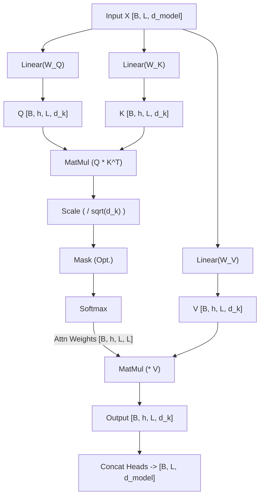

# Self-Attention 自注意力机制
---

## 0. 先判断它值不值得深挖

- **类别**：**A 类（核心概念，必须深挖）** 
- **判断理由**：Self-Attention 是 Transformer 架构的心脏，也是目前所有主流大语言模型（如 GPT、BERT 等）的底层基石。不深刻理解它，就无法读懂当今自然语言处理领域的任何前沿进展。它值得你花几天时间彻底搞懂每一个矩阵维度的变化和操作动机。

---

## 1. 这个知识点解决什么问题？

> **我们遇到了什么麻烦**：
> 在 Self-Attention 诞生之前，处理序列数据主要依赖两种网络架构：
> 1. **RNN/LSTM**：串行计算，必须等第 $t-1$ 步算完才能算第 $t$ 步，**完全无法并行**，导致训练极慢。而且在极长序列中容易遗忘早期信息（长距离依赖问题）。
> 2. **CNN (如 TextCNN)**：虽然可以高度并行，但它的**感受野是局部的**。要捕捉两个相隔很远的单词之间的关系，需要堆叠非常多层卷积，效率低下。
> 
> **必须引入新工具的原因**：我们需要一种机制，既能**高度并行计算**，又能**在一步之内捕捉全局的（任意两个词之间的）长距离依赖关系**。Self-Attention 应运而生。

---

## 2. 为什么它重要？它有什么用？

- **连接大图景**：它是彻底取代 RNN 的关键创新。学会它之后，才能顺利过渡到 Multi-Head Attention，进而是完整的 Transformer 结构和各类大语言模型。
- **实际应用场景**：在机器翻译、文本摘要、代码生成、对话系统等几乎所有现代 NLP 任务的建模和代码实现中，Self-Attention 都是提特征的标准范式。
- **高频题型/任务**：面试中极常被问到“为什么要除以 $\sqrt{d_k}$？”、“Q, K, V 是怎么来的？”、“Mask 机制是如何运作的？”。

---

## 3. 学它之前需要哪些前置知识？

最小必要背景（各 200 字以内）：

1. **[[Word Embedding]]**：将离散的单词映射成连续的稠密向量表示，这样才能进行数学运算。
2. **[[向量点积 (Dot Product)]]**：两个向量的点积越大，代表它们在空间中的方向越一致，**相似度越高**。这是 Self-Attention 寻找相关信息的数学基础。

---

## 4. 用直觉语言解释它

> «“这东西其实就像在一个拥挤的晚宴上社交寻找有价值的信息。”»

- **直觉类比**：
  想象你在晚宴上。你心里带着一个寻找某个人的特征（**Query，查询**，比如“寻找懂 AI 的人”）。
  晚宴上的每个人都挂着一个胸牌，上面写着他们的特征标签（**Key，键**，比如“数据科学家”）。
  每个人肚子里还装了一肚子的知识和八卦（**Value，值**）。
  你拿着你的 Query，去和每个人的 Key 进行比对（**点积**）。发现匹配度很高（点积很大），你就会把大部分的注意力分配给这个人，并获取他的知识（Value）。这就是注意力机制的核心。
- **为什么很自然**：一个词的意义通常取决于它周围的词。通过让每个词去“环顾”句子中的其他词，并根据相似度提取有用的信息，网络能动态地构建出具有丰富上下文的词表示。
- **一句话直觉本质**：Self-Attention 就是让序列中的每个元素通过互相打分（计算相似度），来加权融合整个序列的信息，从而更新自己的表示。

---

## 5. 正式定义、核心公式、符号解释

### 1. 最核心定义
Scaled Dot-Product Attention（缩放点积注意力）是一种将 Query 与一组 Key-Value 对映射为输出的计算过程。输出是所有 Value 的加权求和，其中每个 Value 的权重由 Query 和对应 Key 的点积计算并缩放后经过 Softmax 得到。

### 2. 核心公式
$$\text{Attention}(Q, K, V) = \text{softmax}\left(\frac{QK^T}{\sqrt{d_k}}\right)V$$

### 3. 符号说明表与 Tensor 形状映射 (PyTorch)

假设 Batch Size 为 $B$，序列长度为 $L$ (即上文的 $n$)，多头注意力的头数为 $h$，每个头的维度为 $d_k = d_v$。模型隐藏层总维度 $d_{model} = h \times d_k$。

| 符号 | 含义 | 形状 (PyTorch Tensor) | 备注 |
| :--- | :--- | :--- | :--- |
| $X$ | 输入序列 (经过 Embedding) | `[B, L, d_model]` | - |
| $W^Q, W^K, W^V$ | 权重矩阵 | `[d_model, d_model]` | 实际代码中常用一个大的 Linear 层统一映射 |
| $Q, K, V$ | Query, Key, Value | `[B, h, L, d_k]` | 经过 reshape 和 transpose，将头数 $h$ 提前以支持并行 |
| $QK^T$ | 注意力分数 (Attn Scores) | `[B, h, L, L]` | 表示序列内各个词对其他词的打分 |
| $\text{softmax}(...)$ | 注意力权重 (Attn Weights)| `[B, h, L, L]` | 每行和为 1 |
| $\text{Output}$ | 最终输出 (拼接后) | `[B, L, d_model]` | 将 $h$ 个头拼接 (concat)，再经过一次线性映射 |

### 4. 架构数据流图 (Mermaid)



### 5. 常见变体与适用条件
- **适用条件**：输入序列需要捕捉全局依赖关系。
- **Masked Self-Attention (掩码机制)**：在自回归生成任务（如机器翻译的 Decoder 或 GPT）中，预测第 $t$ 个词时不能看到 $t$ 以后的词。因此需要加上一个 Mask 矩阵（上三角全为 $-\infty$），使 softmax 后的权重为 0。
公式变为：$\text{softmax}\left(\frac{QK^T + M}{\sqrt{d_k}}\right)V$

---

## 6. 推导思路和思想来源

- **最初困难**：RNN 的逐步传递使得信息在长距离丢失，且无法并行；CNN 的感受野小。我们需要任意两个词的直接连接。
- **直接方法局限**：全连接层（MLP）虽然能捕捉全局信息，但参数量太大，且无法处理可变长度的序列。
- **关键“转念”**：使用“自适应权重”。权重不是固定的，而是根据输入序列自身的元素计算出来的（点积相似度）。
- **推导主线与动机**：
  1. 首先，序列 $X$ 分别乘以三个不同的矩阵 $W^Q, W^K, W^V$，得到 $Q, K, V$。
  2. 计算 $Q$ 和 $K^T$ 的点积，得到 $n \times n$ 的注意力矩阵。
  3. **为什么要缩放（除以 $\sqrt{d_k}$）？** (⚠️ 学术硬核推导)
     - **方差放大效应**：假设 $q$ 和 $k$ 是两个独立的向量，它们的每个分量 $q_i, k_i$ 都满足均值为 0，方差为 1（即 $q_i, k_i \sim \mathcal{N}(0, 1)$）。
     - **点积的方差**：计算它们的点积 $q \cdot k = \sum_{i=1}^{d_k} q_i k_i$。对于每一项 $q_i k_i$，其均值 $\mathbb{E}[q_i k_i] = \mathbb{E}[q_i]\mathbb{E}[k_i] = 0$。其方差 $\text{Var}(q_i k_i) = \mathbb{E}[q_i^2 k_i^2] - (\mathbb{E}[q_i k_i])^2 = \text{Var}(q_i)\text{Var}(k_i) = 1 \times 1 = 1$。
     - **总方差**：由于有 $d_k$ 项独立相加，点积的最终均值为 0，但总方差变为 $d_k$，即 $\text{Var}(q \cdot k) = \sum_{i=1}^{d_k} \text{Var}(q_i k_i) = d_k$。
     - **梯度消失后果**：当 $d_k$ 很大时，点积结果的分布极其宽广。这会将 Softmax 函数的输入推向绝对值极大的区域。在 $e^x / \sum e^x$ 中，极大值对应概率趋近于 1，其他趋近于 0，此时处于 Softmax 饱和区，**梯度 $\frac{\partial \text{softmax}}{\partial x}$ 趋近于 0**，导致反向传播梯度消失。
     - **解决方案**：除以标准差 $\sqrt{d_k}$，使得缩放后的结果 $\frac{q \cdot k}{\sqrt{d_k}}$ 重新服从方差为 1 的分布，维持良好的梯度回传。
  4. 经过 Softmax 归一化，得到权重。
  5. 权重矩阵乘上 $V$，得到新的特征表示。由于这些矩阵乘法可以同时进行，**高度并行化**得以实现。

---

## 7. 例子：基础 → 中等 → 实际应用

### 例子 1：基础例子（可手算，2个单词的自注意力）
- **题目**：输入序列有两个词 "I", "am"。假设它们的词向量经过 $W$ 矩阵映射后得到：
  $Q = \begin{bmatrix} 1 & 0 \\ 0 & 1 \end{bmatrix}$, $K = \begin{bmatrix} 1 & 0 \\ 1 & 1 \end{bmatrix}$, $V = \begin{bmatrix} 2 & 2 \\ 3 & 3 \end{bmatrix}$，假设 $\sqrt{d_k} = 1$。
- **解题思路与关键步骤**：
  1. 算点积 $QK^T = \begin{bmatrix} 1 & 0 \\ 0 & 1 \end{bmatrix} \begin{bmatrix} 1 & 1 \\ 0 & 1 \end{bmatrix} = \begin{bmatrix} 1 & 1 \\ 0 & 1 \end{bmatrix}$
     
     **2D 矩阵直观图 (注意力打分)**:
     | $QK^T$ (Attn Scores) | 词汇 `I` (Key) | 词汇 `am` (Key) |
     | :--- | :---: | :---: |
     | **词汇 `I` (Query)** | 1 | 1 |
     | **词汇 `am` (Query)** | 0 | 1 |
     *(注: 此时 `I` 会等价地关注 `I` 和 `am`，而 `am` 只关注自己。)*
  2. 算 Softmax（按行计算）：
     第一行 $[1, 1]$ softmax 后是 $[0.5, 0.5]$
     第二行 $[0, 1]$ softmax 后大约是 $[0.27, 0.73]$
  3. 算输出 $Output = \text{Softmax} \times V = \begin{bmatrix} 0.5 & 0.5 \\ 0.27 & 0.73 \end{bmatrix} \begin{bmatrix} 2 & 2 \\ 3 & 3 \end{bmatrix} = \begin{bmatrix} 2.5 & 2.5 \\ 2.73 & 2.73 \end{bmatrix}$
- **最终答案**：输出为 $\begin{bmatrix} 2.5 & 2.5 \\ 2.73 & 2.73 \end{bmatrix}$。
- **🤔 追问**：如果加上 Mask 呢？
  第一行不能看第二行（未来信息），第二列变为 $-\infty$，第一行 softmax 后将变成 $[1, 0]$。

### 例子 2：中等例子（Masked Self-Attention 的条件判断）
- **题目**：为什么要使用 Masked Self-Attention？它是如何通过矩阵加法实现的？
- **解答**：在 Decoder 训练时，我们在预测下一个词时必须隐藏之后的词。实现上，我们在 $QK^T$ 结果上加上一个形如右上三角（不含主对角线）全为 $-\infty$ 的矩阵 $M$。这样，原本 $QK^T + M$ 右上角的值都会变成极小的负数。经过 softmax $(e^x / \sum e^x)$ 计算后，这些极小值对应的概率权重趋近于 0，从而切断了对“未来”词汇的注意力。

### 例子 3：实际应用例子（PyTorch 核心实现）
- **实际价值与转化**：这是几乎所有 Transformer 库内部的核心逻辑。
```python
import torch
import torch.nn.functional as F

def scaled_dot_product_attention(q, k, v, mask=None):
    d_k = q.size(-1)
    # 1. 矩阵乘法并缩放
    scores = torch.matmul(q, k.transpose(-2, -1)) / math.sqrt(d_k)
    # 2. Mask 操作
    if mask is not None:
        scores = scores.masked_fill(mask == 0, -1e9)
    # 3. Softmax
    p_attn = F.softmax(scores, dim=-1)
    # 4. 加权聚合
    return torch.matmul(p_attn, v), p_attn
```

---

## 8. 常见误区和易混概念

### 误区 1：Self-Attention 就是没有参数的简单点积
- **错误直觉**：很多人以为直接拿输入的 $X$ 和自己做点积就是 Self-Attention。
- **为什么错**：如果直接拿 $X \cdot X^T$，那么一个词和它自己的相似度永远是最大的。网络没有学习能力去决定“在这个上下文中我该关注谁”。
- **正确理解**：输入序列 $X$ 首先通过三个**不同的可学习的线性变换矩阵** $W^Q, W^K, W^V$ 映射成三个不同的空间。这赋予了模型学习不同特征空间交互的能力。

### 概念对比表

| 概念 | 核心问题 | 关键区别 | 典型使用场景 |
| :--- | :--- | :--- | :--- |
| Self-Attention | 理解序列内部的关联 | Q, K, V 均来自同一个输入序列 $X$ | Transformer 的 Encoder, GPT, BERT |
| Cross-Attention | 连接两个不同的序列 | Q 来自解码器(如机器翻译的目标句)，K,V 来自编码器(源句) | 传统 Seq2Seq, Transformer 的 Decoder 中的跨层 |

---

## 9. 相关知识点与 Obsidian 双链建议

### 上游依赖
- [[Word Embedding]]：输入必须是词嵌入向量序列。
- [[Seq2Seq Attention]]：Self-Attention 思想是对传统 Encoder-Decoder Attention 的内化升华。

### 下游延伸
- [[Multi-Head Attention]]：将 Self-Attention 做多次并拼接，让模型能同时从多个不同的子空间视角去捕捉信息。
- [[Positional Encoding]]：由于 Self-Attention 本身是位置不变的（打乱序列顺序，输出不变），必须显式加入位置信息。

### 横向关联
- [[RNN]] ↔ [[Self-Attention]]：彻底抛弃了循环递归机制，通过全局连接实现长距离依赖和完全并行。

---

## 10. 闭卷验收（工程/应用模式）

合上笔记，独立完成以下 4 项：

- [ ] **直觉复述**：用寻找晚宴上带着胸牌的人（Q，K）并获取他们肚子里知识（V）的例子复述。
- [ ] **核心公式默写**：$\text{softmax}(\frac{QK^T}{\sqrt{d_k}})V$。解释为什么要除以 $\sqrt{d_k}$ 防止梯度消失。
- [ ] **关键推导复现**：讲清楚如何利用三次线性变换获取 QKV，进而矩阵并行化计算避免了 RNN 的串行问题。
- [ ] **典型例子复现**：能写出 Mask 矩阵的形态（上三角全为负无穷）和作用。

---

## 11. 分级习题与实践

| 题号 | 类型 | 难度 | 来源 | 考查点 |
| :--- | :--- | :--- | :--- | :--- |
| 1 | 概念理解 | 基础 | CS224N | Q, K, V 矩阵的生成机制 |
| 2 | 公式推导 | 中等 | CS224N | 缩放因子 $\sqrt{d_k}$ 的原理 |
| 3 | 代码实现 | 中等 | 常见面试题 | Masked Attention 的实现逻辑 |
| 4 | 架构对比 | 较难 | 常见面试题 | 感受野与并行的优劣势分析 |

### 题目与解析

#### 1. Self-Attention 中 Q、K、V 的来源是什么？
> [!question]- 答案与解析（复盘阶段查看）
> - **答案**：它们都来自同一个输入序列 $X$。通过 $X$ 分别乘以三个独立初始化的可学习矩阵 $W^Q, W^K, W^V$ 得到。
> - **解析**：这正是 "Self" 的含义，即让序列自己内部的元素之间发生交互。

#### 2. 为什么公式中需要除以 $\sqrt{d_k}$？
> [!question]- 答案与解析（复盘阶段查看）
> - **答案**：防止点积结果过大导致 softmax 梯度消失。
> - **解析**：假设 Q 和 K 的元素是互相独立的随机变量，均值为0，方差为1。它们的点积 $q \cdot k = \sum_{i=1}^{d_k} q_i k_i$ 的均值为 0，但方差会变成 $d_k$。当 $d_k$ 很大时，点积结果的极值也会很大。经过 softmax 后，大的值对应的概率接近 1，其余接近 0，此时 softmax 函数的梯度几乎为 0，导致模型无法更新。除以 $\sqrt{d_k}$ 可将其方差强行拉回 1。

#### 3. 与 RNN 和 CNN 相比，Self-Attention 的最大优势是什么？
> [!question]- 答案与解析（复盘阶段查看）
> - **答案**：1. 完全并行化计算（对比 RNN）；2. 全局的感受野，常数级（O(1)）的操作距离捕捉任意长距离依赖（对比 CNN）。
> - **解析**：RNN 必须按时间步顺序执行，$O(N)$；CNN 受限卷积核大小，$O(N/k)$ 或需多层堆叠；Self-Attention 只需要一次矩阵乘法 $O(1)$ 的连接距离，就能计算出所有词的相互影响。

---

## 🃏 Anki 卡片

### 1. 张量维度推演 (Tensor Shape Derivation)
给定 Input $X$ 形状为 `[B, L, d_model]`，共有 $h$ 个头，假设经过 $W^Q, W^K, W^V$ 映射后：
- $Q$ 在与 $K^T$ 相乘前，Shape 会被 Reshape 和 Transpose 为：__________。为什么要将 $h$ 这个维度提前？
- $QK^T$ 的 Shape 为：__________。这个四维张量分别代表了哪些维度的交互？
- Softmax 函数应该作用在 $QK^T$ 的哪一个维度上（`dim=___`）？它代表了什么物理意义？

### 2. 核心数学填空 (Cloze Deletion)
- 在 Scaled Dot-Product Attention 中，假设 $q_i, k_i$ 均值为 0、方差为 1。由于点积是 $d_k$ 个维度的乘积求和，其总方差会被放大到 __________。
- Softmax 函数在输入方差极大的情况下，输出向量会逼近 __________（One-hot 还是 Uniform 分布？），这会导致进入网络反向传播时的梯度趋向于 __________。
- 为了修复上述梯度消失问题，必须将 $QK^T$ 除以 __________ 进行缩放。

### 3. Mask 机制考察
- 在自回归语言模型（如 GPT）中，预测第 $t$ 个词时，注意力分数矩阵 $QK^T$ 的（上三角/下三角）__________ 部分会被加上 $-\infty$。经过 Softmax 后，这些位置的注意力权重将变为 __________，从而严格阻止信息穿越到未来。

---

## 13. 给 Obsidian 的归档建议

- **适合文件夹**：`02-Knowledge/🧠 学习系统/08-NLP全栈/Transformer与大模型/`
- **关联已有笔记**：`[[Transformer]]`, `[[Seq2Seq]]`
- **建议标签**：`#学习` `#NLP` `#CS224N`
- **拆分建议**：`Scaled Dot-Product Attention` 本身的数学推导可以独立成卡。
