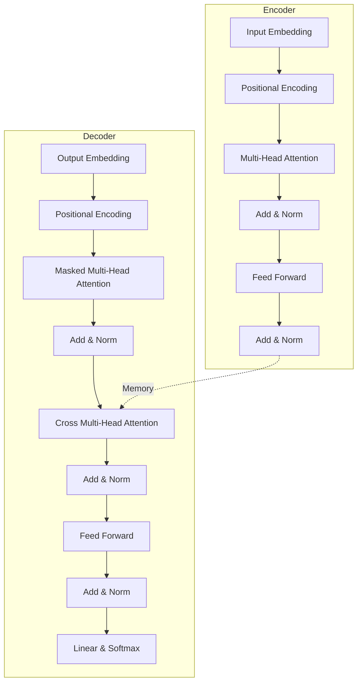

# Transformer架构
---

## 0. 先判断它值不值得深挖

- **类别**：**A 类（核心概念，必须深挖）**
- **判断理由**：NLP领域的绝对基石。2017年《Attention Is All You Need》提出后，取代了RNN/LSTM成为NLP的标准架构，直接催生了BERT、GPT等大模型，不仅是CS224N的核心考点（Assignment 4 & 5），也是深度学习从业者必须完全掌握的基础。

---

## 1. 这个知识点解决什么问题？

> **我们遇到了什么麻烦**：
> 以前的 Seq2Seq 模型依赖 RNN/LSTM。RNN 必须按顺序（step-by-step）处理序列，导致两大问题：
> 1. **无法并行计算**，训练速度极慢；
> 2. **长距离依赖问题**依然存在，信息传递过长后会衰减或丢失。
> 我们需要一种能高度并行、且能瞬间捕捉序列中任意两个词之间依赖关系的模型。

---

## 2. 为什么它重要？它有什么用？

- **连接大图景**：它是现代NLP模型的底座。不学透 Transformer，后续的 BERT（仅编码器）、GPT（仅解码器）、T5（编解码器）都无法真正理解。
- **实际应用场景**：机器翻译（最初任务）、文本生成、代码生成、甚至视觉任务（ViT）。
- **高频题型/任务**：面试中常被要求手撕 Multi-Head Attention，解释为何要除以 $\sqrt{d_k}$，解释 Positional Encoding 的设计原理。

---

## 3. 学它之前需要哪些前置知识？

最小必要背景（各 200 字以内）：

1. **[[Self-Attention机制]]**：理解 $Q, K, V$ 矩阵的作用，知道自注意力是如何计算词与词之间相关性的。
2. **[[Seq2Seq模型]]**：理解编码器将输入序列编码，解码器根据编码和历史输出生成下一个词的整体框架。

---

## 4. 用直觉语言解释它

> «“这东西其实就像开一场高效的圆桌会议。”»

- **直觉类比/几何图像**：RNN 像传话游戏，一个人传给下一个人，不仅慢而且容易传错。Transformer 就像一个圆桌会议，所有词同时坐在桌边，每个人都可以自由地看向其他人（Attention），评估谁说的话对现在的自己最重要。
- **为什么很自然**：既然句子中任何两个词都有可能有语法或语义联系，为什么要把它们按距离拉远？直接用完全图一样的结构让它们两两交互，再配合强大的显卡算力并行，是非常合理的。
- **一句话直觉本质**：彻底抛弃递归和卷积，仅依靠多头自注意力机制和前馈神经网络来实现序列到序列的特征提取与映射。

---

## 5. 正式定义、核心公式、符号解释

### 1. 最核心定义
Transformer 是一个基于 Encoder-Decoder 架构的序列转录模型，完全依赖自注意力机制实现长距离依赖的建模，无需 RNN 或 CNN。



### 2. 核心公式
**缩放点积注意力 (Scaled Dot-Product Attention)**：
$$\text{Attention}(Q, K, V) = \text{softmax}\left(\frac{QK^T}{\sqrt{d_k}}\right)V$$

**多头注意力 (Multi-Head Attention)**：
$$\text{MultiHead}(Q, K, V) = \text{Concat}(\text{head}_1, ..., \text{head}_h)W^O$$
$$\text{where } \text{head}_i = \text{Attention}(QW_i^Q, KW_i^K, VW_i^V)$$

**位置编码 (Positional Encoding)**：
$$PE_{(pos, 2i)} = \sin(pos / 10000^{2i/d_{\text{model}}})$$
$$PE_{(pos, 2i+1)} = \cos(pos / 10000^{2i/d_{\text{model}}})$$

### 3. 符号说明表

| 符号 | 含义 | 取值范围 / 量纲 | 备注 |
| :--- | :--- | :--- | :--- |
| $Q, K, V$ | 查询(Query)、键(Key)、值(Value)矩阵 | $\mathbb{R}^{L \times d_k}, \mathbb{R}^{L \times d_k}, \mathbb{R}^{L \times d_v}$ | $L$为序列长度 |
| $d_k$ | Query和Key的维度 | 标量 | 通常 $d_k = d_v = d_{\text{model}} / h$ |
| $h$ | 注意力头数 (Heads) | 正整数 | 原论文中 $h=8$ |
| $d_{\text{model}}$ | 模型隐藏层维度 | 正整数 | 原论文中为 512 |
| $W^O$ | 线性投影矩阵 | $\mathbb{R}^{hd_v \times d_{\text{model}}}$ | 将多头结果融合 |

### 4. 常见变体与适用条件
- **适用条件**：数据量充足，能够提供足够的算力资源进行并行训练。
- **限制条件**：自注意力的时空复杂度为 $O(N^2)$，对于极长序列（如长文本、大图象）会遇到内存和计算瓶颈。

---

## 6. 推导思路和思想来源

- **最初困难**：RNN 的时序依赖阻碍了 GPU 并行计算；长序列会导致梯度消失/信息遗忘。
- **直接方法局限**：使用 CNN 也可以并行，但感受野是局部的，要捕捉极长距离依赖需要堆叠很多层，路径长度为对数级别。
- **关键“转念”**：干脆用 Attention 机制代替 RNN！Attention 的路径长度始终是 $O(1)$，两个词不管隔多远，一步就能互相看到。
- **推导主线与动机**：
  1. 为了捕捉关系，引入 **Self-Attention**。
  2. 为了防止内积过大导致 softmax 梯度消失，引入除以 **$\sqrt{d_k}$**。
  3. 为了让模型在不同表示子空间关注不同信息，引入 **Multi-Head**。
  4. 既然没有了 RNN，序列顺序丢失了，必须手动注入位置信息，引入 **Positional Encoding**。
  5. 为了训练更深的网络，引入 **残差连接 (Add)** 和 **层归一化 (LayerNorm)**。
  6. 叠加两层 **FFN** 增加非线性。

**🚀 PyTorch Tensor 维度流转 (Tensor Tracking)**:
- **Input**: `x` shape `[B, L, d_model]` (Batch, Length, Dimension)
- **Q, K, V Projection**: `x @ W_q` $\to$ `[B, L, d_model]`
- **Multi-Head Split**: Reshape to `[B, L, h, d_k]` $\to$ Transpose to `[B, h, L, d_k]` (where `d_k = d_model / h`)
- **Attention Scores**: `Q @ K^T` $\to$ `[B, h, L, L]`
- **Attention Context**: `Scores @ V` $\to$ `[B, h, L, d_v]` (usually `d_v = d_k`)
- **Merge Heads**: Transpose back to `[B, L, h, d_v]` $\to$ Reshape to `[B, L, d_model]`
- **Output Projection**: `Context @ W_o` $\to$ `[B, L, d_model]`
- **FFN Block**: `[B, L, d_model] -> [B, L, 4*d_model] -> [B, L, d_model]`

**🧮 深度解析：为什么除以 $\sqrt{d_k}$？**
假设 $Q$ 和 $K$ 的分量 $q_i, k_i$ 是独立同分布的随机变量，均值 $0$，方差 $1$。点积 $q \cdot k = \sum_{i=1}^{d_k} q_i k_i$。
- 其均值 $\mathbb{E}[q \cdot k] = \sum \mathbb{E}[q_i]\mathbb{E}[k_i] = 0$
- 其方差 $\text{Var}(q \cdot k) = \sum \text{Var}(q_i k_i) = \sum (\mathbb{E}[q_i^2]\mathbb{E}[k_i^2] - 0) = \sum (1 \times 1) = d_k$
由于方差为 $d_k$，点积的分布会随维度 $d_k$ 变大而变得极其分散。进入 softmax 时，最大的值会极大，导致输出极其尖锐（接近 one-hot），此时 softmax 的梯度极小。通过缩放除以 $\sqrt{d_k}$，方差重新变为 $1$，避免了梯度消失。

- **为什么自然得到此结论**：这种全连接且并行的结构，最大化利用了现代硬件的计算能力，同时理论上也清除了信息传递的距离壁垒。

---

## 7. 例子：基础 → 中等 → 实际应用

### 例子 1：基础例子（可手算）
- **题目**：假设句子有两个词 "I", "eat"，已转换为嵌入 $X \in \mathbb{R}^{2 \times 4}$。计算单头注意力（设 $W^Q, W^K, W^V$ 为恒等矩阵，忽略位置编码）。
- **解题思路与关键步骤**：
  1. $Q = K = V = X$
  2. 计算分数 $S = X X^T / \sqrt{4}$
  3. 权重 $W = \text{softmax}(S, \text{dim}=-1)$
  4. 输出 $Z = W X$
- **最终答案**：每个词的输出将是 "I" 和 "eat" 嵌入的加权平均，权重由它们的点积相似度决定。
- **易错点**：忘记除以缩放因子 $\sqrt{d_k}$。
- **🤔 追问**：如果这里换成多头注意力，结果会怎样？（需要将特征拆分到不同的头独立运算，最后再拼接）。

### 例子 2：中等例子（条件判断与多步推理）
- **题目与完整解答**：在 Decoder 中，为什么需要 Masked Multi-Head Attention？如何实现？
  - **解答**：在自回归生成时，模型不能“作弊”看到未来的词。实现方式是在计算 $QK^T$ 的结果矩阵中，将上三角部分（代表当前词对未来词的注意力）加上一个负无穷（如 $-1e9$），这样再过 softmax 时，未来词对应的权重就变成了 0。

### 例子 3：实际应用例子（真实场景/代码）
- **实际价值与转化**：在 PyTorch 中，可以直接调用 `nn.TransformerEncoderLayer` 构建模型底座，或者调用 Hugging Face 的 `transformers` 库加载预训练权重。实际工业界几乎都依赖 Transformer 的变体。

---

## 8. 常见误区和易混概念

### 误区 1：Transformer 中的 Add & Norm 是先 Norm 还是后 Norm？
- **错误直觉**：原论文中是 Post-LN（先 Add 再 Norm），这就一定是最好的。
- **为什么错**：Post-LN 在深层网络中梯度极易爆炸，导致训练极不稳定，常需要复杂的 Warmup 策略。
- **正确理解**：后来多数模型（如 GPT系列, 各种现代 Transformer）都改用 Pre-LN（先 Norm，然后算 Attention/FFN，再 Add），这样训练更稳定，即便很深的网络也不易崩溃。

### 概念对比表

| 概念 | 核心问题 | 关键区别 | 典型使用场景 |
| :--- | :--- | :--- | :--- |
| Encoder Attention | 提取输入特征 | 看全部上下文（双向无掩码） | BERT, 文本理解 |
| Decoder Masked Attention | 自回归生成 | 只能看历史，不能看未来（带掩码） | GPT, 文本生成 |
| Cross Attention | 融合编码信息 | Q来自解码器，K,V来自编码器 | 机器翻译 (Seq2Seq) |

---

## 9. 相关知识点与 Obsidian 双链建议

### 上游依赖
- [[Self-Attention机制]]：本知识点的核心计算算子。
- [[位置编码]]：解决非时序模型丢失语序问题的关键组件。

### 下游延伸
- [[BERT]]：Transformer 编码器的巅峰之作。
- [[GPT]]：Transformer 解码器的巅峰之作。

### 横向关联
- [[RNN]] ↔ [[Transformer架构]]：时代更替的两代序列建模霸主。

---

## 10. 闭卷验收（工程/应用模式）

合上笔记，独立完成以下 4 项：

- [ ] **直觉复述**：用大白话解释这个概念在干嘛。
- [ ] **核心公式默写**：写出最重要的 1-2 个公式，并解释所有符号。
- [ ] **关键推导复现**：能讲清楚从直接方法到该方法的那次“转念”。
- [ ] **典型例子复现**：能独立写出第 7 节中的基础/中等例子。

---

## 11. 分级习题与实践

题目来源标注教材章节、项目或作业。

| 题号 | 类型 | 难度 | 来源 | 考查点 |
| :--- | :--- | :--- | :--- | :--- |
| 1 | 概念理解 | 基础 | CS224N考试 | Self-Attention 复杂度分析 |
| 2 | 公式推导 | 中等 | 面试高频题 | 为什么除以 $\sqrt{d_k}$ |
| 3 | 代码实现 | 中等 | CS224N A4 | Masked Attention 实现 |
| 4 | 场景应用 | 较难 | 实际工程 | Pre-LN vs Post-LN |
| 5 | 优化探索 | 挑战 | FlashAttention | 降低 $O(N^2)$ 的内存和计算瓶颈 |

### 题目与解析

#### 1. Transformer 每层的计算复杂度和序列长度 N 的关系是什么？
> [!question]- 答案与解析（复盘阶段查看）
> - **答案**：Self-Attention 的时间复杂度是 $O(N^2 \cdot d)$，空间复杂度通常也是 $O(N^2)$。
> - **解析**：计算 $QK^T$ 需要 $N \times d$ 和 $d \times N$ 的矩阵乘法，操作数为 $O(N^2 d)$。当序列极长时（如大模型上下文扩展），$N^2$ 会成为瓶颈。
> - **易错原因**：混淆序列长度 $N$ 和隐藏层维度 $d$ 的影响。

#### 2. Attention 中为什么要除以 $\sqrt{d_k}$？
> [!question]- 答案与解析（复盘阶段查看）
> - **答案**：防止 softmax 进入饱和区，导致梯度消失。
> - **解析**：如果 $Q$ 和 $K$ 的元素是独立同分布且均值为 0，方差为 1，那么 $q \cdot k$ 的点积均值仍为 0，但方差会变成 $d_k$。维度 $d_k$ 越大，点积结果的方差越大。方差变大意味着 softmax 的输入会有极大的正数和负数，使得 softmax 输出逼近 one-hot 向量，此时局部梯度几乎为 0。除以 $\sqrt{d_k}$ 把方差重新拉回 1。

#### 3. 手写实现一个简单的 Scaled Dot-Product Attention
> [!question]- 答案与解析（复盘阶段查看）
> - **答案**：代码见下方
> - **代码片段**：
```python
import torch
import torch.nn.functional as F
import math

def scaled_dot_product_attention(q, k, v, mask=None):
    d_k = q.size(-1)
    scores = torch.matmul(q, k.transpose(-2, -1)) / math.sqrt(d_k)
    if mask is not None:
        scores = scores.masked_fill(mask == 0, -1e9)
    attn = F.softmax(scores, dim=-1)
    output = torch.matmul(attn, v)
    return output, attn
```

#### 4. FFN (Feed Forward Network) 在 Transformer 中起到什么作用？
> [!question]- 答案与解析（复盘阶段查看）
> - **答案**：提供非线性和增强特征表示。
> - **解析**：Attention 层本质上是做加权平均（特征的线性组合）。如果没有非线性层，整个 Transformer 拟合能力大减。FFN 将特征先投影到高维（通常 $4d_{\text{model}}$），经过 ReLU/GELU 激活，再投影回低维，极大地丰富了每个 token 的独立特征表达。

#### 5. 如何缓解 Transformer 中 $O(N^2)$ 的复杂度问题？
> [!question]- 答案与解析（复盘阶段查看）
> - **答案**：局部注意力 (Local Attention)、稀疏注意力 (Sparse Attention, 比如 Longformer, BigBird) 或 线性注意力 (Linear Attention)。工程实现上可使用 FlashAttention。
> - **解析**：为了打破 $N^2$ 的限制，可以限制只看窗口内的 token，或通过核方法等数学推导避免显式计算 $N \times N$ 的注意力矩阵。

---

## 12. 我的主动回忆区 (Active Recall)

### 🧩 核心概念填空
- Transformer 完全摒弃了 RNN 和 CNN，其捕捉长距离依赖的核心算子是 __________，为了避免 softmax 饱和，缩放因子的分母是 __________。
- 在 Decoder 中，为了防止模型在自回归生成时看到未来的词，在多头注意力前必须使用 __________，实现方式是在计算出的分数矩阵的 __________ 加上一个极小的负数（如 -1e9）。
- 为了打破序列位置无关的特性，输入层注入了 __________，它的公式中，偶数维度使用 __________ 函数，奇数维度使用 __________ 函数。

### 📐 张量维度推演 (Tensor Derivation)
已知 `Batch_size=B`, `Sequence_Length=L`, `Hidden_size=d_model`, `Num_heads=h`, `d_k = d_model / h`。
1. `Input` 进过多头注意力前，Q、K 的维度在重塑并转置后变为：`[__, __, __, __]`。
2. `Q @ K^T` 后得到的 Attention Scores 的形状是：`[__, __, __, __]`。
3. FFN 网络通常会将隐藏层维度扩大 4 倍，其两层线性变换间的张量形状流转为：`[B, L, d_model]` $\to$ `[__, __, __]` $\to$ `[B, L, d_model]`。

### 🤔 深度追问
**Q: 如果没有 FFN (Feed Forward Network)，Transformer 的表达能力会发生什么变化？为什么？**
A: ___________________________________________________________________

**Q: Pre-LN 与 Post-LN 相比，哪一个在深层网络中训练更稳定？为什么？**
A: ___________________________________________________________________

### 📅 下次复习日期

---

## 13. 给 Obsidian 的归档建议

- **适合文件夹**：`02-Knowledge/🧠 学习系统/08-NLP全栈/Transformer/`
- **关联已有笔记**：`[[Self-Attention机制]]`, `[[Seq2Seq模型]]`, `[[位置编码]]`
- **建议标签**：`#学习` `#NLP` `#CS224N`
- **拆分建议**：多头注意力机制、位置编码推导，如果在复习时觉得过长，可以拆分为独立的卡片。
