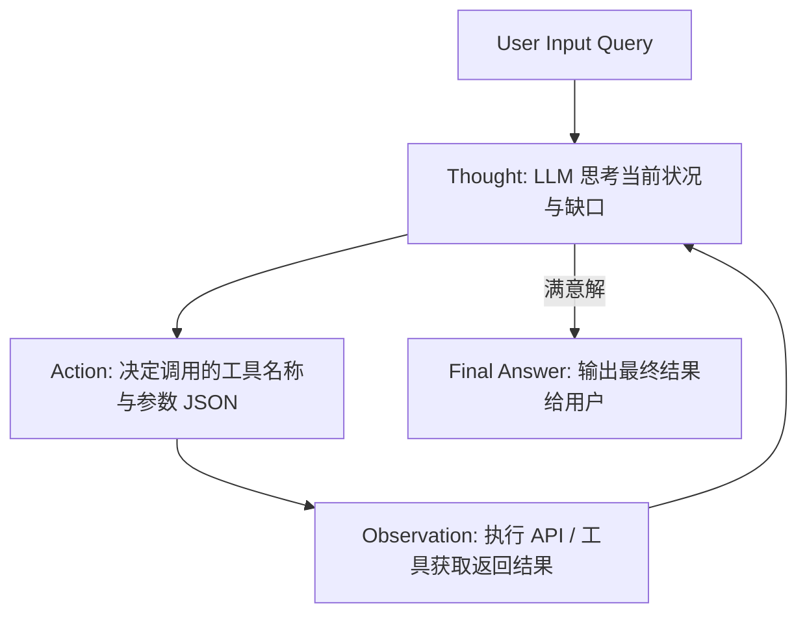

# 08-NLP全栈-Agent与工具使用

---

## 1. 这个知识点解决什么问题？

> **我们遇到了什么麻烦**：
> 孤立的大语言模型是一个静态的“无手无脚之大脑”，无法实时获取最新的互联网数据（时效性问题）、无法准确进行复杂数学运算（计算器问题）、无法直接修改数据库或调用 API 接口。AI Agent (智能体) 赋予了大模型规划 (Planning)、记忆 (Memory)、工具调用 (Tool Execution) 与环境交互反馈 (Environment Feedback) 的能力。

---

## 2. 为什么它重要？它有什么用？

- **连接大图景**：它是大语言模型从单轮问答助手向自主完成复杂工作流（如自主代码编写、自动化数据分析、多 Agent 协作系统）跨越的核心范式。
- **核心算法机制**：
  1. **ReAct 范式**：Reasoning (思考) + Acting (行动) 循环。
  2. **Function Calling (函数调用)**：JSON Schema 格式化工具定义与结构化参数解析。
  3. **Toolformer**：自我自监督学习何时以及如何调用 API 接口。

---


### 3.1 形式化 Markov 决策过程与 ReAct 数学表达

Agent 的决策过程可以抽象为带有工具调用的扩展 Markov 决策过程 (MDP)：
$$\mathcal{M} = \langle \mathcal{S}, \mathcal{A}, \mathcal{O}, \mathcal{T}, \mathcal{R}, \gamma \rangle$$

在 ReAct 范式下，在时刻 $t$ 的状态序列包含思考推理 (Thought $i_t$)、动作工具调用 (Action $a_t$) 与环境观察 (Observation $o_t$)：
$$H_t = (i_1, a_1, o_1, i_2, a_2, o_2, \dots, i_{t-1}, a_{t-1}, o_{t-1})$$

大语言模型 Policy $\pi_\theta$ 生成当前时刻的思考与动作：
$$P(i_t, a_t \mid H_t, q) = \pi_\theta(i_t \mid H_t, q) \cdot \pi_\theta(a_t \mid H_t, q, i_t)$$
环境执行工具调用 $a_t$ 返回 Observation $o_t \sim \mathcal{T}(\cdot \mid a_t)$。


## 3. ReAct 循环架构与工作流



---

## 4. Python 代码示例：极简 ReAct Agent 实现

```python
import json

# 1. 定义可用工具函数
def get_weather(location: str) -> str:
    if "Tokyo" in location:
        return "Sunny, 22°C"
    return "Rainy, 15°C"

tools_map = {"get_weather": get_weather}

# 2. 模拟 LLM 输出解析与 Agent Loop
def run_agent_step(llm_response: str):
    """解析 LLM 产生的 Action JSON"""
    if "Action:" in llm_response:
        action_str = llm_response.split("Action:")[1].strip()
        action_obj = json.loads(action_str)
        
        tool_name = action_obj["tool"]
        tool_args = action_obj["args"]
        
        # 执行工具
        result = tools_map[tool_name](**tool_args)
        return f"Observation: {result}"
    return "Final Answer Reached."

# 模拟 LLM 思考与行动指令
llm_step1 = 'Thought: I need to check the weather in Tokyo.\nAction: {"tool": "get_weather", "args": {"location": "Tokyo"}}'
obs = run_agent_step(llm_step1)
print("Agent Execution Loop ->", obs)
# 输出: Observation: Sunny, 22°C
```

---


## 5. 常见误区与对比矩阵

| Agent 架构范式 | 核心机制 | 代表性框架/论文 | 优势与局限 |
| :--- | :--- | :--- | :--- |
| **ReAct** | 思考(Thought)-行动(Act)-观察(Obs) 交错迭代 | Yao et al. (2023) | 可解释性强；容易死循环或产生幻觉行动 |
| **Plan-and-Solve** | 提前规划多步子任务拆解后再依次执行 | Wang et al. (2023) | 适合复杂长流程任务；灵活性差，无法即时调整 |
| **Reflexion** | 结合自我反思 (Self-Reflection) 与记忆缓存 | Shinn et al. (2023) | 错题纠偏能力强；消耗较多 Token 预算 |
| **Toolformer** | 自监督在文本中插入 API Call 标记 | Schick et al. (2023) | 无需 Prompt 即可原生触发工具；微调成本较高 |


## 6. 闭卷自测与验收入口

请在不查阅资料的前提下尝试解答以下问题，或完成对应关联作业：
1. 本知识点的核心定义与推导公式是什么？
2. 相比传统方法，它的核心优势与工程选型 Trade-offs 是什么？
3. 如何在 PyTorch / Python 中实现并校验其关键张量维度与运算逻辑？


---

## 🛠️ 我的主动回忆区 (Guided Recall)

- [ ] **问题 1**：请不看笔记，口述《Agent与工具使用》的核心核心定义与求解动机。
- [ ] **问题 2**：算法或推导的核心计算公式是什么？其中关键变量代表什么物理含义？
- [ ] **问题 3**：在实际工程落地或模型训练中，该方法最常见的 2 个踩坑点或退化场景是什么？


---

## 🃏 闭卷提取练习 (Self-Quiz)

1. **概念自测**：说明《Agent与工具使用》的核心机制及其与上下游模块的连接逻辑。
2. **代数/代码自测**：手写关键代数推导步骤或 PyTorch/Python 核心实现伪代码。
3. **防错自测**：如果输入数据出现极小值或极大值离群点，该模块会发生什么异常？如何做数值稳定防护？


---

## 🛠️ 学完后可以完成

```dataview
LIST
FROM "03-Projects"
WHERE contains(requires, this.file.link)
SORT assignment_level ASC, file.name ASC
```
