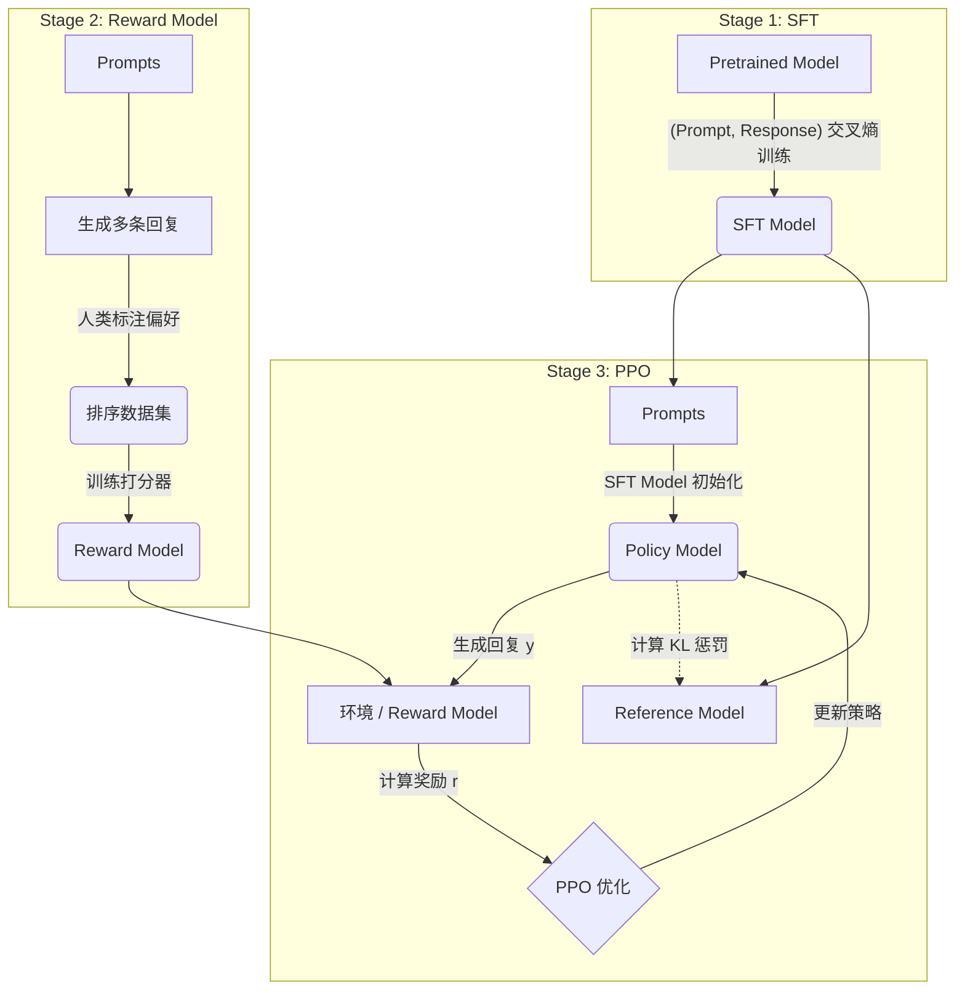

## 0. 先判断它值不值得深挖

- **类别**：**A 类（核心概念，必须深挖）**
- **判断理由**：这是目前大模型从“懂接话的机器人”变成“有用且听话的AI助手”的核心技术。没有指令微调和对齐，GPT-3永远成不了ChatGPT。RLHF和DPO是当下大模型开发流程（Post-training）的绝对标配，面试必考，也是做大模型应用必须理解的底层机制。

---

## 1. 这个知识点解决什么问题？

> **我们遇到了什么麻烦**：
> 预训练大模型（Base Model）本质上只是在做“词汇接龙”（Next-token prediction）。当你输入“如何做番茄炒蛋？”时，它可能会接着生成“如何做青椒肉丝？”，因为它在预测互联网上常见的连续文本，而不是在“回答问题”。
> 我们需要一种机制，让模型学会**遵循指令（Follow Instructions）**，并且其输出要**符合人类的价值观和偏好（Helpful, Honest, Harmless - 3H）**，不能生成有害或无意义的内容。

---

## 2. 为什么它重要？它有什么用？

- **连接大图景**：它是预训练（Pre-training）之后的关键步骤，即后训练（Post-training）。学完它，你就能完整理解ChatGPT的训练三部曲（SFT -> RM -> RLHF）。
- **实际应用场景**：开源模型微调（Llama-3-Instruct是怎么来的）、构建垂直领域的对话机器人、控制模型输出不越狱（Jailbreak）。
- **高频题型/任务**：面试常问 RLHF 的三个阶段、PPO 的损失函数、DPO 为什么能干掉 Reward Model、SFT 数据如何构造。

---

## 3. 学它之前需要哪些前置知识？

最小必要背景（各 200 字以内）：

1. **[[语言模型与Next-token Prediction]]**：知道大模型的基础能力是根据前文预测下一个词，一切微调都是在这个基础上的概率分布调整。
2. **[[监督微调 (SFT)]]**：知道如何用 (Prompt, Response) 的数据对，通过交叉熵损失函数更新模型参数，让模型学会特定的格式或任务。
3. **[[强化学习基础 (RL)]]**：知道智能体（Agent/Model）在环境（Environment）中采取动作（Action/生成Token），获得奖励（Reward），并通过最大化长期奖励来更新策略（Policy）。

---

## 4. 用直觉语言解释它

> «“指令微调就像教大学生写公文，对齐就像教他职场情商。”»

- **直觉类比/几何图像**：
  - **预训练**：读了全世界的书，知识渊博但自言自语的野人。
  - **指令微调 (SFT)**：给野人看 10 万个问答示例，让他学会“哦，原来你是要我回答问题，而不是顺着你的话往下编”。
  - **人类反馈强化学习 (RLHF)**：给野人配个打分老师（Reward Model）。野人每次回答，老师就打分。野人为了拿高分，逐渐学会察言观色，知道哪些回答讨人喜欢（Helpful），哪些会挨骂（Harmful）。
- **为什么很自然**：人类无法写出所有完美的回答（SFT成本高），但很容易判断“哪个回答更好”（比较成本低）。所以用标注的比较数据训练一个打分模型（RM），再让打分模型去自动教语言模型，非常符合人类学习和教导的逻辑。
- **一句话直觉本质**：用高质量问答示例赋予模型对话能力（SFT），用偏好打分引导模型符合人类价值观（Alignment）。

### RLHF 三阶段全景图 (3-Stage RLHF Pipeline)

---

## 5. 正式定义、核心公式、符号解释

### 1. 最核心定义
**指令微调（Instruction Tuning）**：使用大量包含指令和期望输出的任务描述数据对模型进行监督微调，提升其泛化到未见指令的能力（如 FLAN）。
**RLHF (Reinforcement Learning from Human Feedback)**：利用人类偏好数据训练奖励模型，再用强化学习算法（如PPO）优化语言模型策略的过程。

### 2. 核心公式与数学洞见 (Math Insights)
**RLHF中PPO的优化目标（简化版）**：
$$\max_{\pi_\theta} \mathbb{E}_{x \sim \mathcal{D}, y \sim \pi_\theta(\cdot|x)} \left[ r_\phi(x, y) - \beta \mathbb{D}_{\text{KL}} (\pi_\theta(y|x) \| \pi_{\text{ref}}(y|x)) \right]$$

**📐 PPO 目标函数数学洞见**:
- $r_\phi(x, y)$ 提供**方向**：鼓励模型生成能够获得 RM 高分的序列。
- $-\beta \mathbb{D}_{\text{KL}}$ 提供**约束**：防止模型过拟合 RM（Reward Hacking）。它作为一个逐 Token 的正则项，要求当前模型 $\pi_\theta$ 的概率分布不能偏离参考模型 $\pi_{\text{ref}}$ 太远。
- **动态奖励重构**：在 PPO 实际代码中，往往会将 KL 惩罚合并到 Reward 中计算，即 $R(x, y) = r_\phi(x, y) - \beta \log \frac{\pi_\theta(y|x)}{\pi_{\text{ref}}(y|x)}$。

**💻 核心张量维度追踪 (Tensor Tracking in RLHF)**:
- **Policy Model (LLM) 前向传播**: 
  `Input: [Batch, Seq_Len]` -> `Transformer Blocks` -> `Logits: [Batch, Seq_Len, Vocab_Size]`
  - 采样后，通过 `Logits` 获取生成动作的对数概率 `log_probs: [Batch, Seq_Len]`。
- **Reference Model 前向传播**:
  同上，获取参考概率 `ref_log_probs: [Batch, Seq_Len]`，用于计算相对优势与 KL 惩罚项。
- **Reward Model / Critic (Value Head)**:
  `Input: [Batch, Seq_Len]` -> `Transformer Blocks` -> `Hidden States: [Batch, Seq_Len, Hidden_Dim]` -> `Linear(Hidden_Dim, 1)` -> `Value: [Batch, Seq_Len]`
  - 注意：RM 通常在最后一个 Token 处取值作为整个句子的标量奖励 `[Batch, 1]`。而 PPO 中的 Critic Model (Value Network) 则会评估每个 Token 处的期望收益 `[Batch, Seq_Len]`，用于结合优势函数 (Advantage) 计算策略梯度流 (Gradient Flows)。

**DPO (Direct Preference Optimization) 损失函数**：
$$\mathcal{L}_{\text{DPO}}(\theta; \pi_{\text{ref}}) = - \mathbb{E}_{(x, y_w, y_l) \sim \mathcal{D}} \left[ \log \sigma \left( \beta \log \frac{\pi_\theta(y_w|x)}{\pi_{\text{ref}}(y_w|x)} - \beta \log \frac{\pi_\theta(y_l|x)}{\pi_{\text{ref}}(y_l|x)} \right) \right]$$

### 3. 符号说明表

| 符号 | 含义 | 取值范围 / 量纲 | 备注 |
| :--- | :--- | :--- | :--- |
| $x$ | 输入指令 (Prompt) | 文本序列 | 用户的问题 |
| $y$ | 生成回复 (Response) | 文本序列 | 模型的回答 |
| $\pi_\theta$ | 当前优化的策略模型 | 概率分布 | 正在被RL优化的LLM |
| $\pi_{\text{ref}}$ | 参考模型 (Reference Model) | 概率分布 | 通常是SFT后的模型，用来防止灾难性遗忘 |
| $r_\phi$ | 奖励模型 (Reward Model) | $\mathbb{R}$ | 标量分数，越高越好 |
| $\beta$ | KL惩罚系数 | $(0, 1)$ | 控制模型不要偏离参考模型太远 |
| $y_w, y_l$ | 获胜(赢)和失败(输)的回答 | 文本序列 | 人类偏好的回答 vs 不偏好的回答 |
| $\sigma$ | Sigmoid函数 | $(0, 1)$ | 将差值映射为概率 |

### 4. 常见变体与适用条件
- **适用条件**：基础模型需要有足够的能力和知识储备，否则SFT和RLHF只是“教傻子说场面话”。
- **限制条件**：RLHF极其脆弱（Reward Hacking），DPO容易对噪声数据敏感。

---

## 6. 推导思路和思想来源

- **最初困难**：如何让模型生成符合人类喜好的文本？如果只用交叉熵损失，意味着必须提供“完美标准答案”，成本极高。
- **直接方法局限**：SFT（监督微调）只能克隆行为，但“写出完美的回答”比“比较两个回答哪个好”要难得多。高质量的人类SFT数据太贵。
- **关键“转念”**：从“教它怎么说”转变为“评价它说得好不好”。引入 Reward Model 代理人类进行自动化打分。而在 DPO 中，更进一步的转念是：既然 Reward Model 是通过偏好数据训练的，语言模型也是用 Reward Model 训练的，能不能把这两步合并，直接用偏好数据更新语言模型？
- **推导主线与动机**：InstructGPT 提出了三步走战略。后来研究者发现 PPO 调参太难，于是数学上证明了 Reward 函数可以表示为最优策略和参考策略的比值，从而推导出了 DPO 消除 RM 的直接优化方式。

---

## 7. 例子：基础 → 中等 → 实际应用

### 例子 1：基础例子（可手算）
- **题目**：理解 DPO 损失项的作用。假设 $\beta=1$，参考模型概率比值为 $A$，当前模型概率比值为 $B$。
- **解题思路与关键步骤**：DPO试图最大化赢得回答和输的回答在当前模型下概率对数差，相对于参考模型的优势。如果模型给 $y_w$ 的概率相对于参考模型变大，给 $y_l$ 的相对变小，那么差值就大，$-\log \sigma(差值)$ 就小，损失下降。
- **🤔 追问**：如果模型对 $y_w$ 和 $y_l$ 的概率都大幅提升，DPO 损失会怎样？差值可能不变，损失不受影响，这也是为什么要引入 KL 散度的等效约束。

### 例子 2：中等例子（条件判断与多步推理）
- **题目与完整解答**：KL惩罚项的作用是什么？
在 RLHF 中，如果我们只最大化 $r_\phi(x,y)$，模型会发现“漏洞”（Reward Hacking）。比如模型发现只要回复里大量使用“非常抱歉”、“很高兴为您服务”，RM 就会打高分，最终输出会变成废话。引入 $- \beta \mathbb{D}_{\text{KL}} (\pi_\theta \| \pi_{\text{ref}})$ 就是告诉模型：“你可以去追求高分，但你的说话风格必须和最初那个正常说话的你（SFT模型）保持接近”。

### 例子 3：实际应用例子（真实场景/代码）
- **实际价值与转化**：在使用 TRL (Transformer Reinforcement Learning) 库进行 DPO 训练时，你只需要准备一堆具有 `prompt`, `chosen`, `rejected` 三个字段的 JSONL 数据，扔进 `DPOTrainer` 即可。这极大降低了开源社区复刻 ChatGPT 对齐能力的门槛，催生了 Llama-3, Mistral 等一大批优秀的开源对齐模型。

---

## 8. 常见误区和易混概念

### 误区 1：微调（Fine-tuning）可以注入新知识
- **错误直觉**：通过让模型大量阅读医学问答对（SFT），模型就能学会复杂的医学原理。
- **为什么错**：SFT 的主要作用是“激发”模型在预训练阶段学到的知识，教它“如何表达”，而不是“塞入新知识”。强行用 SFT 注入大量新知识容易导致灾难性遗忘和幻觉（Hallucination）。
- **正确理解**：知识在 Pre-training 中学习，格式和行为在 SFT/Alignment 中学习。RAG 是补充新知识更好的方案。

### 概念对比表

| 概念 | 核心问题 | 关键区别 | 典型使用场景 |
| :--- | :--- | :--- | :--- |
| SFT | 模型不会按指令回答 | 提供标准答案，用交叉熵训练 | 第一轮微调，注入对话格式 |
| RLHF | 标准答案难写，想用评分引导 | 需要先练RM，再用PPO练策略 | 追求极致性能，资金雄厚的大厂 |
| DPO | PPO太难调参，不稳定 | 无需RM，用偏好数据直接优化策略 | 开源社区，快速实现对齐 |

---

## 9. 相关知识点与 Obsidian 双链建议

### 上游依赖
- [[语言模型]]：一句话说明为什么要链接：对齐的基础是模型具备生成能力。
- [[强化学习 PPO]]：一句话说明为什么要链接：RLHF中用于策略优化的核心算法。

### 下游延伸
- [[Prompt Engineering]]：一句话说明为什么要链接：了解模型经过对齐后，会有哪些特定的“偏好”和“触发词”。
- [[RAG (检索增强生成)]]：一句话说明为什么要链接：对齐无法解决知识更新和幻觉问题，需要RAG补充。

### 横向关联
- [[KTO]] ↔ [[本知识点]]：一句话说明关联（相似方法 / 替代方案）：除了DPO之外的其他直接对齐算法，无需成对的偏好数据。

---

## 10. 闭卷验收（工程/应用模式）

合上笔记，独立完成以下 4 项：

- [ ] **直觉复述**：用大白话解释 SFT 和 RLHF 分别在干嘛。
- [ ] **核心公式默写**：写出 RLHF 的优化目标和 KL 惩罚项。
- [ ] **关键推导复现**：能讲清楚为什么要从 RLHF 转向 DPO。
- [ ] **典型例子复现**：解释为什么 RLHF 训练中需要 Reference Model。

---

## 11. 分级习题与实践

| 题号 | 类型 | 难度 | 来源 | 考查点 |
| :--- | :--- | :--- | :--- | :--- |
| 1 | 概念理解 | 基础 | CS224N | RLHF三阶段 |
| 2 | 公式推导 | 中等 | InstructGPT | KL散度的作用 |
| 3 | 代码实现 | 中等 | HuggingFace TRL | DPO数据格式 |
| 4 | 场景应用 | 较难 | 实际业务 | Reward Hacking |

### 题目与解析

#### 1. InstructGPT (RLHF) 的三个阶段分别是什么？
> [!question]- 答案与解析（复盘阶段查看）
> - **答案**：1. SFT (监督微调)；2. 训练 Reward Model (奖励模型)；3. 使用 PPO 强化学习优化策略。
> - **解析**：先学怎么答题，再练一个自动阅卷机，最后让模型对着阅卷机刷分。

#### 2. DPO 的优势是什么？
> [!question]- 答案与解析（复盘阶段查看）
> - **答案**：不需要单独训练并加载 Reward Model，不需要繁琐且不稳定的 PPO 采样和优化过程，直接在一个交叉熵风格的损失函数中利用偏好数据更新模型，极大降低了显存开销和调参难度。

#### 3. 构建 SFT 数据有哪些经典方法？
> [!question]- 答案与解析（复盘阶段查看）
> - **答案**：1. 人工手写（高质量但贵）；2. 收集已有的任务数据集（如 FLAN）；3. Self-Instruct：利用更强的闭源模型（如 GPT-4）通过 Prompt 批量生成指令和回答。

---

## 12. 💀 学术硬核主动回忆区 (Active Recall)

### 填空与核心机制推理
1. **Q**: 在 RLHF 的 PPO 阶段，KL 惩罚项 $-\beta \mathbb{D}_{\text{KL}} (\pi_\theta \| \pi_{\text{ref}})$ 的本质作用是为了防止 __________（填具体术语）。如果 $\beta$ 设置过小，会导致模型在输出上产生什么样的行为缺陷？
   **A**: ______________________________________________________________

2. **Q**: PPO 训练中，Critic（Value Network）输出张量的维度是 `__________`，它代表了什么物理含义？这与仅在句末提取打分的 Reward Model 输出维度 `[Batch, 1]` 有何本质区别？
   **A**: ______________________________________________________________

3. **Q**: DPO 损失函数 $\mathcal{L}_{\text{DPO}}$ 中，比值项 $\log \frac{\pi_\theta(y_w|x)}{\pi_{\text{ref}}(y_w|x)}$ 代表的数学意义是 __________。为什么当模型尝试靠同时放大 $y_w$ 和 $y_l$ 的绝对概率来作弊时，DPO 的损失值依然能够保持稳健不受误导？
   **A**: ______________________________________________________________

4. **Q**: 推导维度流：假设 PPO 中 Policy 模型输入维度为 `[B, L]`，词表大小为 `V`，经过模型最终得到每步动作选择概率张量维度应当是 `__________`。为了正确计算策略梯度更新方向（Gradient Flows），除了计算概率外还需要 Critic 提供的 `__________` 张量（结合优势函数 Advantage），其维度同样为 `[B, L]`。
   **A**: ______________________________________________________________

---

## 13. 给 Obsidian 的归档建议

- **适合文件夹**：`02-Knowledge/🧠 学习系统/08-NLP全栈/04-大语言模型/`
- **关联已有笔记**：`[[监督微调]]`, `[[RLHF]]`
- **建议标签**：`#学习` `#NLP` `#CS224N` `#LLM` `#Alignment`
- **拆分建议**：DPO 的推导过程偏向数学，可以在复习时考虑单独拆分出一张卡片 `[[DPO 损失函数数学推导]]`。
