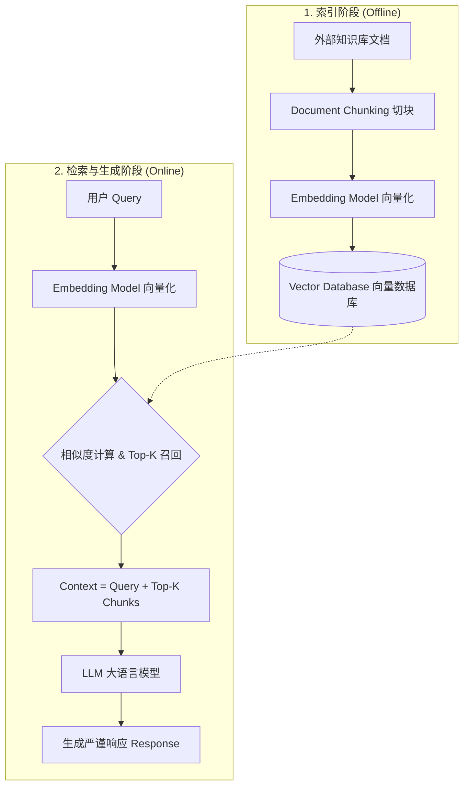

## 0. 先判断它值不值得深挖

- **类别**：**A 类（核心概念，必须深挖）**
- **判断理由**：大模型（LLM）的幻觉问题和知识更新滞后是当前工业界最大的痛点，而 RAG 是目前解决这两大问题最成熟、落地最广的范式。无论是构建智能客服还是企业级知识库，RAG 都是绝对的核心。

---

## 1. 这个知识点解决什么问题？

> **我们遇到了什么麻烦**：
> 大模型（如 GPT-4）虽然强大，但存在几个致命缺陷：首先是“幻觉”，经常一本正经地胡说八道；其次是知识截止日期，无法知道训练之后发生的事情；最后是私有数据问题，企业不可能把核心机密数据放进公开模型里微调。如果我们能让大模型在回答前，先去可靠的数据库里查阅相关资料再作答，这些问题就能迎刃而解。

---

## 2. 为什么它重要？它有什么用？

- **连接大图景**：RAG 桥接了传统信息检索（IR）和现代生成式大语言模型（LLM），是当前 NLP 架构演进的关键节点，也是理解 Agent 记忆机制的基础。
- **实际应用场景**：企业内部知识库问答、法律/医疗垂直领域智能助手、实时联网搜索（如 Bing Chat、Perplexity）。
- **高频题型/任务**：如何优化文档分块（Chunking）、如何选择召回模型（Dense vs Sparse）、如何缓解生成中的幻觉。

---

## 3. 学它之前需要哪些前置知识？

最小必要背景（各 200 字以内）：

1. **[[语言模型生成机制]]**：LLM 本质上是基于前文预测下一个 Token，Prompt 中包含的信息会直接影响其生成概率分布。
2. **[[文本嵌入 (Embeddings)]]**：将文本映射到高维稠密向量空间，使得语义相似的文本在空间中距离更近，这是 Dense Retrieval（稠密检索）的基础。

---

## 4. 用直觉语言解释它

> «“这东西其实就像开卷考试”»

- **直觉类比/几何图像**：LLM 就像是一个记忆力很好的学生，但在闭卷考试时难免会记错或忘了最新的知识。RAG 就是给这个学生配了一个“搜索引擎”+“图书馆”，当被问到一个问题时，先去图书馆把相关的几页书找出来（Retrieval），然后结合这些资料和自己的知识，给出严谨的答案（Generation）。
- **为什么很自然**：让大脑（LLM）专注于推理和归纳，让外部存储（向量数据库）专注于记忆，各司其职。
- **一句话直觉本质**：用外部召回的相关文档来增强大模型的上下文，约束其生成过程。

**RAG 经典工作流 (Mermaid)**:


---

## 5. 正式定义、核心公式、符号解释

### 1. 最核心定义
Retrieval-Augmented Generation (RAG) 是一种结合了信息检索和文本生成的框架，通过给定查询 $q$，从外部语料库 $\mathcal{Z}$ 中检索出相关文档集合 $\mathcal{D}$，并将这些文档与 $q$ 拼接后输入给生成模型，生成最终响应 $y$。

### 2. 核心公式
RAG 模型的条件概率生成公式为：
$$P(y|q) = \sum_{d \in \mathcal{D}} P(d|q) P(y|q, d)$$
在实际工业应用中，通常直接取检索阶段 Top-K 的文档拼接输入，退化为近似（最大化）：
$$y = \text{LLM}(q \oplus d_{1} \oplus d_{2} \dots \oplus d_{k})$$

### 3. 向量维度与张量计算 (Tensor Tracking)
在 Dense Retrieval (如 DPR) 阶段，模型将文本映射到高维稠密空间。对于双塔模型（Bi-encoder）：
- **Query 编码**: `Input $q$: [B, L_q] -> Encoder_Q -> Embedding $E_q$: [B, d_{model}]`
- **Document 编码**: `Input $d$: [B, L_d] -> Encoder_D -> Embedding $E_d$: [B, d_{model}]` (通常事先离线计算并存入向量数据库，规模为 `[N, d_{model}]`)
- **相似度计算 (Dot Product)**: 
  `Score = $E_q \cdot E_d^T$` 
  张量运算维度：`[B, d_{model}] @ [d_{model}, N] -> [B, N]` 
  *（其中 $B$ 是 batch size, $N$ 是知识库文档数，$d_{model}$ 是词向量维度，如 768）*
> 为什么缩放点积注意力/相似度需要除以 $\sqrt{d_{model}}$？因为假设向量元素独立同分布且均值为0、方差为1，两个 $d_{model}$ 维向量的点积结果方差会变成 $d_{model}$。当 $d_{model}$ 较大时，方差很大，输入 softmax 会导致分布极其陡峭，使得梯度几乎为0（梯度消失）。因此除以 $\sqrt{d_{model}}$ 将方差缩放回1。

### 4. 符号说明表

| 符号 | 含义 | 取值范围 / 量纲 | 备注 |
| :--- | :--- | :--- | :--- |
| $q$ | 用户查询 (Query) | 文本字符串 | 输入问题 |
| $d$ | 检索到的文档分块 | 文本字符串 | 知识库 Chunk |
| $y$ | 生成的响应 | 文本字符串 | 最终回答 |
| $P(d\|q)$ | 检索概率得分 | $[0, 1]$ | 由 Retriever (如 DPR) 输出 |

### 5. 常见变体与适用条件
- **适用条件**：依赖外部事实知识、需要高准确性和可解释性溯源的任务。
- **限制条件**：检索强依赖 Document Chunking 的质量和 Embedding 模型的匹配度，且受限于 LLM 的 Context Window 长度。

---

## 6. 推导思路和思想来源

- **最初困难**：直接 Fine-tuning（微调）模型更新知识成本极高，且容易造成灾难性遗忘。
- **直接方法局限**：纯生成模型无法溯源，纯检索系统无法整合多篇文档回答复杂问题。
- **关键“转念”**：不要让模型把世界知识全背下来，而是把模型当成“处理器（CPU）”，外接一个“硬盘（知识库）”。
- **推导主线与动机**：Query -> Retriever -> Top-K Chunks -> Prompt Augmentation -> Generator。
- **数学严谨性 (Pipeline vs Joint Training)**：
  - **Pipeline Training (解耦训练)**：Retriever 和 Generator 独立训练。Retriever 优化相似度 $P(z|x)$，Generator 优化生成概率 $P(y|z, x)$。两者互不干涉。
  - **Joint Training (联合训练，如 REALM, RAG 原始论文)**：将检索过程视为一个隐变量（Latent Variable）模型。目标是最大化边缘似然函数：
    $$P(y|x) = \sum_{z \in \mathcal{Z}} P(z|x) \cdot P(y|z, x)$$
    在反向传播时，生成器的梯度能够回传给检索器，使得检索器不仅能找“字面相似”的文档，更能寻找“对生成最终正确答案 $y$ 有帮助”的文档。
- **为什么自然得到此结论**：因为 transformer 架构支持在 context 中输入大量 token，只要检索准，生成自然顺理成章。

---

## 7. 例子：基础 → 中等 → 实际应用

### 例子 1：基础例子（可手算）
- **题目**：实现一个极简 RAG 的 Prompt 构造过程。
- **解题思路与关键步骤**：
  1. 用户查询 $q$ = "2024年奥运会在哪举办？"
  2. 检索库中找到 $d$ = "2024年夏季奥林匹克运动会将在法国巴黎举行。"
  3. 构造增强提示："基于以下背景知识回答问题。\n背景：{d}\n问题：{q}"
- **最终答案**：输入模型得到回答："2024年奥运会在法国巴黎举办。"
- **易错点**：如果不加入检索文档，老旧模型可能会回答东京或其他错觉答案。
- **🤔 追问**：如果检索到的 $d$ 是完全无关的内容，大模型会怎样？（需要依赖大模型的 instruction following 拒绝回答）。

### 例子 2：中等例子（条件判断与多步推理）
- **题目与完整解答**：如何处理长文档导致向量表达不准的问题？
  **解答**：采用分块（Document Chunking）。按照语义（如换行符）或者固定 Token 长度（如 512）+ 50 Token Overlap 对长文档进行切分。这样可以保证每块的 Embedding 向量表示的语义足够具体，在匹配 Query 时相似度计算更准确。

### 例子 3：实际应用例子（真实场景/代码）
- **实际价值与转化**：
  使用 BM25 (Sparse) + DPR/BGE (Dense) 双路召回机制。在企业搜索中，BM25 保证专有名词的精确匹配，Dense 模型保证语义上的相关性泛化，最后通过 Cross-Encoder 进行重排 (Reranking)，选取 Top-3 的 Chunk 喂给 GPT-4 获得高精度回答。

---

## 8. 常见误区和易混概念

### 误区 1：只要把文档全塞给大模型就行
- **错误直觉**：把整个 PDF 文档直接放进大模型的 128K context 里。
- **为什么错**：长上下文存在 "Lost in the Middle" 现象，即大模型容易忽略中间部分的文档，且极耗费 Token 成本。
- **正确理解**：应该先用廉价且快速的向量检索（Retrieval）召回最相关的少数片段，再交给大模型。

### 概念对比表

| 概念 | 核心问题 | 关键区别 | 典型使用场景 |
| :--- | :--- | :--- | :--- |
| Fine-tuning (微调) | 模型记忆与能力改变 | 改变模型权重，隐式学习知识 | 学风格、领域泛化、任务范式 |
| RAG | 知识获取与事实注入 | 不改变权重，通过提示词显式引入知识 | 客服问答、动态知识库、防幻觉 |

---

## 9. 相关知识点与 Obsidian 双链建议

### 上游依赖
- [[Sentence-BERT]]：一句话说明为什么要链接——理解 Dense Retriever 的训练基础。
- [[BM25算法]]：一句话说明为什么要链接——理解词法层面的稀疏检索原理。

### 下游延伸
- [[Reranking模型]]：一句话说明为什么要链接——解决初筛（召回）精度不够的问题。
- [[Agentic RAG]]：一句话说明为什么要链接——让大模型自己决定何时检索、检索什么的进阶形态。

### 横向关联
- [[长文本大模型]] ↔ [[检索增强生成RAG]]：替代方案对比，超长上下文与精准检索的路线之争。

---

## 10. 闭卷验收（工程/应用模式）

合上笔记，独立完成以下 4 项：

- [ ] **直觉复述**：用大白话解释这个概念在干嘛。
- [ ] **核心公式默写**：写出最重要的 1-2 个公式，并解释所有符号。
- [ ] **关键推导复现**：能讲清楚从直接方法到该方法的那次“转念”。
- [ ] **典型例子复现**：能独立写出第 7 节中的基础/中等例子。

---

## 11. 分级习题与实践

题目来源标注教材章节、项目或作业。

| 题号 | 类型 | 难度 | 来源 | 考查点 |
| :--- | :--- | :--- | :--- | :--- |
| 1 | 概念理解 | 基础 | 常见面试题 | 为什么不用微调代替 RAG |
| 2 | 公式推导 | 中等 | CS224N | DPR 中的负样本构造策略 |
| 3 | 代码实现 | 中等 | LangChain文档 | 编写一个简单的分块和检索管线 |
| 4 | 场景应用 | 较难 | 工程实践 | 召回结果存在冲突怎么处理 |
| 5 | 优化探索 | 挑战 | 前沿论文 | 多跳问题 (Multi-hop) 的检索方案 |

### 题目与解析

#### 1. 为什么不直接用特定领域的语料微调大模型？
> [!question]- 答案与解析（复盘阶段查看）
> - **答案**：微调更新知识成本高，容易遗忘，且生成的答案无法溯源。
> - **解析**：模型参数记忆是隐式的，而 RAG 显式地将文档作为 Context，保证了事实的准确性。
> - **易错原因**：认为微调是万能的知识注入手段。

#### 2. 在训练 DPR (Dense Passage Retriever) 时，In-batch Negatives 机制是什么？
> [!question]- 答案与解析（复盘阶段查看）
> - **答案**：在同一个 batch 内，将其它 query 对应的正样本作为当前 query 的负样本。
> - **解析**：极大提高了负样本采样的效率，使得模型在计算对比损失时能利用矩阵乘法快速完成大量负样本的比对。

#### 3. 用伪代码实现一个带有 Overlap 的 Chunking 函数。
> [!question]- 答案与解析（复盘阶段查看）
> - **答案**：实现滑动窗口机制。
> - **代码片段**：
```python
def chunk_text(text, chunk_size, overlap):
    chunks = []
    i = 0
    while i < len(text):
        chunks.append(text[i:i+chunk_size])
        i += (chunk_size - overlap)
    return chunks
```

#### 4. 当 RAG 召回的多个 Chunk 中，信息存在矛盾时，LLM 该如何处理？
> [!question]- 答案与解析（复盘阶段查看）
> - **答案**：需要在 Prompt 中注入判别指令。
> - **解析**：可以要求大模型对比不同来源的时间戳（如有），或者在回答中说明“存在争议：资料A显示...，资料B显示...”。

#### 5. 对于 "周杰伦老婆的妈妈叫什么？" 这样的问题，传统 RAG 会遇到什么挑战？
> [!question]- 答案与解析（复盘阶段查看）
> - **答案**：Multi-hop 困境，无法一次检索得到答案。
> - **解析**：需要迭代式 RAG（如 DSPy 中的 ReAct 架构），先检索周杰伦老婆是谁，再将结果拼成新的 Query 去检索她的妈妈是谁。

---

## 12. 我的主动回忆区（Academic Hardcore）

> 请不要翻看上文，补全以下硬核推导与细节：

1. **RAG 条件生成概率**：RAG 的严格条件概率生成公式是 $P(y|q) = \\sum_{d \\in \\mathcal{D}} \\text{\\_\\_\\_\\_\\_} P(y|q, d)$，但在工程上往往退化为直接拼接 Top-K。
2. **张量维度推演 (DPR)**：若 Query 经过 Encoder 后的维度为 $E_q \\in \\mathbb{R}^{B \\times d}$，知识库中共 $N$ 个 Chunk，其离线计算的 Embedding 矩阵 $E_D \\in \\mathbb{R}^{N \\times d}$。在一次 Batch 检索中计算相似度矩阵时的运算是 $\\text{Score} = \\text{\\_\\_\\_\\_\\_} \\times \\text{\\_\\_\\_\\_\\_}^T$，输出相似度矩阵维度为 \\_\\_\\_\\_\\_\\_\\_\\_。
3. **数学直觉**：为什么在计算注意力或相似度得分时，若采用 Dot-Product，常常需要除以 $\\sqrt{d}$？
   A: 因为点积操作是对应维度相乘后相加，假设输入向量元素独立同分布，相加后方差会扩大 \\_\\_\\_\\_\\_\\_ 倍，导致分布过于极端，送入 Softmax 后会使梯度 \\_\\_\\_\\_\\_\\_。
4. **架构差异**：在 RAG 的召回阶段，相比 Cross-encoder，Bi-encoder 的最大优势是：可以将 $E_D$ 的计算 \\_\\_\\_\\_\\_\\_\\_\\_，从而能够接入 Faiss 等向量数据库进行 ANN（近似最近邻）搜索。
5. **代码填空 (Chunking)**：
   在滑动窗口切词算法中，若 `chunk_size`=512，`overlap`=50。循环游标 `i` 的步进应当写成 `i += \\_\\_\\_\\_\\_\\_\\_\\_\\_\\_`。

### 卡点与深入推导区
- [在此记录手动推演 Multi-hop RAG 链式梯度的卡点或实验遇到的 GPU OOM 问题]


---

## 13. 给 Obsidian 的归档建议

- **适合文件夹**：`02-Knowledge/🧠 学习系统/08-NLP全栈/检索增强生成/`
- **关联已有笔记**：`[[DPR]]`, `[[LangChain]]`
- **建议标签**：`#学习` `#NLP` `#CS224N` `#RAG`
- **拆分建议**：DPR 原理和向量数据库底层（如 HNSW 算法）可独立成卡。
