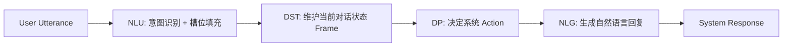

# 08-NLP全栈-对话系统

---

## 1. 这个知识点解决什么问题？

> **我们遇到了什么麻烦**：
> 人类对话包含闲聊 (Open-domain Chit-chat) 与任务型 (Task-Oriented Dialogue, TOD) 两大类型。在任务型对话中（如机票预订、酒店退退订），系统必须维护多轮对话状态 (Dialogue State Tracking, DST)、跨轮次跟踪槽位 (Slots) 填充情况，并做出策略决策 (Dialogue Policy)。如何构建稳健的多轮对话架构是核心课题。

---

## 2. 为什么它重要？它有什么用？

- **连接大图景**：它是智能客服、语音助手（Siri, Alexa）、任务型 Agent 工作流的工业界应用典范。
- **两大主流分类**：
  1. **任务型对话 (TOD)**：目标明确（如订票），传统包含 NLU -> DST -> DP -> NLG 模块化流水线。
  2. **开放域闲聊**：无固定目标，基于端到端 Seq2Seq / LLM 进行多轮生成。

---


### 3.1 形式化对话状态追踪 (DST) 与策略优化数学表示

任务型对话系统 (TOD) 的状态更新在时刻 $t$ 满足：
$$s_t = \text{DST}(s_{t-1}, u_t, m_{t-1})$$
其中 $u_t$ 为用户输入，$m_{t-1}$ 为上一轮系统动作，$s_t \in \mathcal{S}$ 为当前对话状态（如槽位-值对 Slot-Value Pairs）。

对话策略 (Dialogue Policy) 选择最优系统动作 $a_t \in \mathcal{A}$：
$$a_t = \pi(s_t) = \arg\max_a Q^*(s_t, a)$$

自然语言生成 (NLG) 模块基于系统动作生成响应文本：
$$y_t \sim P(\cdot \mid a_t, s_t)$$


## 3. 任务型对话 (TOD) 四大核心模块



### 1. 对话状态追踪 (DST) 示例

- User: `"Book a flight to Boston for next Monday."`
- **DST Frame**:
  - `destination`: `"Boston"`
  - `date`: `"2026-08-10"`
  - `origin`: `null` (尚待追问)

---

## 4. Python 代码示例：基于 Rule/LLM 的对话状态更新

```python
class DialogueStateTracker:
    def __init__(self):
        self.state = {"destination": None, "date": None, "passengers": 1}

    def update(self, nlu_output: dict):
        for slot, value in nlu_output.get("slots", {}).items():
            if value is not None:
                self.state[slot] = value
        return self.state

    def get_next_action(self):
        if self.state["destination"] is None:
            return "ASK_DESTINATION"
        if self.state["date"] is None:
            return "ASK_DATE"
        return "CALL_BOOKING_API"

dst = DialogueStateTracker()
dst.update({"slots": {"destination": "Seattle"}})
print("Current State:", dst.state)
print("Next System Action:", dst.get_next_action()) # ASK_DATE
```

---


## 5. 常见误区与对比矩阵

| 对话系统类型 | 核心模块架构 | 评测指标 | 工业落地局限与挑战 |
| :--- | :--- | :--- | :--- |
| **任务型对话 (TOD)** | NLU + DST + DP + NLG 管道 / 端到端 | Slot Accuracy, Goal Success Rate | 级联误差累积，领域迁移能力差 |
| **开放域闲聊 (Open-Domain)** | Encoder-Decoder / Only-Decoder LLM | BLEU, ROUGE, Human Evaluation | 安全合规风险、知识幻觉与一致性缺失 |
| **问答型对话 (QA Dialogue)** | RAG 检索器 + 读者生成器 | Precision@K, F1, MRR | 知识更新滞后、长文档跨段落推导困难 |


## 6. 闭卷自测与验收入口

请在不查阅资料的前提下尝试解答以下问题，或完成对应关联作业：
1. 本知识点的核心定义与推导公式是什么？
2. 相比传统方法，它的核心优势与工程选型 Trade-offs 是什么？
3. 如何在 PyTorch / Python 中实现并校验其关键张量维度与运算逻辑？


---

## 🛠️ 我的主动回忆区 (Guided Recall)

- [ ] **问题 1**：请不看笔记，口述《对话系统》的核心核心定义与求解动机。
- [ ] **问题 2**：算法或推导的核心计算公式是什么？其中关键变量代表什么物理含义？
- [ ] **问题 3**：在实际工程落地或模型训练中，该方法最常见的 2 个踩坑点或退化场景是什么？


---

## 🃏 闭卷提取练习 (Self-Quiz)

1. **概念自测**：说明《对话系统》的核心机制及其与上下游模块的连接逻辑。
2. **代数/代码自测**：手写关键代数推导步骤或 PyTorch/Python 核心实现伪代码。
3. **防错自测**：如果输入数据出现极小值或极大值离群点，该模块会发生什么异常？如何做数值稳定防护？


---

## 🛠️ 学完后可以完成

```dataview
LIST
FROM "03-Projects"
WHERE contains(requires, this.file.link)
SORT assignment_level ASC, file.name ASC
```
