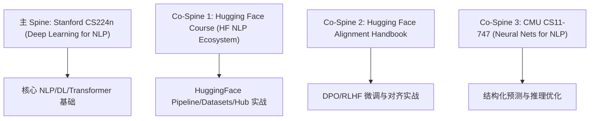

# 📚 08-NLP全栈 教材挂载与开源来源索引

> 本页面为 `08-NLP全栈` 课程的唯一权威来源注册表，记录主教材 (Spine)、辅助教材 (Co-Spine) 及名校开源作业/开源项目来源映射关系。

---

## 🎯 一、最少充分来源架构 (Spine & Co-Spines)

### 1.1 主 Spine: Stanford CS224n
- **课程名称**：Stanford CS224n: Natural Language Processing with Deep Learning
- **官方主页**：[https://web.stanford.edu/class/cs224n/](https://web.stanford.edu/class/cs224n/)
- **代码仓库**：[https://github.com/stanfordnlp/cs224n-assignments](https://github.com/stanfordnlp/cs224n-assignments)
- **挂载范围**：全课核心概念底座（Word2Vec, GloVe, BPE, RNN/Seq2Seq, Transformer, MinBERT, PEFT/LoRA, RAG）。

### 1.2 Co-Spine 1: Hugging Face NLP Course
- **开源主页**：[https://huggingface.co/learn/nlp-course/](https://huggingface.co/learn/nlp-course/)
- **代码仓库**：[https://github.com/huggingface/course](https://github.com/huggingface/course)
- **挂载范围**：分词算法（WordPiece/Unigram）、Transformers 库、Tokenizers、Datasets、Evaluator 及文本分类/情感分析实战。

### 1.3 Co-Spine 2: Hugging Face Alignment Handbook & TRL
- **开源主页**：[https://github.com/huggingface/alignment-handbook](https://github.com/huggingface/alignment-handbook)
- **挂载范围**：大模型指令微调 (SFT)、DPO (Direct Preference Optimization)、RLHF/PPO、GRPO 与对齐评测。

### 1.4 Co-Spine 3: CMU CS11-747
- **课程名称**：CMU CS11-747: Neural Networks for NLP
- **官方主页**：[http://www.phontron.com/class/nn4nlp2024/](http://www.phontron.com/class/nn4nlp2024/)
- **挂载范围**：序列标注 (CRF)、句法分析、解码采样策略 (Beam Search/Nucleus) 与注意力机制优化。

---

## 🔗 二、知识卡与来源章节覆盖矩阵

| 本地阶段目录 | 本地核心知识点卡片 | 对应开源来源 | 来源章节/讲次/作业链接 |
| :--- | :--- | :--- | :--- |
| **00-前置知识** | PyTorch与NLP编程基础等 3 卡 | Stanford CS224n | PyTorch Review / Python Tutorial |
| **01-基础准备** | NLP数学基础, 倒排索引等 4 卡 | Jurafsky & Martin SLP3 | Chapter 2-3 Vector Semantics |
| **02-传统NLP方法** | WordPiece与SentencePiece, 序列标注等 8 卡 | Hugging Face Course / SLP3 | Tokenization / HMM / CRF Chapter |
| **03-深度学习NLP基础** | Word2Vec, GloVe, RNN, Seq2Seq 等 8 卡 | Stanford CS224n | Lecture 1-6 (Word Vectors, RNNs) |
| **04-Transformer与预训练** | Self-Attention, Transformer, FlashAttention, BERT 等 10 卡 | Stanford CS224n / FlashAttn | Lecture 7-10 (Transformers, MinBERT) |
| **05-大语言模型与前沿** | DPO对齐, AWQ量化, LoRA, RAG, Agent 等 9 卡 | HF Alignment Handbook / CS224n | Lecture 11-15 (PEFT, Alignment, RAG) |
| **06-专业方向深入** | 解码采样策略, 信息抽取, 问答系统等 5 卡 | CMU CS11-747 / SLP3 | Generation Decoding & QA Chapters |

---

## 📜 三、许可与版权声明

- 本课程涉及的开源代码与讲义均遵循 **CC BY-NC 4.0** 或 **MIT License** 许可。
- 本地笔记为自主知识构建与推导，保持对原课程与第一方讲义的显式引用。
