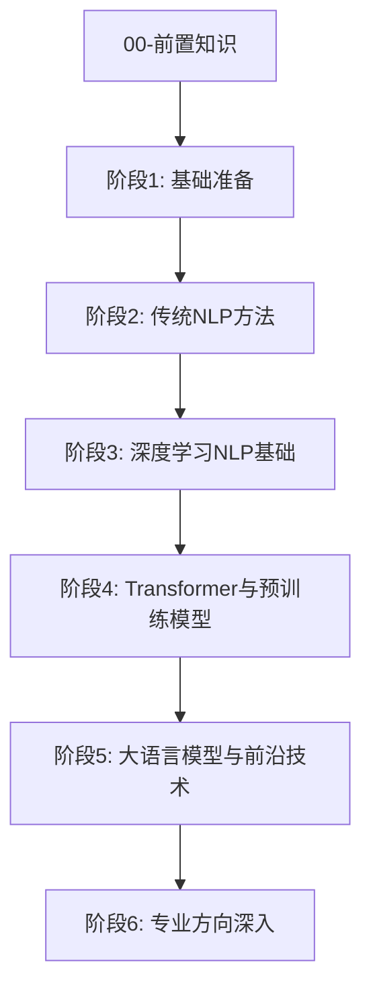

# 🗺️ 08-NLP全栈学习路径

> **课程定位**：涵盖传统统计 NLP（词性标注、句法分析、WordPiece）、深度学习 NLP（Word2Vec、Seq2Seq+Attention）、Transformer 预训练模型（BERT、GPT、FlashAttention）以及前沿大语言模型技术（DPO 对齐、AWQ 量化、PEFT、RAG、Agent）的系统化自学路线。

---

## 🎯 课程目标与能力树

完成本课程后，学习者将具备以下核心能力：
1. **理论底座**：掌握语言学基础、词向量理论、Seq2Seq 机制、Transformer / Self-Attention 的数学表达、DPO 隐式 Reward 推导与 FlashAttention 在线 Softmax 算法。
2. **工程实现**：能用 PyTorch 手写多头自注意力机制、BertLayer、LoRA 算子、KV Cache 提速解码以及 INT4 非对称量化。
3. **前沿调优**：熟练运用 Hugging Face Alignment Handbook / TRL 与 Transformers 生态系统进行 SFT 指令微调、DPO 偏好对齐、RAG 检索增强与 Agent 智能体构造。

---

## 🧭 最低前置知识要求

在开启第一阶段前，请确保通过以下前置能力的自测：
- **数学基础**：线性代数（矩阵乘法、特征值解）、概率论与信息论（条件概率、交叉熵、KL 散度）。
- **编程基础**：Python 面向对象编程、PyTorch 张量（Tensor）形状变换 (`transpose`, `permute`, `view`, `reshape`) 与自动求导。
- 📖 **前置导览与地图**：[[🧭 08-NLP全栈-前置知识]]

---

## 📚 官方主教材与挂载源

- **主 Spine**：Stanford CS224n (*Deep Learning for Natural Language Processing*).
- **Co-Spine / 实践源**：Hugging Face Course & Hugging Face Alignment Handbook.
- 📖 **教材挂载索引**：[[📚 教材挂载索引|08-NLP全栈 - 教材挂载索引与白名单]]

---

## 🗺️ 阶段路线与知识卡清单

### 阶段 0：前置与工具准备
- 入口：[[🧭 08-NLP全栈-前置知识]]
- 核心卡：[[08-NLP全栈-前置-PyTorch与NLP编程基础]]、[[08-NLP全栈-前置-概率论与信息论基础]]、[[08-NLP全栈-前置-线性代数与张量运算]]

### 阶段 1：语言学与数学基础准备
- 入口：[[🧭 阶段1-基础准备]]
- 核心卡：[[08-NLP全栈-语言学基础]]、[[08-NLP全栈-Python编程与NLP工具]]、[[08-NLP全栈-NLP数学基础]]、[[08-NLP全栈-倒排索引]]

### 阶段 2：传统统计 NLP 方法
- 入口：[[🧭 阶段2-传统NLP方法]]
- 核心卡：[[08-NLP全栈-文本预处理]]、[[08-NLP全栈-文本表示方法]]、[[08-NLP全栈-子词分词]]、[[08-NLP全栈-WordPiece与SentencePiece分词]]、[[08-NLP全栈-统计机器学习]]、[[08-NLP全栈-序列标注]]、[[08-NLP全栈-句法分析]]、[[08-NLP全栈-主题模型]]

### 阶段 3：深度学习 NLP 基础
- 入口：[[🧭 阶段3-深度学习NLP基础]]
- 核心卡：[[08-NLP全栈-词向量与Word2Vec]]、[[08-NLP全栈-GloVe与稠密向量]]、[[08-NLP全栈-CNN在NLP中的应用]]、[[08-NLP全栈-循环神经网络RNN]]、[[08-NLP全栈-Seq2Seq与注意力机制]]、[[08-NLP全栈-Attention计算]]、[[08-NLP全栈-文本分类与情感分析]]、[[08-NLP全栈-数据集与评测指标]]

### 阶段 4：Transformer 与预训练模型
- 入口：[[🧭 阶段4-Transformer与预训练模型]]
- 核心卡：[[08-NLP全栈-Self-Attention自注意力机制]]、[[08-NLP全栈-Transformer架构]]、[[08-NLP全栈-FlashAttention与KVCache显存优化]]、[[08-NLP全栈-BERT模型]]、[[08-NLP全栈-BERT及其变体]]、[[08-NLP全栈-BERT与GPT对比]]、[[08-NLP全栈-GPT系列]]、[[08-NLP全栈-其他预训练模型]]、[[08-NLP全栈-HuggingFace生态系统]]、[[08-NLP全栈-RoPE旋转位置编码]]

### 阶段 5：大语言模型与前沿技术
- 入口：[[🧭 阶段5-大语言模型与前沿技术]]
- 核心卡：[[08-NLP全栈-提示工程]]、[[08-NLP全栈-思维链与推理大模型]]、[[08-NLP全栈-指令微调与对齐]]、[[08-NLP全栈-DPO直接偏好优化与RLHF对齐]]、[[08-NLP全栈-参数高效微调PEFT]]、[[08-NLP全栈-检索增强生成RAG]]、[[08-NLP全栈-LLM推理优化]]、[[08-NLP全栈-LLM量化算法AWQ与GPTQ]]、[[08-NLP全栈-Agent与工具使用]]、[[08-NLP全栈-多模态NLP]]

### 阶段 6：专业应用领域深入
- 入口：[[🧭 阶段6-专业方向深入]]
- 核心卡：[[08-NLP全栈-信息抽取]]、[[08-NLP全栈-对话系统]]、[[08-NLP全栈-文本生成]]、[[08-NLP全栈-文本生成解码与采样策略]]、[[08-NLP全栈-问答系统]]

---

## 🧪 阶梯作业与全量验收体系

作业统一放置于 `03-Projects/08-NLP全栈/`，完整索引见：[[🧭 课程作业总索引]]

| 层级 | 规范作业名称 | 关键考核技能 | 对应名校开源来源 |
|:---|:---|:---|:---|
| **课后作业 1** | [[03-Projects/08-NLP全栈/课后作业/08-NLP全栈-课后作业-01-词向量与文本表征\|01-词向量与文本表征]] | 手写 Word2Vec / TF-IDF 与 余弦相似度计算 | Stanford CS224n Assignment 1 |
| **课后作业 2** | [[03-Projects/08-NLP全栈/课后作业/08-NLP全栈-课后作业-02-子词分词与BPE算法\|02-子词分词与BPE算法]] | 纯 Python 从零手写 BPE 分词器训练与 encode/decode | Hugging Face Tokenizers Project |
| **课后作业 3** | [[03-Projects/08-NLP全栈/课后作业/08-NLP全栈-课后作业-03-RoPE旋转位置编码与注意力掩码\|03-RoPE旋转位置编码]] | PyTorch 手写 RoPE 旋转位置编码与 Causal Attention Mask | Meta LLaMA Architecture Repo |
| **课后作业 4** | [[03-Projects/08-NLP全栈/课后作业/08-NLP全栈-课后作业-04-LoRA参数高效微调算子\|04-LoRA参数高效微调]] | PyTorch 手写 `LoRALinear` 旁路算子与 Merge 权重融合 | Hugging Face PEFT Repo |
| **课后作业 5** | [[03-Projects/08-NLP全栈/课后作业/08-NLP全栈-课后作业-05-传统NLP与序列标注实战\|05-传统NLP与序列标注]] | 倒排索引构建、BM25 检索算法与 HMM Viterbi POS 标注 | Stanford CS224n / NLTK Lab |
| **课后作业 6** | [[03-Projects/08-NLP全栈/课后作业/08-NLP全栈-课后作业-06-文本分类与评测指标\|06-文本分类与评测指标]] | 1D-TextCNN 分类器、BLEU-4 / ROUGE-L 手算与 Prompt 分类 | Hugging Face Course Chapter 1-3 |
| **阶段作业 1** | [[03-Projects/08-NLP全栈/阶段作业/08-NLP全栈-阶段作业-01-RNN与Seq2Seq注意力\|01-RNN与Seq2Seq注意力]] | 手写 BiLSTM + Bahdanau Attention 机器翻译 | Stanford CS224n Assignment 3 |
| **阶段作业 2** | [[03-Projects/08-NLP全栈/阶段作业/08-NLP全栈-阶段作业-02-Transformer与MinBERT实现\|02-Transformer与MinBERT]] | 手写 Multi-Head Attention, BertLayer 并微调 SST-2 (Acc $\ge 85\%$) | Stanford CS224n Assignment 5 |
| **阶段作业 3** | [[03-Projects/08-NLP全栈/阶段作业/08-NLP全栈-阶段作业-03-大模型微调对齐与推理评估\|03-大模型微调对齐与推理]] | DPO 损失算子、KV Cache 提速解码、Top-P 采样与 W4A16 量化 | Hugging Face Alignment Handbook |
| **大作业** | [[03-Projects/08-NLP全栈/大作业/08-NLP全栈-大作业-稀疏检索到Transformer文本误差审计\|稀疏检索到Transformer误差审计]] | BM25 + FAISS 混合检索、RRF 融合、Cross-Encoder 重排与误差审计 | Stanford CS224n Capstone Lab |

---

## 🏆 结课验收标准 (Rubric 100 分)

1. **理论关 (40分)**：通过全部阶段 MOC 的闭卷提取自测，知识卡 Guided Recall 正确率 $\ge 90\%$。
2. **代码关 (30分)**：完成 `阶段作业-02-Transformer与MinBERT` 和 `阶段作业-03-大模型微调对齐与推理`，并通过全部单元测试断言。
3. **综合关 (30分)**：大作业在独立测试集中准确率/Recall 达到 Baseline，提交无前视/泄漏审计报告。
