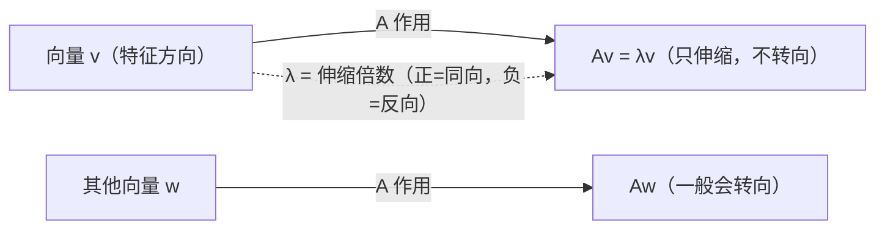

# 特征值与特征向量

> **核心问题**：线性变换作用在哪些方向上"只伸缩、不转向"？——$A\mathbf{v}=\lambda\mathbf{v}$。

## 0. 学习边界

| 分类 | 评估 |
|:--|:--|
| 理由 | 几乎一切后续主题（3.8-3.11、阶段 IV 谱理论）都依赖特征值语言 |
| 投入建议 | 必须能求特征值/特征向量、理解特征空间，并证明"不同特征值的特征向量线性无关" |

## 1. 这个知识点解决什么问题？

阶段 II 用矩阵表示 $T$（选基后 $A$）。但同一个 $T$ 换基后有不同矩阵 $P^{-1}AP$——**哪个表示最本质**？特征值给答案：$T$ 在某些方向（特征向量）上只是"数乘 $\lambda$"。找到这些方向和数值，矩阵的"骨架"（对角化、Jordan 形）就暴露出来。$A\mathbf{v}=\lambda\mathbf{v}$ 是线性代数最核心的方程。

## 2. 它为什么重要？它有什么用？

- **对角化钥匙**：$n$ 个无关特征向量 ⟹ $A=P\Lambda P^{-1}$（3.8）——$A^k=P\Lambda^kP^{-1}$ 使矩阵幂秒算。
- **动力学**：$\dot{\mathbf{x}}=A\mathbf{x}$ 的解由特征值的指数决定——稳定性 = 特征值实部符号。
- **谱分解**：对称矩阵 $A=Q\Lambda Q^T$（阶段 IV 主轴定理）。
- **SVD/主成分**：$A^TA$ 的特征值（阶段 IV）。
- **应用**：PageRank、马尔可夫链平稳分布、结构力学振动频率。

## 3. 学它之前需要哪些前置知识？

1. [[线性映射的矩阵表示|线性映射的矩阵表示]]：$T$ 的矩阵版本。
2. [[行列式的定义|行列式的定义]]：$\det(A-\lambda I)$ 的计算基础。
3. [[基变换与坐标变换|基变换与坐标变换]]：换基 $P^{-1}AP$。

## 4. 定义复述

### 4.1 特征值与特征向量

$A\in\mathbb{C}^{n\times n}$（或 $\mathbb{R}$）。非零向量 $\mathbf{v}\neq\mathbf{0}$ 是 $A$ 的**特征向量**，$\lambda$ 是对应**特征值**，若

$$A\mathbf{v}=\lambda\mathbf{v}\iff (A-\lambda I)\mathbf{v}=\mathbf{0}$$

### 4.2 特征方程

$\mathbf{v}\neq\mathbf{0}$ 是 $(A-\lambda I)$ 零空间非零元的充要条件是 $A-\lambda I$ 奇异：

$$\det(A-\lambda I)=0$$

（$n$ 次多项式，按代数重数计恰有 $n$ 个复根。）

### 4.3 特征空间

对应 $\lambda$ 的**特征空间** $E_\lambda=\ker(A-\lambda I)=\{\mathbf{v}:A\mathbf{v}=\lambda\mathbf{v}\}$（含零向量）——是子空间（阶段 II 核的性质）。

### 4.4 术语

- 特征多项式 $p_A(\lambda)=\det(A-\lambda I)$；
- 代数重数 $\operatorname{am}(\lambda)$：$p_A$ 中 $(\lambda-\lambda_0)$ 的幂次；
- 几何重数 $\operatorname{gm}(\lambda)=\dim E_\lambda$；
- 恒有 $1\le\operatorname{gm}(\lambda)\le\operatorname{am}(\lambda)$。

### 4.5 计算步骤

1. 解 $\det(A-\lambda I)=0$ 得特征值；
2. 对每个 $\lambda$ 解 $(A-\lambda I)\mathbf{v}=\mathbf{0}$ 得特征空间基。

例：$A=\begin{bmatrix}4&2\\2&3\end{bmatrix}$：$\det\begin{bmatrix}4-\lambda&2\\2&3-\lambda\end{bmatrix}=(4-\lambda)(3-\lambda)-4=\lambda^2-7\lambda+8$，特征值 $\lambda=(\text{7}\pm\sqrt{17})/2$；$\lambda_1\approx5.56$ 时代入求 $(A-\lambda_1I)\mathbf{v}=0$ 得特征方向。

## 5. 直觉与图像

- 特征向量 = 变换的"不动方向"（只伸缩、不转）；$\lambda$ = 伸缩倍数。
- 旋转 $90°$：无实特征值（$|\lambda|=1$ 的复特征值）——"转圈"没有不动方向。
- 特征空间 = 所有沿同一方向伸缩的向量集合（一条直线/平面）。
- **不是所有方向都特殊**：只有少数"主方向"是特征方向。

**特征方向的几何**（矩阵在某方向退化为标量）：



> **一句话本质**：$A\mathbf{v}=\lambda\mathbf{v}$ = 在特征方向上，矩阵退化为一个数——把"矩阵"压缩成"标量"。

## 6. 定理陈述与证明重建

### 定理 1：不同特征值的特征向量线性无关

**前提**：$\lambda_1,\dots,\lambda_k$ 两两不同，$A\mathbf{v}_i=\lambda_i\mathbf{v}_i$；**结论**：$\mathbf{v}_1,\dots,\mathbf{v}_k$ 线性无关。

**证明主线**：设 $c_1\mathbf{v}_1+\cdots+c_k\mathbf{v}_k=\mathbf{0}$。左乘 $A$ 得 $\sum c_i\lambda_i\mathbf{v}_i=\mathbf{0}$；与 $\lambda_k$ 倍的原式相减消去 $\mathbf{v}_k$：$\sum_{i<k}c_i(\lambda_i-\lambda_k)\mathbf{v}_i=\mathbf{0}$。归纳假设 $\mathbf{v}_1,\dots,\mathbf{v}_{k-1}$ 无关 ⟹ 全部系数为 0，进而 $c_k=0$。$\square$

**关键"转念"**：用 $A$ 作用产生"特征值系数"，再与 $\lambda_k$ 倍原式相减——**Vandermonde 型消去**。

### 定理 2：$A$ 与 $A^T$ 特征值相同

**证明主线**：$\det(A^T-\lambda I)=\det((A-\lambda I)^T)=\det(A-\lambda I)$（转置行列式不变，3.2）。$\square$

### 定理 3：三角矩阵特征值 = 对角元

**证明主线**：$\det(A-\lambda I)$ 对上三角是 $\prod(a_{ii}-\lambda)$（3.1 定理 2）。$\square$

## 7. 经典反例库

### 反例 1：旋转矩阵无实特征值

$R=\begin{bmatrix}0&-1\\1&0\end{bmatrix}$：$\det(R-\lambda I)=\lambda^2+1=0$ 无实根——特征值 $i,-i$ 在 $\mathbb{C}$。**实矩阵的复特征值成共轭对出现**。

### 反例 2：$\mathbf{v}=\mathbf{0}$ 不是特征向量

零向量满足 $A\mathbf{0}=\lambda\mathbf{0}$ 但定义要求非零——特征空间含零向量，特征向量不含。

### 反例 3：$\operatorname{gm}<\operatorname{am}$ 的情形

$A=\begin{bmatrix}2&1\\0&2\end{bmatrix}$：特征多项式 $(\lambda-2)^2$，$\operatorname{am}(2)=2$，但 $\ker(A-2I)=\operatorname{span}\{(1,0)\}$ 一维，$\operatorname{gm}(2)=1$——不可对角化（缺陷矩阵，3.8/3.10）。

## 8. 条件变式

| 变式方向 | 具体变化 | 影响 |
|:--|:--|:--|
| 弱化：实矩阵 | 特征值可能为复 | 共轭成对 |
| 加强：对称矩阵 | 特征值全实 | 谱定理（阶段 IV） |
| 换对象：线性映射 $T$ | 不选基也有特征值 | 算子理论（Hefferon Ch.5） |
| 换视角：$A^{-1}$ | $\lambda\neq0$ 时特征值 $1/\lambda$ | 逆矩阵谱 |
| 推广：$A^k$ | 特征值 $\lambda^k$ | 矩阵幂计算 |

## 9. 相关知识点与 Obsidian 双链建议

- [[线性映射的矩阵表示|线性映射的矩阵表示]]、[[行列式的定义|行列式的定义]] — 上游
- [[特征多项式与特征值性质|特征多项式与特征值性质]] — 下游：$\det(A-\lambda I)$ 的展开
- [[相似对角化条件与判定|相似对角化条件与判定]] — 下游：$n$ 个无关特征向量
- [[Jordan标准形|Jordan 标准形]] — 下游：缺陷矩阵的补全
- [[基变换与坐标变换|基变换与坐标变换]] — 横向：特征值在相似下不变
- 阶段 IV：[[实对称矩阵与谱定理|谱分解]]、[[奇异值分解(SVD)|SVD]]

## 10. 闭卷验收（数学模式）

- [ ] **定义默写**：$A\mathbf{v}=\lambda\mathbf{v}$、特征方程、特征空间、代数/几何重数。
- [ ] **证明**：不同特征值特征向量无关；$A$ 与 $A^T$ 特征值相同。
- [ ] **计算**：给 $3\times3$ 矩阵求全部特征值与特征空间。
- [ ] **反例**：旋转矩阵无实特征值；$\operatorname{gm}<\operatorname{am}$。

## 11. 分级习题

| 等级 | 题目 | 来源 |
|:--|:--|:--|
| ★ | 求 $\begin{bmatrix}2&0\\0&3\end{bmatrix}$ 与 $\begin{bmatrix}0&1\\1&0\end{bmatrix}$ 的特征值 | Hefferon §5.1 |
| ★★ | 证明：上三角矩阵的特征值 = 对角元 | MIT 18.06 Lec 21 |
| ★★★ | 证明不同特征值特征向量线性无关（归纳法） | Hefferon §5.1 |
| ★★★★ | 若 $A^2=A$（幂等），证明特征值只能是 0 或 1，且 $V=E_0\oplus E_1$ | 高等代数（第5版） |

## 12. 我的主动回忆区

<details>
<summary>🔄 核对要点（先默写，再展开比对）</summary>


- [ ] **定义默写**：$A\mathbf{v}=\lambda\mathbf{v}$、特征方程、特征空间、代数/几何重数。
- [ ] **证明**：不同特征值特征向量无关；$A$ 与 $A^T$ 特征值相同。
- [ ] **计算**：给 $3\times3$ 矩阵求全部特征值与特征空间。
- [ ] **反例**：旋转矩阵无实特征值；$\operatorname{gm}<\operatorname{am}$。

</details>

> 不看上文：写定义与特征方程；证明无关性；求旋转矩阵特征值；举例 $\operatorname{gm}<\operatorname{am}$。

## 13. 学完后可以完成

```dataview
LIST
FROM "03-Projects"
WHERE contains(requires, this.file.link)
SORT assignment_level ASC, file.name ASC
```

---
*创建于：2026-08-06 | 来源：Hefferon Ch.5 §5.1 + MIT 18.06SC Lec 21 + 高等代数（第5版）；旧卡（特征值与特征向量）迁移/重写，旧空壳（特征向量空间）并入本卡特征空间一节，于 2026-08-06 清退*

