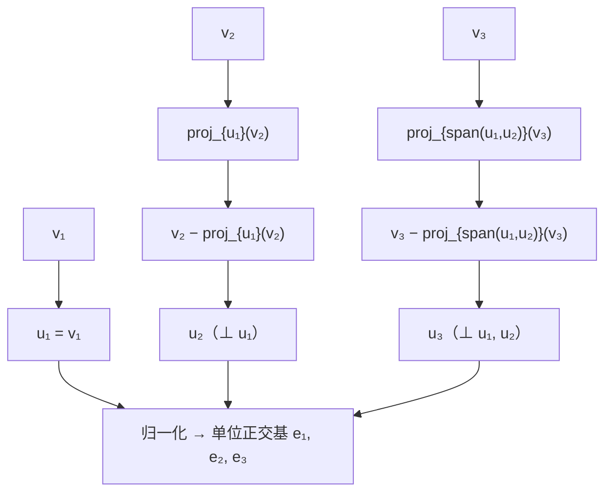

# Gram-Schmidt 正交化

> **核心问题**：给一组线性无关的向量，怎么造出一组"同样张成、但两两垂直且单位长"的向量？——Gram-Schmidt 算法。

## 0. 学习边界

| 分类 | 评估 |
|:--|:--|
| 理由 | 每个内积空间都有正交基（由 G-S 构造）；$P=QQ^T$、最小二乘、QR 全部依赖它 |
| 投入建议 | 必须能手算 G-S（含归一化）、理解"减去投影"的几何，并联系 QR |

## 1. 这个知识点解决什么问题？

正交基的坐标 = 投影系数，计算极简；但任意基通常不正交。本卡给出**算法**：从任意无关组 $\mathbf{v}_1,\dots,\mathbf{v}_k$ 出发，依次"减去在前面的正交方向上的投影"，得到正交组，再归一化。保证 $\operatorname{span}\{\mathbf{q}_1,\dots,\mathbf{q}_i\}=\operatorname{span}\{\mathbf{v}_1,\dots,\mathbf{v}_i\}$ 对每个 $i$ 成立。

## 2. 它为什么重要？它有什么用？

- **正交基存在性**：任何有限维内积空间有 ONB——理论基石。
- **QR 分解**：$A=QR$，$R$ 上三角——数值线性代数主力。
- **简化投影**：ONB 下 $P=QQ^T$（特例）。
- **应用**：多项式正交化（Legendre）、数值稳定性（修正 G-S）、特征值迭代（Arnoldi/Lanczos）。

## 3. 学它之前需要哪些前置知识？

1. [[正交投影与正交分解|正交投影与正交分解]]：投影公式。
2. [[正交与正交补|正交与正交补]]：正交性。
3. [[线性无关与线性相关|线性无关]]（阶段 I）：无关组假设。

## 4. 定义复述

### 4.1 经典 Gram-Schmidt

输入：线性无关组 $\mathbf{v}_1,\dots,\mathbf{v}_k$。输出：正交组 $\mathbf{w}_1,\dots,\mathbf{w}_k$（后归一化 $\mathbf{q}_i=\mathbf{w}_i/\lVert\mathbf{w}_i\rVert$）。

$$\mathbf{w}_1=\mathbf{v}_1,\qquad \mathbf{w}_i=\mathbf{v}_i-\sum_{j=1}^{i-1}\frac{\langle\mathbf{v}_i,\mathbf{w}_j\rangle}{\lVert\mathbf{w}_j\rVert^2}\mathbf{w}_j$$

即：从 $\mathbf{v}_i$ 中减去它在前面每个 $\mathbf{w}_j$ 方向上的投影。

### 4.2 例子（$\mathbb{R}^2$）

$\mathbf{v}_1=(1,1)$，$\mathbf{v}_2=(1,0)$：
- $\mathbf{w}_1=(1,1)$；
- $\mathbf{w}_2=(1,0)-\frac{1}{2}(1,1)=(\tfrac12,-\tfrac12)$；
- 归一化：$\mathbf{q}_1=(\frac1{\sqrt2},\frac1{\sqrt2})$，$\mathbf{q}_2=(\frac1{\sqrt2},-\frac1{\sqrt2})$。

验证：$\langle\mathbf{q}_1,\mathbf{q}_2\rangle=\frac12-\frac12=0$ ✓。

### 4.3 修正 Gram-Schmidt（数值稳定版）

在第 $i$ 步内先对每个 $j<i$ 逐次减去投影并立即更新 $\mathbf{v}_i$（避免浮点误差累积），数学上等价。

## 5. 直觉与图像

- 每步 = "把 $\mathbf{v}_i$ 从已建好的正交墙里'剥离'出垂直分量"。
- 先投影、再相减、最后归一化——"削去已有方向，留下新方向"。
- 数值上：修正版相当于"每次减一点点"，经典版"一次减很多"更易损失正交性。

**算法流程**（逐向量剥离投影）：



> **一句话本质**：G-S = 逐向量"减去对已有正交方向的投影"，把任意无关组变成同张成的 ONB。

## 6. 定理陈述与证明重建

### 定理：G-S 输出是正交组且张成不变

**前提**：$\mathbf{v}_1,\dots,\mathbf{v}_k$ 线性无关；**结论**：$\mathbf{w}_i$ 两两正交，$\operatorname{span}\{\mathbf{w}_1,\dots,\mathbf{w}_i\}=\operatorname{span}\{\mathbf{v}_1,\dots,\mathbf{v}_i\}$ 对每个 $i$。

**证明主线（归纳）**：
- $i=1$ 平凡；假设前 $i-1$ 个已正交且张成不变；
- $\mathbf{w}_i$ 是 $\mathbf{v}_i$ 减去在前 $i-1$ 个 $\mathbf{w}_j$ 上的投影，故 $\mathbf{w}_i\in\operatorname{span}\{\mathbf{v}_1,\dots,\mathbf{v}_i\}$ 且 $\operatorname{span}$ 保持（可逆三角变换）；
- 正交性：$\langle\mathbf{w}_i,\mathbf{w}_j\rangle=\langle\mathbf{v}_i,\mathbf{w}_j\rangle-\sum_{j'}\frac{\langle\mathbf{v}_i,\mathbf{w}_{j'}\rangle}{\lVert\mathbf{w}_{j'}\rVert^2}\langle\mathbf{w}_{j'},\mathbf{w}_j\rangle=\langle\mathbf{v}_i,\mathbf{w}_j\rangle-\frac{\langle\mathbf{v}_i,\mathbf{w}_j\rangle}{\lVert\mathbf{w}_j\rVert^2}\lVert\mathbf{w}_j\rVert^2=0$。$\square$

**关键"转念"**：减去"投影"正是为了制造"垂直"——$\langle\mathbf{v}-\operatorname{proj}_W\mathbf{v},W\rangle=0$ 是 4.4 的构造回放。

### 定理：QR 分解（G-S 的矩阵形式，4.6 详证）

$A=QR$：$Q$ 的列 = $\mathbf{q}_i$，$R_{ij}=\langle\mathbf{v}_j,\mathbf{q}_i\rangle$（$i\le j$），上三角。

## 7. 经典反例库

### 反例 1：输入线性相关会中途出零

$\mathbf{v}_2=2\mathbf{v}_1$ 时 $\mathbf{w}_2=\mathbf{0}$，归一化失败——G-S 要求输入无关。

### 反例 2：经典版数值不稳定

$\mathbf{v}_1=(1,10^{-8})$，$\mathbf{v}_2=(1,0)$（浮点下）：经典版 $\mathbf{w}_2$ 的小分量被吃掉，正交性严重损失——修正版逐个减投影可缓解。

### 反例 3：$\mathbf{w}_i$ 的顺序影响结果

G-S 与输入顺序有关：交换 $\mathbf{v}_1,\mathbf{v}_2$ 会得到不同的 ONB（但张成相同）——"正交化结果依赖顺序"。

## 8. 条件变式

| 变式方向 | 具体变化 | 影响 |
|:--|:--|:--|
| 弱化：输入相关 | 输出零向量 | 需先剔除相关 |
| 加强：归一化 | ONB | $P=QQ^T$ 成立 |
| 换空间：函数空间 | Legendre 多项式 | 正交多项式理论 |
| 换视角：QR | $A=QR$ | 4.6 数值算法 |
| 修正：逐次减法 | 数值稳定 | 修正 G-S |

## 9. 相关知识点与 Obsidian 双链建议

- [[正交投影与正交分解|正交投影与正交分解]] — 上游
- [[QR分解|QR 分解]]
- [[正交矩阵与正交变换|正交矩阵]] — 横向：$Q$ 的性质
- [[最小二乘法|最小二乘法]] — 横向：QR 解法
- [[长度角度与Cauchy-Schwarz不等式|Cauchy-Schwarz]] — 横向：投影公式

## 10. 闭卷验收（数学模式）

- [ ] **算法默写**：G-S 递推公式；修正版区别。
- [ ] **证明**：输出正交且张成不变（归纳）。
- [ ] **计算**：对 $\mathbb{R}^3$ 三向量手算 G-S。
- [ ] **反例**：线性相关输入；数值不稳定。

## 11. 分级习题

| 等级 | 题目 | 来源 |
|:--|:--|:--|
| ★ | 对 $(1,1)$、$(1,0)$ 做 G-S 并归一化 | Hefferon §6.4 |
| ★★★ | 证明：$R$ 上三角且 $A=QR$ 中 $Q$ 的列由 G-S 给出 | MIT 18.06 Lec 17 |
| ★★★ | 用 G-S 将 $\{1,x,x^2\}$（$\mathcal{P}_2$，标准积分内积）正交化，得前三个 Legendre 多项式 | 本地融合习题（参考高等代数第5版，题号待补） |
| ★★★★ | 证明修正 G-S 与经典 G-S 数学等价（归纳） | Trefethen & Bau |

## 12. 我的主动回忆区

> 闭卷检索：先自己写答案，再回头核对「闭卷验收」一节。下面只给线索，不给答案。
>
> **① 情境反推**：把一组歪斜的基「掰正」，每一步减去的究竟是什么？为什么减完就自动与前面所有向量垂直？
>
> **② 易错辨析**：输入线性相关时算法会产出什么？经典版与修正版的差别体现在数学结果上还是数值稳定性上？
>
> **③ 迁移应用**：论证每一步都不改变前 $k$ 个向量的张成空间，并说明这条性质如何直接导出上三角结构。

⏱ **间隔复习节奏**：学完当天 → 次日 → 第 7 天 → 第 30 天，各闭卷重做一次本区；每轮只回读「写不出来」的那一条对应正文，写得出来的不再重读。

## 13. 学完后可以完成

```dataview
LIST
FROM "03-Projects"
WHERE contains(requires, this.file.link)
SORT assignment_level ASC, file.name ASC
```

---
*创建于：2026-08-06 | 来源：Hefferon Ch.6 §6.4 + MIT 18.06SC Lec 17 + 高等代数（第5版）；旧空壳（Gram-Schmidt正交化）于 2026-08-06 重写*
