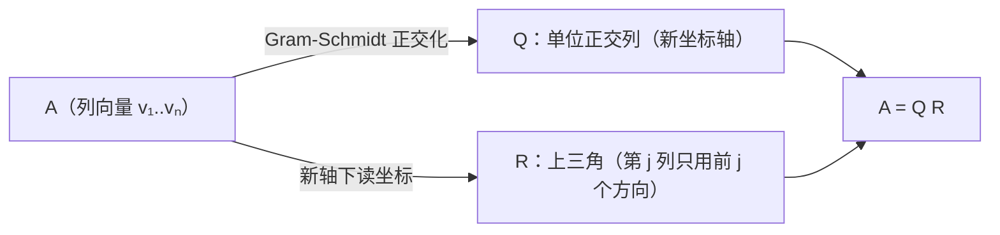

# QR 分解

> **核心问题**：任意矩阵怎么拆成"正交 × 上三角"？——$A=QR$ 及其数值价值。

## 0. 学习边界

| 分类 | 评估 |
|:--|:--|
| 理由 | 特征值算法（QR 迭代）、最小二乘稳定解法、Arnoldi 方法全部以 QR 为内核 |
| 投入建议 | 必须能由 G-S 构造 QR、理解 $R$ 的几何意义、用 QR 解最小二乘 |

## 1. 这个知识点解决什么问题？

G-S（4.5）逐向量正交化，本卡把它写成**矩阵分解**：$A=QR$，$Q$ 列正交（$Q^TQ=I$），$R$ 上三角可逆（$A$ 满列秩时）。好处：解 $A\mathbf{x}=\mathbf{b}$ 变成 $R\mathbf{x}=Q^T\mathbf{b}$（回代），避免求 $A^TA$——数值更稳定，也规避 $A^TA$ 条件数平方问题。

## 2. 它为什么重要？它有什么用？

- **最小二乘稳定解法**：正规方程 $A^TA\mathbf{x}=A^T\mathbf{b}$ 的条件数是 $\kappa(A)^2$，QR 解 $R\mathbf{x}=Q^T\mathbf{b}$ 只有 $\kappa(A)$——**数值优势**。
- **QR 迭代**：特征值算法（$A_k=Q_kR_k$，$A_{k+1}=R_kQ_k$）收敛到特征值（Schur 形）。
- **正交基**：$Q$ 的列是 $C(A)$ 的 ONB。
- **Householder/Givens**：实际数值用反射/旋转构造 QR（比 G-S 稳定）。

## 3. 学它之前需要哪些前置知识？

1. [[Gram-Schmidt正交化|Gram-Schmidt 正交化]]：构造原理。
2. [[正交矩阵与正交变换|正交矩阵]]：$Q^TQ=I$ 的性质。
3. [[最小二乘法|最小二乘法]]：应用场景（4.7 可并行）。

## 4. 定义复述

### 4.1 QR 分解（满列秩）

$A\in\mathbb{R}^{m\times n}$（$m\ge n$，$\operatorname{rank}A=n$）可唯一分解为

$$A=QR$$

- $Q\in\mathbb{R}^{m\times n}$：列标准正交（$Q^TQ=I_n$）；
- $R\in\mathbb{R}^{n\times n}$：上三角且对角元为正。

### 4.2 由 G-S 构造

$Q$ 的第 $i$ 列 = $\mathbf{q}_i$（G-S 归一化输出）；$R_{ij}=\langle\mathbf{v}_j,\mathbf{q}_i\rangle$（$i\le j$），$R_{ij}=0$（$i>j$）。于是 $\mathbf{v}_j=\sum_{i\le j}R_{ij}\mathbf{q}_i$——第 $j$ 个原向量由前 $j$ 个正交方向线性表出。

### 4.3 用途

- 解 $A\mathbf{x}=\mathbf{b}$：$R\mathbf{x}=Q^T\mathbf{b}$（回代）；
- 最小二乘：$\hat{\mathbf{x}}=R^{-1}Q^T\mathbf{b}$；
- $A^TA=R^TR$：Cholesky 视角（$A$ 满列秩时）。

## 5. 直觉与图像

- $R$ 记录"每个 $\mathbf{v}_j$ 在新正交坐标系里的坐标"——上三角表示"第 $j$ 个向量只用前 $j$ 个方向"。
- QR = "先摆正坐标轴（$Q$），再读坐标（$R$）"。
- 数值：$A^TA$ 把条件数平方（小奇异值更小），QR 直接处理 $A$——**避免平方**。

**QR 的结构**：



> **一句话本质**：$A=QR$ = "把列向量组正交化"的矩阵记法：$Q$ 是新坐标轴，$R$ 是旧坐标在新轴下的三角读数。

## 6. 定理陈述与证明重建

### 定理：$A=QR$ 的存在唯一性（满列秩）

**前提**：$\operatorname{rank}A=n$；**结论**：存在唯一 $Q,R$（$R$ 对角元正）。

**证明主线**：
- **存在**：G-S 得 $Q$，定义 $R_{ij}=\langle\mathbf{v}_j,\mathbf{q}_i\rangle$，验证 $\mathbf{v}_j=\sum_{i\le j}R_{ij}\mathbf{q}_i$（G-S 的 $R_{jj}=\lVert\mathbf{w}_j\rVert>0$）⟹ $A=QR$；
- **唯一**：若 $A=Q_1R_1=Q_2R_2$，则 $Q_2^TQ_1=R_2R_1^{-1}$ 既是正交又是上三角，上三角正交阵必为对角阵且对角元 ±1；由 $R$ 对角元正 ⟹ 唯一。$\square$

**关键"转念"**："上三角正交阵 = 对角阵"这个引理是唯一性论证的钥匙。

### 定理：QR 解最小二乘等价于正规方程

**证明主线**：$\lVert A\mathbf{x}-\mathbf{b}\rVert^2=\lVert QR\mathbf{x}-\mathbf{b}\rVert^2=\lVert R\mathbf{x}-Q^T\mathbf{b}\rVert^2+\lVert(I-QQ^T)\mathbf{b}\rVert^2$（正交分解），最小化第一项 ⟹ $R\mathbf{x}=Q^T\mathbf{b}$；且 $A^TA\mathbf{x}=R^TR\mathbf{x}=R^TQ^T\mathbf{b}=A^T\mathbf{b}$。$\square$

## 7. 经典反例库

### 反例 1：$A$ 缺列秩时 QR 不唯一

$\operatorname{rank}A<n$ 时 $R$ 奇异，分解不唯一——需约定（如取 $Q$ 的列扩充为 $\mathbb{R}^m$ 的 ONB）。

### 反例 2：G-S 构造的 QR 数值不如 Householder

经典 G-S 可能严重损失正交性（4.5 反例 2），数值库（LAPACK）用 Householder 反射——"数学等价 ≠ 数值等价"。

### 反例 3：$R$ 的对角元符号约定

若允许 $R$ 对角元为负，分解不唯一（每列可整体乘 $-1$）——约定对角元正才唯一。

## 8. 条件变式

| 变式方向 | 具体变化 | 影响 |
|:--|:--|:--|
| 弱化：$m<n$ | 分解形式调整 | 行多于列的转置场景 |
| 加强：$A$ 方阵可逆 | $Q$ 正交方阵 | $A=QR$ 全分解 |
| 换视角：最小二乘 | $R\mathbf{x}=Q^T\mathbf{b}$ | 稳定算法 |
| 数值：Householder | 反射构造 $Q$ | 工业标准 |
| 迭代：QR 算法 | $A_{k+1}=R_kQ_k$ | 特征值计算 |

## 9. 相关知识点与 Obsidian 双链建议

- [[Gram-Schmidt正交化|Gram-Schmidt 正交化]] — 上游
- [[正交矩阵与正交变换|正交矩阵]] — 横向：$Q$ 的性质
- [[最小二乘法|最小二乘法]] — 下游：QR 解法
- 特征值计算（数值）— 横向：QR 迭代
- [[LU分解|LU分解]]（阶段 I）— 横向：三大分解之一

## 10. 闭卷验收（数学模式）

- [ ] **定义默写**：$A=QR$ 条件与唯一性约定。
- [ ] **构造**：给 $3\times2$ 矩阵手算 QR（G-S 法）。
- [ ] **证明**：唯一性（上三角正交 = 对角）；QR 解最小二乘。
- [ ] **反例**：缺列秩；符号约定。

## 11. 分级习题

| 等级 | 题目 | 来源 |
|:--|:--|:--|
| ★ | 对 $A=\begin{bmatrix}1&1\\1&0\\1&0\end{bmatrix}$ 做 QR | Hefferon §6.5 |
| ★★ | 用 QR 解 $\min\lVert A\mathbf{x}-\mathbf{b}\rVert^2$（$A$ 同上，$\mathbf{b}=(1,1,1)$） | MIT 18.06 Lec 17 |
| ★★★ | 证明：$Q$ 上三角且正交 ⟹ $Q$ 对角且元素 ±1 | 高等代数（第5版） |
| ★★★★ | 说明为什么 QR 比正规方程数值稳定（条件数 $\kappa^2$ vs $\kappa$） | Trefethen & Bau |

## 12. 我的主动回忆区

<details>
<summary>🔄 核对要点（先默写，再展开比对）</summary>


- [ ] **定义默写**：$A=QR$ 条件与唯一性约定。
- [ ] **构造**：给 $3\times2$ 矩阵手算 QR（G-S 法）。
- [ ] **证明**：唯一性（上三角正交 = 对角）；QR 解最小二乘。
- [ ] **反例**：缺列秩；符号约定。

</details>

> 不看上文：写 QR 定义；G-S 构造 $R$ 的公式；唯一性论证；QR 解最小二乘。

## 13. 学完后可以完成

```dataview
LIST
FROM "03-Projects"
WHERE contains(requires, this.file.link)
SORT assignment_level ASC, file.name ASC
```

---
*创建于：2026-08-06 | 来源：Hefferon Ch.6 §6.5 + MIT 18.06SC Lec 17 + Trefethen & Bau；旧空壳（QR分解）于 2026-08-06 重写*

