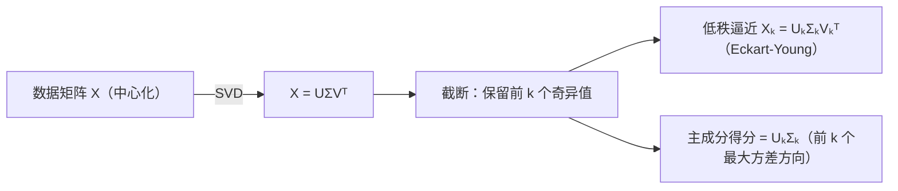

# 低秩逼近与主成分分析（PCA）

> **核心问题**：数据矩阵怎么"压缩"成低秩结构？最大方差方向怎么找？——截断 SVD 与 PCA。

## 0. 学习边界

| 分类 | 评估 |
|:--|:--|
| 理由 | PCA 是统计学/机器学习最经典的降维方法，数学内核就是 $A^TA$ 的特征分解 |
| 投入建议 | 必须理解 Eckart-Young 的意义、PCA 的算法流程与 SVD 的联系、能解释主成分 |

## 1. 这个知识点解决什么问题？

**低秩逼近**：数据/图像矩阵 $A$ 常用低秩结构近似——$A\approx A_k=U_k\Sigma_kV_k^T$（Eckart-Young 保证最优）。**PCA**：$n$ 个样本 $\mathbf{x}_i\in\mathbb{R}^d$ 找 $k$ 个正交方向，使投影后方差最大（信息损失最小）——等价于对中心化数据矩阵做 SVD，主成分 = 右奇异向量（或 $A^TA$ 特征向量）。

## 2. 它为什么重要？它有什么用？

- **图像压缩**：$A_k$ 只需存 $mk+nk+k$ 个数（远小于 $mn$）。
- **去噪**：小奇异值对应噪声，截断即滤波。
- **PCA 降维**：可视化、加速、去相关（白化）。
- **应用**：人脸识别（特征脸 = PCA 主成分）、基因表达分析、推荐系统。

## 3. 学它之前需要哪些前置知识？

1. [[奇异值分解(SVD)|奇异值分解(SVD)]]：核心工具。
2. [[实对称矩阵与谱定理|谱定理]]：$A^TA$ 对角化。
3. [[最小二乘法|最小二乘法]]：数据拟合视角。

## 4. 定义复述

### 4.1 低秩逼近（Eckart-Young 回顾）

$A_k=U_k\Sigma_kV_k^T$ 是最佳 $k$ 秩逼近（2-范数与 F-范数意义，见 4.11 定理 2）。误差 $\lVert A-A_k\rVert_2=\sigma_{k+1}$，$\lVert A-A_k\rVert_F=\sqrt{\sum_{i>k}\sigma_i^2}$。

### 4.2 PCA 算法

输入：样本 $\mathbf{x}_1,\dots,\mathbf{x}_n\in\mathbb{R}^d$，目标维 $k$：

1. **中心化**：$\bar{\mathbf{x}}=\frac1n\sum\mathbf{x}_i$，$\tilde{\mathbf{x}}_i=\mathbf{x}_i-\bar{\mathbf{x}}$；
2. 数据矩阵 $X=[\tilde{\mathbf{x}}_1\cdots\tilde{\mathbf{x}}_n]^T\in\mathbb{R}^{n\times d}$；
3. 协方差矩阵 $S=\frac{1}{n}X^TX$（对称半正定）；
4. **主成分** = $S$ 的前 $k$ 大特征值对应特征向量（= $X$ 的右奇异向量）；
5. 投影：$\mathbf{y}_i=(\langle\mathbf{x}_i,\mathbf{v}_1\rangle,\dots,\langle\mathbf{x}_i,\mathbf{v}_k\rangle)$。

### 4.3 解释

- 第 $j$ 主成分方向 $\mathbf{v}_j$ 使投影方差 $\lambda_j$ 最大（在正交于前 $j-1$ 个方向约束下）；
- **解释方差比**：$\lambda_j/\sum\lambda_i$——第 $j$ 主成分携带的信息占比；
- $X$ 的 SVD：$X=U\Sigma V^T$，主成分 = $V$ 的列，得分 = $U\Sigma$。

## 5. 直觉与图像

- 低秩逼近 = "保留大奇异值（大伸缩方向），丢弃小奇异值（噪声/细节）"。
- PCA = "找数据最'散开'的方向"——第一主成分是方差最大方向，第二与它垂直。
- 几何：把 $d$ 维椭球状数据云投影到前 $k$ 个"最长轴"。

**截断 SVD / PCA 流程**：



> **一句话本质**：低秩逼近 = 截断 SVD；PCA = 中心化数据的 SVD——两者是同一数学（谱分解）在数据科学的两张脸。

## 6. 定理陈述与证明重建

### 定理：第一主成分是方差最大方向

**前提**：$\mathbf{x}$ 中心化，协方差 $S$，$\lVert\mathbf{v}\rVert=1$；**结论**：$\operatorname{Var}(\langle\mathbf{x},\mathbf{v}\rangle)=\mathbf{v}^TS\mathbf{v}\le\lambda_1$，等号在 $\mathbf{v}=\mathbf{v}_1$（$S$ 最大特征向量）时取到。

**证明主线**：谱定理 $S=Q\Lambda Q^T$，令 $\mathbf{y}=Q^T\mathbf{v}$（$\lVert\mathbf{y}\rVert=1$）：$\mathbf{v}^TS\mathbf{v}=\sum\lambda_i y_i^2\le\lambda_1\sum y_i^2=\lambda_1$（Rayleigh 商）。$\square$

**关键"转念"**：**Rayleigh 商** $\mathbf{v}^TS\mathbf{v}/\lVert\mathbf{v}\rVert^2$ 的最大值 = 最大特征值——变分原理把"方差最大"翻译成特征值。

### 定理：前 $k$ 主成分 = $S$ 的前 $k$ 特征向量（顺序递推）

**证明主线**：在 $\mathbf{v}\perp\operatorname{span}\{\mathbf{v}_1,\dots,\mathbf{v}_{k-1}\}$ 约束下，$\mathbf{v}^TS\mathbf{v}\le\lambda_k$（同 Rayleigh 论证，$y_1=\cdots=y_{k-1}=0$）。$\square$

## 7. 经典反例库

### 反例 1：PCA 前要先中心化

不中心化时第一主成分偏向均值方向，失去方差解释意义——"先中心化再 SVD"不可省。

### 反例 2：PCA 对尺度敏感

变量量纲不同（米 vs 公里）会主导方差——通常先标准化（$\sigma=1$）。

### 反例 3：低秩逼近不是"逐元素压缩"

$A_k$ 是最优在**矩阵范数**意义，不等于"保留前 $k$ 行/列"——行/列抽样是另一类方法。

### 反例 4：PCA ≠ 线性判别（LDA）

PCA 无监督（最大方差）；LDA 有监督（类间分离）——目标不同，结果不同。

## 8. 条件变式

| 变式方向 | 具体变化 | 影响 |
|:--|:--|:--|
| 弱化：不中心化 | 协方差 → 二阶矩矩阵 | 方向偏移 |
| 加强：标准化 | 相关矩阵特征分解 | 尺度无关 |
| 换视角：核 PCA | 特征空间内积 | 非线性降维 |
| 应用：矩阵补全 | 低秩假设 | 推荐系统 |
| 随机化 | Randomized SVD | 大数据加速 |

## 9. 相关知识点与 Obsidian 双链建议

- [[奇异值分解(SVD)|奇异值分解(SVD)]] — 上游
- [[实对称矩阵与谱定理|谱定理]] — 横向：$S=Q\Lambda Q^T$
- [[最小二乘法|最小二乘法]] — 横向：回归 vs PCA
- 矩阵范数（数值）— 横向：误差度量
- 压缩感知（拓展）— 横向：另一类降维

## 10. 闭卷验收（数学模式）

- [ ] **算法默写**：PCA 五步流程。
- [ ] **证明**：第一主成分 = 最大特征向量（Rayleigh）。
- [ ] **计算**：给 3 个二维样本手算 PCA（中心化→协方差→特征分解）。
- [ ] **反例**：不中心化；尺度敏感。

## 11. 分级习题

| 等级 | 题目 | 来源 |
|:--|:--|:--|
| ★ | 3 个二维样本 $(1,2),(2,3),(3,5)$：中心化并求协方差 | MIT 18.06 类比题 |
| ★★ | 证明 Rayleigh 商：$\max_{\lVert\mathbf{v}\rVert=1}\mathbf{v}^TS\mathbf{v}=\lambda_1$ | 高等代数（第5版） |
| ★★★ | 用 $X=U\Sigma V^T$ 解释 PCA 得分（$U\Sigma$）与载荷（$V$） | Strang 补充 |
| ★★★★ | 图像压缩实验：对灰度图像做截断 SVD，比较 $k=10,50,100$ 的重建误差 | 应用实验 |

## 12. 我的主动回忆区

<details>
<summary>🔄 核对要点（先默写，再展开比对）</summary>


- [ ] **算法默写**：PCA 五步流程。
- [ ] **证明**：第一主成分 = 最大特征向量（Rayleigh）。
- [ ] **计算**：给 3 个二维样本手算 PCA（中心化→协方差→特征分解）。
- [ ] **反例**：不中心化；尺度敏感。

</details>

> 不看上文：写 PCA 五步；证明第一主成分；解释方差比；说明低秩逼近误差公式。

## 13. 学完后可以完成

```dataview
LIST
FROM "03-Projects"
WHERE contains(requires, this.file.link)
SORT assignment_level ASC, file.name ASC
```

---
*创建于：2026-08-06 | 来源：Hefferon Ch.6 延伸 + MIT 18.06SC Lec 29 + Strang；旧卡（主成分分析(PCA)、低秩逼近、奇异值性质）合并/重写于 2026-08-06*

