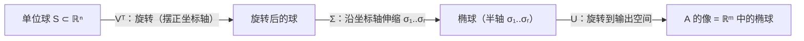

# 奇异值分解（SVD）

> **核心问题**：任意（包括长方形）矩阵的"综合分解"是什么？——$A=U\Sigma V^T$。

## 0. 学习边界

| 分类 | 评估 |
|:--|:--|
| 理由 | 秩、范数、伪逆、低秩逼近、PCA 全部以 SVD 为内核；数值线性代数基石 |
| 投入建议 | 必须能证明 SVD（用 $A^TA$ 谱定理）、理解几何意义、应用 Eckart-Young |

## 1. 这个知识点解决什么问题？

特征分解只对（可对角化的）方阵有效。**SVD** 对任意 $m\times n$ 矩阵 $A$ 给出 $A=U\Sigma V^T$：$U,V$ 正交，$\Sigma$ 对角（奇异值 $\sigma_1\ge\cdots\ge\sigma_r>0$）。构造：$A^TA$ 是对称半正定，谱定理 ⟹ $V\Lambda V^T$；奇异值 $\sigma_i=\sqrt{\lambda_i}$，$U$ 由 $\mathbf{u}_i=A\mathbf{v}_i/\sigma_i$ 补全。它回答"矩阵在不同方向上的伸缩"——**矩阵的完整几何**。

## 2. 它为什么重要？它有什么用？

- **秩揭示**：$\operatorname{rank}A$ = 非零奇异值个数；$\lVert A\rVert_2=\sigma_1$；$\lVert A\rVert_F=\sqrt{\sum\sigma_i^2}$。
- **低秩逼近**：Eckart-Young——截断 SVD 是最佳 $k$ 秩逼近。
- **伪逆**：$A^\dagger=V\Sigma^{-1}U^T$——最小二乘的统一解。
- **PCA/降维**：数据矩阵的 SVD（4.12）。
- **应用**：图像压缩、推荐系统（SVD++）、搜索引擎（LSI）、条件数 $\kappa=\sigma_1/\sigma_r$。

## 3. 学它之前需要哪些前置知识？

1. [[实对称矩阵与谱定理|实对称矩阵与谱定理]]：$A^TA$ 的正交对角化。
2. [[正交矩阵与正交变换|正交矩阵与正交变换]]：$U,V$ 性质。
3. [[正定矩阵与二次型|半正定]]：$A^TA\succeq0$。

## 4. 定义复述

### 4.1 SVD（约化形式）

$A\in\mathbb{R}^{m\times n}$（$m\ge n$），$\operatorname{rank}A=r$：

$$A=U\Sigma V^T$$

- $U\in\mathbb{R}^{m\times r}$：左奇异向量（$C(A)$ 的 ONB）；
- $V\in\mathbb{R}^{n\times r}$：右奇异向量（$C(A^T)$ 的 ONB）；
- $\Sigma=\operatorname{diag}(\sigma_1,\dots,\sigma_r)$，$\sigma_1\ge\cdots\ge\sigma_r>0$。

（全形式扩充 $U,V$ 到 $\mathbb{R}^m,\mathbb{R}^n$ 的正交基，$\Sigma$ 补零块。）

### 4.2 构造（核心推导）

1. $A^TA\in\mathbb{R}^{n\times n}$ 对称半正定，谱定理：$A^TA=V\Lambda V^T$，$\lambda_1\ge\cdots\ge\lambda_n\ge0$；
2. $\sigma_i=\sqrt{\lambda_i}$（$i\le r$），$\sigma_i=0$（$i>r$）；
3. $\mathbf{u}_i=\dfrac{1}{\sigma_i}A\mathbf{v}_i$（$i\le r$）——验证正交：$\langle\mathbf{u}_i,\mathbf{u}_j\rangle=\frac{1}{\sigma_i\sigma_j}\mathbf{v}_i^TA^TA\mathbf{v}_j=\frac{\lambda_j}{\sigma_i\sigma_j}\delta_{ij}=\delta_{ij}$；
4. 扩充为 $\mathbb{R}^m$ 的 ONB（$r<m$ 时补 $N(A^T)$ 基）。

### 4.3 几何意义

$A$ 把单位球映为椭球：$V^T$（旋转）→ $\Sigma$（沿轴伸缩 $\sigma_i$）→ $U$（旋转）。$\sigma_i$ = 椭球半轴长。

## 5. 直觉与图像

- SVD = "任何矩阵都可以拆成 旋转-伸缩-旋转"：$V^T$ 先摆正、$\Sigma$ 逐轴缩放、$U$ 再摆到输出空间。
- 奇异值 = "矩阵在各方向上的放大倍数"——最大奇异值 = 最大放大（谱范数）。
- SVD 对长方形矩阵也成立——"特征分解做不到的，SVD 全能做"。

**几何流程**（单位球 → 椭球）：



> **一句话本质**：$A=U\Sigma V^T$ = 任意矩阵的"旋转×伸缩×旋转"分解；奇异值 = 伸缩倍数 = 矩阵的完整谱信息。

## 6. 定理陈述与证明重建

### 定理 1：SVD 存在性

**证明主线**：由 4.2 构造直接给出 $A=U_r\Sigma_rV_r^T$；$r<m$ 时用 Gram-Schmidt 把 $U$ 扩充为 $\mathbb{R}^m$ 正交基、$\Sigma$ 补零行，$A=U\Sigma V^T$ 仍成立（补的部分贡献为零）。$\square$

**关键"转念"**：**一切从 $A^TA$ 出发**——对称半正定的谱定理给 $V$ 和 $\sigma$，$U$ 是"推出来的"。

### 定理 2：Eckart-Young 定理（低秩逼近）

$A_k=U_k\Sigma_kV_k^T$（截取前 $k$ 个奇异值）满足

$$\lVert A-A_k\rVert_2=\sigma_{k+1}=\min_{\operatorname{rank}B\le k}\lVert A-B\rVert_2,\qquad \lVert A-A_k\rVert_F=\sqrt{\sum_{i>k}\sigma_i^2}=\min_{\operatorname{rank}B\le k}\lVert A-B\rVert_F$$

**证明主线**（要点，2-范数）：$\lVert A-A_k\rVert_2=\sigma_{k+1}$（直接算）；对任意 $\operatorname{rank}B\le k$，$\dim N(B)\ge n-k$，而 $V_{k+1}$ 张成 $(k+1)$ 维子空间与 $N(B)$ 有交，取单位 $\mathbf{z}$ 在交中：$\lVert A-B\rVert_2\ge\lVert(A-B)\mathbf{z}\rVert=\lVert A\mathbf{z}\rVert\ge\sigma_{k+1}$（$A\mathbf{z}$ 的范数 ≥ 第 $k+1$ 个奇异值方向的贡献）。$\square$

**关键"转念"**：用**维数 + 交**论证（$N(B)\cap\operatorname{span}\{\mathbf{v}_1,\dots,\mathbf{v}_{k+1}\}\neq\{\mathbf{0}\}$）把"任何低秩逼近都不如截断 SVD"变成必然。

### 定理 3：SVD 与四个基本子空间

- $C(A)=\operatorname{span}\{\mathbf{u}_1,\dots,\mathbf{u}_r\}$，$N(A^T)=\operatorname{span}\{\mathbf{u}_{r+1},\dots,\mathbf{u}_m\}$；
- $C(A^T)=\operatorname{span}\{\mathbf{v}_1,\dots,\mathbf{v}_r\}$，$N(A)=\operatorname{span}\{\mathbf{v}_{r+1},\dots,\mathbf{v}_n\}$。

## 7. 经典反例库

### 反例 1：奇异值 ≠ 特征值（一般矩阵）

$A=\begin{bmatrix}1&1\\0&0\end{bmatrix}$：奇异值 $\sqrt2,0$；特征值 $1,0$——仅对称半正定时两者重合。

### 反例 2：$U,V$ 不唯一

$\sigma_i=\sigma_j$ 时对应奇异向量可旋转（如 $A=I$：任意正交 $U,V$）——分解不唯一但 $\Sigma$ 唯一（降序排列）。

### 反例 3：$\lVert A\rVert_2=\sigma_1$ 不是 $\max|a_{ij}|$

$\begin{bmatrix}1&1\\1&1\end{bmatrix}$：$\sigma_1=2$，但最大元是 1——谱范数看奇异值不看元素。

### 反例 4：$AA^T$ 与 $A^TA$ 的非零特征值相同

$\operatorname{rank}$ 相同的矩阵对：$AA^T=U\Sigma^2U^T$、$A^TA=V\Sigma^2V^T$——非零特征值都是 $\sigma_i^2$。

## 8. 条件变式

| 变式方向 | 具体变化 | 影响 |
|:--|:--|:--|
| 弱化：复矩阵 | $U^HU=I$ | 复 SVD |
| 加强：$A$ 对称 | $U=V=Q$ | 退化为谱分解 |
| 换视角：范数 | $\lVert A\rVert_2=\sigma_1$、$\lVert A\rVert_F$ | 矩阵范数（数值） |
| 应用：伪逆 | $A^\dagger=V\Sigma^{-1}U^T$ | 最小二乘统一解 |
| 随机化 | Randomized SVD | 大数据 |

## 9. 相关知识点与 Obsidian 双链建议

- [[实对称矩阵与谱定理|实对称矩阵与谱定理]]、[[正交矩阵与正交变换|正交矩阵]] — 上游
- [[低秩逼近与主成分分析|低秩逼近与 PCA]] — 下游：Eckart-Young 应用
- [[最小二乘法|最小二乘法]] — 横向：伪逆解
- 矩阵范数（数值）— 横向：$\sigma_1$、$\sum\sigma_i^2$
- 伪逆（数值）— 横向：$V\Sigma^{-1}U^T$

## 10. 闭卷验收（数学模式）

- [ ] **定义默写**：$A=U\Sigma V^T$ 与构造步骤。
- [ ] **证明**：SVD 存在性；Eckart-Young（交论证）。
- [ ] **计算**：给 $2\times2$ 手算 SVD。
- [ ] **反例**：奇异值 vs 特征值；$U,V$ 不唯一。
- [ ] **应用**：范数、伪逆、低秩逼近公式。

## 11. 分级习题

| 等级 | 题目 | 来源 |
|:--|:--|:--|
| ★ | 手算 $\begin{bmatrix}3&0\\0&2\end{bmatrix}$ 与 $\begin{bmatrix}1&1\\1&1\end{bmatrix}$ 的 SVD | MIT 18.06 Lec 29 |
| ★★ | 证明：$\lVert A\rVert_2=\sigma_1$，$\lVert A\rVert_F^2=\sum\sigma_i^2$ | Trefethen & Bau |
| ★★★ | 证明 Eckart-Young（2-范数，用维数+交） | Trefethen & Bau |
| ★★★★ | 用 SVD 给出最小二乘解 $\hat{\mathbf{x}}=V\Sigma^{-1}U^T\mathbf{b}$ 并说明与正规方程关系 | 高等代数（第5版） |

## 12. 我的主动回忆区

> 不看上文：写 SVD 与构造；几何意义；Eckart-Young；$\lVert A\rVert_2$；伪逆公式。

## 13. 学完后可以完成

```dataview
LIST
FROM "03-Projects"
WHERE contains(requires, this.file.link)
SORT assignment_level ASC, file.name ASC
```

---
*创建于：2026-08-06 | 来源：Hefferon Ch.6 延伸 + MIT 18.06SC Lec 29 + Trefethen & Bau；旧卡（奇异值分解(SVD)、奇异值性质）合并/重写于 2026-08-06*

