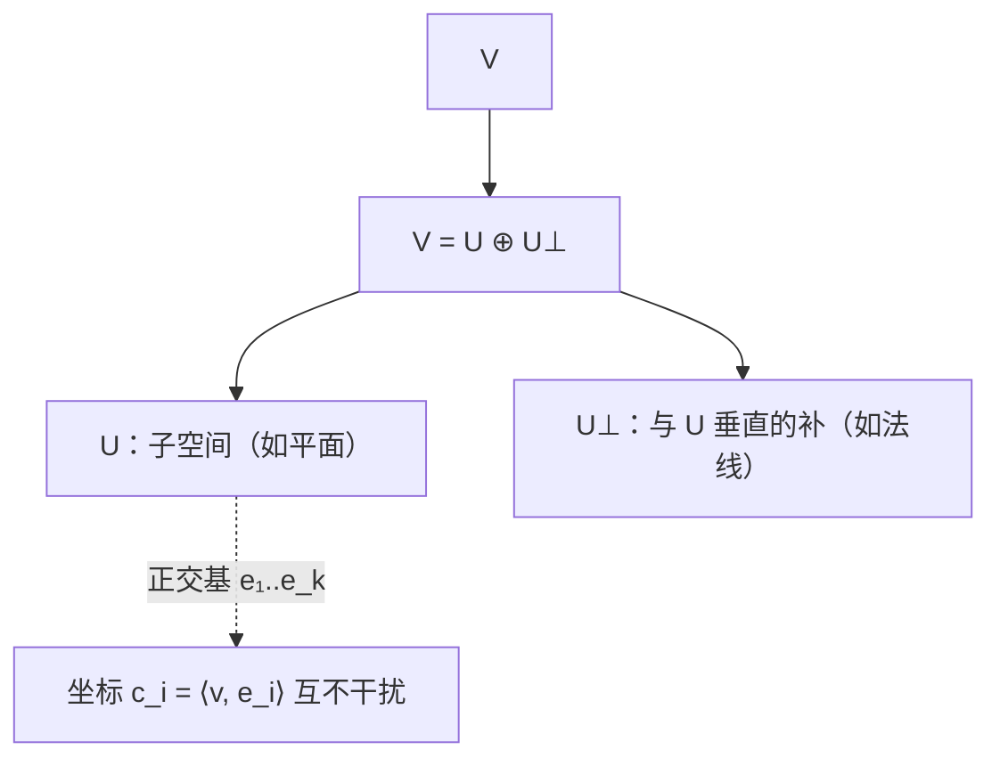

# 正交与正交补

> **核心问题**：什么叫做"垂直"？一个子空间能"垂直"出另一个子空间吗？——$U^\perp$ 与 $V=U\oplus U^\perp$。

## 0. 学习边界

| 分类 | 评估 |
|:--|:--|
| 理由 | 投影（4.4）、Gram-Schmidt（4.5）、最小二乘（4.7）、谱定理（4.9）全部建立在正交补上 |
| 投入建议 | 必须能求 $U^\perp$、证明 $V=U\oplus U^\perp$、理解四个基本子空间的正交关系 |

## 1. 这个知识点解决什么问题？

$\mathbb{R}^3$ 中"垂直于平面"的向量构成一条直线。本卡推广：给定子空间 $U$，与 $U$ 中**每个向量都正交**的全体构成**正交补** $U^\perp$。核心定理：$V=U\oplus U^\perp$（每个向量唯一拆成"在 $U$ 的部分 + 垂直部分"）——这是"垂直分解"的基础，也是 4.4 投影的定义依据。

## 2. 它为什么重要？它有什么用？

- **四个基本子空间**：$\mathbb{R}^n=C(A^T)\oplus N(A)$，$C(A^T)\perp N(A)$（阶段 I 1.10 的正交版证明）。
- **投影**：$V=U\oplus U^\perp$ 给出沿 $U^\perp$ 到 $U$ 的唯一投影（4.4）。
- **方程理论**：$A\mathbf{x}=\mathbf{b}$ 有解 ⟺ $\mathbf{b}\perp N(A^T)$（Fredholm 择一）。
- **最小二乘**：$\mathbf{b}$ 的投影 $=C(A)$ 中最优点（4.7）。

## 3. 学它之前需要哪些前置知识？

1. [[长度角度与Cauchy-Schwarz不等式|长度角度与Cauchy-Schwarz不等式]]：夹角 90° 判据。
2. [[直和与补空间|直和与补空间]]（阶段 II）：直和分解。
3. [[四个基本子空间|四个基本子空间]]（阶段 I）：$C(A)$/$N(A)$ 等。

## 4. 定义复述

### 4.1 正交补

$U\subseteq V$ 子空间，**正交补**：
$$U^\perp=\{\mathbf{v}\in V:\langle\mathbf{v},\mathbf{u}\rangle=0\ \forall\mathbf{u}\in U\}$$

### 4.2 核心定理（正交分解定理）

$V$ 有限维内积空间，$U$ 子空间，则

$$V=U\oplus U^\perp,\qquad \dim U+\dim U^\perp=\dim V,\qquad (U^\perp)^\perp=U$$

### 4.3 四个基本子空间的正交关系

- $C(A^T)=N(A)^\perp$，$C(A)=N(A^T)^\perp$（$\mathbb{R}^n$/$A^T$ 版）；
- $\mathbb{R}^n=C(A^T)\oplus N(A)$；$\mathbb{R}^m=C(A)\oplus N(A^T)$。

### 4.4 正交基与标准正交基

- **正交基**：两两正交的非零基；
- **标准正交基（ONB）**：两两正交且范数 1——坐标 = 投影系数 $\mathbf{v}=\sum\langle\mathbf{v},\mathbf{e}_i\rangle\mathbf{e}_i$。

## 5. 直觉与图像

- $U^\perp$ = "与 $U$ 中一切垂直的墙"：平面 → 法线，直线 → 垂直平面。
- $V=U\oplus U^\perp$ = "空间被 $U$ 和它的垂直墙完全撑开"。
- 正交基 = "互相垂直的坐标系"——每个坐标互不干扰（$c_i=\langle\mathbf{v},\mathbf{e}_i\rangle$）。

**垂直分解结构**：



> **一句话本质**：正交补把"垂直"升级为空间分解工具——$V$ 被 $U$ 和 $U^\perp$ 无损拆成两个垂直部分。

## 6. 定理陈述与证明重建

### 定理：$V=U\oplus U^\perp$

**前提**：$V$ 有限维内积空间，$U$ 子空间；**结论**：$V=U\oplus U^\perp$。

**证明主线**：
1. $U\cap U^\perp=\{\mathbf{0}\}$（$\mathbf{v}\in U\cap U^\perp$ ⟹ $\langle\mathbf{v},\mathbf{v}\rangle=0$ ⟹ $\mathbf{v}=\mathbf{0}$，正定性）；
2. 取 $U$ 的 ONB $\{\mathbf{e}_1,\dots,\mathbf{e}_k\}$（存在性由 Gram-Schmidt，4.5），扩充为 $V$ 的基；
3. 对任意 $\mathbf{v}$，令 $\mathbf{u}=\sum_{i}\langle\mathbf{v},\mathbf{e}_i\rangle\mathbf{e}_i\in U$，$\mathbf{w}=\mathbf{v}-\mathbf{u}$；验证 $\langle\mathbf{w},\mathbf{e}_j\rangle=0$ 对每个 $j$ ⟹ $\mathbf{w}\in U^\perp$ ⟹ $\mathbf{v}=\mathbf{u}+\mathbf{w}$；
4. 结合 1 与 3 得直和分解。$\square$

**关键"转念"**：用 ONB 的投影系数构造 $\mathbf{u}$，残差自动落入 $U^\perp$——**"投影 + 残差"是正交分解的万能构造**。

### 定理：$(U^\perp)^\perp=U$

**证明主线**：$U\subseteq(U^\perp)^\perp$ 显然；由维数 $\dim(U^\perp)^\perp=\dim V-\dim U^\perp=\dim U$，等维包含 ⟹ 相等。$\square$

## 7. 经典反例库

### 反例 1：$U+U^\perp$ 不一定直和于非有限维

无限维内积空间（如 $L^2$）中 $U$ 未必满足 $V=U\oplus U^\perp$（需要 $U$ 闭）——有限维假设不可少。

### 反例 2：$(U+W)^\perp=U^\perp\cap W^\perp$ 而不是 $U^\perp+W^\perp$

$\mathbb{R}^2$ 中 $U=x$-轴、$W=y$-轴：$(U+W)^\perp=\{\mathbf{0}\}=U^\perp\cap W^\perp$，但 $U^\perp+W^\perp=\mathbb{R}^2$——"正交补交换加法与交集"。

### 反例 3：$U^\perp$ 与 $U$ 可以相等（非平凡情形）

$\mathbb{R}^2$ 中 $U=\operatorname{span}\{(1,1)\}$：$U^\perp=\operatorname{span}\{(1,-1)\}\neq U$；但 $\mathbb{R}^4$ 中 $U=\operatorname{span}\{(1,1,0,0),(0,0,1,1)\}$ 时 $U^\perp=\operatorname{span}\{(1,-1,0,0),(0,0,1,-1)\}$——同构于 $U$ 但不同子空间。

## 8. 条件变式

| 变式方向 | 具体变化 | 影响 |
|:--|:--|:--|
| 弱化：无限维 | 需 $U$ 闭 | $L^2$ 理论 |
| 加强：$U=V$ | $V^\perp=\{\mathbf{0}\}$ | 平凡情形 |
| 换视角：矩阵 | $N(A)^\perp=C(A^T)$ | 四个子空间 |
| 推广：多个子空间 | $(\bigcap U_i)^\perp=\sum U_i^\perp$ | 对偶性 |

## 9. 相关知识点与 Obsidian 双链建议

- [[长度角度与Cauchy-Schwarz不等式|长度角度与Cauchy-Schwarz不等式]] — 上游
- [[正交投影与正交分解|正交投影与正交分解]] — 下游：分解的应用
- [[直和与补空间|直和与补空间]]（阶段 II）— 横向：直和 vs 正交直和
- [[四个基本子空间|四个基本子空间]]（阶段 I）— 横向：正交关系
- [[正交矩阵与正交变换|正交矩阵]] — 横向：保正交的变换

## 10. 闭卷验收（数学模式）

- [ ] **定义默写**：$U^\perp$；正交基/标准正交基。
- [ ] **证明**：$V=U\oplus U^\perp$；$(U^\perp)^\perp=U$。
- [ ] **计算**：给 $U$ 求 $U^\perp$ 的基与维数。
- [ ] **反例**：$(U+W)^\perp$ 公式；无限维反例。

## 11. 分级习题

| 等级 | 题目 | 来源 |
|:--|:--|:--|
| ★ | $\mathbb{R}^3$ 中 $U=xy$-平面：求 $U^\perp$ | Hefferon §6.2 |
| ★★ | 证明 $N(A)^\perp=C(A^T)$（用 $\mathbf{x}\perp N(A)$ ⟺ $\mathbf{x}\in C(A^T)$） | MIT 18.06 Lec 14 |
| ★★★ | 证明 $V=U\oplus U^\perp$（ONB 构造法） | 高等代数（第5版）[待验证] |
| ★★★★ | 证明 $(U+W)^\perp=U^\perp\cap W^\perp$ 并给出 $U^\perp+W^\perp$ 不等于它的例子 | Hefferon §6.2 |

## 12. 我的主动回忆区

<details>
<summary>🔄 核对要点（先默写，再展开比对）</summary>


- [ ] **定义默写**：$U^\perp$；正交基/标准正交基。
- [ ] **证明**：$V=U\oplus U^\perp$；$(U^\perp)^\perp=U$。
- [ ] **计算**：给 $U$ 求 $U^\perp$ 的基与维数。
- [ ] **反例**：$(U+W)^\perp$ 公式；无限维反例。

</details>

> 不看上文：写 $U^\perp$ 定义；证 $V=U\oplus U^\perp$；求四个子空间正交关系；举例 $(U+W)^\perp$。

## 13. 学完后可以完成

```dataview
LIST
FROM "03-Projects"
WHERE contains(requires, this.file.link)
SORT assignment_level ASC, file.name ASC
```

---
*创建于：2026-08-06 | 来源：Hefferon Ch.6 §6.2 + MIT 18.06SC Lec 14 + 高等代数（第5版）；旧空壳（正交补）于 2026-08-06 重写*

