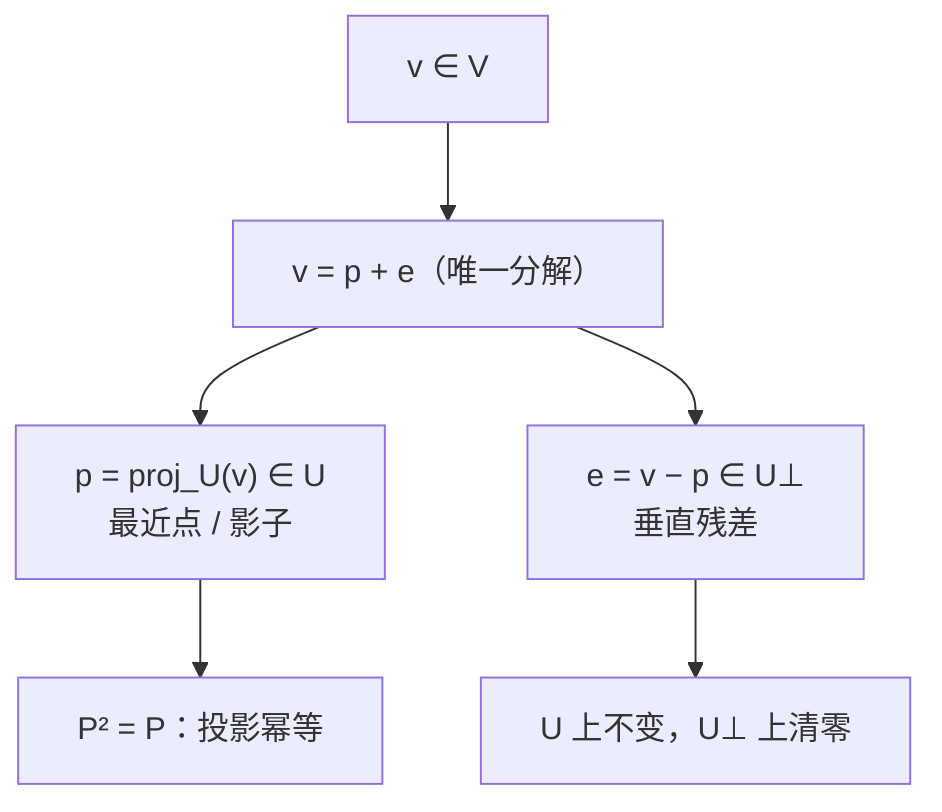

# 正交投影与正交分解

> **核心问题**：子空间外一点到子空间的"最近点"是什么？怎么算？——正交投影与投影矩阵。

## 0. 学习边界

| 分类 | 评估 |
|:--|:--|
| 理由 | 投影矩阵 $P=U(U^TU)^{-1}U^T$ 是统计回归、信号处理、数值线性代数的核心对象 |
| 投入建议 | 必须能求投影与投影矩阵、理解 $P^2=P$、$P^T=P$，并证明"投影 = 最近点" |

## 1. 这个知识点解决什么问题？

$U$ 是子空间，$\mathbf{b}\notin U$。最接近 $\mathbf{b}$ 的 $U$ 中点是什么？——$\mathbf{b}$ 在 $U$ 上的**正交投影** $p=\operatorname{proj}_U\mathbf{b}$。因为 $\mathbf{b}-p\perp U$（残差垂直），$p$ 是唯一使距离 $\lVert\mathbf{b}-p\rVert$ 最小的点（勾股定理证明）。这是 4.7 最小二乘的几何内核。

## 2. 它为什么重要？它有什么用？

- **最小二乘**：$\hat{\mathbf{x}}$ 使 $A\hat{\mathbf{x}}$ 是 $\mathbf{b}$ 在 $C(A)$ 上的投影。
- **投影矩阵**：$P=A(A^TA)^{-1}A^T$ 把任意向量投影到 $C(A)$；$I-P$ 投影到 $N(A^T)$。
- **性质**：$P^2=P$（幂等）、$P^T=P$（对称）、$\operatorname{rank}P=\dim U$。
- **应用**：线性回归（$\hat{\mathbf{y}}=X\hat{\boldsymbol{\beta}}$）、信号滤波、Arnoldi 迭代（数值方法）。

## 3. 学它之前需要哪些前置知识？

1. [[正交与正交补|正交与正交补]]：$V=U\oplus U^\perp$。
2. [[内积的定义与性质|内积的定义与性质]]：内积公理。
3. [[列空间与零空间|列空间与零空间]]（阶段 I）：$C(A)$。

## 4. 定义复述

### 4.1 投影与投影矩阵

$U$ 子空间，$\mathbf{b}\in V$。$\mathbf{b}$ 在 $U$ 上的**正交投影** $\operatorname{proj}_U\mathbf{b}$ 是满足 $\mathbf{b}-p\perp U$ 的唯一向量 $p\in U$。

$U$ 有基 $\{\mathbf{u}_1,\dots,\mathbf{u}_k\}$，$A=[\mathbf{u}_1\cdots\mathbf{u}_k]$，则投影矩阵：

$$P=A(A^TA)^{-1}A^T,\qquad p=P\mathbf{b}$$

若基是标准正交的（$Q$），则简化：$P=QQ^T$。

### 4.2 单向量投影

$$\operatorname{proj}_\mathbf{v}\mathbf{u}=\frac{\langle\mathbf{u},\mathbf{v}\rangle}{\lVert\mathbf{v}\rVert^2}\mathbf{v},\qquad P_{\mathbf{v}}=\frac{\mathbf{v}\mathbf{v}^T}{\lVert\mathbf{v}\rVert^2}$$

### 4.3 正交分解（每向量唯一）

$$\mathbf{b}=p+\mathbf{e},\qquad p\in U,\ \mathbf{e}\in U^\perp$$

## 5. 直觉与图像

- 投影 = "阳光垂直照到平面上留下的影子"——影子在 $U$ 里，光线方向垂直于 $U$。
- 残差 $\mathbf{e}$ = "影子的高度差"。
- $P^2=P$：影子投两次还是影子（幂等）。

**分解结构**（$V = U \oplus U^\perp$）：



> **一句话本质**：正交投影 = 子空间内的最近点 = "垂直影子"；投影矩阵把整个空间"压扁"到子空间并保持 $U$ 不变。

## 6. 定理陈述与证明重建

### 定理 1：投影是最近点（最优逼近）

**前提**：$p=\operatorname{proj}_U\mathbf{b}$；**结论**：对任意 $\mathbf{u}\in U$，$\lVert\mathbf{b}-p\rVert\le\lVert\mathbf{b}-\mathbf{u}\rVert$，等号 ⟺ $\mathbf{u}=p$。

**证明主线**：$\mathbf{b}-\mathbf{u}=(\mathbf{b}-p)+(p-\mathbf{u})$，其中 $\mathbf{b}-p\perp U$ 而 $p-\mathbf{u}\in U$，故两项正交。勾股定理：$\lVert\mathbf{b}-\mathbf{u}\rVert^2=\lVert\mathbf{b}-p\rVert^2+\lVert p-\mathbf{u}\rVert^2\ge\lVert\mathbf{b}-p\rVert^2$。$\square$

**关键"转念"**：把"任意逼近"拆成"最优投影 + 子空间内偏差"，正交 ⟹ 勾股 ⟹ 距离分解——**正交分解把最优化问题变成几何问题**。

### 定理 2：投影矩阵 $P=A(A^TA)^{-1}A^T$ 满足 $P^2=P$、$P^T=P$、$\operatorname{im}P=U$

**证明主线**：$P^2=A(A^TA)^{-1}A^TA(A^TA)^{-1}A^T=A(A^TA)^{-1}A^T=P$；$P^T=P$ 由 $(A^T)^T=A$ 与对称性；$\operatorname{im}P\subseteq U$ 显然，且 $A\mathbf{x}=P(A\mathbf{x})$（对 $\mathbf{x}\in U$ 的坐标）⟹ $U\subseteq\operatorname{im}P$。$\square$

### 定理 3：$I-P$ 投影到 $U^\perp$

**证明主线**：$(I-P)^2=I-2P+P^2=I-P$；对 $\mathbf{e}\in U^\perp$ 验证 $(I-P)\mathbf{e}=\mathbf{e}$；$\operatorname{im}(I-P)=\ker P=U^\perp$。$\square$

## 7. 经典反例库

### 反例 1：$A^TA$ 不可逆时公式失效

$A$ 列线性相关（如 $A=[\mathbf{u},\mathbf{u}]$）：$A^TA$ 奇异，公式无定义——此时应先用 Gram-Schmidt或改用伪逆（数值补充）。

### 反例 2：投影矩阵 ≠ 一般幂等矩阵

幂等 $P^2=P$ 不保证对称（如 $\begin{bmatrix}1&1\\0&0\end{bmatrix}$）——**正交投影要求 $P^T=P$**（斜投影非正交）。

### 反例 3：$P\mathbf{b}$ 不是"逐坐标投影"

$P$ 作用后 $\mathbf{b}$ 的各分量混合（除非基是标准正交的）——"投影到 $U$"是整体操作，不是逐坐标归零。

## 8. 条件变式

| 变式方向 | 具体变化 | 影响 |
|:--|:--|:--|
| 弱化：$A$ 非满列秩 | $A^TA$ 奇异 | 用 QR/伪逆 |
| 加强：标准正交基 | $P=QQ^T$ | 计算最简 |
| 换视角：$U^\perp$ | $I-P$ | 补空间投影 |
| 应用：最小二乘 | $A^TA\hat{\mathbf{x}}=A^T\mathbf{b}$ | 4.7 正规方程 |
| 推广：斜投影 | 沿 $W$ 到 $U$ | 非正交分解 |

## 9. 相关知识点与 Obsidian 双链建议

- [[正交与正交补|正交与正交补]] — 上游
- [[最小二乘法|最小二乘法]]
- [[Gram-Schmidt正交化|Gram-Schmidt 正交化]] — 横向：构造 ONB 使 $P=QQ^T$
- [[列空间与零空间|列空间与零空间]]（阶段 I）— 横向：$C(A)$ 投影
- 伪逆（数值补充）— 横向：$A^\dagger$ 推广投影

## 10. 闭卷验收（数学模式）

- [ ] **定义默写**：投影、投影矩阵、正交分解。
- [ ] **证明**：最近点定理（勾股）；$P^2=P$、$P^T=P$。
- [ ] **计算**：给 $U$ 与 $\mathbf{b}$ 求 $p$、$\mathbf{e}$、$P$。
- [ ] **反例**：非正交幂等；$A^TA$ 奇异。

## 11. 分级习题

| 等级 | 题目 | 来源 |
|:--|:--|:--|
| ★ | $\mathbf{b}=(3,4)$ 在 $\operatorname{span}\{(1,0)\}$ 上的投影 | Hefferon §6.3 |
| ★★ | 求 $A=\begin{bmatrix}1&1\\1&0\\1&0\end{bmatrix}$ 的投影矩阵 $P$ 并验证 $P^2=P$ | MIT 18.06 Lec 15 |
| ★★★ | 证明最近点定理（正交分解 + 勾股） | 本地融合习题（参考高等代数第5版，题号待补） |
| ★★★★ | 证明：$P$ 是正交投影矩阵 ⟺ $P^2=P$ 且 $P^T=P$ | Hefferon §6.3 |

## 12. 我的主动回忆区

> 闭卷检索：先自己写答案，再回头核对「闭卷验收」一节。下面只给线索，不给答案。
>
> **① 情境反推**：把一个向量投到子空间上，得到的点为什么恰好是该子空间里离它最近的点？靠哪条定理保证？
>
> **② 易错辨析**：投影矩阵必须同时满足哪两条性质？只幂等而不对称的矩阵，是投到哪里、沿什么方向投的？
>
> **③ 迁移应用**：说明「单位阵减去投影矩阵」是投向哪个空间的投影，并用它一句话写出最小二乘残差。

⏱ **间隔复习节奏**：学完当天 → 次日 → 第 7 天 → 第 30 天，各闭卷重做一次本区；每轮只回读「写不出来」的那一条对应正文，写得出来的不再重读。

## 13. 学完后可以完成

```dataview
LIST
FROM "03-Projects"
WHERE contains(requires, this.file.link)
SORT assignment_level ASC, file.name ASC
```

---
*创建于：2026-08-06 | 来源：Hefferon Ch.6 §6.3 + MIT 18.06SC Lec 15 + 高等代数（第5版）*
