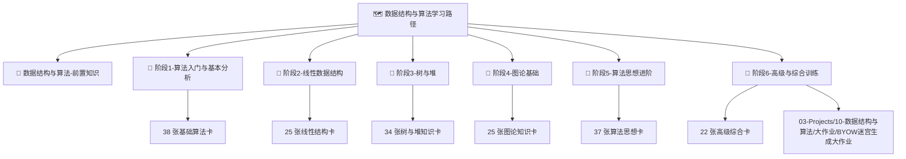

# 🗺️ 数据结构与算法 学习路径

> **课程名称**：数据结构与算法 (Data Structures and Algorithms)  
> **学术 Spine**：[MIT 6.006 Introduction to Algorithms (Spring 2020)](https://ocw.mit.edu/courses/6-006-introduction-to-algorithms-spring-2020/)  
> **辅助教材 (Co-Spines)**：CLRS (*Introduction to Algorithms 4th Ed*) & OpenDSA Interactive Visualizations  
> **教材挂载与来源注册**：[[📚 教材挂载索引]]  
> **完整作业包入口**：[[课程作业总表|数据结构与算法完整作业包]]  

---

## 🎯 课程目标与学习成果

本路线旨在培养扎实的数据结构建模能力与算法设计分析功底。学完本路线后，你将能够：
1. **分析与推导**：熟练推导经典算法的时间与空间渐近复杂度（渐近记号 $O, \Omega, \Theta$、主定理、递归树分析）。
2. **结构与实现**：独立手写线性表、哈希表、平衡二叉搜索树 (AVL/红黑树)、堆、并查集、图数据结构及线段树/树状数组。
3. **算法设计范式**：精通分治、双指针、滑动窗口、回溯剪枝、贪心证明及动态规划状态转移推导。
4. **工程实战**：通过大型综合项目（如 BYOW 随机迷宫生成引擎）验证复杂图算法与高级数据结构的协同落地能力。

---

## 🧭 阶段导航与学习路线

本路线采用三级分层架构（**学习路径 → 阶段 MOC → 知识卡/作业**），从任节点到目标知识卡或作业均在 **2 次点击以内**。

---

### 阶段明细

| 阶段 | 阶段 MOC | 核心主题 | 阶段目标与能力要求 | 阶段作业/项目 |
| :---: | :--- | :--- | :--- | :--- |
| **Stage 0** | [[🧭 数据结构与算法-前置知识]] | 内存/指针、递归栈、渐近记号 | 建立指针/引用与数学推导基础 | [[课程作业总表#OF-PS01\|Problem Set 1]] |
| **Stage 1** | [[🧭 阶段1-算法入门与基本分析]] | 时间/空间复杂度、二分查找、经典排序 | 掌握渐近分析与 $O(n \log n)$ 经典排序 | [[课程作业总表#OF-PS01\|Problem Set 1]] |
| **Stage 2** | [[🧭 阶段2-线性数据结构]] | 链表、栈、队列、哈希表、单调队列 | 独立设计 $O(1)$ 均摊复杂度的线性结构 | [[课程作业总表#OF-PS02\|Problem Set 2]] |
| **Stage 3** | [[🧭 阶段3-树与堆]] | BST、AVL、红黑树、二叉堆、并查集、树状数组 | 手撕旋转平衡树与优先队列 | [[课程作业总表#OF-PS03\|Problem Set 3]] |
| **Stage 4** | [[🧭 阶段4-图论基础]] | BFS/DFS、Dijkstra、Floyd、MST、拓扑排序 | 解决图遍历与最短路径问题 | [[课程作业总表#OF-PS04\|Problem Set 4]] |
| **Stage 5** | [[🧭 阶段5-算法思想进阶]] | 分治、回溯剪枝、贪心证明、动态规划 | 掌握 DP 状态转移推导与状态压缩 | [[课程作业总表#OF-PS05\|Problem Set 5]] |
| **Stage 6** | [[🧭 阶段6-高级与综合训练]] | KMP/Rabin-Karp、网络流、Tarjan 割点割边 | 解决高级字符串匹配与网络流硬核问题 | [[10-数据结构与算法-大作业-BYOW随机迷宫生成与高级数据结构|BYOW 大作业]] |

---

## 🏆 验收标准与毕业要求

1. **知识卡闭卷验收**：通过所有阶段 MOC 内部的闭卷自测题与复杂度分析验证。
2. **官方作业序列**：完成 MIT 6.006 Problem Sets (PS01 - PS06)。
3. **Capstone 项目**：独立完成并通关 [[10-数据结构与算法-大作业-BYOW随机迷宫生成与高级数据结构|BYOW 随机迷宫生成大作业]]，测试 Harness 通过率达 100%。
