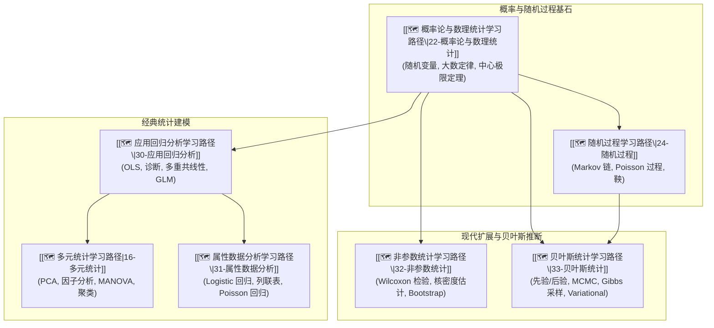

# 🎲 主线：概率统计与数据建模 (Probability, Statistics & Data Modeling Track)

> 🧭 **主线宗旨**：构建从概率论基础、随机过程到多元统计、回归分析与贝叶斯推断的完整统计建模体系。消除统计推断与数据分析中的概念冗余，为机器学习、数据挖掘与量化建模提供坚实的概率不确定性推断底座。

---

## 🗺️ 7 门子线路径逻辑递进图



---

## 🔑 全库唯一 Master 概念卡

所有概率定理、参数估计与检验方法统一收拢至基础统计路径中的 Master 主卡：

1. **极大似然估计与 Log-Likelihood**：[[极大似然估计MLE]] ($\hat{\theta}_{\text{MLE}} = \arg\max_\theta \sum \log p(x_i | \theta)$)
2. **中心极限定理与渐近正态性**：[[中心极限定理CLT]] ($\sqrt{n}(\bar{X}_n - \mu) \xrightarrow{d} \mathcal{N}(0, \sigma^2)$)
3. **马尔可夫链平稳分布**：[[Markov链与平稳分布]] ($\boldsymbol{\pi} \mathbf{P} = \boldsymbol{\pi}$)
4. **主成分分析与特征分解**：[[主成分分析PCA]] ($\mathbf{\Sigma} \mathbf{v}_i = \lambda_i \mathbf{v}_i$)
5. **贝叶斯定理与共轭先验**：[[贝叶斯定理与后验分布]] ($p(\theta | x) \propto p(x | \theta) p(\theta)$)

---

## 📊 包含子路径看板 (Dataview)

```dataview
TABLE course AS "课程名称", status AS "状态", importance AS "优先级", updated AS "最近更新"
FROM "02-Knowledge/🧠 学习系统"
WHERE type = "index" AND track = "概率统计与数据建模"
SORT file.name ASC
```

---

*主线更新时间：2026-07-30 | 状态：active*
