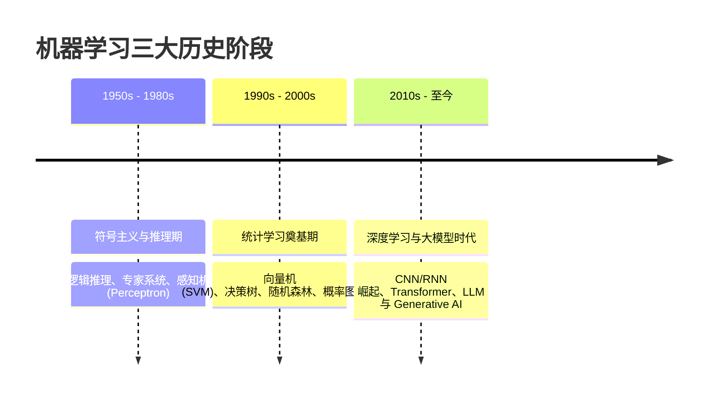

---

type: study

flow: knowledge

kind: concept

topic: "机器学习发展历程"

course: "机器学习"

module: "模块2：假设空间与归纳偏好"

created: 2026-04-18

status: ongoing

difficulty: beginner

concept: ["机器学习发展历程"]

prerequisites: ["归纳偏好"]

related: ["机器学习应用现状", "经验风险最小化"]

source_textbook: ["机器学习（周志华）"]

source_sections: ["第1章 1.3-1.6"]

learning_objectives: ["说明 机器学习发展历程 在“模块2：假设空间与归纳偏好”里解决的具体问题", "把 机器学习发展历程 对应回 第1章 1.3-1.6", "用一个最小例子或代表题解释 机器学习发展历程 的作用"]

deliverables: ["一句话定义或项目目标", "一个最小例子/代表题/最小实验", "一条易错点或跨路径连接", "能用自己的话解释假设空间与归纳偏好的关系。"]

tags: ["机器学习", "学习"]

aliases: ["🎯 机器学习发展历程"]

stage_moc: "[[🧭 阶段1-基础概念]]"

upstream: ["[[机器学习-归纳偏好]]"]

source: "周志华《机器学习》第1–2章"
source_url: "https://book.douban.com/subject/26708119/"
accessed: 2026-08-07
license: "[待验证]"

---


# 机器学习发展历程


> 所属路径：[[🗺️ 机器学习学习路径|机器学习学习路径]]

> 所属阶段：[[🧭 阶段1-基础概念|返回阶段页]]

> 所属模块：`模块2：假设空间与归纳偏好`


## 为什么学

- 这张卡位于“模块2：假设空间与归纳偏好”，用来解决：为什么学习器必须受限于假设空间，又为什么偏好决定泛化风格？

- 它是你从 [[机器学习-归纳偏好]] 走向 [[机器学习-机器学习应用现状]]、[[机器学习-经验风险最小化]] 的桥梁。


## 教材定位

- 主教材：`机器学习（周志华）`

- 对应章节：第1章 1.3-1.6

- 阶段入口：[[🧭 阶段1-基础概念|🌱 第一阶段：基础概念]]


## 必须掌握

- 用自己的话定义 `机器学习发展历程`，并说清它的边界。

- 解释 `机器学习发展历程` 为什么是“为什么学习器必须受限于假设空间，又为什么偏好决定泛化风格？”这条问题链的一部分。

- 说明它和同阶段相邻概念的区别与联系。


## 关键问题

- 机器学习发展历程 在“模块2：假设空间与归纳偏好”这条主线里具体负责哪一步？

- 如果忽略 机器学习发展历程，为什么学习器必须受限于假设空间，又为什么偏好决定泛化风格？ 会在哪一步断掉？

- 机器学习发展历程 和相邻概念的边界是什么？


## 最小例子

- 场景：

- 输入：

- 关键一步：

- 结论：


## 检索练习与反思


**检索练习（闭卷后回卡核对）：**

- [ ] 列出机器学习发展的三个里程碑阶段（符号主义 / 统计学习 / 深度学习），各举一个代表性算法或事件。

- [ ] 对比统计学习时期（如 SVM）与深度学习时期在「特征」处理方式上的根本差异。

- [ ] 用自己的话解释 2010 年前后深度学习为何再次兴起（数据、算力、算法三要素）。


**反思小节：**

- [ ] 记录一个你过去对 ML 发展历程的常见误解，并写出纠正后的版本。

- [ ] 补一条跨路径连接：本卡与 [[机器学习-机器学习概述]] / [[机器学习-监督学习]] 的连接。


## 完成标准

- [ ] 能说出机器学习发展的三个里程碑阶段及其代表算法。

- [ ] 能解释深度学习复兴的三要素（数据 / 算力 / 算法）。

- [ ] 能区分「统计学习时期」与「深度学习时期」在特征处理上的差异。


## 前后连接

- 前置：[[机器学习-归纳偏好]]

- 相关：[[机器学习-机器学习应用现状]]、[[机器学习-经验风险最小化]]

- 返回阶段页：[[🧭 阶段1-基础概念|🌱 第一阶段：基础概念]]


*创建于：2026-04-18*


---


## 补充代码示例（自旧版合并保留）




## 学完后可以完成


> 下面由作业 `requires` 自动反查：学完本卡后可完成的课后作业、阶段作业与大作业（单一事实源，不手动维护）。


```dataview

LIST

FROM "03-Projects"

WHERE type = "project" AND contains(map(requires, (r) => r.path), this.file.name)

SORT assignment_level ASC, file.name ASC

```

