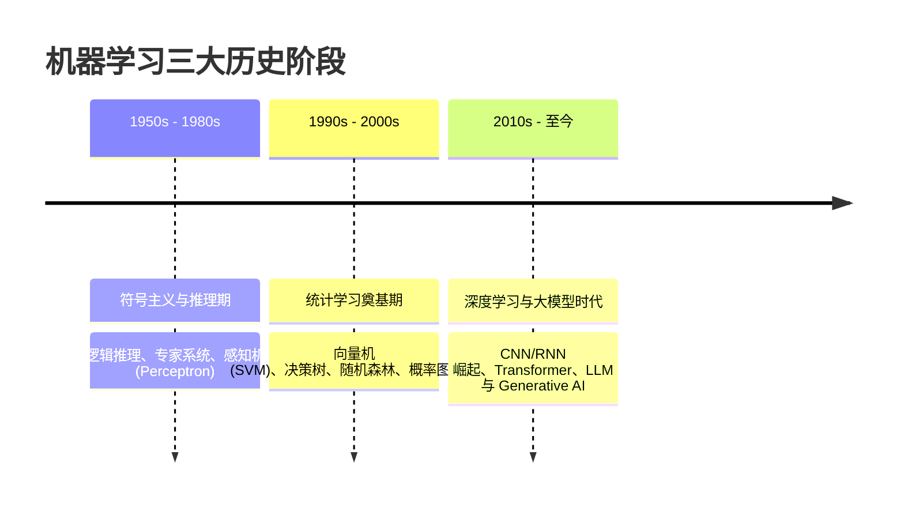

# 机器学习发展历程

> 所属路径：[[../🗺️ 机器学习学习路径|机器学习学习路径]]
> 所属阶段：[[🌱 第一阶段：基础概念|返回阶段页]]
> 所属模块：`模块2：假设空间与归纳偏好`

## 为什么学
- 这张卡位于“模块2：假设空间与归纳偏好”，用来解决：为什么学习器必须受限于假设空间，又为什么偏好决定泛化风格？
- 它是你从 [[归纳偏好]] 走向 [[机器学习应用现状]]、[[经验风险最小化]] 的桥梁。

## 教材定位
- 主教材：`机器学习（周志华）`
- 对应章节：第1章 1.3-1.6
- 阶段入口：[[🌱 第一阶段：基础概念|🌱 第一阶段：基础概念]]

## 必须掌握
- 用自己的话定义 `机器学习发展历程`，并说清它的边界。
- 解释 `机器学习发展历程` 为什么是“为什么学习器必须受限于假设空间，又为什么偏好决定泛化风格？”这条问题链的一部分。
- 说明它和同阶段相邻概念的区别与联系。

## 关键问题
- 机器学习发展历程 在“模块2：假设空间与归纳偏好”这条主线里具体负责哪一步？
- 如果忽略 机器学习发展历程，为什么学习器必须受限于假设空间，又为什么偏好决定泛化风格？ 会在哪一步断掉？
- 机器学习发展历程 和相邻概念的边界是什么？

## 最小例子
- 场景：
- 输入：
- 关键一步：
- 结论：

## 练习与输出
- [ ] 写 3-5 行自己的定义或项目目标。
- [ ] 补一个最小例子、例题、推导片段或实验记录。
- [ ] 记录一个易错点，或补一条跨路径连接。

## 完成标准
- [ ] 能用自己的话解释假设空间与归纳偏好的关系。
- [ ] 能独立解释这张卡在本阶段中的位置。
- [ ] 能把教材章节和这张卡一一对应。

## 前后连接
- 前置：[[归纳偏好]]
- 相关：[[机器学习应用现状]]、[[经验风险最小化]]
- 返回阶段页：[[🌱 第一阶段：基础概念|🌱 第一阶段：基础概念]]

*创建于：2026-04-18*

---

## 历史版本补充内容（合并自同名旧卡，待复核）

## 0. 先判断它值不值得深挖

- **类别**：**C 类（了解背景，快速过一遍）**
- **判断理由**：机器学习发展历程主要提供历史脉络与学术演化全景，帮助建立“符号学派 $\to$ 统计学习 $\to$ 深度学习 $\to$ 大语言模型 (LLM)”的认知大图景。不需要死记硬背公式或推导，掌握三大主要阶段与学术学派分流即可。

---

## 1. 历史演变三大关键阶段

### 1. 符号主义与知识工程时代 (1950s - 1980s)
- **核心理念**：认为智能源于“符号操作”与逻辑推理。
- **代表成果**：阿兰·图灵的图灵测试、图灵奖得主 Simon 与 Newell 的通用问题求解器、专家系统（Expert Systems）。
- **局限性**：无法自动从数据中学习，依赖人工编写庞大死板的规则库，遭遇“知识获取瓶颈”。

### 2. 统计学习时代 (1990s - 2000s)
- **核心理念**：抛弃硬编码规则，引入概率统计与最优化理论，从数据中自动学习概率分布与映射。
- **代表成果**：Vapnik 提出统计学习理论与支持向量机（SVM）、Breiman 提出随机森林、Boosting 算法（AdaBoost）、对数几率回归与朴素贝叶斯。
- **特点**：具备严密的数学证明与凸优化保证，主导了早期工业界文本分类与风控。

### 3. 深度学习与大模型时代 (2010s - 至今)
- **核心理念**：借助海量数据（Big Data）与 GPU 算力，通过多层非线性感知机自动学习分级特征表示。
- **代表成果**：
  - 2012 ImageNet 比赛 AlexNet 奠定 CNN 在视觉领域的统治地位；
  - 2017 Google 提出 Transformer 架构，统一了 NLP 与 CV；
  - 2022 年至今 OpenAI 推出 ChatGPT，大语言模型（LLM）开启通用人工智能（AGI）探索。

---

## 2. 常见误区和易混概念

### 误区 1：深度学习彻底淘汰了经典统计机器学习
- **为什么错**：在表格数据（Tabular Data）、小样本风控、医疗诊断与嵌入式物联网设备中，XGBoost、LightGBM 以及 SVM 依然因其高可解释性、低算力开销与稳健性占据主流地位。

---

