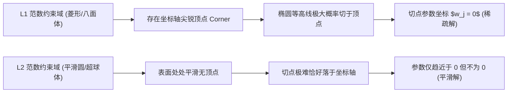

# L1 正则化与 Lasso

Lasso 在线性回归的平方误差上加入参数的 L1 范数惩罚，使系数收缩，并可能把部分系数精确压到零。因此它兼具正则化与嵌入式变量选择作用。

**L1正则化Lasso**指的正是这一“平方损失 + L1 惩罚”的估计问题。下文使用 Lasso 作为 L1正则化Lasso 的简称，不把一般的 L1 惩罚分类器与线性回归 Lasso 混为一谈。

## 1. 优化问题

设特征已中心化、目标已中心化，Lasso 的惩罚形式为

$$
\hat\beta=\arg\min_{\beta}
\left\{\frac{1}{2n}\lVert y-X\beta\rVert_2^2+\lambda\lVert\beta\rVert_1\right\},
$$

其中 $\lVert\beta\rVert_1=\sum_j|\beta_j|$，$\lambda\ge0$ 控制收缩强度。等价约束形式是最小化残差平方和，同时要求 $\lVert\beta\rVert_1\le t$。

- $\lambda=0$ 时退化为普通最小二乘。
- $\lambda$ 增大时系数整体更小，零系数通常更多。
- 截距一般不惩罚；特征应在训练折内标准化，否则尺度会改变惩罚强度。

## 2. 为什么产生稀疏解

L1 约束区域在坐标轴方向有尖角。平方误差等高线与约束边界首次相切时，容易落在某个坐标为零的尖角上。解析上，一维正交情形对应软阈值算子：

$$
S(z,\lambda)=\operatorname{sign}(z)\max(|z|-\lambda,0).
$$

当 $|z|\le\lambda$ 时输出正好为零；这与 L2 正则通常只连续缩小但不置零不同。

## 3. 最小验证

```python
import numpy as np
from sklearn.linear_model import Lasso

rng = np.random.default_rng(4)
X = rng.normal(size=(200, 5))
y = 3 * X[:, 0] - 2 * X[:, 2] + rng.normal(scale=0.3, size=200)

model = Lasso(alpha=0.08, max_iter=10000).fit(X, y)
support = np.flatnonzero(np.abs(model.coef_) > 1e-8)

assert 0 in support and 2 in support
assert len(support) < X.shape[1]
```

该例只验证稀疏性。正式实验必须把标准化和 Lasso 放入同一交叉验证 Pipeline，并在未见测试集上评估预测误差。

## 4. 超参数选择

不能用训练误差选择 $\lambda$，因为训练误差偏向更弱惩罚。应在训练集内部做交叉验证，以验证误差最小值选择 `lambda_min`，或用 one-standard-error 规则选择更简单的模型。最终测试集只评估一次。

若特征高度相关，Lasso 可能从一组相关变量中任意选择一个，支持集会对抽样扰动不稳定。Elastic Net 同时使用 L1 与 L2 惩罚，常能改善成组相关特征的稳定性。

## 5. 统计与工程边界

1. 零系数不自动表示变量没有因果作用；共线性、测量误差和遗漏变量都会改变选择结果。
2. $p>n$ 时 Lasso 仍可拟合，但变量选择一致性需要额外设计矩阵条件。
3. 正则化估计有偏；其目标是降低泛化误差或获得稀疏表示，不是恢复无偏 OLS。
4. 分类任务对应 L1 惩罚逻辑回归，而不是把分类标签直接套入平方损失 Lasso。
5. 报告模型时必须同时记录标准化方式、$\lambda$ 选择规则和交叉验证划分。

## 6. 知识连接

- 基础模型：[[02-Knowledge/🧠 学习系统/17-机器学习/02-线性模型/线性回归|线性回归]]。
- 机制延伸：[[02-Knowledge/🧠 学习系统/17-机器学习/03-正则优化/特征选择|特征选择]]、[[02-Knowledge/🧠 学习系统/17-机器学习/03-正则优化/稀疏学习|稀疏学习]]。
- 验证协议：[[02-Knowledge/🧠 学习系统/17-机器学习/01-基础概念/数据集划分与交叉验证|数据集划分与交叉验证]]。

## 🌐 开放教材定位

> 以下条目是本卡的知识主线与定位依据；算法 API 和软件文档只作实现对照。

- [An Introduction to Statistical Learning](https://www.statlearning.com/) — `Chapter 6: Linear Model Selection and Regularization`；官方免费访问，不推定再分发权。

引用时继续保留 `locator`，不把教材首页或搜索摘要当作具体论据。

## 参考资料

- Tibshirani, R. “Regression Shrinkage and Selection via the Lasso”, *JRSS B* 58(1), 1996, DOI:10.1111/j.2517-6161.1996.tb02080.x：https://rss.onlinelibrary.wiley.com/doi/10.1111/j.2517-6161.1996.tb02080.x
- scikit-learn, *Lasso* 官方文档：https://scikit-learn.org/stable/modules/linear_model.html#lasso

---

## 历史版本补充内容（合并自同名旧卡，待复核）

## 0. 先判断它值不值得深挖


- **类别**：**A 类（核心概念，必须深挖）**
- **判断理由**：L1 正则化（Lasso 回归 / 最小绝对收缩和选择算子）是机器学习中实现**自动特征选择与产生稀疏解（Sparse Solution）**的最关键技术。理解为什么 L1 能够产生稀疏解而 L2 不能（几何等高线与菱形顶点切点视角、拉普拉斯先验视角、次梯度视角）是面试与理论考核的高频焦点。

---

## 1. 这个知识点解决什么问题？


> **我们遇到了什么麻烦：**
> 假设你的数据集有 10,000 个特征，但其中只有 20 个特征是真正影响预测目标的，其余 9,980 个都是毫无价值的噪声。如果使用普通的线性回归，模型会为这 9,980 个噪声特征分配微小的非零权重，导致模型庞大、不可解释且极易过拟合。

L1 正则化**通过在损失函数中增加参数绝对值之和的惩罚项**，强制将大量不重要特征的权重精确压缩为绝对的 **0**，自动筛选出关键特征。

---

## 2. 为什么它重要？它有什么用？


- **连接大图景**：
  - **后续影响**：支撑了 [[03-正则优化/特征选择|特征选择]]、[[03-正则优化/稀疏学习|稀疏学习]] 与压缩感知（Compressed Sensing）。
  - **课程位置**：属于“第三阶段：正则优化”的核心算法。
- **实战与科研价值**：
  - **高维稀疏建模**：基因组学、文本袋模型（Bag-of-Words）降维。
  - **最常出现题型**：L1 产生稀疏解的三大几何与数学推导题、坐标下降法 (Coordinate Descent) 求解题、L1 (Lasso) vs L2 (Ridge) 对比辨析题。

---

## 3. 学它之前需要哪些前置知识？


### 最小必要背景：
1. **线性回归损失 (MSE)**：$E(\mathbf{w}) = \|\mathbf{y} - \mathbf{X}\mathbf{w}\|^2$。
2. **范数 (Norm)**：L1 范数 $\|\mathbf{w}\|_1 = \sum |w_j|$，L2 范数 $\|\mathbf{w}\|_2^2 = \sum w_j^2$。

---

## 4. 用直觉语言解释它


> «“这东西其实就像给每个参数征收固定的人头税……”»

- **L2 正则化 (Ridge 软惩罚)**：惩罚金额与 $w_j^2$ 成正比。当 $w_j$ 变得很小（如 0.001）时，$w_j^2 = 0.000001$ 惩罚微乎其微，因此参数会被无限无限拉近 0，但**永远不会真正等于 0**。
- **L1 正则化 (Lasso 拔毛惩罚)**：无论 $w_j$ 多小，惩罚金额都与 $|w_j|$ 成正比（恒定梯度）。如果某个特征对降低损失的贡献抵不上固定的“人头税 $\lambda$”，算法就会干脆直接把这个参数**砍到恰好等于 0**。

---

## 5. 正式定义、核心公式、符号解释


### 1. Lasso 回归目标函数
给定数据矩阵 $\mathbf{X} \in \mathbb{R}^{N \times d}$ 和目标 $\mathbf{y} \in \mathbb{R}^N$：

$$J(\mathbf{w}) = \frac{1}{2N} \|\mathbf{y} - \mathbf{X}\mathbf{w}\|_2^2 + \lambda \|\mathbf{w}\|_1 = \frac{1}{2N} \sum_{i=1}^N (y_i - \mathbf{w}^T \mathbf{x}_i)^2 + \lambda \sum_{j=1}^d |w_j|$$

其中 $\lambda > 0$ 为调节稀疏度的超参数。

### 2. 约束优化等价形式 (KKT 条件视角)
$$\min_{\mathbf{w}} \|\mathbf{y} - \mathbf{X}\mathbf{w}\|_2^2 \quad \text{s.t. } \|\mathbf{w}\|_1 \le C$$

- L1 约束域：在二维空间中是一个**顶点位于坐标轴上的菱形（或高维正八面体）**。
- 最小二乘损失的等高线：是一组以无约束解 $\mathbf{w}^{\text{OLS}}$ 为中心的**椭圆族**。

---

## 6. 推导思路：为什么 L1 能产生稀疏解？


### 几何视角推导：
1. 优化目标在几何上等价于寻找“椭圆等高线”与“约束区域”的第一相切点。
2. L2 的约束区域是光滑的**圆形/超球体**，椭圆等高线与圆相切的点几乎不可能恰好发生在坐标轴上（即坐标分量不为 0）。
3. L1 的约束区域是有**尖锐顶点（Corners/Vertices）**的菱形/正八面体，这些顶点恰好位于坐标轴上（如 $(C, 0)$ 或 $(0, C)$）。
4. 椭圆等高线在扩展时，**极大概率首先接触到菱形的尖锐顶点**！一旦切点在顶点上，对应的某些参数分量就精确等于 **0**，从而产生稀疏解。



---

## 7. 例子：基础 → 中等 → 实际应用


### 例子 1：L1 (Lasso) vs L2 (Ridge) 对比
| 维度 | L1 正则化 (Lasso) | L2 正则化 (Ridge) |
| :--- | :--- | :--- |
| **惩罚项形式** | $\lambda \sum \|w_j\|$ | $\lambda \sum w_j^2$ |
| **约束几何形状** | 菱形 / 八面体（带尖顶） | 圆形 / 超球体（处处平滑） |
| **解的性质** | **稀疏解**（许多权重精确为 0） | **非稀疏解**（权重趋近 0 但不为 0）|
| **核心用途** | 特征选择、高维稀疏降维 | 防止过拟合、处理多重共线性 |
| **贝叶斯先验视角** | 参数服从拉普拉斯先验 (Laplace Prior) | 参数服从高斯先验 (Gaussian Prior) |
| **导数性质** | 在 0 处不可导（需用次梯度/软阈值求解） | 处处可导（有封闭解 $(\mathbf{X}^T\mathbf{X}+\lambda\mathbf{I})^{-1}\mathbf{X}^T\mathbf{y}$）|

---

## 9. 闭卷复现任务


1. 写出 Lasso 回归的目标函数。
2. 几何上解释为什么 L1 能够产生稀疏解而 L2 不能。
3. 比较 L1 与 L2 正则化对应的贝叶斯先验分布。

---

## 10. 自测题：5 道


| 题号 | 类型 | 难度 | 考查点 |
| :--- | :--- | :--- | :--- |
| 1 | 概念辨析 | 基础 | Lasso 解的稀疏性 |
| 2 | 先验匹配 | 基础 | 贝叶斯分布对应 |
| 3 | 几何推理 | 中等 | 菱形顶点切点 |
| 4 | 条件决策 | 中等 | 特征选择场景 |
| 5 | 算法推导 | 较难 | 软阈值算子 (Soft-Thresholding) |

1. **[概念辨析] Lasso 回归（L1 正则化）与 Ridge 回归（L2 正则化）最根本的区别在于 Lasso 能够：**
   A. 保证矩阵可逆  
   B. 产生稀疏解（将不重要特征的权重精确压缩为 0），实现自动特征选择  
   C. 获得更快的训练速度  
   D. 避免欠拟合
> [!question]- 答案解析
> **答案**：B  
> **解析**：L1 正则化最核心的独特性在于产生稀疏解，具备自动特征选择能力。  
> **标签**：`#自测/基础 #Lasso稀疏解`

2. **[先验匹配] 从贝叶斯最大后验估计 (MAP) 视角来看，L1 正则化等价于假设模型参数服从：**
   A. 高斯分布 (Gaussian Distribution)  
   B. 拉普拉斯分布 (Laplace Distribution)  
   C. 伯努利分布 (Bernoulli Distribution)  
   D. 均匀分布
> [!question]- 答案解析
> **答案**：B  
> **解析**：拉普拉斯分布密度为 $\propto \exp(-\frac{|w|}{b})$，其对数形式恰好为 L1 绝对值惩罚。  
> **标签**：`#自测/基础 #拉普拉斯先验`

3. **[几何推理] 在二维平面中，L1 范数约束区域 $\|\mathbf{w}\|_1 \le C$ 的几何边界形状是：**
   A. 一个以原点为中心的圆  
   B. 一个顶点位于 $(C,0), (0,C), (-C,0), (0,-C)$ 的菱形  
   C. 一个抛物线  
   D. 一个无限延伸的双曲线
> [!question]- 答案解析
> **答案**：B  
> **解析**：$|w_1| + |w_2| \le C$ 在二维空间中是顶点在坐标轴上的菱形。  
> **标签**：`#自测/中等 #L1几何形状`

4. **[条件决策] 如果你面对一个拥有 50,000 个特征但绝大部分特征均无效的数据集，为了挑选出最重要的 20 个特征，应当优先采用：**
   A. Ridge 岭回归  B. Lasso 回归  C. 简单线性回归  D. K-Means
> [!question]- 答案解析
> **答案**：B  
> **解析**：高维稀疏特征选择场景是 Lasso 回归的标准应用主战场。  
> **标签**：`#自测/中等 #Lasso应用场景`

5. **[算法推导] 在一维坐标下降法中，求解 $\min_w \frac{1}{2}(w - a)^2 + \lambda |w|$ 的解为软阈值算子 (Soft-Thresholding Operator) $S_\lambda(a)$，其解析表达式为：**
   A. $w = a$  
   B. $S_\lambda(a) = \text{sign}(a) \max(|a| - \lambda, 0)$  
   C. $w = a - \lambda$  
   D. $w = 0$
> [!question]- 答案解析
> **答案**：B  
> **解析**：通过分段讨论 $w > 0, w < 0$ 以及次导数包含 0 的区间，可推导出软阈值解 $S_\lambda(a) = \text{sign}(a) \max(|a| - \lambda, 0)$，即当 $|a| \le \lambda$ 时直接截断压缩为 0。  
> **标签**：`#自测/较难 #软阈值算子`

---

