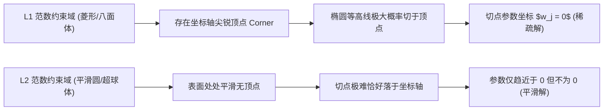

---
type: study
topic: "L1正则化Lasso"
course: "机器学习"
created: 2026-04-18
updated: 2026-08-02
status: completed
difficulty: intermediate
concept: ["Lasso", "L1正则化", "稀疏回归"]
prerequisites: ["线性回归", "凸优化", "交叉验证"]
related: ["特征选择", "稀疏学习", "正则化"]
tags: [机器学习, 学习, Lasso, 正则化]
flow: knowledge
kind: derivation
sources:
  - title: "An Introduction to Statistical Learning"
    url: "https://www.statlearning.com/"
    locator: "Chapter 6: Linear Model Selection and Regularization"
    source_type: "official-free-textbook"
    license: "official-free; redistribution not assumed"
    verified_at: 2026-08-02
aliases: ["🎯 L1 正则化与 Lasso 回归"]
stage_moc: "[[🧭 阶段3-正则优化]]"
upstream: ["[[机器学习-线性回归]]"]
---

# L1 正则化与 Lasso

Lasso 在线性回归的平方误差上加入参数的 L1 范数惩罚，使系数收缩，并可能把部分系数精确压到零。因此它兼具正则化与嵌入式变量选择作用。

**L1正则化Lasso**指的正是这一“平方损失 + L1 惩罚”的估计问题。下文使用 Lasso 作为 L1正则化Lasso 的简称，不把一般的 L1 惩罚分类器与线性回归 Lasso 混为一谈。

## 1. 优化问题

设特征已中心化、目标已中心化，Lasso 的惩罚形式为

$$
\hat\beta=\arg\min_{\beta}
\left\{\frac{1}{2n}\lVert y-X\beta\rVert_2^2+\lambda\lVert\beta\rVert_1\right\},
$$

其中 $\lVert\beta\rVert_1=\sum_j|\beta_j|$，$\lambda\ge0$ 控制收缩强度。等价约束形式是最小化残差平方和，同时要求 $\lVert\beta\rVert_1\le t$。

- $\lambda=0$ 时退化为普通最小二乘。
- $\lambda$ 增大时系数整体更小，零系数通常更多。
- 截距一般不惩罚；特征应在训练折内标准化，否则尺度会改变惩罚强度。

## 2. 为什么产生稀疏解

L1 约束区域在坐标轴方向有尖角。平方误差等高线与约束边界首次相切时，容易落在某个坐标为零的尖角上。解析上，一维正交情形对应软阈值算子：

$$
S(z,\lambda)=\operatorname{sign}(z)\max(|z|-\lambda,0).
$$

当 $|z|\le\lambda$ 时输出正好为零；这与 L2 正则通常只连续缩小但不置零不同。

## 3. 最小验证

```python
import numpy as np
from sklearn.linear_model import Lasso

rng = np.random.default_rng(4)
X = rng.normal(size=(200, 5))
y = 3 * X[:, 0] - 2 * X[:, 2] + rng.normal(scale=0.3, size=200)

model = Lasso(alpha=0.08, max_iter=10000).fit(X, y)
support = np.flatnonzero(np.abs(model.coef_) > 1e-8)

assert 0 in support and 2 in support
assert len(support) < X.shape[1]
```

该例只验证稀疏性。正式实验必须把标准化和 Lasso 放入同一交叉验证 Pipeline，并在未见测试集上评估预测误差。

## 4. 超参数选择

不能用训练误差选择 $\lambda$，因为训练误差偏向更弱惩罚。应在训练集内部做交叉验证，以验证误差最小值选择 `lambda_min`，或用 one-standard-error 规则选择更简单的模型。最终测试集只评估一次。

若特征高度相关，Lasso 可能从一组相关变量中任意选择一个，支持集会对抽样扰动不稳定。Elastic Net 同时使用 L1 与 L2 惩罚，常能改善成组相关特征的稳定性。

## 5. 统计与工程边界

1. 零系数不自动表示变量没有因果作用；共线性、测量误差和遗漏变量都会改变选择结果。
2. $p>n$ 时 Lasso 仍可拟合，但变量选择一致性需要额外设计矩阵条件。
3. 正则化估计有偏；其目标是降低泛化误差或获得稀疏表示，不是恢复无偏 OLS。
4. 分类任务对应 L1 惩罚逻辑回归，而不是把分类标签直接套入平方损失 Lasso。
5. 报告模型时必须同时记录标准化方式、$\lambda$ 选择规则和交叉验证划分。

## 6. 知识连接

- 基础模型：[[机器学习-线性回归|线性回归]]。
- 机制延伸：[[机器学习-特征选择|特征选择]]、[[机器学习-稀疏学习|稀疏学习]]。
- 验证协议：[[机器学习-数据集划分与交叉验证|数据集划分与交叉验证]]。

## 🌐 开放教材定位

> 以下条目是本卡的知识主线与定位依据；算法 API 和软件文档只作实现对照。

- [An Introduction to Statistical Learning](https://www.statlearning.com/) — `Chapter 6: Linear Model Selection and Regularization`；官方免费访问，不推定再分发权。

引用时继续保留 `locator`，不把教材首页或搜索摘要当作具体论据。

## 参考资料

- Tibshirani, R. “Regression Shrinkage and Selection via the Lasso”, *JRSS B* 58(1), 1996, DOI:10.1111/j.2517-6161.1996.tb02080.x：https://rss.onlinelibrary.wiley.com/doi/10.1111/j.2517-6161.1996.tb02080.x
- scikit-learn, *Lasso* 官方文档：https://scikit-learn.org/stable/modules/linear_model.html#lasso

---


## 补充代码示例（自旧版合并保留）


## 学完后可以完成

> 下面由作业 `requires` 自动反查：学完本卡后可完成的课后作业、阶段作业与大作业（单一事实源，不手动维护）。

```dataview
LIST
FROM "03-Projects"
WHERE type = "project" AND contains(requires, this.file.link)
SORT assignment_level ASC, file.name ASC
```
