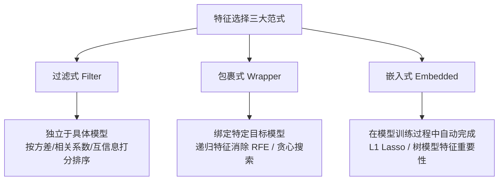

---

type: study

flow: knowledge

kind: concept

topic: "特征选择"

course: "机器学习"

module: "模块2：特征选择与稀疏化"

created: 2026-04-18

status: ongoing

difficulty: advanced

concept: ["特征选择"]

prerequisites: ["深度学习入门"]

related: ["稀疏学习", "L1正则化Lasso"]

source_textbook: ["机器学习（周志华）"]

source_sections: ["第11章"]

learning_objectives: ["说明 特征选择 在“模块2：特征选择与稀疏化”里解决的具体问题", "把 特征选择 对应回 第11章", "用一个最小例子或代表题解释 特征选择 的作用"]

deliverables: ["一句话定义或项目目标", "一个最小例子/代表题/最小实验", "一条易错点或跨路径连接", "能说明特征选择、L1 正则与稀疏表示的联系。"]

tags: ["机器学习", "学习"]

aliases: ["🎯 特征选择 (Feature Selection)"]

stage_moc: "[[🧭 阶段3-正则优化]]"

upstream: ["[[机器学习-深度学习入门]]"]

source: "周志华《机器学习》第5、11、12章"
source_url: "https://book.douban.com/subject/26708119/"
accessed: 2026-08-07
license: "[待验证]"

---


# 特征选择


> 所属路径：[[🗺️ 机器学习学习路径|机器学习学习路径]]

> 所属阶段：[[🧭 阶段3-正则优化|返回阶段页]]

> 所属模块：`模块2：特征选择与稀疏化`


## 为什么学

- 这张卡位于“模块2：特征选择与稀疏化”，用来解决：为什么正则化能同时服务于泛化控制和特征压缩？

- 它是你从 [[机器学习-深度学习入门]] 走向 [[机器学习-稀疏学习]]、[[机器学习-L1正则化Lasso]] 的桥梁。


## 教材定位

- 主教材：`机器学习（周志华）`

- 对应章节：第11章

- 阶段入口：[[🧭 阶段3-正则优化|🧭 阶段3-正则优化]]


## 必须掌握

- 用自己的话定义 `特征选择`，并说清它的边界。

- 解释 `特征选择` 为什么是“为什么正则化能同时服务于泛化控制和特征压缩？”这条问题链的一部分。

- 说明它和同阶段相邻概念的区别与联系。


## 关键问题

- 特征选择 在“模块2：特征选择与稀疏化”这条主线里具体负责哪一步？

- 如果忽略 特征选择，为什么正则化能同时服务于泛化控制和特征压缩？ 会在哪一步断掉？

- 特征选择 和相邻概念的边界是什么？


## 最小例子

- 场景：

- 输入：

- 关键一步：

- 结论：


## 练习与输出

- [ ] 写 3-5 行自己的定义或项目目标。

- [ ] 补一个最小例子、例题、推导片段或实验记录。

- [ ] 记录一个易错点，或补一条跨路径连接。


## 完成标准

- [ ] 能说明特征选择、L1 正则与稀疏表示的联系。

- [ ] 能独立解释这张卡在本阶段中的位置。

- [ ] 能把教材章节和这张卡一一对应。


## 前后连接

- 前置：[[机器学习-深度学习入门]]

- 相关：[[机器学习-稀疏学习]]、[[机器学习-L1正则化Lasso]]

- 返回阶段页：[[🧭 阶段3-正则优化|🧭 阶段3-正则优化]]


*创建于：2026-04-18*


---


## 补充代码示例（自旧版合并保留）




## 学完后可以完成


> 下面由作业 `requires` 自动反查：学完本卡后可完成的课后作业、阶段作业与大作业（单一事实源，不手动维护）。


```dataview

LIST

FROM "03-Projects"

WHERE type = "project" AND contains(map(requires, (r) => r.path), this.file.name)

SORT assignment_level ASC, file.name ASC

```

