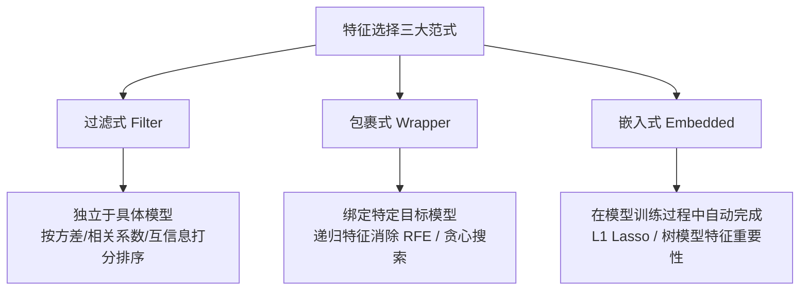

# 特征选择

> 所属路径：[[../🗺️ 机器学习学习路径|机器学习学习路径]]
> 所属阶段：[[🛡️ 第三阶段：正则优化|返回阶段页]]
> 所属模块：`模块2：特征选择与稀疏化`

## 为什么学
- 这张卡位于“模块2：特征选择与稀疏化”，用来解决：为什么正则化能同时服务于泛化控制和特征压缩？
- 它是你从 [[深度学习入门]] 走向 [[稀疏学习]]、[[L1正则化Lasso]] 的桥梁。

## 教材定位
- 主教材：`机器学习（周志华）`
- 对应章节：第11章
- 阶段入口：[[🛡️ 第三阶段：正则优化|🛡️ 第三阶段：正则优化]]

## 必须掌握
- 用自己的话定义 `特征选择`，并说清它的边界。
- 解释 `特征选择` 为什么是“为什么正则化能同时服务于泛化控制和特征压缩？”这条问题链的一部分。
- 说明它和同阶段相邻概念的区别与联系。

## 关键问题
- 特征选择 在“模块2：特征选择与稀疏化”这条主线里具体负责哪一步？
- 如果忽略 特征选择，为什么正则化能同时服务于泛化控制和特征压缩？ 会在哪一步断掉？
- 特征选择 和相邻概念的边界是什么？

## 最小例子
- 场景：
- 输入：
- 关键一步：
- 结论：

## 练习与输出
- [ ] 写 3-5 行自己的定义或项目目标。
- [ ] 补一个最小例子、例题、推导片段或实验记录。
- [ ] 记录一个易错点，或补一条跨路径连接。

## 完成标准
- [ ] 能说明特征选择、L1 正则与稀疏表示的联系。
- [ ] 能独立解释这张卡在本阶段中的位置。
- [ ] 能把教材章节和这张卡一一对应。

## 前后连接
- 前置：[[深度学习入门]]
- 相关：[[稀疏学习]]、[[L1正则化Lasso]]
- 返回阶段页：[[🛡️ 第三阶段：正则优化|🛡️ 第三阶段：正则优化]]

*创建于：2026-04-18*

---

## 历史版本补充内容（合并自同名旧卡，待复核）

## 0. 先判断它值不值得深挖

- **类别**：**A 类（核心概念，必须深挖）**
- **判断理由**：在实际工业界特征工程中，“特征决定了机器学习性能的上界，而算法和模型只是逼近这个上界”。特征选择能够降低维度、消除冗余与无用噪声、提升模型可解释性并加速训练。掌握三大通用特征选择范式（**过滤式 Filter、包裹式 Wrapper、嵌入式 Embedded**）是特征工程的核心基础。

---

## 1. 三大特征选择范式对比

### 1. 过滤式 (Filter)
- **原理**：先对数据集的每个特征进行统计检验与打分（独立于后续的具体学习算法），挑选得分最高的 $k$ 个特征。
- **常用指标**：方差选择（剔除 0 方差）、皮尔逊相关系数、卡方检验 ($\chi^2$)、互信息 (Mutual Information)。
- **优缺点**：计算速度极快，适合超高维预处理；但忽略了特征之间的组合效应以及与特定模型的契合度。

### 2. 包裹式 (Wrapper)
- **原理**：将目标机器学习模型的预测性能作为特征子集的评估函数（将模型作为黑盒包裹在搜索算法外）。
- **常见算法**：递归特征消除 (RFE - Recursive Feature Elimination)、向前/向后贪心搜索。
- **优缺点**：效果最好、最契合目标模型；但计算成本极高（每次评估子集都需要重新训练模型）。

### 3. 嵌入式 (Embedded)
- **原理**：将特征选择过程与机器学习模型的学习训练过程融为一体，在优化损失函数的同时自动完成特征选择。
- **代表方法**：L1 正则化 (Lasso)、决策树/随机森林（基于基尼不纯度减少量的特征重要性）。
- **优缺点**：兼顾了 Filter 的高效率与 Wrapper 的高性能。

---

## 2. 常见误区和易混概念

### 三大范式总结表格
| 范式 | 与机器学习模型关系 | 计算复杂度 | 性能与契合度 | 代表算法 |
| :--- | :--- | :--- | :--- | :--- |
| **过滤式 (Filter)** | 独立（先过滤，后训练） | 极低 $O(d)$ | 中等（忽略特征组合） | 卡方检验、方差阈值、互信息 |
| **包裹式 (Wrapper)** | 绑定（模型作为评估器） | 极高 $O(2^d)$ | 最高 | RFE (递归特征消除)、贪心搜索 |
| **嵌入式 (Embedded)**| 融合（训练中自动选择） | 中等 | 高 | L1 Lasso、树模型 Feature Importance |

---

