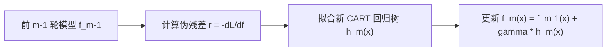

# XGBoost

XGBoost 是正则化梯度提升树的工程化实现，不是“很多树投票”的同义词。第 (t) 轮在已有预测上加一棵树：

$$
\hat y_i^{(t)}=\hat y_i^{(t-1)}+f_t(x_i),\qquad
\mathcal L^{(t)}=\sum_i l(y_i,\hat y_i^{(t)})+\Omega(f_t),
$$

其中 (f_t) 把样本映射到叶节点分数，复杂度项常写为

$$
\Omega(f)=\gamma T+\frac{\lambda}{2}\sum_{j=1}^{T}w_j^2.
$$

(T) 是叶数；(\gamma) 惩罚新增叶，(\lambda) 收缩叶权重。与只按纯度分裂的单棵树相比，目标函数直接权衡训练损失与模型复杂度。

## 1. 二阶近似与分裂增益

对新增树做二阶泰勒展开，记

$$g_i=\partial_{\hat y}l(y_i,\hat y_i^{(t-1)}),\qquad
h_i=\partial^2_{\hat y}l(y_i,\hat y_i^{(t-1)}).$$

叶 (j) 内聚合 (G_j=\sum g_i, H_j=\sum h_i)，固定树结构时最优叶权重为

$$w_j^*=-\frac{G_j}{H_j+\lambda}.$$

候选节点分成左右子节点的收益是

$$
\text{Gain}=\frac12\left[
\frac{G_L^2}{H_L+\lambda}+\frac{G_R^2}{H_R+\lambda}
-\frac{(G_L+G_R)^2}{H_L+H_R+\lambda}
\right]-\gamma.
$$

收益不足时不分裂。XGBoost 还通过直方图/近似分裂、稀疏感知的默认方向、缓存友好布局和并行化提高训练效率；这些是对梯度提升框架的实现增强，不改变“逐轮拟合当前损失”的核心。

## 2. 最小可靠实验

```python
from xgboost import XGBClassifier

model = XGBClassifier(
    n_estimators=500, learning_rate=0.05, max_depth=4,
    min_child_weight=5, subsample=0.8, colsample_bytree=0.8,
    reg_lambda=1.0, eval_metric="logloss", random_state=42
)
model.fit(X_train, y_train, eval_set=[(X_valid, y_valid)], verbose=False)
```

先建立逻辑回归和[[随机森林]]基线，再按同一划分比较样本外指标。时间数据必须按时间切分；类别不平衡需同时报告 PR-AUC、召回率与阈值。`learning_rate` 与树数联动，深度、`min_child_weight`、行/列采样和正则项共同控制方差。

## 3. 边界与误区

- XGBoost 擅长中等规模表格数据，但不会自动修复数据泄漏、错误标签或分布漂移。
- 缺失值默认方向是训练得到的路由，不等于统计意义上的缺失机制建模。
- 内置特征重要性不代表因果效应；高基数字段和相关特征会扭曲解释。
- 训练分数持续提高而验证分数变差就是过拟合，应早停或降低容量，而不是盲目加树。

## 4. 开放教材定位

先用 ISLR Chapter 8 建立树、装袋与 boosting 的统一概念，再用 XGBoost 官方教程完成目标函数推导，以原论文核验稀疏与系统实现。教材负责主线，文档和论文只承担实现与验收层。

直观地看，每轮新树不是直接拟合原始标签，而是拟合“当前模型还应往哪个方向、走多远”。一阶梯度给出纠错方向，二阶梯度刻画局部曲率；按叶汇总后，训练器无须为每个样本单独保存一个叶权重。`reg_lambda` 增大时最优叶分数绝对值收缩，`gamma` 增大时弱分裂被拒绝，这正对应目标函数中的两种正则化作用。验收时应画训练与验证损失随树数变化的曲线，证明早停轮次来自独立验证集，而不是测试集。

## 参考资料

- James et al., [An Introduction to Statistical Learning, Chapter 8](https://www.statlearning.com/)，树模型与 boosting 教材主线。
- XGBoost Developers, [Introduction to Boosted Trees](https://xgboost.readthedocs.io/en/stable/tutorials/model.html)，正则化目标、二阶近似与分裂增益。
- Chen & Guestrin, [XGBoost: A Scalable Tree Boosting System](https://arxiv.org/abs/1603.02754)，论文 §§2–3 的算法与稀疏系统实现。

---

## 历史版本补充内容（合并自同名旧卡，待复核）

## 0. 先判断它值不值得深挖


* **分类结果**：**A 类（核心概念，必须深挖）**
* **判断理由**：GBDT 与 XGBoost 是 Boosting 提升树家族的核心王者，几乎统治了工业界所有的非图像/非语音类**结构化表格数据（Tabular Data）建模**。XGBoost 提出的二阶泰勒展开、树结构正则化与分割增益计算，是理解现代表格机器学习、搜索排序（Learning to Rank）与量化因子建模的必备核心技能。

---

## 1. 这个知识点解决什么问题？


**我们遇到了什么麻烦？**

假设你正在为一家电商平台预测用户的点击率（CTR）。你尝试了两种现有方法：
* **单决策树**：树深度调浅了泛化能力差（偏差大）；树深度调深了又极易过拟合（方差大）。
* **随机森林 (Bagging)**：它通过并行投票极大地降低了模型方差，但对于复杂的非线性拟合能力上限由单树的偏差决定——如果单树本来就拟合不够（偏差大），随机森林也无法降低偏差。

* **以前的方法在哪里卡住？**
  * Bagging（如随机森林）只能“降低方差”，却**无法有效降低模型的偏差（Bias）**。
  * 如果我们手头有一堆拟合能力较弱的基学习器（高偏差），如何通过一种系统性的机制，让他们“接力协作”，把预测误差一步步压到最低？

* **为什么必须引入这个新工具？**
  * 我们需要一种能够**持续纠错、逐步降低偏差**的串行集成框架。这就是 **GBDT (梯度提升树)**。
  * 但传统 GBDT 仅用一阶梯度近似，收敛较慢且缺乏防止过拟合的叶结构正则化；为了解决计算效率与防止过拟合的麻烦，陈天奇提出了 **XGBoost**。

---

## 2. 为什么它重要？它有什么用？


* **大图景连接**：
  * **课程位置**：它是提升树（Boosting）理论的巅峰之作，前接随机森林与梯度下降，后接 LightGBM 与 CatBoost。
  * **后续知识**：不理解二阶泰勒展开 $g_i, h_i$ 和增益 Gain 公式，将无法理解 LightGBM 的 GOSS 采样与 Leaf-wise 生长策略。
* **实际应用**：
  * **搜索排序与 CTR 预估**：搜索引擎结果排序、电商推荐系统点击率预测。
  * **金融量化**：高频 alpha 因子合成与信用违约风险评级。
  * **Kaggle 竞赛**：在所有非深度学习竞赛中，XGBoost/LightGBM 几乎占据了 80% 以上的冠军方案。

---

## 3. 学它之前需要哪些前置知识？


最小必要背景清单：

1. **二阶泰勒展开 (Taylor Expansion)**：
   > 200 字补齐：任意二阶可微函数 $f(x+\Delta x)$ 在 $x$ 附近的二阶近似公式为 $f(x+\Delta x) \approx f(x) + f'(x)\Delta x + \frac{1}{2}f''(x)(\Delta x)^2$。这允许我们在不知道复杂损失函数全局形态时，仅用当前点的一阶导数（梯度）与二阶导数（Hessian）精确近似函数变化。

2. **决策树 (CART) 回归树**：
   > 200 字补齐：回归树将空间切分为 $T$ 个叶节点，每个叶节点输出一个固定实数值权重 $w_j$。预测函数为 $f(x) = w_{q(x)}$，其中 $q(x)$ 表示样本 $x$ 被映射到的叶节点索引。

---

## 4. 用直觉语言解释它


«“这东西其实就像**高尔夫打球接力（或者考前错题集修正）**。第一棵树打出第一杆，球落在离洞口还有 50 米的地方；第二棵树不从起点重新打，而是专门针对这剩下的 50 米残差打第二杆；第三棵树再修正最后剩的 5 米。到了 XGBoost，它不仅看距离洞口还有多远（一阶梯度），还看地面的坡度弯曲变化（二阶 Hessian 梯度），从而打得更精准，同时每多用一杆都要扣除惩罚分（树结构正则化）。”»

* **GBDT 在干什么？** 让每一棵新树去专门学习前面所有树遗留下的“预测误差（负梯度）”。
* **XGBoost 为什么更自然？** 用二阶牛顿法取代一阶梯度下降，走得更准更稳；同时对过于复杂的树结构罚款，防止过拟合。
* **一句话直觉本质**：**GBDT 是在函数空间中沿着负梯度方向串行叠加弱树来降低偏差；XGBoost 则是通过二阶泰勒展开精确求解叶节点最优权重，并用结构正则化控制模型复杂度。**

---

## 5. 正式定义、核心公式、符号解释


### 1. 核心定义
* **GBDT**：一种将 CART 回归树作为基学习器，通过加法模型 $\sum f_t(x)$ 串行叠加，并用新树拟合上一轮损失函数负梯度的梯度提升算法。
* **XGBoost**：对 GBDT 损失函数进行二阶泰勒展开，显式加入包含叶节点数 $T$ 与叶权重 $L_2$ 模长的正则项 $\Omega(f) = \gamma T + \frac{1}{2}\lambda \sum w_j^2$，并导出 closed-form 叶节点最优权重的算法。

### 2. 核心公式

#### (1) 二阶泰勒展开目标函数
$$\tilde{\mathcal{L}}^{(t)} \approx \sum_{i=1}^N \left[ g_i f_t(x_i) + \frac{1}{2} h_i f_t^2(x_i) \right] + \gamma T + \frac{1}{2} \lambda \sum_{j=1}^T w_j^2$$

#### (2) 叶节点最优权重 (Closed-form Leaf Weight)
$$w_j^* = -\frac{G_j}{H_j + \lambda}$$

#### (3) 最优结构得分 (Structure Score)
$$\tilde{\mathcal{L}}^{(t)*} = -\frac{1}{2} \sum_{j=1}^T \frac{G_j^2}{H_j + \lambda} + \gamma T$$

#### (4) 节点切分分割增益 (Gain)
$$\text{Gain} = \frac{1}{2} \left[ \frac{G_L^2}{H_L + \lambda} + \frac{G_R^2}{H_R + \lambda} - \frac{(G_L + G_R)^2}{H_L + H_R + \lambda} \right] - \gamma$$

### 3. 符号说明

| 符号 | 含义 | 取值范围/量纲 | 备注 |
|:---|:---|:---|:---|
| $g_i$ | 样本 $i$ 的损失函数一阶梯度 $\frac{\partial L}{\partial \hat{y}}$ | $\mathbb{R}$ | 衡量预测偏高还是偏低 |
| $h_i$ | 样本 $i$ 的损失函数二阶梯度 $\frac{\partial^2 L}{\partial \hat{y}^2}$ | $\mathbb{R}^+$ | 衡量损失函数的曲率/置信度 |
| $G_j$ | 叶节点 $j$ 内所有样本的一阶梯度和 $\sum_{i \in I_j} g_i$ | $\mathbb{R}$ | 叶节点一阶推力 |
| $H_j$ | 叶节点 $j$ 内所有样本的二阶梯度和 $\sum_{i \in I_j} h_i$ | $\mathbb{R}^+$ | 叶节点二阶阻尼 |
| $w_j^*$ | 叶节点 $j$ 的最优预测输出值 | $\mathbb{R}$ | closed-form 精确解 |
| $\lambda$ | 叶节点权重的 $L_2$ 正则化惩罚系数 | $\ge 0$ | 防止叶权重过大 |
| $\gamma$ | 引入一个新叶节点的固定惩罚系数 | $\ge 0$ | 相当于预剪枝门槛 |

---

## 6. 推导思路和思想来源


### 1. 从 GBDT 到 XGBoost 的推导主线
* **一开始想解决什么困难？**
  传统 GBDT 每一轮拟合负梯度 $r_{it} = -g_i$，本质上是用一阶最速下降法。最速下降法在接近极小值时容易产生震荡且收敛缓慢，且无法直接融入复杂的结构正则项。
* **关键转念（牛顿法与二阶展开）**：
  为什么不用**牛顿法（Newton's Method）**？对损失函数做二阶泰勒展开，同时利用一阶梯度 $g_i$ 和二阶曲率 $h_i$！
* **推导动机**：
  1. 将第 $t$ 棵树写成叶节点组的形式 $f_t(x_i) = w_{q(x_i)}$。
  2. 展开后，将按“样本 $i$”的累加重排为按“叶节点 $j$”的累加：
     $$\tilde{\mathcal{L}}^{(t)} = \sum_{j=1}^T \left[ G_j w_j + \frac{1}{2} (H_j + \lambda) w_j^2 \right] + \gamma T$$
  3. 这是一个关于 $w_j$ 的**标准一元二次方程**！二次项系数为 $(H_j + \lambda) > 0$。
  4. 对 $w_j$ 求导令其为 0，直接解出顶点最优解 $w_j^* = -\frac{G_j}{H_j + \lambda}$。无需迭代，一步到位得到闭环解！

---

## 7. 例子：基础 → 中等 → 实际应用


### 例子 1：基础例子（一阶/二阶梯度与叶权重手工计算）

**题目**：
假设某平方损失函数 $L(y, \hat{y}) = \frac{1}{2}(y - \hat{y})^2$。在某叶节点 $j$ 中有 2 个样本：
* 样本 1：真实值 $y_1 = 3$，当前预测值 $\hat{y}_1 = 1$
* 样本 2：真实值 $y_2 = 5$，当前预测值 $\hat{y}_2 = 2$
设置 $L_2$ 正则系数 $\lambda = 1.0$。

1. 计算两样本的一阶梯度 $g_1, g_2$ 与二阶梯度 $h_1, h_2$。
2. 计算该叶节点的一阶梯度和 $G_j$、二阶梯度和 $H_j$。
3. 计算该叶节点的最优预测权重 $w_j^*$。

**解题思路与步骤**：
1. 损失函数 $L = \frac{1}{2}(y - \hat{y})^2$。
   * 一阶梯度 $g_i = \frac{\partial L}{\partial \hat{y}} = \hat{y}_i - y_i$。
     - $g_1 = 1 - 3 = -2.0$
     - $g_2 = 2 - 5 = -3.0$
   * 二阶梯度 $h_i = \frac{\partial^2 L}{\partial \hat{y}^2} = 1.0$。
     - $h_1 = 1.0, h_2 = 1.0$
2. 累加求和：
   * $G_j = g_1 + g_2 = -2.0 + (-3.0) = -5.0$
   * $H_j = h_1 + h_2 = 1.0 + 1.0 = 2.0$
3. 计算最优叶权重 $w_j^*$：
   $$w_j^* = -\frac{G_j}{H_j + \lambda} = -\frac{-5.0}{2.0 + 1.0} = \frac{5.0}{3.0} \approx 1.667$$

**最终答案**：$G_j = -5.0, H_j = 2.0$；最优叶权重 $w_j^* = \frac{5}{3} \approx 1.667$。

**容易错的地方**：一阶梯度定义是 $\frac{\partial L}{\partial \hat{y}} = \hat{y} - y$，符号容易弄反成 $y - \hat{y}$。

**追问**：若不加正则化（$\lambda = 0$），最优权重 $w_j^*$ 是多少？
*(答案：$w_j^* = \frac{5}{2} = 2.5$，恰好等于两样本残差 $(3-1=2)$ 与 $(5-2=3)$ 的均值 $2.5$！这验证了当 $\lambda=0$ 时平方损失下 XGBoost 退化为拟合残差均值)*。

---

### 例子 2：中等例子（节点分割 Gain 计算）

**题目**：
接例子 1，假设尝试将该节点分割为左右两个子节点：
* 左节点包含样本 1：$g_1 = -2.0, h_1 = 1.0 \implies G_L = -2.0, H_L = 1.0$
* 右节点包含样本 2：$g_2 = -3.0, h_2 = 1.0 \implies G_R = -3.0, H_R = 1.0$
设定 $\lambda = 1.0$，叶节点分割惩罚 $\gamma = 0.5$。请计算本次切分的分割增益 Gain，并判断是否应该切分。

**完整解答过程**：
1. 切分前的节点得分（父节点）：
   $$\text{Score}_{\text{parent}} = \frac{G_P^2}{H_P + \lambda} = \frac{(-5.0)^2}{2.0 + 1.0} = \frac{25}{3} \approx 8.333$$
2. 切分后的左右节点得分：
   * 左节点：$\text{Score}_L = \frac{G_L^2}{H_L + \lambda} = \frac{(-2.0)^2}{1.0 + 1.0} = \frac{4}{2} = 2.0$
   * 右节点：$\text{Score}_R = \frac{G_R^2}{H_R + \lambda} = \frac{(-3.0)^2}{1.0 + 1.0} = \frac{9}{2} = 4.5$
3. 计算 Gain：
   $$\text{Gain} = \frac{1}{2} \left[ \text{Score}_L + \text{Score}_R - \text{Score}_{\text{parent}} \right] - \gamma$$
   $$\text{Gain} = \frac{1}{2} \left[ 2.0 + 4.5 - 8.333 \right] - 0.5 = \frac{1}{2} [-1.833] - 0.5 = -0.9165 - 0.5 = -1.4165$$

**结论**：由于 $\text{Gain} = -1.4165 < 0$，本次切分不仅没有降低损失，反而增加了结构复杂度，因此**拒绝切分，保持原节点**！

---

### 例子 3：实际应用例子（电商推荐系统广告 CTR 预估）

在某大型电商推荐系统中，需要根据用户历史行为（浏览量、购买额）与商品特征预测用户是否点击广告（二分类，LogLoss 损失）。

1. **二阶梯度加速**：Logistic 损失函数 $L = -y \log p - (1-y)\log(1-p)$ 的一阶梯度为 $p - y$，二阶梯度 Hessian 为 $p(1-p)$。XGBoost 可以在毫秒级并行计算出数百万样本的 $g_i, h_i$。
2. **处理缺失值**：若某用户的“近 30 天消费额”缺失，XGBoost 在构建决策树时，会自动将缺失值样本分别放入左分支与右分支，计算哪种走向得到的 Gain 更大，从而**自动学习出缺失值的最优默认分支**。
3. **线上高效推理**：训练完成后，树结构被编译为 C++ 高性能模型块，线上服务仅需若干次比对与加法即可在 1 毫秒内完成预测。

---

## 8. 常见误区和易混概念


### 误区 1：XGBoost 中的学习率 (learning_rate / shrinkage) 是为了调整梯度下降的步长

* **错误直觉**：学习率就像 SGD 里的步长 $\eta$，控制权重的更新速度。
* **为什么错**：XGBoost 在每个叶节点求解时，其权重 $w_j^*$ 已经是通过二阶牛顿法解出的 closed-form 最优值，不需要步长。
* **正确理解**：XGBoost 中的学习率（又称 shrinkage 缩减系数 $\nu$）是在每轮新树加入时，将新树的预测结果乘以一个缩减因子 $\nu \in (0, 1]$（如 0.1）：$\hat{y}^{(t)} = \hat{y}^{(t-1)} + \nu f_t(x)$。其本质是**留出优化空间给后续的树**，防止前几棵树太贪婪而早熟过拟合。

### 误区 2：GBDT 可以用于大规模高度并行训练

* **错误直觉**：既然随机森林可以并行，GBDT/XGBoost 也可以多节点并行建树。
* **为什么错**：GBDT 的每棵树依赖于上一轮模型的预测负梯度，**树与树之间具有严格的先后顺序**，树的构建无法并行。
* **正确理解**：XGBoost 的“并行”不是树级别的并行，而是**特征级别的并行**（在搜索最佳切分点时，多线程同时计算不同特征的 $G_L, G_R$）。

### 概念对比表格

| 算法 | 导数阶数 | 切分点搜索算法 | 生长策略 | 核心亮点 |
|:---|:---|:---|:---|:---|
| **传统 GBDT** | 一阶梯度 | Exact 预排序 | Level-wise (按层) | 函数空间一阶梯度下降 |
| **XGBoost** | **一阶 + 二阶 Hessian** | Exact / 分位数 Quantile | Level-wise (按层) | 二阶展开 + 闭环叶权重 + 结构正则 |
| **LightGBM** | 一阶 + 二阶 Hessian | **直方图算法 (Histogram)** | **Leaf-wise (按叶子)** | GOSS 采样 + EFB 特征捆绑，速度极快 |

---

## 10. 闭卷复现任务


看完笔记后，请合上笔记，独立回答：

1. 用一句话说清楚 GBDT 与 XGBoost 解决什么问题。（通过串行拟合负梯度/二阶梯度，接力降低模型偏差）
2. 用直觉语言解释 XGBoost。（高尔夫球接力打球，结合球距与地面曲率，每多用一杆要扣惩罚分）
3. 写出 XGBoost 二阶泰勒展开后的目标函数。（$\tilde{\mathcal{L}} = \sum [g_i f + \frac{1}{2}h_i f^2] + \gamma T + \frac{1}{2}\lambda \sum w_j^2$）
4. 写出最优叶节点权重 $w_j^*$ 的 closed-form 公式。（$w_j^* = -\frac{G_j}{H_j + \lambda}$）
5. 解释公式中 $G_j, H_j, \lambda$ 的含义。（叶内一阶梯度和、二阶梯度和、$L_2$ 正则参数）
6. 写出节点切分增益 Gain 的公式。
7. 讲出求 $w_j^*$ 的推导主线。（按叶节点重排求和 $\to$ 一元二次方程求极值 $\to$ 一步导出顶点解）
8. 做出一个平方损失下一阶/二阶梯度与叶权重的计算基础例子。
9. 说出关于学习率 (shrinkage) 的常见误区。（不是 SGD 步长，而是缩减新树贡献留出空间给后续树）
10. 说出 XGBoost 与 LightGBM 的核心区别。（Level-wise vs Leaf-wise 生长，预排序 vs 直方图算法）

---

## 11. 自测题：5 道


| 题号 | 类型 | 难度 | 考查点 |
|:---|:---|:---|:---|
| 1 | 概念辨析 | 基础 | 一阶与二阶梯度的区别 |
| 2 | 公式运用 | 基础 | 最优叶节点权重 $w_j^*$ 计算 |
| 3 | 条件判断 | 中等 | 节点增益 Gain 为负时的决策 |
| 4 | 变式/综合 | 中等 | 平方损失下 $g_i, h_i$ 的具体形式推导 |
| 5 | 开放/建模 | 较难 | XGBoost 正则项参数 $\lambda, \gamma$ 调参对模型的影响 |

---

### 题目 1 (概念辨析)
**题目**：在二分类问题（使用对数损失 LogLoss）中，已知某样本当前预测概率为 $\hat{p}_i = 0.8$，真实标签为 $y_i = 1$。请问该样本的一阶梯度 $g_i$ 与二阶梯度 $h_i$ 各是多少？

> [!question]- 答案解析
> **答案**：
> 对数损失下，一阶梯度 $g_i = \hat{p}_i - y_i = 0.8 - 1.0 = -0.2$。
> 二阶梯度 $h_i = \hat{p}_i(1 - \hat{p}_i) = 0.8 \times (1 - 0.8) = 0.16$。
> **最可能做错的原因**：记住公式但二阶梯度算错；LogLoss 的二阶导数形式为 $p(1-p)$。
> **Obsidian 标签建议**：`#自测题/概念辨析` `#梯度计算`

---

### 题目 2 (公式运用)
**题目**：已知某叶节点 $j$ 搜集到的样本一阶梯度和 $G_j = -6.0$，二阶梯度和 $H_j = 4.0$。设定 $L_2$ 正则系数 $\lambda = 2.0$。计算该叶节点的最优输出权重 $w_j^*$ 及该节点结构得分 $\text{Score}_j$。

> [!question]- 答案解析
> **答案**：
> 1. 最优叶权重：
>    $$w_j^* = -\frac{G_j}{H_j + \lambda} = -\frac{-6.0}{4.0 + 2.0} = \frac{6.0}{6.0} = 1.0$$
> 2. 节点结构得分：
>    $$\text{Score}_j = \frac{G_j^2}{H_j + \lambda} = \frac{(-6.0)^2}{4.0 + 2.0} = \frac{36}{6} = 6.0$$
> **最可能做错的原因**：计算结构得分时忘记分子上要平方 $G_j^2$。
> **Obsidian 标签建议**：`#自测题/计算题` `#叶节点权重`

---

### 题目 3 (条件判断)
**题目**：在 XGBoost 节点切分过程中，若某个最佳切分点算出的分割增益 $\text{Gain} = -0.1 < 0$。如果设置了允许负增益切分后剪枝（即 post-pruning 策略），算法会如何处理？

> [!question]- 答案解析
> **答案**：如果采用预剪枝（Pre-pruning），当 $\text{Gain} < 0$ 时立刻停止切分；但如果采用 XGBoost 默认的后剪枝策略，算法会**暂时接受该负增益切分并继续向下深探索**。因为当前切分虽然暂时使 Gain 为负，但其子节点在进一步切分后可能产生巨大的正增益（克服 $\gamma$ 门槛）。若最终整棵子树的总增益仍为负，则从下往上递归剪枝。
> **最可能做错的原因**：以为只要 Gain < 0 就永远不能切分。
> **Obsidian 标签建议**：`#自测题/条件判断` `#后剪枝策略`

---

### 题目 4 (变式/综合)
**题目**：当增加 $L_2$ 正则化参数 $\lambda$ 时，最优叶节点权重 $w_j^*$ 的绝对值会如何变化？这在物理上起到了什么作用？

> [!question]- 答案解析
> **答案**：
> 1. 根据 $w_j^* = -\frac{G_j}{H_j + \lambda}$，分母增加 $\lambda$ 会使 $|w_j^*|$ 的绝对值**变小**（收缩趋近于 0）。
> 2. 这在物理上起到了**平滑叶节点预测输出**（Shrinkage / Regularization）的作用，防止单个样本量较小的叶节点预测出过大的异常权重，从而有效抑制模型过拟合。
> **最可能做错的原因**：未能直观理解分母惩罚项对参数收缩的约束机制。
> **Obsidian 标签建议**：`#自测题/综合应用` `#正则化分析`

---

### 题目 5 (开放/证明/建模)
**题目**：在金融高频量化因子建模中，训练数据往往存在较多噪声和异常值。尝试分析：相比传统 GBDT，XGBoost 中的哪些机制使其在含噪数据集上更加稳健？

> [!question]- 答案解析
> **答案**：
> 1. **二阶 Hessian 梯度 $h_i$ 的自适应调节**：对于异常值或置信度低的样本，$h_i$ 往往较大，分母 $H_j + \lambda$ 增大自动抑制了该叶节点的输出权重 $w_j^*$，使其不会被单个异常值拉偏。
> 2. **显式树结构正则化 $\Omega(f)$**：$\gamma T$ 防止树生成过多琐碎叶节点，$\frac{1}{2}\lambda \sum w_j^2$ 限制叶权重模长，降低了对噪声的敏感度。
> 3. **Shrinkage (缩减率)**：通过乘以较小的学习率 $\nu$（如 0.05），使单棵树无法拟合高频噪声，依赖多棵树的组合平均消化随机干扰。
> **最可能做错的原因**：仅回答“XGBoost 准确率高”，没有从 $h_i$ 阻尼、正则项与 Shrinkage 机制深入分析。
> **Obsidian 标签建议**：`#自测题/建模分析` `#鲁棒性机制`

---

---

## 历史版本补充内容（合并自同名旧卡，待复核）

## 1. 核心思想与负梯度拟合




### 1. 伪残差 (Pseudo-residual) 严格定义
在第 $m$ 轮迭代中，计算损失函数对当前模型预测值 $f_{m-1}(\mathbf{x}_i)$ 的负梯度：

$$r_{m,i} = -\left[ \frac{\partial L(y_i, f(\mathbf{x}_i))}{\partial f(\mathbf{x}_i)} \right]_{f(\mathbf{x}) = f_{m-1}(\mathbf{x})}$$

- 当损失函数为均方误差 $L = \frac{1}{2}(y - f(\mathbf{x}))^2$ 时，负梯度恰好等于**真实残差 $y_i - f_{m-1}(\mathbf{x}_i)$**！

---

## 🛠️ 14. PyTorch 动手实战与代码映射


### 1. 课本公式到 PyTorch 变量映射表 (Textbook-to-Code Mapping)
| 课本公式 / 符号 | 数学含义 | PyTorch 对应 API / 变量 | 说明 / 维度 (Shape) |
| :--- | :--- | :--- | :--- |
| $f_{m-1}(\mathbf{x})$ | 前 $m-1$ 轮累计预测 | `f_pred` | `[N]` |
| $r_{m,i} = -\frac{\partial L}{\partial f}$ | 负梯度 (伪残差) | `torch.autograd.grad(loss, f_pred)` | 借助 PyTorch autograd 自动求负梯度 |
| $h_m(\mathbf{x})$ | 新树拟合负梯度 | `tree.fit(X, r_m)` | 回归树拟合目标 $r_m$ |

### 2. 自包含、零依赖可运行代码 (Self-Contained Runnable Code)

```python
import torch
import torch.nn as nn

# ---------------------------------------------------------------
# 1. 模拟非线性回归数据集 (y = sin(x) + noise)
# ---------------------------------------------------------------
torch.manual_seed(42)
N = 200
X = torch.linspace(-3, 3, N).unsqueeze(1) # [200, 1]
y = torch.sin(X[:, 0]) + 0.1 * torch.randn(N) # [200]

# ---------------------------------------------------------------
# 2. 用简易决策树作为基回归器 (利用均值切分)
# ---------------------------------------------------------------
class SimpleDecisionTreeRegressor:
    def __init__(self, max_depth=2):
        self.max_depth = max_depth
        self.split_feature = 0
        self.split_val = 0.0
        self.left_mean = 0.0
        self.right_mean = 0.0

    def fit(self, X, r):
        # 简化版深 2 回归树
        best_mse = float('inf')
        for val in torch.linspace(-3, 3, 40):
            left_mask = X[:, 0] < val
            right_mask = ~left_mask
            if left_mask.sum() == 0 or right_mask.sum() == 0:
                continue
            l_mean = r[left_mask].mean().item()
            r_mean = r[right_mask].mean().item()
            mse = ((r[left_mask] - l_mean)**2).sum() + ((r[right_mask] - r_mean)**2).sum()
            if mse < best_mse:
                best_mse = mse
                self.split_val = val
                self.left_mean = l_mean
                self.right_mean = r_mean

    def predict(self, X):
        preds = torch.zeros(X.shape[0])
        left_mask = X[:, 0] < self.split_val
        preds[left_mask] = self.left_mean
        preds[~left_mask] = self.right_mean
        return preds

# ---------------------------------------------------------------
# 3. 手写 GBDT 训练过程 (利用 PyTorch Autograd 自动求负梯度)
# ---------------------------------------------------------------
M = 20 # 20 棵树
lr = 0.1 # 学习率 (Shrinkage)
trees = []

# 初始预测 f0(x) = y 的均值
f_pred = torch.full((N,), y.mean().item(), requires_grad=True)

for m in range(M):
    # 1. 定义 MSE 损失并利用 PyTorch autograd 计算负梯度
    loss = 0.5 * torch.sum((y - f_pred) ** 2)
    loss.backward()
    
    # 2. 伪残差 (负梯度) = - (dLoss / df_pred) = y - f_pred
    r_m = -f_pred.grad.clone().detach()
    f_pred.grad.zero_() # 清空梯度
    
    # 3. 拟合新回归树拟合负梯度
    tree = SimpleDecisionTreeRegressor(max_depth=2)
    tree.fit(X, r_m)
    trees.append(tree)
    
    # 4. 更新累计预测 f_pred = f_prev + lr * h_m(x)
    with torch.no_grad():
        f_pred = f_pred + lr * tree.predict(X)
    f_pred.requires_grad_(True)

final_loss = 0.5 * torch.sum((y - f_pred.detach()) ** 2).item()
print("=== PyTorch Autograd 辅助 GBDT 训练完成 ===")
print(f"20 棵树迭代后 MSE 最终 Loss: {final_loss:.4f}")
```

---

---

## 历史版本补充内容（合并自同名旧卡，待复核）

## 2. 正式定义与目标函数推导


### 1. 目标函数 (加法模型第 $t$ 步)
在第 $t$ 步，需拟合一棵新树 $f_t(\mathbf{x})$：

$$\mathcal{L}^{(t)} = \sum_{i=1}^N l(y_i, \hat{y}_i^{(t-1)} + f_t(\mathbf{x}_i)) + \Omega(f_t)$$

其中树的复杂度正则项为：$\Omega(f_t) = \gamma T + \frac{1}{2} \lambda \sum_{j=1}^T w_j^2$（$T$ 为叶节点数，$w_j$ 为叶节点得分）。

### 2. 二阶泰勒展开
对损失函数 $l(y_i, \hat{y}_i^{(t-1)} + f_t(\mathbf{x}_i))$ 进行在 $\hat{y}_i^{(t-1)}$ 处的一阶与二阶泰勒展开：
设一阶导数（一阶梯度）$g_i = \partial_{\hat{y}^{(t-1)}} l(y_i, \hat{y}^{(t-1)})$，二阶导数（Hessian）$h_i = \partial_{\hat{y}^{(t-1)}}^2 l(y_i, \hat{y}^{(t-1)})$。

$$\mathcal{L}^{(t)} \approx \sum_{i=1}^N \left[ l(y_i, \hat{y}_i^{(t-1)}) + g_i f_t(\mathbf{x}_i) + \frac{1}{2} h_i f_t^2(\mathbf{x}_i) \right] + \gamma T + \frac{1}{2} \lambda \sum_{j=1}^T w_j^2$$

去除常数项 $l(y_i, \hat{y}_i^{(t-1)})$，按叶节点 $j \in \{1, \dots, T\}$ 进行样本聚合（设 $I_j = \{i \mid q(\mathbf{x}_i) = j\}$）：

$$\tilde{\mathcal{L}}^{(t)} = \sum_{j=1}^T \left[ \left(\sum_{i \in I_j} g_i\right) w_j + \frac{1}{2} \left(\sum_{i \in I_j} h_i + \lambda\right) w_j^2 \right] + \gamma T$$

恰好为关于 $w_j$ 的**一元二次函数**！

### 3. 最优叶节点权重 $w_j^*$ 与最佳结构打分
令 $\frac{\partial \tilde{\mathcal{L}}^{(t)}}{\partial w_j} = 0$，求得最优叶节点权重：

$$w_j^* = -\frac{\sum_{i \in I_j} g_i}{\sum_{i \in I_j} h_i + \lambda} = -\frac{G_j}{H_j + \lambda}$$

代回目标函数，得到树结构的**最佳得分 (Structure Score / Gain)**：

$$\tilde{\mathcal{L}}^{(t)*} = -\frac{1}{2} \sum_{j=1}^T \frac{G_j^2}{H_j + \lambda} + \gamma T$$

用于节点切分增益（Gain）计算：

$$\text{Gain} = \frac{1}{2} \left[ \frac{G_L^2}{H_L + \lambda} + \frac{G_R^2}{H_R + \lambda} - \frac{(G_L + G_R)^2}{H_L + H_R + \lambda} \right] - \gamma$$

---

## 3. XGBoost 的 5 大核心改进点


1. **二阶泰勒展开**：利用一阶 $g_i$ 与二阶 $h_i$ 梯度，收敛速度更快更准。
2. **显式正则化**：在目标函数中直接加入叶节点数 $T$ 和叶节点权重 $L2$ 惩罚 $\Omega(f)$。
3. **缺省值自动分支 (Sparsity-aware Split)**：对缺失值自动分别尝试划入左/右子树，挑选最佳 Gain 路线。
4. **Block 预排序与并行**：特征预先排序并存储为 Block 结构，切分点寻找可并行计算。
5. **剪枝**：采用 $\gamma$ 作为增益阈值，当切分 Gain 小于 $\gamma$ 时停止切分（后剪枝）。

---

