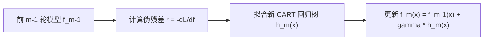

---
type: study
topic: "XGBoost"
course: "机器学习"
created: 2026-04-18
updated: 2026-08-02
status: completed
difficulty: advanced
concept: ["梯度提升树", "二阶优化", "正则化集成"]
prerequisites: ["决策树", "梯度下降", "泰勒展开"]
related: ["随机森林", "过拟合与欠拟合", "模型评估指标"]
tags: [学习, 机器学习, 集成学习, XGBoost]
flow: knowledge
kind: derivation
sources:
  - title: "An Introduction to Statistical Learning"
    url: "https://www.statlearning.com/"
    locator: "Chapter 8: Tree-Based Methods; boosting as the textbook foundation"
    source_type: "official-free-textbook"
    license: "official-free; redistribution not assumed"
    verified_at: 2026-08-02
  - title: "Introduction to Boosted Trees"
    url: "https://xgboost.readthedocs.io/en/stable/tutorials/model.html"
    locator: "Official tutorial: regularized objective, second-order approximation and split gain"
    source_type: "official-documentation"
    license: "Apache-2.0 project documentation"
    verified_at: 2026-08-02
  - title: "XGBoost: A Scalable Tree Boosting System"
    url: "https://arxiv.org/abs/1603.02754"
    locator: "Sections 2-3: regularized learning objective, sparsity-aware split finding and systems design"
    source_type: "open-access-paper"
    license: "arXiv open access; redistribution not assumed"
    verified_at: 2026-08-02
aliases: ["GBDT与XGBoost"]
stage_moc: "[[🧭 阶段4-树与集成]]"
upstream: ["[[机器学习-决策树]]"]
---

# XGBoost

XGBoost 是正则化梯度提升树的工程化实现，不是“很多树投票”的同义词。第 (t) 轮在已有预测上加一棵树：

$$
\hat y_i^{(t)}=\hat y_i^{(t-1)}+f_t(x_i),\qquad
\mathcal L^{(t)}=\sum_i l(y_i,\hat y_i^{(t)})+\Omega(f_t),
$$

其中 (f_t) 把样本映射到叶节点分数，复杂度项常写为

$$
\Omega(f)=\gamma T+\frac{\lambda}{2}\sum_{j=1}^{T}w_j^2.
$$

(T) 是叶数；(\gamma) 惩罚新增叶，(\lambda) 收缩叶权重。与只按纯度分裂的单棵树相比，目标函数直接权衡训练损失与模型复杂度。

## 1. 二阶近似与分裂增益

对新增树做二阶泰勒展开，记

$$g_i=\partial_{\hat y}l(y_i,\hat y_i^{(t-1)}),\qquad
h_i=\partial^2_{\hat y}l(y_i,\hat y_i^{(t-1)}).$$

叶 (j) 内聚合 (G_j=\sum g_i, H_j=\sum h_i)，固定树结构时最优叶权重为

$$w_j^*=-\frac{G_j}{H_j+\lambda}.$$

候选节点分成左右子节点的收益是

$$
\text{Gain}=\frac12\left[
\frac{G_L^2}{H_L+\lambda}+\frac{G_R^2}{H_R+\lambda}
-\frac{(G_L+G_R)^2}{H_L+H_R+\lambda}
\right]-\gamma.
$$

收益不足时不分裂。XGBoost 还通过直方图/近似分裂、稀疏感知的默认方向、缓存友好布局和并行化提高训练效率；这些是对梯度提升框架的实现增强，不改变“逐轮拟合当前损失”的核心。

## 2. 最小可靠实验

```python
from xgboost import XGBClassifier

model = XGBClassifier(
    n_estimators=500, learning_rate=0.05, max_depth=4,
    min_child_weight=5, subsample=0.8, colsample_bytree=0.8,
    reg_lambda=1.0, eval_metric="logloss", random_state=42
)
model.fit(X_train, y_train, eval_set=[(X_valid, y_valid)], verbose=False)
```

先建立逻辑回归和[[机器学习-随机森林]]基线，再按同一划分比较样本外指标。时间数据必须按时间切分；类别不平衡需同时报告 PR-AUC、召回率与阈值。`learning_rate` 与树数联动，深度、`min_child_weight`、行/列采样和正则项共同控制方差。

## 3. 边界与误区

- XGBoost 擅长中等规模表格数据，但不会自动修复数据泄漏、错误标签或分布漂移。
- 缺失值默认方向是训练得到的路由，不等于统计意义上的缺失机制建模。
- 内置特征重要性不代表因果效应；高基数字段和相关特征会扭曲解释。
- 训练分数持续提高而验证分数变差就是过拟合，应早停或降低容量，而不是盲目加树。

## 4. 开放教材定位

先用 ISLR Chapter 8 建立树、装袋与 boosting 的统一概念，再用 XGBoost 官方教程完成目标函数推导，以原论文核验稀疏与系统实现。教材负责主线，文档和论文只承担实现与验收层。

直观地看，每轮新树不是直接拟合原始标签，而是拟合“当前模型还应往哪个方向、走多远”。一阶梯度给出纠错方向，二阶梯度刻画局部曲率；按叶汇总后，训练器无须为每个样本单独保存一个叶权重。`reg_lambda` 增大时最优叶分数绝对值收缩，`gamma` 增大时弱分裂被拒绝，这正对应目标函数中的两种正则化作用。验收时应画训练与验证损失随树数变化的曲线，证明早停轮次来自独立验证集，而不是测试集。

## 参考资料

- James et al., [An Introduction to Statistical Learning, Chapter 8](https://www.statlearning.com/)，树模型与 boosting 教材主线。
- XGBoost Developers, [Introduction to Boosted Trees](https://xgboost.readthedocs.io/en/stable/tutorials/model.html)，正则化目标、二阶近似与分裂增益。
- Chen & Guestrin, [XGBoost: A Scalable Tree Boosting System](https://arxiv.org/abs/1603.02754)，论文 §§2–3 的算法与稀疏系统实现。

---


## 补充代码示例（自旧版合并保留）


```python
import torch
import torch.nn as nn

# ---------------------------------------------------------------
# 1. 模拟非线性回归数据集 (y = sin(x) + noise)
# ---------------------------------------------------------------
torch.manual_seed(42)
N = 200
X = torch.linspace(-3, 3, N).unsqueeze(1) # [200, 1]
y = torch.sin(X[:, 0]) + 0.1 * torch.randn(N) # [200]

# ---------------------------------------------------------------
# 2. 用简易决策树作为基回归器 (利用均值切分)
# ---------------------------------------------------------------
class SimpleDecisionTreeRegressor:
    def __init__(self, max_depth=2):
        self.max_depth = max_depth
        self.split_feature = 0
        self.split_val = 0.0
        self.left_mean = 0.0
        self.right_mean = 0.0

    def fit(self, X, r):
        # 简化版深 2 回归树
        best_mse = float('inf')
        for val in torch.linspace(-3, 3, 40):
            left_mask = X[:, 0] < val
            right_mask = ~left_mask
            if left_mask.sum() == 0 or right_mask.sum() == 0:
                continue
            l_mean = r[left_mask].mean().item()
            r_mean = r[right_mask].mean().item()
            mse = ((r[left_mask] - l_mean)**2).sum() + ((r[right_mask] - r_mean)**2).sum()
            if mse < best_mse:
                best_mse = mse
                self.split_val = val
                self.left_mean = l_mean
                self.right_mean = r_mean

    def predict(self, X):
        preds = torch.zeros(X.shape[0])
        left_mask = X[:, 0] < self.split_val
        preds[left_mask] = self.left_mean
        preds[~left_mask] = self.right_mean
        return preds

# ---------------------------------------------------------------
# 3. 手写 GBDT 训练过程 (利用 PyTorch Autograd 自动求负梯度)
# ---------------------------------------------------------------
M = 20 # 20 棵树
lr = 0.1 # 学习率 (Shrinkage)
trees = []

# 初始预测 f0(x) = y 的均值
f_pred = torch.full((N,), y.mean().item(), requires_grad=True)

for m in range(M):
    # 1. 定义 MSE 损失并利用 PyTorch autograd 计算负梯度
    loss = 0.5 * torch.sum((y - f_pred) ** 2)
    loss.backward()
    
    # 2. 伪残差 (负梯度) = - (dLoss / df_pred) = y - f_pred
    r_m = -f_pred.grad.clone().detach()
    f_pred.grad.zero_() # 清空梯度
    
    # 3. 拟合新回归树拟合负梯度
    tree = SimpleDecisionTreeRegressor(max_depth=2)
    tree.fit(X, r_m)
    trees.append(tree)
    
    # 4. 更新累计预测 f_pred = f_prev + lr * h_m(x)
    with torch.no_grad():
        f_pred = f_pred + lr * tree.predict(X)
    f_pred.requires_grad_(True)

final_loss = 0.5 * torch.sum((y - f_pred.detach()) ** 2).item()
print("=== PyTorch Autograd 辅助 GBDT 训练完成 ===")
print(f"20 棵树迭代后 MSE 最终 Loss: {final_loss:.4f}")
```
## 学完后可以完成

> 下面由作业 `requires` 自动反查：学完本卡后可完成的课后作业、阶段作业与大作业（单一事实源，不手动维护）。

```dataview
LIST
FROM "03-Projects"
WHERE type = "project" AND contains(requires, this.file.link)
SORT assignment_level ASC, file.name ASC
```
