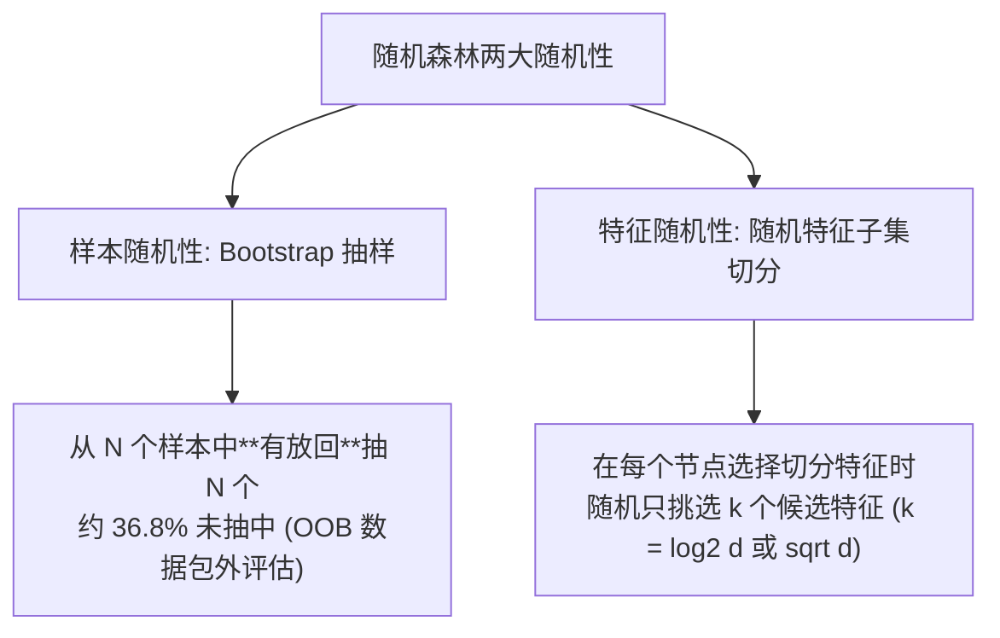

---

type: study

topic: "随机森林"

course: "机器学习"

created: 2026-04-18

updated: 2026-08-02

status: completed

difficulty: intermediate

concept: ["随机森林", "装袋法", "特征子采样"]

prerequisites: ["决策树", "自助法", "偏差方差权衡"]

related: ["XGBoost", "过拟合与欠拟合", "模型评估指标"]

tags: [学习, 机器学习, 集成学习, 随机森林]

flow: knowledge

kind: concept

sources:

  - title: "An Introduction to Statistical Learning"

    url: "https://www.statlearning.com/"

    locator: "Chapter 8: Bagging, random forests, out-of-bag error and variable importance"

    source_type: "official-free-textbook"

    license: "official-free; redistribution not assumed"

    verified_at: 2026-08-02

aliases: ["🎯 随机森林 (Random Forest)"]

stage_moc: "[[🧭 阶段4-树与集成]]"

upstream: ["[[机器学习-决策树]]"]

source: "周志华《机器学习》第4、8章"
source_url: "https://book.douban.com/subject/26708119/"
accessed: 2026-08-07

---


# 随机森林


随机森林是对高方差[[机器学习-决策树]]做“样本扰动 + 特征扰动 + 聚合”的并行集成。第 (b) 棵树在训练集的 bootstrap 样本上生长；每个节点只从随机抽取的 (m\) 个特征中寻找最佳切分。回归取树预测均值，分类取多数票或平均类别概率：


$$

\hat f_{RF}(x)=\frac1B\sum_{b=1}^{B}\hat f^{(b)}(x).

$$


若单树方差为 (\sigma^2)，树间平均相关系数为 (\rho)，大量树平均后的方差近似为


$$

\rho\sigma^2+\frac{1-\rho}{B}\sigma^2.

$$


增加树数 (B) 消除第二项，却无法消除相关性导致的第一项；节点级特征子采样的目的正是降低树间相关性。若总让最强特征参与切分，各树会长得相似，装袋收益受限。


## 1. OOB 估计


每棵树的 bootstrap 样本约包含 63.2% 的不同训练样本，其余为该树的 out-of-bag（OOB）样本。对每个训练样本，只聚合没有见过它的树，可近似估计泛化误差。OOB 适合快速诊断，但时间序列、分组数据或存在重复个体时仍必须使用尊重数据结构的验证方案，不能让 bootstrap 破坏时间/群组边界。


```python

from sklearn.ensemble import RandomForestClassifier


rf = RandomForestClassifier(

    n_estimators=500, max_features="sqrt",

    min_samples_leaf=5, class_weight="balanced",

    oob_score=True, n_jobs=-1, random_state=42

)

rf.fit(X_train, y_train)

print(rf.oob_score_)

```


## 2. 关键旋钮


- `n_estimators`：树越多，蒙特卡洛波动越小，但训练与推理更贵；通常不会像提升树那样因单纯加树而明显过拟合。

- `max_features`：越小，树的相关性越低但单树偏差可能上升。

- `min_samples_leaf` / `max_depth`：控制叶节点噪声与模型容量。

- `class_weight` 与决策阈值：应依据误报/漏报代价设置，不能被默认准确率替代。


## 3. 与 boosting 的区别


随机森林各树可并行训练，主要通过平均降低方差；[[机器学习-XGBoost]] 串行添加树来修正当前损失，并显式优化正则化目标。前者通常是稳健、低调参成本的表格基线；后者常能取得更低偏差，但对学习率、树深和泄漏更敏感。


## 4. 验收与边界


1. 与单树、简单线性模型在相同数据划分上比较，并报告 OOB 与独立验证指标。

2. 不纯度型特征重要性偏好可切分点多的变量；优先在独立验证集做 permutation importance，并检查相关特征替代效应。

3. 随机森林不能外推训练范围之外的连续趋势；回归输出是叶均值的平均。

4. 概率平均不保证校准，若概率用于决策，应另做校准曲线与 Brier score 检查。


## 5. 开放教材定位


主线使用 ISLR Chapter 8，从 bagging 的 bootstrap 平均过渡到随机森林的特征子采样，并复现 OOB 误差。掌握标准是能用“单树强度—树间相关性”解释 `max_features` 的作用，而不是只会调用库。


## 参考资料


- James et al., [An Introduction to Statistical Learning, Chapter 8](https://www.statlearning.com/)，bagging、随机森林、OOB 误差与变量重要性。


---


## 补充代码示例（自旧版合并保留）




## 学完后可以完成


> 下面由作业 `requires` 自动反查：学完本卡后可完成的课后作业、阶段作业与大作业（单一事实源，不手动维护）。


```dataview

LIST

FROM "03-Projects"

WHERE type = "project" AND contains(map(requires, (r) => r.path), this.file.name)

SORT assignment_level ASC, file.name ASC

```

