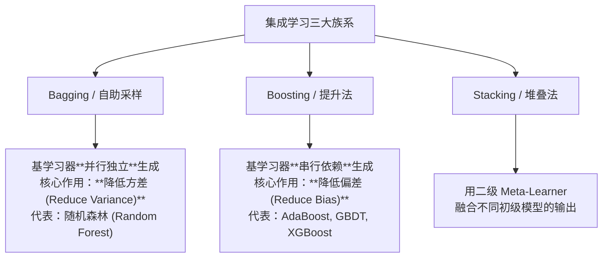

---
type: study
flow: knowledge
kind: concept
topic: "集成学习"
course: "机器学习"
module: "模块2：集成学习原理"
created: 2026-04-18
status: ongoing
difficulty: advanced
concept: ["集成学习"]
prerequisites: ["多变量决策树"]
related: ["结合策略", "多样性"]
source_textbook: ["机器学习（周志华）"]
source_sections: ["第8章"]
learning_objectives: ["说明 集成学习 在“模块2：集成学习原理”里解决的具体问题", "把 集成学习 对应回 第8章", "用一个最小例子或代表题解释 集成学习 的作用"]
deliverables: ["一句话定义或项目目标", "一个最小例子/代表题/最小实验", "一条易错点或跨路径连接", "能说清 Bagging 与 Boosting 的差异以及“多样性”的作用。"]
tags: ["机器学习", "学习"]
stage_moc: "[[🧭 阶段4-树与集成]]"
upstream: ["[[机器学习-多变量决策树]]"]
aliases: ["🎯 集成学习 (Ensemble Learning)", "集成学习回顾"]
---
# 集成学习

> 所属路径：[[🗺️ 机器学习学习路径|机器学习学习路径]]
> 所属阶段：[[🧭 阶段4-树与集成|返回阶段页]]
> 所属模块：`模块2：集成学习原理`

## 为什么学
- 这张卡位于“模块2：集成学习原理”，用来解决：为什么把弱学习器组合起来，反而能得到更稳更强的模型？
- 它是你从 [[机器学习-多变量决策树]] 走向 [[机器学习-结合策略]]、[[机器学习-多样性]] 的桥梁。

## 教材定位
- 主教材：`机器学习（周志华）`
- 对应章节：第8章
- 阶段入口：[[🧭 阶段4-树与集成|🌲 第四阶段：树与集成]]

## 必须掌握
- 用自己的话定义 `集成学习`，并说清它的边界。
- 解释 `集成学习` 为什么是“为什么把弱学习器组合起来，反而能得到更稳更强的模型？”这条问题链的一部分。
- 说明它和同阶段相邻概念的区别与联系。

## 关键问题
- 集成学习 在“模块2：集成学习原理”这条主线里具体负责哪一步？
- 如果忽略 集成学习，为什么把弱学习器组合起来，反而能得到更稳更强的模型？ 会在哪一步断掉？
- 集成学习 和相邻概念的边界是什么？

## 最小例子
- 场景：
- 输入：
- 关键一步：
- 结论：

## 练习与输出
- [ ] 写 3-5 行自己的定义或项目目标。
- [ ] 补一个最小例子、例题、推导片段或实验记录。
- [ ] 记录一个易错点，或补一条跨路径连接。

## 完成标准
- [ ] 能说清 Bagging 与 Boosting 的差异以及“多样性”的作用。
- [ ] 能独立解释这张卡在本阶段中的位置。
- [ ] 能把教材章节和这张卡一一对应。

## 前后连接
- 前置：[[机器学习-多变量决策树]]
- 相关：[[机器学习-结合策略]]、[[机器学习-多样性]]
- 返回阶段页：[[🧭 阶段4-树与集成|🌲 第四阶段：树与集成]]

*创建于：2026-04-18*

---


## 补充代码示例（自旧版合并保留）


## 学完后可以完成

> 下面由作业 `requires` 自动反查：学完本卡后可完成的课后作业、阶段作业与大作业（单一事实源，不手动维护）。

```dataview
LIST
FROM "03-Projects"
WHERE type = "project" AND contains(requires, this.file.link)
SORT assignment_level ASC, file.name ASC
```
