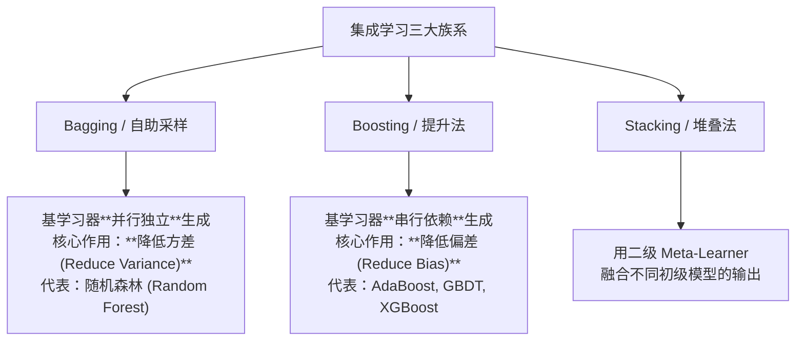

# 集成学习

> 所属路径：[[../🗺️ 机器学习学习路径|机器学习学习路径]]
> 所属阶段：[[🌲 第四阶段：树与集成|返回阶段页]]
> 所属模块：`模块2：集成学习原理`

## 为什么学
- 这张卡位于“模块2：集成学习原理”，用来解决：为什么把弱学习器组合起来，反而能得到更稳更强的模型？
- 它是你从 [[多变量决策树]] 走向 [[结合策略]]、[[多样性]] 的桥梁。

## 教材定位
- 主教材：`机器学习（周志华）`
- 对应章节：第8章
- 阶段入口：[[🌲 第四阶段：树与集成|🌲 第四阶段：树与集成]]

## 必须掌握
- 用自己的话定义 `集成学习`，并说清它的边界。
- 解释 `集成学习` 为什么是“为什么把弱学习器组合起来，反而能得到更稳更强的模型？”这条问题链的一部分。
- 说明它和同阶段相邻概念的区别与联系。

## 关键问题
- 集成学习 在“模块2：集成学习原理”这条主线里具体负责哪一步？
- 如果忽略 集成学习，为什么把弱学习器组合起来，反而能得到更稳更强的模型？ 会在哪一步断掉？
- 集成学习 和相邻概念的边界是什么？

## 最小例子
- 场景：
- 输入：
- 关键一步：
- 结论：

## 练习与输出
- [ ] 写 3-5 行自己的定义或项目目标。
- [ ] 补一个最小例子、例题、推导片段或实验记录。
- [ ] 记录一个易错点，或补一条跨路径连接。

## 完成标准
- [ ] 能说清 Bagging 与 Boosting 的差异以及“多样性”的作用。
- [ ] 能独立解释这张卡在本阶段中的位置。
- [ ] 能把教材章节和这张卡一一对应。

## 前后连接
- 前置：[[多变量决策树]]
- 相关：[[结合策略]]、[[多样性]]
- 返回阶段页：[[🌲 第四阶段：树与集成|🌲 第四阶段：树与集成]]

*创建于：2026-04-18*

---

## 历史版本补充内容（合并自同名旧卡，待复核）

## 0. 先判断它值不值得深挖

- **类别**：**A 类（核心概念，必须深挖）**
- **判断理由**：集成学习（Ensemble Learning）是机器学习竞赛（Kaggle/天池）与工业界落地中**提升模型预测性能与稳定性最强有力的通用武器**。“三个臭皮匠顶个诸葛亮”，通过构建并结合多个基学习器（Base Learners）来完成学习任务。掌握 Bagging（降方差）与 Boosting（降偏差）两大族系是精通机器学习的必经之路。

---

## 1. 这个知识点解决什么问题？

> **我们遇到了什么麻烦：**
> 单个模型（如单棵决策树）往往陷入两难：树深了极易过拟合（高方差），树浅了又拟合不足（高偏差）。

集成学习**通过结合多个弱学习器的预测结果**，实现了在降低偏差的同时降低方差。

---

## 2. 为什么它重要？它有什么用？

- **连接大图景**：
  - **Bagging 族系**：平行独立训练 + 投票/平均 $\implies$ [[04-树与集成/随机森林|随机森林 (Random Forest)]]。
  - **Boosting 族系**：串行串联训练 + 专注于前序错题 $\implies$ [[04-树与集成/XGBoost|AdaBoost / GBDT / XGBoost / LightGBM]]。
  - **Stacking 族系**：多层模型融合。

---

## 3. 正式定义与两大核心族系对比

### 1. Bagging (Bootstrap Aggregating - 降低方差)
- **核心机制**：通过**自助采样 (Bootstrap Sampling)** 从全量数据中有放回抽取 $M$ 个子数据集，并行独立训练 $M$ 个高方差弱学习器（如未剪枝的深度决策树）。
- **结合策略**：分类用简单投票法（Majority Voting），回归用简单平均法（Averaging）。
- **主要功效**：**大幅降低模型方差 (Reduce Variance)**，且不容易过拟合。

### 2. Boosting (提升法 - 降低偏差)
- **核心机制**：基学习器之间存在**强串行依赖**。后一个基学习器专注于纠正前一个基学习器的残差/预测错误，通过动态调整样本权重或拟合负梯度逐步提升整体性能。
- **主要功效**：**大幅降低模型偏差 (Reduce Bias)**，能将多个浅层弱学习器提升为极强模型。

---

## 4. 例子：Bagging 降低方差的数学证明

设 $M$ 个独立同分布的基学习器预测方差均为 $\sigma^2$，两两之间相关系数为 $\rho$。
则 $M$ 个模型简单平均后的总方差为：

$$\text{Var}\left(\frac{1}{M} \sum_{i=1}^M X_i\right) = \rho \sigma^2 + \frac{1 - \rho}{M} \sigma^2$$

- 当基模型完全独立（$\rho = 0$）时，总方差降为 $\frac{\sigma^2}{M}$！
- 提示：可以通过在训练时引入随机特征切分来降低基模型间的相关性 $\rho$（这正是**随机森林**的灵魂所在）。

---

## 5. 常见误区和易混概念

### Bagging vs Boosting 终极对比表
| 维度 | Bagging (如随机森林) | Boosting (如 GBDT/XGBoost) |
| :--- | :--- | :--- |
| **基学习器关系** | **并行**、独立生成 | **串行**、前后强依赖 |
| **基学习器要求** | 强学习器 / 高方差弱模型（如深度树）| 弱学习器 / 高偏差简单模型（如浅层树）|
| **核心主要效果** | **降低方差 (Reduce Variance)** | **降低偏差 (Reduce Bias)** |
| **噪声敏感度** | 对离群噪声鲁棒 | 对噪声和错误标签极其敏感 |
| **样本采样权重** | 均匀有放回自助采样 | 动态调整样本权重（关注前序错题）|

---

## 7. 闭卷复现任务

1. 写出 Bagging 与 Boosting 的核心区别（并行vs串行、降低方差vs降低偏差）。
2. 写出 Bagging 平均后总方差公式，并说明如何通过降低模型相关性 $\rho$ 来降低总体方差。

---

## 8. 自测题：5 道

| 题号 | 类型 | 难度 | 考查点 |
| :--- | :--- | :--- | :--- |
| 1 | 概念辨析 | 基础 | 族系效果区分 |
| 2 | 采样方式 | 基础 | 自助采样性质 |
| 3 | 算法匹配 | 中等 | 随机森林范式 |
| 4 | 方差推导 | 中等 | 模型相关性 $\rho$ |
| 5 | 综合对比 | 较难 | Bagging 与 Boosting 噪声敏感度 |

1. **[概念辨析] 关于 Bagging 算法与 Boosting 算法的核心功效，下列说法正确的是：**
   A. Bagging 主要用于降低模型偏差，Boosting 主要用于降低模型方差  
   B. Bagging 主要用于降低模型方差，Boosting 主要用于降低模型偏差  
   C. 两者都能极大降低偏差但无法降低方差  
   D. 两者完全相同
> [!question]- 答案解析
> **答案**：B  
> **解析**：Bagging 通过独立模型平均降低方差；Boosting 通过串行残差纠正降低偏差。  
> **标签**：`#自测/基础 #Bagging与Boosting`

2. **[采样方式] Bagging 算法中使用的 Bootstrap 采样（自助采样）是指：**
   A. 无放回抽样  
   B. 有放回随机抽样（约有 36.8% 的样本未被抽中，称为包外数据 OOB）  
   C. 按特征比例抽样  
   D. 只抽取正例
> [!question]- 答案解析
> **答案**：B  
> **解析**：Bootstrap 是包含 $N$ 个样本的容量为 $N$ 的有放回抽样，约 36.8% 样本未入选（$\lim (1-1/N)^N = 1/e \approx 0.368$）。  
> **标签**：`#自测/基础 #Bootstrap`

3. **[算法匹配] 下列集成算法中属于 Bagging 族系的是：**
   A. AdaBoost  B. GBDT  C. 随机森林 (Random Forest)  D. XGBoost
> [!question]- 答案解析
> **答案**：C  
> **解析**：随机森林是 Bagging 算法最典型的代表；其余均属于 Boosting 族系。  
> **标签**：`#自测/中等 #随机森林范式`

4. **[方差推导] 随机森林在 Bagging 的基础之上额外引入了“随机特征选择”，其主要目的是：**
   A. 降低单棵树的计算复杂度  
   B. 进一步降低基决策树之间的相关系数 $\rho$，使得集成后的总方差更小  
   C. 增加训练样本  
   D. 使得树更深
> [!question]- 答案解析
> **答案**：B  
> **解析**：随机特征选择增加了单树间的差异性，降低了相互相关性 $\rho$，由方差公式可知能进一步降低集成总方差。  
> **标签**：`#自测/中等 #随机特征选择`

5. **[综合对比] 为什么 Boosting 算法（如 AdaBoost）相比于 Bagging（如随机森林）对数据集中的噪声和离群点（Outliers）更加敏感？**
> [!question]- 答案解析
> **答案**：因为 Boosting 算法会在后续迭代中不断加大前序被预测错误样本的权重。离群点或错误标签极易被持续判定为错题，导致 Boosting 算法在后续轮次中倾斜大量算力去过拟合这些噪声点。  
> **标签**：`#自测/较难 #Boosting噪声敏感`

---

