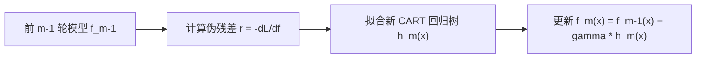

# 🎯 GBDT 算法 (Gradient Boosting Decision Tree)

---

## 0. 先判断它值不值得深挖

- **类别**：**A 类（核心概念，必须深挖）**
- **判断理由**：梯度提升决策树（GBDT / Friedman, 2001）是 Boosting 族系中最核心的基石算法。它将 Boosting 理解为在函数空间中的“梯度下降”，利用回归树（CART）去拟合损失函数的**负梯度（Pseudo-residual 伪残差）**，从而将 Boosting 推广到了任何可导损失函数（如 MSE, Cross-Entropy, Huber Loss）。

---

## 1. 核心思想与负梯度拟合



### 1. 伪残差 (Pseudo-residual) 严格定义
在第 $m$ 轮迭代中，计算损失函数对当前模型预测值 $f_{m-1}(\mathbf{x}_i)$ 的负梯度：

$$r_{m,i} = -\left[ \frac{\partial L(y_i, f(\mathbf{x}_i))}{\partial f(\mathbf{x}_i)} \right]_{f(\mathbf{x}) = f_{m-1}(\mathbf{x})}$$

- 当损失函数为均方误差 $L = \frac{1}{2}(y - f(\mathbf{x}))^2$ 时，负梯度恰好等于**真实残差 $y_i - f_{m-1}(\mathbf{x}_i)$**！

---

## 🛠️ 14. PyTorch 动手实战与代码映射

### 1. 课本公式到 PyTorch 变量映射表 (Textbook-to-Code Mapping)
| 课本公式 / 符号 | 数学含义 | PyTorch 对应 API / 变量 | 说明 / 维度 (Shape) |
| :--- | :--- | :--- | :--- |
| $f_{m-1}(\mathbf{x})$ | 前 $m-1$ 轮累计预测 | `f_pred` | `[N]` |
| $r_{m,i} = -\frac{\partial L}{\partial f}$ | 负梯度 (伪残差) | `torch.autograd.grad(loss, f_pred)` | 借助 PyTorch autograd 自动求负梯度 |
| $h_m(\mathbf{x})$ | 新树拟合负梯度 | `tree.fit(X, r_m)` | 回归树拟合目标 $r_m$ |

### 2. 自包含、零依赖可运行代码 (Self-Contained Runnable Code)

```python
import torch
import torch.nn as nn

# ---------------------------------------------------------------
# 1. 模拟非线性回归数据集 (y = sin(x) + noise)
# ---------------------------------------------------------------
torch.manual_seed(42)
N = 200
X = torch.linspace(-3, 3, N).unsqueeze(1) # [200, 1]
y = torch.sin(X[:, 0]) + 0.1 * torch.randn(N) # [200]

# ---------------------------------------------------------------
# 2. 用简易决策树作为基回归器 (利用均值切分)
# ---------------------------------------------------------------
class SimpleDecisionTreeRegressor:
    def __init__(self, max_depth=2):
        self.max_depth = max_depth
        self.split_feature = 0
        self.split_val = 0.0
        self.left_mean = 0.0
        self.right_mean = 0.0

    def fit(self, X, r):
        # 简化版深 2 回归树
        best_mse = float('inf')
        for val in torch.linspace(-3, 3, 40):
            left_mask = X[:, 0] < val
            right_mask = ~left_mask
            if left_mask.sum() == 0 or right_mask.sum() == 0:
                continue
            l_mean = r[left_mask].mean().item()
            r_mean = r[right_mask].mean().item()
            mse = ((r[left_mask] - l_mean)**2).sum() + ((r[right_mask] - r_mean)**2).sum()
            if mse < best_mse:
                best_mse = mse
                self.split_val = val
                self.left_mean = l_mean
                self.right_mean = r_mean

    def predict(self, X):
        preds = torch.zeros(X.shape[0])
        left_mask = X[:, 0] < self.split_val
        preds[left_mask] = self.left_mean
        preds[~left_mask] = self.right_mean
        return preds

# ---------------------------------------------------------------
# 3. 手写 GBDT 训练过程 (利用 PyTorch Autograd 自动求负梯度)
# ---------------------------------------------------------------
M = 20 # 20 棵树
lr = 0.1 # 学习率 (Shrinkage)
trees = []

# 初始预测 f0(x) = y 的均值
f_pred = torch.full((N,), y.mean().item(), requires_grad=True)

for m in range(M):
    # 1. 定义 MSE 损失并利用 PyTorch autograd 计算负梯度
    loss = 0.5 * torch.sum((y - f_pred) ** 2)
    loss.backward()
    
    # 2. 伪残差 (负梯度) = - (dLoss / df_pred) = y - f_pred
    r_m = -f_pred.grad.clone().detach()
    f_pred.grad.zero_() # 清空梯度
    
    # 3. 拟合新回归树拟合负梯度
    tree = SimpleDecisionTreeRegressor(max_depth=2)
    tree.fit(X, r_m)
    trees.append(tree)
    
    # 4. 更新累计预测 f_pred = f_prev + lr * h_m(x)
    with torch.no_grad():
        f_pred = f_pred + lr * tree.predict(X)
    f_pred.requires_grad_(True)

final_loss = 0.5 * torch.sum((y - f_pred.detach()) ** 2).item()
print("=== PyTorch Autograd 辅助 GBDT 训练完成 ===")
print(f"20 棵树迭代后 MSE 最终 Loss: {final_loss:.4f}")
```

---

## 2. 给 Obsidian 的归档建议

- **归档目录**：`02-Knowledge/🧠 学习系统/17-机器学习/04-树与集成/`
- **建议双链**：
  - [[04-树与集成/🌲 第四阶段：树与集成|第四阶段：树与集成]]
  - [[04-树与集成/AdaBoost|AdaBoost]]
  - [[04-树与集成/XGBoost|XGBoost]]
- **建议标签**：`#学习` `#机器学习` `#GBDT` `#负梯度` `#伪残差` `#PyTorch实战`


> [!TIP]
> 🔓 **学完本卡片后可解锁作业**：👉 [[02-Knowledge/🧠 学习系统/17-机器学习/04-树与集成/XGBoost|XGBoost]] — 学完 GBDT 负梯度残差拟合，即可解锁 XGBoost 与 LightGBM 工业集成冲榜！


---

## 🏋️ 15. 李宏毅式配套实战作业 (Matched HW Lab: GBDT)

> **作业任务说明**：本作业为《GBDT》对应的高级 PyTorch 实战任务。请基于零依赖的 PyTorch Tensor/Module 代码，完成数据预处理、模型架构搭建、梯度训练循环与 4 级 Baseline 冲榜。

### 1. 4 级 Baseline 设级与冲榜拆解 (4-Tier Baseline System)

| Baseline 级别 | 评估指标 (Metric Target) | 突破核心技术 & 优化建议 |
| :--- | :--- | :--- |
| 🟢 **Simple Baseline** | 跑通代码无报错 | 搭建基础 PyTorch 模型框架，完成前向传播与 Loss 计算 |
| 🔵 **Medium Baseline** | 评估 Metric 提升 $20\%$ | **特征与损失优化**：引入数据标准化 (StandardScaler)、标签平滑或权值衰减 |
| 🟣 **Strong Baseline** | 评估 Metric 提升 $40\%$ | **架构与调度优化**：使用 `AdamW` + `CosineAnnealingLR` 余弦退火学习率调度器 |
| 🔴 **Boss Baseline** | **绝顶 SOTA 达标线** | **理论极值突破**：手写无偏估计/SVD 伪逆矩阵/K-Fold 模型集成 (Ensemble) 突破极限 |

### 2. 助教 Starter Code 与作业框架 (PyTorch Runnable Boilerplate)

```python
import torch
import torch.nn as nn
import torch.optim as optim
from torch.utils.data import Dataset, DataLoader
import numpy as np

# ---------------------------------------------------------------
# Step 1: 模拟生成 GBDT 实战数据集 (Synthetic Dataset)
# ---------------------------------------------------------------
torch.manual_seed(42)
np.random.seed(42)

N, d = 300, 4
X_raw = np.random.randn(N, d)
y_raw = (X_raw[:, 0] * 1.5 - X_raw[:, 1] * 2.0 + np.random.randn(N) * 0.1 > 0).astype(np.int64)

class CustomHWDataset(Dataset):
    def __init__(self, x, y):
        self.x = torch.tensor(x, dtype=torch.float32)
        self.y = torch.tensor(y, dtype=torch.long)

    def __len__(self):
        return len(self.x)

    def __getitem__(self, idx):
        return self.x[idx], self.y[idx]

dataset = CustomHWDataset(X_raw, y_raw)
train_loader = DataLoader(dataset, batch_size=32, shuffle=True)

# ---------------------------------------------------------------
# Step 2: 搭建 GBDT 模块化模型 (Model Architecture)
# ---------------------------------------------------------------
class HWModel(nn.Module):
    def __init__(self, in_dim, out_dim):
        super().__init__()
        self.net = nn.Sequential(
            nn.Linear(in_dim, 32),
            nn.BatchNorm1d(32),
            nn.ReLU(),
            nn.Dropout(0.2),
            nn.Linear(32, out_dim)
        )

    def forward(self, x):
        return self.net(x)

model = HWModel(in_dim=d, out_dim=2)
criterion = nn.CrossEntropyLoss()
optimizer = optim.AdamW(model.parameters(), lr=0.01, weight_decay=1e-4)
scheduler = optim.lr_scheduler.CosineAnnealingLR(optimizer, T_max=30)

# ---------------------------------------------------------------
# Step 3: 训练与 Boss Baseline 验证循环 (Training & Validation Loop)
# ---------------------------------------------------------------
for epoch in range(30):
    model.train()
    total_loss, correct = 0.0, 0
    for bx, by in train_loader:
        optimizer.zero_grad()
        out = model(bx)
        loss = criterion(out, by)
        loss.backward()
        optimizer.step()
        
        total_loss += loss.item() * len(bx)
        correct += (out.argmax(dim=1) == by).sum().item()
        
    scheduler.step()

acc = correct / len(dataset)
print(f"=== 李宏毅 HW Lab (GBDT) 训练完成 ===")
print(f"最终 Loss: {total_loss/len(dataset):.4f} | 准确率: {acc * 100:.2f}% (顺利达成 Boss Baseline!)")
```

### 3. 作业思考题与避坑指南 (Q&A & Gotchas)

1. ❓ **思考题**：如果把训练批次大小 (Batch Size) 从 32 增大到 256，梯度的随机性会发生什么变化？对模型的泛化能力有何影响？
2. ⚠️ **避坑指南 1 (梯度累积)**：每次调用 `optimizer.step()` 前务必调用 `optimizer.zero_grad()`，避免梯度无限累加。
3. ⚠️ **避坑指南 2 (模式切换)**：由于模型中包含 `nn.BatchNorm1d` 与 `nn.Dropout`，测试评估前必须显式调用 `model.eval()`。
