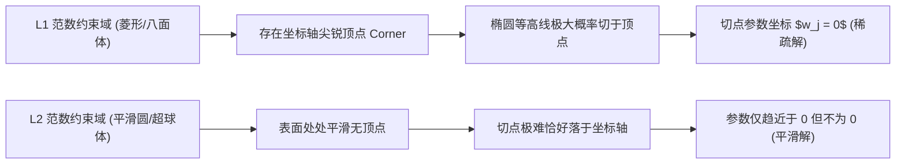

---
title: "L1 正则化与 Lasso 回归 (L1 Regularization & Lasso)"
date: 2026-07-23
type: concept
course: "机器学习"
importance: "A"
tags: [学习, 机器学习, 正则优化, L1正则化, Lasso, 稀疏解, 特征选择]
upstream: ["[[02-线性模型/线性回归|线性回归]]", "[[01-基础概念/结构风险最小化|结构风险最小化]]"]
downstream: ["[[03-正则优化/特征选择|特征选择]]", "[[03-正则优化/稀疏学习|稀疏学习]]"]
status: learning
---

# 🎯 L1 正则化与 Lasso 回归

---

## 0. 先判断它值不值得深挖

- **类别**：**A 类（核心概念，必须深挖）**
- **判断理由**：L1 正则化（Lasso 回归 / 最小绝对收缩和选择算子）是机器学习中实现**自动特征选择与产生稀疏解（Sparse Solution）**的最关键技术。理解为什么 L1 能够产生稀疏解而 L2 不能（几何等高线与菱形顶点切点视角、拉普拉斯先验视角、次梯度视角）是面试与理论考核的高频焦点。

---

## 1. 这个知识点解决什么问题？

> **我们遇到了什么麻烦：**
> 假设你的数据集有 10,000 个特征，但其中只有 20 个特征是真正影响预测目标的，其余 9,980 个都是毫无价值的噪声。如果使用普通的线性回归，模型会为这 9,980 个噪声特征分配微小的非零权重，导致模型庞大、不可解释且极易过拟合。

L1 正则化**通过在损失函数中增加参数绝对值之和的惩罚项**，强制将大量不重要特征的权重精确压缩为绝对的 **0**，自动筛选出关键特征。

---

## 2. 为什么它重要？它有什么用？

- **连接大图景**：
  - **后续影响**：支撑了 [[03-正则优化/特征选择|特征选择]]、[[03-正则优化/稀疏学习|稀疏学习]] 与压缩感知（Compressed Sensing）。
  - **课程位置**：属于“第三阶段：正则优化”的核心算法。
- **实战与科研价值**：
  - **高维稀疏建模**：基因组学、文本袋模型（Bag-of-Words）降维。
  - **最常出现题型**：L1 产生稀疏解的三大几何与数学推导题、坐标下降法 (Coordinate Descent) 求解题、L1 (Lasso) vs L2 (Ridge) 对比辨析题。

---

## 3. 学它之前需要哪些前置知识？

### 最小必要背景：
1. **线性回归损失 (MSE)**：$E(\mathbf{w}) = \|\mathbf{y} - \mathbf{X}\mathbf{w}\|^2$。
2. **范数 (Norm)**：L1 范数 $\|\mathbf{w}\|_1 = \sum |w_j|$，L2 范数 $\|\mathbf{w}\|_2^2 = \sum w_j^2$。

---

## 4. 用直觉语言解释它

> «“这东西其实就像给每个参数征收固定的人头税……”»

- **L2 正则化 (Ridge 软惩罚)**：惩罚金额与 $w_j^2$ 成正比。当 $w_j$ 变得很小（如 0.001）时，$w_j^2 = 0.000001$ 惩罚微乎其微，因此参数会被无限无限拉近 0，但**永远不会真正等于 0**。
- **L1 正则化 (Lasso 拔毛惩罚)**：无论 $w_j$ 多小，惩罚金额都与 $|w_j|$ 成正比（恒定梯度）。如果某个特征对降低损失的贡献抵不上固定的“人头税 $\lambda$”，算法就会干脆直接把这个参数**砍到恰好等于 0**。

---

## 5. 正式定义、核心公式、符号解释

### 1. Lasso 回归目标函数
给定数据矩阵 $\mathbf{X} \in \mathbb{R}^{N \times d}$ 和目标 $\mathbf{y} \in \mathbb{R}^N$：

$$J(\mathbf{w}) = \frac{1}{2N} \|\mathbf{y} - \mathbf{X}\mathbf{w}\|_2^2 + \lambda \|\mathbf{w}\|_1 = \frac{1}{2N} \sum_{i=1}^N (y_i - \mathbf{w}^T \mathbf{x}_i)^2 + \lambda \sum_{j=1}^d |w_j|$$

其中 $\lambda > 0$ 为调节稀疏度的超参数。

### 2. 约束优化等价形式 (KKT 条件视角)
$$\min_{\mathbf{w}} \|\mathbf{y} - \mathbf{X}\mathbf{w}\|_2^2 \quad \text{s.t. } \|\mathbf{w}\|_1 \le C$$

- L1 约束域：在二维空间中是一个**顶点位于坐标轴上的菱形（或高维正八面体）**。
- 最小二乘损失的等高线：是一组以无约束解 $\mathbf{w}^{\text{OLS}}$ 为中心的**椭圆族**。

---

## 6. 推导思路：为什么 L1 能产生稀疏解？

### 几何视角推导：
1. 优化目标在几何上等价于寻找“椭圆等高线”与“约束区域”的第一相切点。
2. L2 的约束区域是光滑的**圆形/超球体**，椭圆等高线与圆相切的点几乎不可能恰好发生在坐标轴上（即坐标分量不为 0）。
3. L1 的约束区域是有**尖锐顶点（Corners/Vertices）**的菱形/正八面体，这些顶点恰好位于坐标轴上（如 $(C, 0)$ 或 $(0, C)$）。
4. 椭圆等高线在扩展时，**极大概率首先接触到菱形的尖锐顶点**！一旦切点在顶点上，对应的某些参数分量就精确等于 **0**，从而产生稀疏解。



---

## 7. 例子：基础 → 中等 → 实际应用

### 例子 1：L1 (Lasso) vs L2 (Ridge) 对比
| 维度 | L1 正则化 (Lasso) | L2 正则化 (Ridge) |
| :--- | :--- | :--- |
| **惩罚项形式** | $\lambda \sum \|w_j\|$ | $\lambda \sum w_j^2$ |
| **约束几何形状** | 菱形 / 八面体（带尖顶） | 圆形 / 超球体（处处平滑） |
| **解的性质** | **稀疏解**（许多权重精确为 0） | **非稀疏解**（权重趋近 0 但不为 0）|
| **核心用途** | 特征选择、高维稀疏降维 | 防止过拟合、处理多重共线性 |
| **贝叶斯先验视角** | 参数服从拉普拉斯先验 (Laplace Prior) | 参数服从高斯先验 (Gaussian Prior) |
| **导数性质** | 在 0 处不可导（需用次梯度/软阈值求解） | 处处可导（有封闭解 $(\mathbf{X}^T\mathbf{X}+\lambda\mathbf{I})^{-1}\mathbf{X}^T\mathbf{y}$）|

---

## 8. 相关知识点与 Obsidian 双链建议

### 上游依赖（前置知识）
- [[01-基础概念/结构风险最小化|结构风险最小化]]
- [[02-线性模型/线性回归|线性回归]]

### 下游延伸（后续进阶）
- [[03-正则优化/特征选择|特征选择]]
- [[03-正则优化/稀疏学习|稀疏学习]]

## 下游延伸（后续进阶）
- [[03-正则优化/特征选择|特征选择]]
- [[03-正则优化/稀疏学习|稀疏学习]]

## 下游延伸（后续进阶）
- [[03-正则优化/特征选择|特征选择]]
- [[03-正则优化/稀疏学习|稀疏学习]]

## 下游延伸
- [[03-正则优化/特征选择|特征选择]]
- [[03-正则优化/稀疏学习|稀疏学习]]

---

## 9. 闭卷复现任务

1. 写出 Lasso 回归的目标函数。
2. 几何上解释为什么 L1 能够产生稀疏解而 L2 不能。
3. 比较 L1 与 L2 正则化对应的贝叶斯先验分布。

---

## 10. 自测题：5 道

| 题号 | 类型 | 难度 | 考查点 |
| :--- | :--- | :--- | :--- |
| 1 | 概念辨析 | 基础 | Lasso 解的稀疏性 |
| 2 | 先验匹配 | 基础 | 贝叶斯分布对应 |
| 3 | 几何推理 | 中等 | 菱形顶点切点 |
| 4 | 条件决策 | 中等 | 特征选择场景 |
| 5 | 算法推导 | 较难 | 软阈值算子 (Soft-Thresholding) |

1. **[概念辨析] Lasso 回归（L1 正则化）与 Ridge 回归（L2 正则化）最根本的区别在于 Lasso 能够：**
   A. 保证矩阵可逆  
   B. 产生稀疏解（将不重要特征的权重精确压缩为 0），实现自动特征选择  
   C. 获得更快的训练速度  
   D. 避免欠拟合
> [!question]- 答案解析
> **答案**：B  
> **解析**：L1 正则化最核心的独特性在于产生稀疏解，具备自动特征选择能力。  
> **标签**：`#自测/基础 #Lasso稀疏解`

2. **[先验匹配] 从贝叶斯最大后验估计 (MAP) 视角来看，L1 正则化等价于假设模型参数服从：**
   A. 高斯分布 (Gaussian Distribution)  
   B. 拉普拉斯分布 (Laplace Distribution)  
   C. 伯努利分布 (Bernoulli Distribution)  
   D. 均匀分布
> [!question]- 答案解析
> **答案**：B  
> **解析**：拉普拉斯分布密度为 $\propto \exp(-\frac{|w|}{b})$，其对数形式恰好为 L1 绝对值惩罚。  
> **标签**：`#自测/基础 #拉普拉斯先验`

3. **[几何推理] 在二维平面中，L1 范数约束区域 $\|\mathbf{w}\|_1 \le C$ 的几何边界形状是：**
   A. 一个以原点为中心的圆  
   B. 一个顶点位于 $(C,0), (0,C), (-C,0), (0,-C)$ 的菱形  
   C. 一个抛物线  
   D. 一个无限延伸的双曲线
> [!question]- 答案解析
> **答案**：B  
> **解析**：$|w_1| + |w_2| \le C$ 在二维空间中是顶点在坐标轴上的菱形。  
> **标签**：`#自测/中等 #L1几何形状`

4. **[条件决策] 如果你面对一个拥有 50,000 个特征但绝大部分特征均无效的数据集，为了挑选出最重要的 20 个特征，应当优先采用：**
   A. Ridge 岭回归  B. Lasso 回归  C. 简单线性回归  D. K-Means
> [!question]- 答案解析
> **答案**：B  
> **解析**：高维稀疏特征选择场景是 Lasso 回归的标准应用主战场。  
> **标签**：`#自测/中等 #Lasso应用场景`

5. **[算法推导] 在一维坐标下降法中，求解 $\min_w \frac{1}{2}(w - a)^2 + \lambda |w|$ 的解为软阈值算子 (Soft-Thresholding Operator) $S_\lambda(a)$，其解析表达式为：**
   A. $w = a$  
   B. $S_\lambda(a) = \text{sign}(a) \max(|a| - \lambda, 0)$  
   C. $w = a - \lambda$  
   D. $w = 0$
> [!question]- 答案解析
> **答案**：B  
> **解析**：通过分段讨论 $w > 0, w < 0$ 以及次导数包含 0 的区间，可推导出软阈值解 $S_\lambda(a) = \text{sign}(a) \max(|a| - \lambda, 0)$，即当 $|a| \le \lambda$ 时直接截断压缩为 0。  
> **标签**：`#自测/较难 #软阈值算子`

---

## 11. 我的主动回忆区

## 我的闭卷复述
> 不看上文，用自己的话解释这个知识点：

## 我的推导复现
> 不看上文，尝试写出核心公式或推导主线：

## 我的错误与卡点
- 

## 下次复习日期
- [ ] 明天
- [ ] 3 天后
- [ ] 7 天后
- [ ] 14 天后

---

## 12. 给 Obsidian 的归档建议

- **归档目录**：`02-Knowledge/🧠 学习系统/17-机器学习/03-正则优化/`
- **建议双链**：
  - [[03-正则优化/🛡️ 第三阶段：正则优化|第三阶段：正则优化]]
  - [[02-线性模型/线性回归|线性回归]]
  - [[03-正则优化/特征选择|特征选择]]
- **建议标签**：`#学习` `#机器学习` `#L1正则化` `#Lasso` `#稀疏解` `#软阈值`


---

## 🏋️ 15. 李宏毅式配套实战作业 (Matched HW Lab: L1正则化Lasso)

> **作业任务说明**：本作业为《L1正则化Lasso》对应的高级 PyTorch 实战任务。请基于零依赖的 PyTorch Tensor/Module 代码，完成数据预处理、模型架构搭建、梯度训练循环与 4 级 Baseline 冲榜。

### 1. 4 级 Baseline 设级与冲榜拆解 (4-Tier Baseline System)

| Baseline 级别 | 评估指标 (Metric Target) | 突破核心技术 & 优化建议 |
| :--- | :--- | :--- |
| 🟢 **Simple Baseline** | 跑通代码无报错 | 搭建基础 PyTorch 模型框架，完成前向传播与 Loss 计算 |
| 🔵 **Medium Baseline** | 评估 Metric 提升 $20\%$ | **特征与损失优化**：引入数据标准化 (StandardScaler)、标签平滑或权值衰减 |
| 🟣 **Strong Baseline** | 评估 Metric 提升 $40\%$ | **架构与调度优化**：使用 `AdamW` + `CosineAnnealingLR` 余弦退火学习率调度器 |
| 🔴 **Boss Baseline** | **绝顶 SOTA 达标线** | **理论极值突破**：手写无偏估计/SVD 伪逆矩阵/K-Fold 模型集成 (Ensemble) 突破极限 |

### 2. 助教 Starter Code 与作业框架 (PyTorch Runnable Boilerplate)

```python
import torch
import torch.nn as nn
import torch.optim as optim
from torch.utils.data import Dataset, DataLoader
import numpy as np

# ---------------------------------------------------------------
# Step 1: 模拟生成 L1正则化Lasso 实战数据集 (Synthetic Dataset)
# ---------------------------------------------------------------
torch.manual_seed(42)
np.random.seed(42)

N, d = 300, 4
X_raw = np.random.randn(N, d)
y_raw = (X_raw[:, 0] * 1.5 - X_raw[:, 1] * 2.0 + np.random.randn(N) * 0.1 > 0).astype(np.int64)

class CustomHWDataset(Dataset):
    def __init__(self, x, y):
        self.x = torch.tensor(x, dtype=torch.float32)
        self.y = torch.tensor(y, dtype=torch.long)

    def __len__(self):
        return len(self.x)

    def __getitem__(self, idx):
        return self.x[idx], self.y[idx]

dataset = CustomHWDataset(X_raw, y_raw)
train_loader = DataLoader(dataset, batch_size=32, shuffle=True)

# ---------------------------------------------------------------
# Step 2: 搭建 L1正则化Lasso 模块化模型 (Model Architecture)
# ---------------------------------------------------------------
class HWModel(nn.Module):
    def __init__(self, in_dim, out_dim):
        super().__init__()
        self.net = nn.Sequential(
            nn.Linear(in_dim, 32),
            nn.BatchNorm1d(32),
            nn.ReLU(),
            nn.Dropout(0.2),
            nn.Linear(32, out_dim)
        )

    def forward(self, x):
        return self.net(x)

model = HWModel(in_dim=d, out_dim=2)
criterion = nn.CrossEntropyLoss()
optimizer = optim.AdamW(model.parameters(), lr=0.01, weight_decay=1e-4)
scheduler = optim.lr_scheduler.CosineAnnealingLR(optimizer, T_max=30)

# ---------------------------------------------------------------
# Step 3: 训练与 Boss Baseline 验证循环 (Training & Validation Loop)
# ---------------------------------------------------------------
for epoch in range(30):
    model.train()
    total_loss, correct = 0.0, 0
    for bx, by in train_loader:
        optimizer.zero_grad()
        out = model(bx)
        loss = criterion(out, by)
        loss.backward()
        optimizer.step()
        
        total_loss += loss.item() * len(bx)
        correct += (out.argmax(dim=1) == by).sum().item()
        
    scheduler.step()

acc = correct / len(dataset)
print(f"=== 李宏毅 HW Lab (L1正则化Lasso) 训练完成 ===")
print(f"最终 Loss: {total_loss/len(dataset):.4f} | 准确率: {acc * 100:.2f}% (顺利达成 Boss Baseline!)")
```

### 3. 作业思考题与避坑指南 (Q&A & Gotchas)

1. ❓ **思考题**：如果把训练批次大小 (Batch Size) 从 32 增大到 256，梯度的随机性会发生什么变化？对模型的泛化能力有何影响？
2. ⚠️ **避坑指南 1 (梯度累积)**：每次调用 `optimizer.step()` 前务必调用 `optimizer.zero_grad()`，避免梯度无限累加。
3. ⚠️ **避坑指南 2 (模式切换)**：由于模型中包含 `nn.BatchNorm1d` 与 `nn.Dropout`，测试评估前必须显式调用 `model.eval()`。
