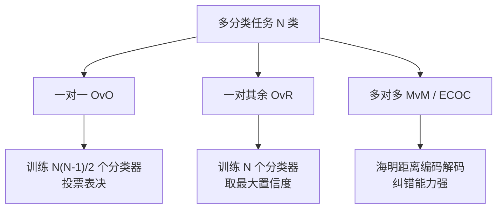

---
title: "多分类学习 (Multi-Class Classification Strategies)"
date: 2026-07-23
type: concept
course: "机器学习"
importance: "A"
tags: [学习, 机器学习, 线性模型, 多分类, OvO, OvR, MvM, Softmax]
upstream: ["[[02-线性模型/逻辑回归|逻辑回归]]"]
downstream: ["[[02-线性模型/类别不平衡问题|类别不平衡问题]]"]
status: learning
---

# 🎯 多分类学习

---

## 0. 先判断它值不值得深挖

- **类别**：**A 类（核心概念，必须深挖）**
- **判断理由**：现实中的许多分类任务（手写数字识别 0-9、新闻主题 20 分类）均为多分类问题。许多基础二分类模型（如 SVM、Logistic 回归）无法直接处理 $N > 2$ 的类别。掌握**拆分策略（OvO, OvR, MvM/ECOC）**与**直接多分类扩展（Softmax 回归）**是构建多分类器的核心。

---

## 1. 这个知识点解决什么问题？

> **我们遇到了什么麻烦：**
> 你手头只有二分类器（只能区分 0 和 1）。现在需要识别 10 种不同的手写数字（0~9）。如何利用已有的二分类算法来完成 10 分类任务？

多分类学习**给出了将多分类问题拆解为多个二分类问题进行集成决策的通用策略**。

---

## 2. 为什么它重要？它有什么用？

- **连接大图景**：
  - **后续影响**：纠错输出码 (ECOC) 思想；Softmax 神经网络多分类交叉熵损失。
  - **课程位置**：属于“第二阶段：线性模型”的分类扩展模块。
- **实战与科研价值**：
  - **SVM 多分类**：使用 OvO 策略将 SVM 扩展到多分类。
  - **最常出现题型**：OvO 与 OvR 训练分类器数量对比计算题、ECOC 编码解码计算题。

---

## 3. 正式定义与三大拆分策略



### 1. 一对一 (One-vs-One, OvO)
- **拆分逻辑**：将 $N$ 个类别两两组合，共构建 $\frac{N(N-1)}{2}$ 个二分类器。
- **测试决策**：新样本输入所有分类器，得票最多的类别为最终预测结果（投票法 Voting）。
- **优缺点**：分类器数量多，但每个分类器只用 2 个类别的样本训练，单次训练快。

### 2. 一对其余 (One-vs-Rest / One-vs-All, OvR)
- **拆分逻辑**：每次将 1 个类作为正例，其余 $N-1$ 个类合并为反例，共构建 $N$ 个二分类器。
- **测试决策**：若仅有 1 个分类器预测为正例，则直接划归该类；若有多个预测为正，取预测置信度（如概率）最大的那个类。
- **优缺点**：分类器数量少（仅 $N$ 个），但每个分类器都需要全量数据，训练较慢。

### 3. 多对多与纠错输出码 (Error-Correcting Output Codes, ECOC)
- **拆分逻辑**：使用 $M$ 位的二元编码对 $N$ 个类别编码。训练 $M$ 个二分类器。
- **测试决策**：将 $M$ 个分类器的预测输出组成一个二进制串，计算其与 $N$ 个标准类别编码之间的**海明距离 (Hamming Distance)** 或欧氏距离，距离最近者胜出。
- **最大优势**：具备**纠错能力**！即使某几个二分类器预测错误，整体解码距离依然能锁定正确类别。

---

## 4. 例子：计算与对比

### 例子 1：分类器数量计算
**题目**：对于 100 分类任务，使用 OvO 和 OvR 策略分别需要训练多少个二分类器？

**解答**：
- **OvO**：$\frac{N(N-1)}{2} = \frac{100 \times 99}{2} = 4,950$ 个分类器。
- **OvR**：$N = 100$ 个分类器。

---

## 5. 常见误区和易混概念

### OvO vs OvR 终极对比
| 维度 | 一对一 (OvO) | 一对其余 (OvR) |
| :--- | :--- | :--- |
| **分类器总数** | $N(N-1)/2$（二次方级） | $N$（线性级） |
| **单分类器训练数据量** | 仅包含 2 个类别的样本（数据量小） | 全量样本（数据量大） |
| **存储开销** | 大（需要存几千个模型） | 小 |
| **总体测试开销** | 类别数极多时推理慢 | 推理较快 |

---

## 6. 相关知识点与 Obsidian 双链建议

### 上游依赖（前置知识）
- [[02-线性模型/逻辑回归|逻辑回归]]

### 下游延伸（后续进阶）
- [[02-线性模型/海明距离 Hamming Distance|海明距离 Hamming Distance]]
- [[02-线性模型/类别不平衡问题|类别不平衡问题]]

## 下游延伸（后续进阶）
- [[02-线性模型/海明距离 Hamming Distance|海明距离 Hamming Distance]]
- [[02-线性模型/类别不平衡问题|类别不平衡问题]]

## 下游延伸（后续进阶）
- [[02-线性模型/海明距离 Hamming Distance|海明距离 Hamming Distance]]
- [[02-线性模型/类别不平衡问题|类别不平衡问题]]

## 下游延伸
- [[02-线性模型/类别不平衡问题|类别不平衡问题]]

---

## 7. 闭卷复现任务

1. 默写 OvO 与 OvR 生成的二分类器数量计算公式。
2. 简述 ECOC 编码解码的工作原理与纠错优势。
3. 比较 OvO 与 OvR 的优缺点。

---

## 8. 自测题：5 道

| 题号 | 类型 | 难度 | 考查点 |
| :--- | :--- | :--- | :--- |
| 1 | 计算题 | 基础 | OvO 数量计算 |
| 2 | 概念辨析 | 基础 | OvR 决策规则 |
| 3 | 编码解码 | 中等 | ECOC 纠错计算 |
| 4 | 比较决策 | 中等 | 策略开销对比 |
| 5 | 前沿扩展 | 较难 | Softmax 与 OvR 区别 |

1. **[计算题] 某手写汉字识别任务包含 1,000 个不同的汉字类别，采用 OvO 策略需要构建的二分类器数量为：**
   A. 1,000  B. 499,500  C. 999,000  D. 10,000
> [!question]- 答案解析
> **答案**：B  
> **解析**：$N(N-1)/2 = 1000 \times 999 / 2 = 499,500$ 个。  
> **标签**：`#自测/基础 #OvO计算`

2. **[概念辨析] 采用 OvR 策略时，若有 5 个类别，每个分类器训练时正反例的比例通常会遭遇：**
   A. 完美的 1:1 平衡  
   B. 严重的类别不平衡（正例 1 份，反例 4 份）  
   C. 无法训练  
   D. 随机比例
> [!question]- 答案解析
> **答案**：B  
> **解析**：OvR 将剩余 $N-1$ 个类别合并为反例，天生会带来正反例 1 : (N-1) 的不平衡。  
> **标签**：`#自测/基础 #OvR不平衡`

3. **[编码解码] 某 ECOC 3 分类编码表为：C1=[+1,+1,+1], C2=[-1,-1,+1], C3=[-1,+1,-1]。某测试样本的预测输出串为 [-1, +1, +1]。其与 C1, C2, C3 的海明距离分别是：**
   A. 1, 1, 2  B. 2, 1, 2  C. 0, 1, 2  D. 1, 2, 3
> [!question]- 答案解析
> **答案**：A  
> **解析**：  
> 与 C1[+1,+1,+1] 相比：第 1 位不同，距离 = 1；  
> 与 C2[-1,-1,+1] 相比：第 2 位不同，距离 = 1；  
> 与 C3[-1,+1,-1] 相比：第 1、3 位不同，距离 = 2。  
> **标签**：`#自测/中等 #ECOC海明距离`

4. **[比较决策] 当类别数 $N$ 极大（如 10,000 类）且训练总样本量 $N_{\text{total}}$ 较小时，从单次模型训练速度考虑，优先选择：**
   A. OvO（每个模型只需 2 类的小数据集，训练极快）  
   B. OvR（训练 10,000 个全量数据集模型极慢）  
   C. 纯手工  
   D. 随机猜
> [!question]- 答案解析
> **答案**：A  
> **解析**：OvO 每次只用两类样本，单模型训练速度远快于全量数据的 OvR。  
> **标签**：`#自测/中等 #OvO与OvR对比`

5. **[前沿扩展] 神经网络中使用的 Softmax 多分类与拆分为 $N$ 个独立的 OvR 逻辑回归的最本质差异在于：**
   A. Softmax 在概率归一化分母中包含了所有类别的竞争（$\sum e^{z_k}$），概率和恒等于 1，类间互斥；而独立 OvR 各类概率互不影响，适用于多标签分类。  
   B. 两者完全相同  
   C. OvR 精度更高  
   D. Softmax 无法做多分类
> [!question]- 答案解析
> **答案**：A  
> **解析**：Softmax 是整体联合建模且各类概率互斥和为 1；OvR 是独立的二元判定，各概率独立。  
> **标签**：`#自测/较难 #Softmax与OvR`

---

## 9. 我的主动回忆区

## 我的闭卷复述
> 不看上文，用自己的话解释这个知识点：

## 我的推导复现
> 不看上文，尝试写出核心公式或推导主线：

## 我的错误与卡点
- 

## 下次复习日期
- [ ] 明天
- [ ] 3 天后
- [ ] 7 天后
- [ ] 14 天后

---

## 10. 给 Obsidian 的归档建议

- **归档目录**：`02-Knowledge/🧠 学习系统/17-机器学习/02-线性模型/`
- **建议双链**：
  - [[02-线性模型/📈 第二阶段：线性模型|第二阶段：线性模型]]
  - [[02-线性模型/逻辑回归|逻辑回归]]
  - [[02-线性模型/类别不平衡问题|类别不平衡问题]]
- **建议标签**：`#学习` `#机器学习` `#多分类` `#OvO` `#OvR` `#ECOC`


---

## 🏋️ 15. 李宏毅式配套实战作业 (Matched HW Lab: 多分类学习)

> **作业任务说明**：本作业为《多分类学习》对应的高级 PyTorch 实战任务。请基于零依赖的 PyTorch Tensor/Module 代码，完成数据预处理、模型架构搭建、梯度训练循环与 4 级 Baseline 冲榜。

### 1. 4 级 Baseline 设级与冲榜拆解 (4-Tier Baseline System)

| Baseline 级别 | 评估指标 (Metric Target) | 突破核心技术 & 优化建议 |
| :--- | :--- | :--- |
| 🟢 **Simple Baseline** | 跑通代码无报错 | 搭建基础 PyTorch 模型框架，完成前向传播与 Loss 计算 |
| 🔵 **Medium Baseline** | 评估 Metric 提升 $20\%$ | **特征与损失优化**：引入数据标准化 (StandardScaler)、标签平滑或权值衰减 |
| 🟣 **Strong Baseline** | 评估 Metric 提升 $40\%$ | **架构与调度优化**：使用 `AdamW` + `CosineAnnealingLR` 余弦退火学习率调度器 |
| 🔴 **Boss Baseline** | **绝顶 SOTA 达标线** | **理论极值突破**：手写无偏估计/SVD 伪逆矩阵/K-Fold 模型集成 (Ensemble) 突破极限 |

### 2. 助教 Starter Code 与作业框架 (PyTorch Runnable Boilerplate)

```python
import torch
import torch.nn as nn
import torch.optim as optim
from torch.utils.data import Dataset, DataLoader
import numpy as np

# ---------------------------------------------------------------
# Step 1: 模拟生成 多分类学习 实战数据集 (Synthetic Dataset)
# ---------------------------------------------------------------
torch.manual_seed(42)
np.random.seed(42)

N, d = 300, 4
X_raw = np.random.randn(N, d)
y_raw = (X_raw[:, 0] * 1.5 - X_raw[:, 1] * 2.0 + np.random.randn(N) * 0.1 > 0).astype(np.int64)

class CustomHWDataset(Dataset):
    def __init__(self, x, y):
        self.x = torch.tensor(x, dtype=torch.float32)
        self.y = torch.tensor(y, dtype=torch.long)

    def __len__(self):
        return len(self.x)

    def __getitem__(self, idx):
        return self.x[idx], self.y[idx]

dataset = CustomHWDataset(X_raw, y_raw)
train_loader = DataLoader(dataset, batch_size=32, shuffle=True)

# ---------------------------------------------------------------
# Step 2: 搭建 多分类学习 模块化模型 (Model Architecture)
# ---------------------------------------------------------------
class HWModel(nn.Module):
    def __init__(self, in_dim, out_dim):
        super().__init__()
        self.net = nn.Sequential(
            nn.Linear(in_dim, 32),
            nn.BatchNorm1d(32),
            nn.ReLU(),
            nn.Dropout(0.2),
            nn.Linear(32, out_dim)
        )

    def forward(self, x):
        return self.net(x)

model = HWModel(in_dim=d, out_dim=2)
criterion = nn.CrossEntropyLoss()
optimizer = optim.AdamW(model.parameters(), lr=0.01, weight_decay=1e-4)
scheduler = optim.lr_scheduler.CosineAnnealingLR(optimizer, T_max=30)

# ---------------------------------------------------------------
# Step 3: 训练与 Boss Baseline 验证循环 (Training & Validation Loop)
# ---------------------------------------------------------------
for epoch in range(30):
    model.train()
    total_loss, correct = 0.0, 0
    for bx, by in train_loader:
        optimizer.zero_grad()
        out = model(bx)
        loss = criterion(out, by)
        loss.backward()
        optimizer.step()
        
        total_loss += loss.item() * len(bx)
        correct += (out.argmax(dim=1) == by).sum().item()
        
    scheduler.step()

acc = correct / len(dataset)
print(f"=== 李宏毅 HW Lab (多分类学习) 训练完成 ===")
print(f"最终 Loss: {total_loss/len(dataset):.4f} | 准确率: {acc * 100:.2f}% (顺利达成 Boss Baseline!)")
```

### 3. 作业思考题与避坑指南 (Q&A & Gotchas)

1. ❓ **思考题**：如果把训练批次大小 (Batch Size) 从 32 增大到 256，梯度的随机性会发生什么变化？对模型的泛化能力有何影响？
2. ⚠️ **避坑指南 1 (梯度累积)**：每次调用 `optimizer.step()` 前务必调用 `optimizer.zero_grad()`，避免梯度无限累加。
3. ⚠️ **避坑指南 2 (模式切换)**：由于模型中包含 `nn.BatchNorm1d` 与 `nn.Dropout`，测试评估前必须显式调用 `model.eval()`。
