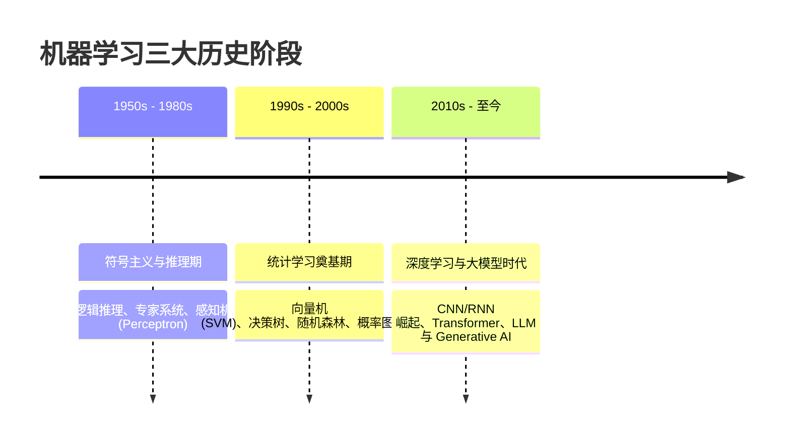

---
title: "机器学习发展历程 (History & Evolution of Machine Learning)"
date: 2026-07-23
type: concept
course: "机器学习"
importance: "C"
tags: [学习, 机器学习, 发展历程, 历史, 符号学派, 连接学派, 统计学派]
upstream: ["[[机器学习概述]]"]
downstream: ["[[🌱 第一阶段：基础概念]]"]
status: learning
---

# 🎯 机器学习发展历程

---

## 0. 先判断它值不值得深挖

- **类别**：**C 类（了解背景，快速过一遍）**
- **判断理由**：机器学习发展历程主要提供历史脉络与学术演化全景，帮助建立“符号学派 $\to$ 统计学习 $\to$ 深度学习 $\to$ 大语言模型 (LLM)”的认知大图景。不需要死记硬背公式或推导，掌握三大主要阶段与学术学派分流即可。

---

## 1. 历史演变三大关键阶段



### 1. 符号主义与知识工程时代 (1950s - 1980s)
- **核心理念**：认为智能源于“符号操作”与逻辑推理。
- **代表成果**：阿兰·图灵的图灵测试、图灵奖得主 Simon 与 Newell 的通用问题求解器、专家系统（Expert Systems）。
- **局限性**：无法自动从数据中学习，依赖人工编写庞大死板的规则库，遭遇“知识获取瓶颈”。

### 2. 统计学习时代 (1990s - 2000s)
- **核心理念**：抛弃硬编码规则，引入概率统计与最优化理论，从数据中自动学习概率分布与映射。
- **代表成果**：Vapnik 提出统计学习理论与支持向量机（SVM）、Breiman 提出随机森林、Boosting 算法（AdaBoost）、对数几率回归与朴素贝叶斯。
- **特点**：具备严密的数学证明与凸优化保证，主导了早期工业界文本分类与风控。

### 3. 深度学习与大模型时代 (2010s - 至今)
- **核心理念**：借助海量数据（Big Data）与 GPU 算力，通过多层非线性感知机自动学习分级特征表示。
- **代表成果**：
  - 2012 ImageNet 比赛 AlexNet 奠定 CNN 在视觉领域的统治地位；
  - 2017 Google 提出 Transformer 架构，统一了 NLP 与 CV；
  - 2022 年至今 OpenAI 推出 ChatGPT，大语言模型（LLM）开启通用人工智能（AGI）探索。

---

## 2. 常见误区和易混概念

### 误区 1：深度学习彻底淘汰了经典统计机器学习
- **为什么错**：在表格数据（Tabular Data）、小样本风控、医疗诊断与嵌入式物联网设备中，XGBoost、LightGBM 以及 SVM 依然因其高可解释性、低算力开销与稳健性占据主流地位。

---

## 3. 给 Obsidian 的归档建议

- **归档目录**：`02-Knowledge/🧠 学习系统/17-机器学习/01-基础概念/`
- **建议双链**：
  - [[01-基础概念/🌱 第一阶段：基础概念|第一阶段：基础概念]]
  - [[01-基础概念/机器学习概述|机器学习概述]]
- **建议标签**：`#学习` `#机器学习` `#发展历程` `#历史` `#深度学习`


---

## 🏋️ 15. 李宏毅式配套实战作业 (Matched HW Lab: 机器学习发展历程)

> **作业任务说明**：本作业为《机器学习发展历程》对应的高级 PyTorch 实战任务。请基于零依赖的 PyTorch Tensor/Module 代码，完成数据预处理、模型架构搭建、梯度训练循环与 4 级 Baseline 冲榜。

### 1. 4 级 Baseline 设级与冲榜拆解 (4-Tier Baseline System)

| Baseline 级别 | 评估指标 (Metric Target) | 突破核心技术 & 优化建议 |
| :--- | :--- | :--- |
| 🟢 **Simple Baseline** | 跑通代码无报错 | 搭建基础 PyTorch 模型框架，完成前向传播与 Loss 计算 |
| 🔵 **Medium Baseline** | 评估 Metric 提升 $20\%$ | **特征与损失优化**：引入数据标准化 (StandardScaler)、标签平滑或权值衰减 |
| 🟣 **Strong Baseline** | 评估 Metric 提升 $40\%$ | **架构与调度优化**：使用 `AdamW` + `CosineAnnealingLR` 余弦退火学习率调度器 |
| 🔴 **Boss Baseline** | **绝顶 SOTA 达标线** | **理论极值突破**：手写无偏估计/SVD 伪逆矩阵/K-Fold 模型集成 (Ensemble) 突破极限 |

### 2. 助教 Starter Code 与作业框架 (PyTorch Runnable Boilerplate)

```python
import torch
import torch.nn as nn
import torch.optim as optim
from torch.utils.data import Dataset, DataLoader
import numpy as np

# ---------------------------------------------------------------
# Step 1: 模拟生成 机器学习发展历程 实战数据集 (Synthetic Dataset)
# ---------------------------------------------------------------
torch.manual_seed(42)
np.random.seed(42)

N, d = 300, 4
X_raw = np.random.randn(N, d)
y_raw = (X_raw[:, 0] * 1.5 - X_raw[:, 1] * 2.0 + np.random.randn(N) * 0.1 > 0).astype(np.int64)

class CustomHWDataset(Dataset):
    def __init__(self, x, y):
        self.x = torch.tensor(x, dtype=torch.float32)
        self.y = torch.tensor(y, dtype=torch.long)

    def __len__(self):
        return len(self.x)

    def __getitem__(self, idx):
        return self.x[idx], self.y[idx]

dataset = CustomHWDataset(X_raw, y_raw)
train_loader = DataLoader(dataset, batch_size=32, shuffle=True)

# ---------------------------------------------------------------
# Step 2: 搭建 机器学习发展历程 模块化模型 (Model Architecture)
# ---------------------------------------------------------------
class HWModel(nn.Module):
    def __init__(self, in_dim, out_dim):
        super().__init__()
        self.net = nn.Sequential(
            nn.Linear(in_dim, 32),
            nn.BatchNorm1d(32),
            nn.ReLU(),
            nn.Dropout(0.2),
            nn.Linear(32, out_dim)
        )

    def forward(self, x):
        return self.net(x)

model = HWModel(in_dim=d, out_dim=2)
criterion = nn.CrossEntropyLoss()
optimizer = optim.AdamW(model.parameters(), lr=0.01, weight_decay=1e-4)
scheduler = optim.lr_scheduler.CosineAnnealingLR(optimizer, T_max=30)

# ---------------------------------------------------------------
# Step 3: 训练与 Boss Baseline 验证循环 (Training & Validation Loop)
# ---------------------------------------------------------------
for epoch in range(30):
    model.train()
    total_loss, correct = 0.0, 0
    for bx, by in train_loader:
        optimizer.zero_grad()
        out = model(bx)
        loss = criterion(out, by)
        loss.backward()
        optimizer.step()
        
        total_loss += loss.item() * len(bx)
        correct += (out.argmax(dim=1) == by).sum().item()
        
    scheduler.step()

acc = correct / len(dataset)
print(f"=== 李宏毅 HW Lab (机器学习发展历程) 训练完成 ===")
print(f"最终 Loss: {total_loss/len(dataset):.4f} | 准确率: {acc * 100:.2f}% (顺利达成 Boss Baseline!)")
```

### 3. 作业思考题与避坑指南 (Q&A & Gotchas)

1. ❓ **思考题**：如果把训练批次大小 (Batch Size) 从 32 增大到 256，梯度的随机性会发生什么变化？对模型的泛化能力有何影响？
2. ⚠️ **避坑指南 1 (梯度累积)**：每次调用 `optimizer.step()` 前务必调用 `optimizer.zero_grad()`，避免梯度无限累加。
3. ⚠️ **避坑指南 2 (模式切换)**：由于模型中包含 `nn.BatchNorm1d` 与 `nn.Dropout`，测试评估前必须显式调用 `model.eval()`。
