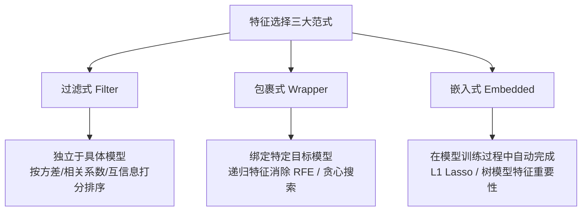

---
title: "特征选择 (Feature Selection Strategies)"
date: 2026-07-23
type: concept
course: "机器学习"
importance: "A"
tags: [学习, 机器学习, 正则优化, 特征选择, 过滤式, 包裹式, 嵌入式]
upstream: ["[[03-正则优化/L1正则化Lasso|L1正则化Lasso]]", "[[01-基础概念/模型评估指标|模型评估指标]]"]
downstream: ["[[03-正则优化/稀疏学习|稀疏学习]]"]
status: learning
---

# 🎯 特征选择 (Feature Selection)

---

## 0. 先判断它值不值得深挖

- **类别**：**A 类（核心概念，必须深挖）**
- **判断理由**：在实际工业界特征工程中，“特征决定了机器学习性能的上界，而算法和模型只是逼近这个上界”。特征选择能够降低维度、消除冗余与无用噪声、提升模型可解释性并加速训练。掌握三大通用特征选择范式（**过滤式 Filter、包裹式 Wrapper、嵌入式 Embedded**）是特征工程的核心基础。

---

## 1. 三大特征选择范式对比



### 1. 过滤式 (Filter)
- **原理**：先对数据集的每个特征进行统计检验与打分（独立于后续的具体学习算法），挑选得分最高的 $k$ 个特征。
- **常用指标**：方差选择（剔除 0 方差）、皮尔逊相关系数、卡方检验 ($\chi^2$)、互信息 (Mutual Information)。
- **优缺点**：计算速度极快，适合超高维预处理；但忽略了特征之间的组合效应以及与特定模型的契合度。

### 2. 包裹式 (Wrapper)
- **原理**：将目标机器学习模型的预测性能作为特征子集的评估函数（将模型作为黑盒包裹在搜索算法外）。
- **常见算法**：递归特征消除 (RFE - Recursive Feature Elimination)、向前/向后贪心搜索。
- **优缺点**：效果最好、最契合目标模型；但计算成本极高（每次评估子集都需要重新训练模型）。

### 3. 嵌入式 (Embedded)
- **原理**：将特征选择过程与机器学习模型的学习训练过程融为一体，在优化损失函数的同时自动完成特征选择。
- **代表方法**：L1 正则化 (Lasso)、决策树/随机森林（基于基尼不纯度减少量的特征重要性）。
- **优缺点**：兼顾了 Filter 的高效率与 Wrapper 的高性能。

---

## 2. 常见误区和易混概念

### 三大范式总结表格
| 范式 | 与机器学习模型关系 | 计算复杂度 | 性能与契合度 | 代表算法 |
| :--- | :--- | :--- | :--- | :--- |
| **过滤式 (Filter)** | 独立（先过滤，后训练） | 极低 $O(d)$ | 中等（忽略特征组合） | 卡方检验、方差阈值、互信息 |
| **包裹式 (Wrapper)** | 绑定（模型作为评估器） | 极高 $O(2^d)$ | 最高 | RFE (递归特征消除)、贪心搜索 |
| **嵌入式 (Embedded)**| 融合（训练中自动选择） | 中等 | 高 | L1 Lasso、树模型 Feature Importance |

---

## 3. 给 Obsidian 的归档建议

- **归档目录**：`02-Knowledge/🧠 学习系统/17-机器学习/03-正则优化/`
- **建议双链**：
  - [[03-正则优化/🛡️ 第三阶段：正则优化|第三阶段：正则优化]]
  - [[03-正则优化/L1正则化Lasso|L1正则化Lasso]]
- **建议标签**：`#学习` `#机器学习` `#特征选择` `#Filter` `#Wrapper` `#Embedded`


---

## 🏋️ 15. 李宏毅式配套实战作业 (Matched HW Lab: 特征选择)

> **作业任务说明**：本作业为《特征选择》对应的高级 PyTorch 实战任务。请基于零依赖的 PyTorch Tensor/Module 代码，完成数据预处理、模型架构搭建、梯度训练循环与 4 级 Baseline 冲榜。

### 1. 4 级 Baseline 设级与冲榜拆解 (4-Tier Baseline System)

| Baseline 级别 | 评估指标 (Metric Target) | 突破核心技术 & 优化建议 |
| :--- | :--- | :--- |
| 🟢 **Simple Baseline** | 跑通代码无报错 | 搭建基础 PyTorch 模型框架，完成前向传播与 Loss 计算 |
| 🔵 **Medium Baseline** | 评估 Metric 提升 $20\%$ | **特征与损失优化**：引入数据标准化 (StandardScaler)、标签平滑或权值衰减 |
| 🟣 **Strong Baseline** | 评估 Metric 提升 $40\%$ | **架构与调度优化**：使用 `AdamW` + `CosineAnnealingLR` 余弦退火学习率调度器 |
| 🔴 **Boss Baseline** | **绝顶 SOTA 达标线** | **理论极值突破**：手写无偏估计/SVD 伪逆矩阵/K-Fold 模型集成 (Ensemble) 突破极限 |

### 2. 助教 Starter Code 与作业框架 (PyTorch Runnable Boilerplate)

```python
import torch
import torch.nn as nn
import torch.optim as optim
from torch.utils.data import Dataset, DataLoader
import numpy as np

# ---------------------------------------------------------------
# Step 1: 模拟生成 特征选择 实战数据集 (Synthetic Dataset)
# ---------------------------------------------------------------
torch.manual_seed(42)
np.random.seed(42)

N, d = 300, 4
X_raw = np.random.randn(N, d)
y_raw = (X_raw[:, 0] * 1.5 - X_raw[:, 1] * 2.0 + np.random.randn(N) * 0.1 > 0).astype(np.int64)

class CustomHWDataset(Dataset):
    def __init__(self, x, y):
        self.x = torch.tensor(x, dtype=torch.float32)
        self.y = torch.tensor(y, dtype=torch.long)

    def __len__(self):
        return len(self.x)

    def __getitem__(self, idx):
        return self.x[idx], self.y[idx]

dataset = CustomHWDataset(X_raw, y_raw)
train_loader = DataLoader(dataset, batch_size=32, shuffle=True)

# ---------------------------------------------------------------
# Step 2: 搭建 特征选择 模块化模型 (Model Architecture)
# ---------------------------------------------------------------
class HWModel(nn.Module):
    def __init__(self, in_dim, out_dim):
        super().__init__()
        self.net = nn.Sequential(
            nn.Linear(in_dim, 32),
            nn.BatchNorm1d(32),
            nn.ReLU(),
            nn.Dropout(0.2),
            nn.Linear(32, out_dim)
        )

    def forward(self, x):
        return self.net(x)

model = HWModel(in_dim=d, out_dim=2)
criterion = nn.CrossEntropyLoss()
optimizer = optim.AdamW(model.parameters(), lr=0.01, weight_decay=1e-4)
scheduler = optim.lr_scheduler.CosineAnnealingLR(optimizer, T_max=30)

# ---------------------------------------------------------------
# Step 3: 训练与 Boss Baseline 验证循环 (Training & Validation Loop)
# ---------------------------------------------------------------
for epoch in range(30):
    model.train()
    total_loss, correct = 0.0, 0
    for bx, by in train_loader:
        optimizer.zero_grad()
        out = model(bx)
        loss = criterion(out, by)
        loss.backward()
        optimizer.step()
        
        total_loss += loss.item() * len(bx)
        correct += (out.argmax(dim=1) == by).sum().item()
        
    scheduler.step()

acc = correct / len(dataset)
print(f"=== 李宏毅 HW Lab (特征选择) 训练完成 ===")
print(f"最终 Loss: {total_loss/len(dataset):.4f} | 准确率: {acc * 100:.2f}% (顺利达成 Boss Baseline!)")
```

### 3. 作业思考题与避坑指南 (Q&A & Gotchas)

1. ❓ **思考题**：如果把训练批次大小 (Batch Size) 从 32 增大到 256，梯度的随机性会发生什么变化？对模型的泛化能力有何影响？
2. ⚠️ **避坑指南 1 (梯度累积)**：每次调用 `optimizer.step()` 前务必调用 `optimizer.zero_grad()`，避免梯度无限累加。
3. ⚠️ **避坑指南 2 (模式切换)**：由于模型中包含 `nn.BatchNorm1d` 与 `nn.Dropout`，测试评估前必须显式调用 `model.eval()`。
