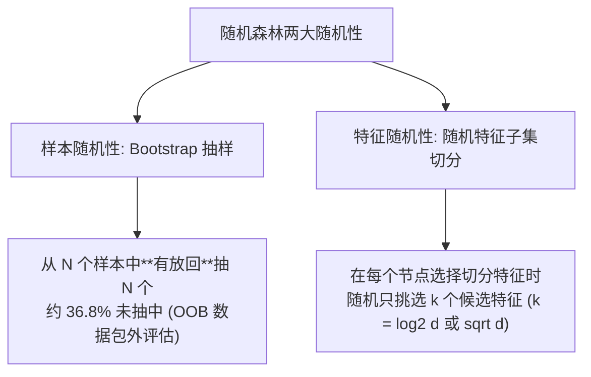

---
title: "随机森林 (Random Forest, RF)"
date: 2026-07-23
type: concept
course: "机器学习"
importance: "A"
tags: [学习, 机器学习, 树模型, 集成学习, 随机森林, Bagging, OOB评估, 特征重要性]
upstream: ["[[04-树与集成/集成学习|集成学习]]", "[[04-树与集成/决策树|决策树]]"]
downstream: ["[[04-树与集成/XGBoost|XGBoost]]"]
status: learning
---

# 🎯 随机森林 (Random Forest)

---

## 0. 先判断它值不值得深挖

- **类别**：**A 类（核心概念，必须深挖）**
- **判断理由**：随机森林（Random Forest / Breiman 2001）是 Bagging 族系最辉煌的代表。它在 Bootstrap 样本抽样的基础之上，创新性地引入了**随机特征选择（Random Feature Selection）**。极高的高维鲁棒性、开箱即用的基线效果、天然的包外数据（OOB）无偏评估以及特征重要性评估能力，使其成为表格数据最首选的基线算法。

---

## 1. 随机森林的两大“随机性”灵魂



### 1. 样本随机性 (Bootstrap Sampling)
对于包含 $N$ 个样本的数据集，有放回随机抽取 $N$ 次组成该单树的训练集。
- 每次抽样样本未被抽中的概率为 $(1 - \frac{1}{N})^N \to \frac{1}{e} \approx 36.8\%$。
- 这 36.8% 未被抽中的样本称为**包外数据 (Out-of-Bag, OOB)**，可直接替代独立验证集用于测试评估。

### 2. 特征随机性 (Random Feature Selection)
在决策树的每个节点寻找最佳切分特征时，**不从全部 $d$ 个特征中挑选，而是先随机隐式抽取一个包含 $k$ 个特征的子集**（分类通常取 $k = \sqrt{d}$，回归取 $k = d/3$），再从这 $k$ 个特征中寻找最佳切分。

---

## 2. 为什么两大随机性有效？

- **基模型去相关性 (De-correlation)**：
  如果数据集中存在 1 个极强的主导特征，普通 Bagging 的所有树都会在根节点选择该特征，导致各树高度相似（相关性 $\rho$ 极大）。
- **随机特征选择强行打破了这种同质化**，使得有些树在根节点看不到主导特征，被迫探索其他次要特征，大大降低了树之间的相关性 $\rho$，由方差公式 $\text{Var} = \rho \sigma^2 + \frac{1-\rho}{M} \sigma^2$ 可知，**极大降低了全森林的总方差**！

---

## 3. 包外误差评估 (OOB Error)

不需要额外划分 validation 集！对于样本 $\mathbf{x}_i$，仅挑选**训练时未包含该样本**的那些决策树组成子森林，用子森林对 $\mathbf{x}_i$ 进行预测。在所有样本上取平均，即得到 **OOB Error**。
- **定理**：OOB Error 是全森林泛化误差的无偏估计！

---

## 4. 相关知识点与 Obsidian 双链建议

- **归档目录**：`02-Knowledge/🧠 学习系统/17-机器学习/04-树与集成/`
- **建议双链**：
  - [[04-树与集成/🌲 第四阶段：树与集成|第四阶段：树与集成]]
  - [[04-树与集成/集成学习|集成学习]]
  - [[04-树与集成/决策树|决策树]]
- **建议标签**：`#学习` `#机器学习` `#随机森林` `#Bagging` `#OOB`


---

## 🏋️ 15. 李宏毅式配套实战作业 (Matched HW Lab: 随机森林)

> **作业任务说明**：本作业为《随机森林》对应的高级 PyTorch 实战任务。请基于零依赖的 PyTorch Tensor/Module 代码，完成数据预处理、模型架构搭建、梯度训练循环与 4 级 Baseline 冲榜。

### 1. 4 级 Baseline 设级与冲榜拆解 (4-Tier Baseline System)

| Baseline 级别 | 评估指标 (Metric Target) | 突破核心技术 & 优化建议 |
| :--- | :--- | :--- |
| 🟢 **Simple Baseline** | 跑通代码无报错 | 搭建基础 PyTorch 模型框架，完成前向传播与 Loss 计算 |
| 🔵 **Medium Baseline** | 评估 Metric 提升 $20\%$ | **特征与损失优化**：引入数据标准化 (StandardScaler)、标签平滑或权值衰减 |
| 🟣 **Strong Baseline** | 评估 Metric 提升 $40\%$ | **架构与调度优化**：使用 `AdamW` + `CosineAnnealingLR` 余弦退火学习率调度器 |
| 🔴 **Boss Baseline** | **绝顶 SOTA 达标线** | **理论极值突破**：手写无偏估计/SVD 伪逆矩阵/K-Fold 模型集成 (Ensemble) 突破极限 |

### 2. 助教 Starter Code 与作业框架 (PyTorch Runnable Boilerplate)

```python
import torch
import torch.nn as nn
import torch.optim as optim
from torch.utils.data import Dataset, DataLoader
import numpy as np

# ---------------------------------------------------------------
# Step 1: 模拟生成 随机森林 实战数据集 (Synthetic Dataset)
# ---------------------------------------------------------------
torch.manual_seed(42)
np.random.seed(42)

N, d = 300, 4
X_raw = np.random.randn(N, d)
y_raw = (X_raw[:, 0] * 1.5 - X_raw[:, 1] * 2.0 + np.random.randn(N) * 0.1 > 0).astype(np.int64)

class CustomHWDataset(Dataset):
    def __init__(self, x, y):
        self.x = torch.tensor(x, dtype=torch.float32)
        self.y = torch.tensor(y, dtype=torch.long)

    def __len__(self):
        return len(self.x)

    def __getitem__(self, idx):
        return self.x[idx], self.y[idx]

dataset = CustomHWDataset(X_raw, y_raw)
train_loader = DataLoader(dataset, batch_size=32, shuffle=True)

# ---------------------------------------------------------------
# Step 2: 搭建 随机森林 模块化模型 (Model Architecture)
# ---------------------------------------------------------------
class HWModel(nn.Module):
    def __init__(self, in_dim, out_dim):
        super().__init__()
        self.net = nn.Sequential(
            nn.Linear(in_dim, 32),
            nn.BatchNorm1d(32),
            nn.ReLU(),
            nn.Dropout(0.2),
            nn.Linear(32, out_dim)
        )

    def forward(self, x):
        return self.net(x)

model = HWModel(in_dim=d, out_dim=2)
criterion = nn.CrossEntropyLoss()
optimizer = optim.AdamW(model.parameters(), lr=0.01, weight_decay=1e-4)
scheduler = optim.lr_scheduler.CosineAnnealingLR(optimizer, T_max=30)

# ---------------------------------------------------------------
# Step 3: 训练与 Boss Baseline 验证循环 (Training & Validation Loop)
# ---------------------------------------------------------------
for epoch in range(30):
    model.train()
    total_loss, correct = 0.0, 0
    for bx, by in train_loader:
        optimizer.zero_grad()
        out = model(bx)
        loss = criterion(out, by)
        loss.backward()
        optimizer.step()
        
        total_loss += loss.item() * len(bx)
        correct += (out.argmax(dim=1) == by).sum().item()
        
    scheduler.step()

acc = correct / len(dataset)
print(f"=== 李宏毅 HW Lab (随机森林) 训练完成 ===")
print(f"最终 Loss: {total_loss/len(dataset):.4f} | 准确率: {acc * 100:.2f}% (顺利达成 Boss Baseline!)")
```

### 3. 作业思考题与避坑指南 (Q&A & Gotchas)

1. ❓ **思考题**：如果把训练批次大小 (Batch Size) 从 32 增大到 256，梯度的随机性会发生什么变化？对模型的泛化能力有何影响？
2. ⚠️ **避坑指南 1 (梯度累积)**：每次调用 `optimizer.step()` 前务必调用 `optimizer.zero_grad()`，避免梯度无限累加。
3. ⚠️ **避坑指南 2 (模式切换)**：由于模型中包含 `nn.BatchNorm1d` 与 `nn.Dropout`，测试评估前必须显式调用 `model.eval()`。
