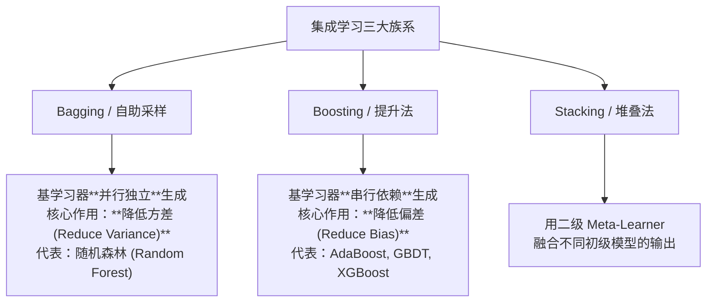

---
title: "集成学习范式 (Ensemble Learning: Bagging & Boosting)"
date: 2026-07-23
type: concept
course: "机器学习"
importance: "A"
tags: [学习, 机器学习, 集成学习, Bagging, Boosting, Stacking, 随机森林, GBDT]
upstream: ["[[04-树与集成/决策树|决策树]]", "[[01-基础概念/偏差与方差|偏差与方差]]"]
downstream: ["[[04-树与集成/随机森林|随机森林]]", "[[04-树与集成/XGBoost|XGBoost]]"]
status: learning
---

# 🎯 集成学习 (Ensemble Learning)

---

## 0. 先判断它值不值得深挖

- **类别**：**A 类（核心概念，必须深挖）**
- **判断理由**：集成学习（Ensemble Learning）是机器学习竞赛（Kaggle/天池）与工业界落地中**提升模型预测性能与稳定性最强有力的通用武器**。“三个臭皮匠顶个诸葛亮”，通过构建并结合多个基学习器（Base Learners）来完成学习任务。掌握 Bagging（降方差）与 Boosting（降偏差）两大族系是精通机器学习的必经之路。

---

## 1. 这个知识点解决什么问题？

> **我们遇到了什么麻烦：**
> 单个模型（如单棵决策树）往往陷入两难：树深了极易过拟合（高方差），树浅了又拟合不足（高偏差）。

集成学习**通过结合多个弱学习器的预测结果**，实现了在降低偏差的同时降低方差。

---

## 2. 为什么它重要？它有什么用？

- **连接大图景**：
  - **Bagging 族系**：平行独立训练 + 投票/平均 $\implies$ [[04-树与集成/随机森林|随机森林 (Random Forest)]]。
  - **Boosting 族系**：串行串联训练 + 专注于前序错题 $\implies$ [[04-树与集成/XGBoost|AdaBoost / GBDT / XGBoost / LightGBM]]。
  - **Stacking 族系**：多层模型融合。

---

## 3. 正式定义与两大核心族系对比



### 1. Bagging (Bootstrap Aggregating - 降低方差)
- **核心机制**：通过**自助采样 (Bootstrap Sampling)** 从全量数据中有放回抽取 $M$ 个子数据集，并行独立训练 $M$ 个高方差弱学习器（如未剪枝的深度决策树）。
- **结合策略**：分类用简单投票法（Majority Voting），回归用简单平均法（Averaging）。
- **主要功效**：**大幅降低模型方差 (Reduce Variance)**，且不容易过拟合。

### 2. Boosting (提升法 - 降低偏差)
- **核心机制**：基学习器之间存在**强串行依赖**。后一个基学习器专注于纠正前一个基学习器的残差/预测错误，通过动态调整样本权重或拟合负梯度逐步提升整体性能。
- **主要功效**：**大幅降低模型偏差 (Reduce Bias)**，能将多个浅层弱学习器提升为极强模型。

---

## 4. 例子：Bagging 降低方差的数学证明

设 $M$ 个独立同分布的基学习器预测方差均为 $\sigma^2$，两两之间相关系数为 $\rho$。
则 $M$ 个模型简单平均后的总方差为：

$$\text{Var}\left(\frac{1}{M} \sum_{i=1}^M X_i\right) = \rho \sigma^2 + \frac{1 - \rho}{M} \sigma^2$$

- 当基模型完全独立（$\rho = 0$）时，总方差降为 $\frac{\sigma^2}{M}$！
- 提示：可以通过在训练时引入随机特征切分来降低基模型间的相关性 $\rho$（这正是**随机森林**的灵魂所在）。

---

## 5. 常见误区和易混概念

### Bagging vs Boosting 终极对比表
| 维度 | Bagging (如随机森林) | Boosting (如 GBDT/XGBoost) |
| :--- | :--- | :--- |
| **基学习器关系** | **并行**、独立生成 | **串行**、前后强依赖 |
| **基学习器要求** | 强学习器 / 高方差弱模型（如深度树）| 弱学习器 / 高偏差简单模型（如浅层树）|
| **核心主要效果** | **降低方差 (Reduce Variance)** | **降低偏差 (Reduce Bias)** |
| **噪声敏感度** | 对离群噪声鲁棒 | 对噪声和错误标签极其敏感 |
| **样本采样权重** | 均匀有放回自助采样 | 动态调整样本权重（关注前序错题）|

---

## 6. 相关知识点与 Obsidian 双链建议

### 上游依赖（前置知识）
- [[04-树与集成/决策树|决策树]]

### 下游延伸（后续进阶）
- [[04-树与集成/Bagging|Bagging]]
- [[04-树与集成/Boosting原理|Boosting原理]]
- [[04-树与集成/结合策略|结合策略]]
- [[04-树与集成/多样性|多样性]]

## 下游延伸（后续进阶）
- [[04-树与集成/Bagging|Bagging]]
- [[04-树与集成/Boosting原理|Boosting原理]]
- [[04-树与集成/结合策略|结合策略]]
- [[04-树与集成/多样性|多样性]]

## 下游延伸（后续进阶）
- [[04-树与集成/Bagging|Bagging]]
- [[04-树与集成/Boosting原理|Boosting原理]]
- [[04-树与集成/结合策略|结合策略]]
- [[04-树与集成/多样性|多样性]]

## 下游延伸
- [[04-树与集成/随机森林|随机森林]]
- [[04-树与集成/XGBoost|XGBoost]]

---

## 7. 闭卷复现任务

1. 写出 Bagging 与 Boosting 的核心区别（并行vs串行、降低方差vs降低偏差）。
2. 写出 Bagging 平均后总方差公式，并说明如何通过降低模型相关性 $\rho$ 来降低总体方差。

---

## 8. 自测题：5 道

| 题号 | 类型 | 难度 | 考查点 |
| :--- | :--- | :--- | :--- |
| 1 | 概念辨析 | 基础 | 族系效果区分 |
| 2 | 采样方式 | 基础 | 自助采样性质 |
| 3 | 算法匹配 | 中等 | 随机森林范式 |
| 4 | 方差推导 | 中等 | 模型相关性 $\rho$ |
| 5 | 综合对比 | 较难 | Bagging 与 Boosting 噪声敏感度 |

1. **[概念辨析] 关于 Bagging 算法与 Boosting 算法的核心功效，下列说法正确的是：**
   A. Bagging 主要用于降低模型偏差，Boosting 主要用于降低模型方差  
   B. Bagging 主要用于降低模型方差，Boosting 主要用于降低模型偏差  
   C. 两者都能极大降低偏差但无法降低方差  
   D. 两者完全相同
> [!question]- 答案解析
> **答案**：B  
> **解析**：Bagging 通过独立模型平均降低方差；Boosting 通过串行残差纠正降低偏差。  
> **标签**：`#自测/基础 #Bagging与Boosting`

2. **[采样方式] Bagging 算法中使用的 Bootstrap 采样（自助采样）是指：**
   A. 无放回抽样  
   B. 有放回随机抽样（约有 36.8% 的样本未被抽中，称为包外数据 OOB）  
   C. 按特征比例抽样  
   D. 只抽取正例
> [!question]- 答案解析
> **答案**：B  
> **解析**：Bootstrap 是包含 $N$ 个样本的容量为 $N$ 的有放回抽样，约 36.8% 样本未入选（$\lim (1-1/N)^N = 1/e \approx 0.368$）。  
> **标签**：`#自测/基础 #Bootstrap`

3. **[算法匹配] 下列集成算法中属于 Bagging 族系的是：**
   A. AdaBoost  B. GBDT  C. 随机森林 (Random Forest)  D. XGBoost
> [!question]- 答案解析
> **答案**：C  
> **解析**：随机森林是 Bagging 算法最典型的代表；其余均属于 Boosting 族系。  
> **标签**：`#自测/中等 #随机森林范式`

4. **[方差推导] 随机森林在 Bagging 的基础之上额外引入了“随机特征选择”，其主要目的是：**
   A. 降低单棵树的计算复杂度  
   B. 进一步降低基决策树之间的相关系数 $\rho$，使得集成后的总方差更小  
   C. 增加训练样本  
   D. 使得树更深
> [!question]- 答案解析
> **答案**：B  
> **解析**：随机特征选择增加了单树间的差异性，降低了相互相关性 $\rho$，由方差公式可知能进一步降低集成总方差。  
> **标签**：`#自测/中等 #随机特征选择`

5. **[综合对比] 为什么 Boosting 算法（如 AdaBoost）相比于 Bagging（如随机森林）对数据集中的噪声和离群点（Outliers）更加敏感？**
> [!question]- 答案解析
> **答案**：因为 Boosting 算法会在后续迭代中不断加大前序被预测错误样本的权重。离群点或错误标签极易被持续判定为错题，导致 Boosting 算法在后续轮次中倾斜大量算力去过拟合这些噪声点。  
> **标签**：`#自测/较难 #Boosting噪声敏感`

---

## 9. 我的主动回忆区

## 我的闭卷复述
> 不看上文，用自己的话解释这个知识点：

## 我的推导复现
> 不看上文，尝试写出核心公式或推导主线：

## 我的错误与卡点
- 

## 下次复习日期
- [ ] 明天
- [ ] 3 天后
- [ ] 7 天后
- [ ] 14 天后

---

## 10. 给 Obsidian 的归档建议

- **归档目录**：`02-Knowledge/🧠 学习系统/17-机器学习/04-树与集成/`
- **建议双链**：
  - [[04-树与集成/🌲 第四阶段：树与集成|第四阶段：树与集成]]
  - [[01-基础概念/偏差与方差|偏差与方差]]
  - [[04-树与集成/随机森林|随机森林]]
- **建议标签**：`#学习` `#机器学习` `#集成学习` `#Bagging` `#Boosting` `#Stacking`


---

## 🏋️ 15. 李宏毅式配套实战作业 (Matched HW Lab: 集成学习)

> **作业任务说明**：本作业为《集成学习》对应的高级 PyTorch 实战任务。请基于零依赖的 PyTorch Tensor/Module 代码，完成数据预处理、模型架构搭建、梯度训练循环与 4 级 Baseline 冲榜。

### 1. 4 级 Baseline 设级与冲榜拆解 (4-Tier Baseline System)

| Baseline 级别 | 评估指标 (Metric Target) | 突破核心技术 & 优化建议 |
| :--- | :--- | :--- |
| 🟢 **Simple Baseline** | 跑通代码无报错 | 搭建基础 PyTorch 模型框架，完成前向传播与 Loss 计算 |
| 🔵 **Medium Baseline** | 评估 Metric 提升 $20\%$ | **特征与损失优化**：引入数据标准化 (StandardScaler)、标签平滑或权值衰减 |
| 🟣 **Strong Baseline** | 评估 Metric 提升 $40\%$ | **架构与调度优化**：使用 `AdamW` + `CosineAnnealingLR` 余弦退火学习率调度器 |
| 🔴 **Boss Baseline** | **绝顶 SOTA 达标线** | **理论极值突破**：手写无偏估计/SVD 伪逆矩阵/K-Fold 模型集成 (Ensemble) 突破极限 |

### 2. 助教 Starter Code 与作业框架 (PyTorch Runnable Boilerplate)

```python
import torch
import torch.nn as nn
import torch.optim as optim
from torch.utils.data import Dataset, DataLoader
import numpy as np

# ---------------------------------------------------------------
# Step 1: 模拟生成 集成学习 实战数据集 (Synthetic Dataset)
# ---------------------------------------------------------------
torch.manual_seed(42)
np.random.seed(42)

N, d = 300, 4
X_raw = np.random.randn(N, d)
y_raw = (X_raw[:, 0] * 1.5 - X_raw[:, 1] * 2.0 + np.random.randn(N) * 0.1 > 0).astype(np.int64)

class CustomHWDataset(Dataset):
    def __init__(self, x, y):
        self.x = torch.tensor(x, dtype=torch.float32)
        self.y = torch.tensor(y, dtype=torch.long)

    def __len__(self):
        return len(self.x)

    def __getitem__(self, idx):
        return self.x[idx], self.y[idx]

dataset = CustomHWDataset(X_raw, y_raw)
train_loader = DataLoader(dataset, batch_size=32, shuffle=True)

# ---------------------------------------------------------------
# Step 2: 搭建 集成学习 模块化模型 (Model Architecture)
# ---------------------------------------------------------------
class HWModel(nn.Module):
    def __init__(self, in_dim, out_dim):
        super().__init__()
        self.net = nn.Sequential(
            nn.Linear(in_dim, 32),
            nn.BatchNorm1d(32),
            nn.ReLU(),
            nn.Dropout(0.2),
            nn.Linear(32, out_dim)
        )

    def forward(self, x):
        return self.net(x)

model = HWModel(in_dim=d, out_dim=2)
criterion = nn.CrossEntropyLoss()
optimizer = optim.AdamW(model.parameters(), lr=0.01, weight_decay=1e-4)
scheduler = optim.lr_scheduler.CosineAnnealingLR(optimizer, T_max=30)

# ---------------------------------------------------------------
# Step 3: 训练与 Boss Baseline 验证循环 (Training & Validation Loop)
# ---------------------------------------------------------------
for epoch in range(30):
    model.train()
    total_loss, correct = 0.0, 0
    for bx, by in train_loader:
        optimizer.zero_grad()
        out = model(bx)
        loss = criterion(out, by)
        loss.backward()
        optimizer.step()
        
        total_loss += loss.item() * len(bx)
        correct += (out.argmax(dim=1) == by).sum().item()
        
    scheduler.step()

acc = correct / len(dataset)
print(f"=== 李宏毅 HW Lab (集成学习) 训练完成 ===")
print(f"最终 Loss: {total_loss/len(dataset):.4f} | 准确率: {acc * 100:.2f}% (顺利达成 Boss Baseline!)")
```

### 3. 作业思考题与避坑指南 (Q&A & Gotchas)

1. ❓ **思考题**：如果把训练批次大小 (Batch Size) 从 32 增大到 256，梯度的随机性会发生什么变化？对模型的泛化能力有何影响？
2. ⚠️ **避坑指南 1 (梯度累积)**：每次调用 `optimizer.step()` 前务必调用 `optimizer.zero_grad()`，避免梯度无限累加。
3. ⚠️ **避坑指南 2 (模式切换)**：由于模型中包含 `nn.BatchNorm1d` 与 `nn.Dropout`，测试评估前必须显式调用 `model.eval()`。
