# 泛函分析-变分方法与椭圆PDE弱解

> 所属阶段：[[🧭 阶段4-变分方法与应用|第四阶段：变分方法与应用]]

---

## 0. 知识定位与核心价值

- **核心使命**：全课程数学理论的终极大成应用。将赋范完备性、Hilbert 空间正交投影、Riesz 对偶、Hahn-Banach 分离、自反空间弱紧性、Sobolev 空间与迹定理全部汇聚于一处，彻底拯救 19 世纪破产的经典 Dirichlet 原理，建立现代偏微分方程弱解的存在唯一性，并通过 Nirenberg 差商自举回归经典光滑解。
- **不可替代性**：它是连接纯粹泛函分析与现代应用数学、计算力学（有限元方法 FEM）的最核心桥梁。

---

## 1. 问题驱动与历史危机

> **Dirichlet 原理与 Weierstrass 危机**：
> 19 世纪中叶，Dirichlet 提出：要求解 Poisson 方程 $-\Delta u = f \ (\text{在 } \Omega \text{ 内}), \ \left.u\right|_{\partial \Omega} = 0$，只需在所有满足边界条件的连续可微函数中极小化静电场能量泛函：
> $$J(v) = \frac{1}{2} \int_\Omega |\nabla v|^2 dx - \int_\Omega f v dx$$
> Riemann 坚信下确界存在且必能达到。然而 Weierstrass 提出致命一击：**下确界存在绝不代表极小值能在线性空间内取得！**（例如函数 $g(x)=x$ 在开区间 $(0,1)$ 上的下确界为 0，但 0 点不在空间内）。
> 直到 20 世纪 Sobolev 空间建立以及自反空间弱紧性理论成熟，现代泛函分析才通过**变分直接法 (Direct Method)** 彻底解决了这一数学危机。

---

## 2. 前置知识准备

1. **[[泛函分析-Riesz表示定理与Lax-Milgram引理]]**：双线性型连续性与矫顽性。
2. **[[泛函分析-Sobolev空间与嵌入定理]]**：$H_0^1(\Omega)$ 空间、Poincaré 不等式与 Rellich-Kondrachov 紧嵌入。
3. **[[泛函分析-迹定理与Sobolev边界空间]]**：零迹核空间 $H_0^1(\Omega) = \ker(\gamma)$。

---

## 3. 三大数学形式：古典解 vs 弱解 vs 变分极小点

### 1. 古典 Dirichlet 边值问题
求 $u \in C^2(\Omega) \cap C(\overline{\Omega})$ 使得：
$$\begin{cases} -\Delta u(x) = f(x), & x \in \Omega \\ u(x) = 0, & x \in \partial \Omega \end{cases}$$

### 2. 弱解 (Weak Solution) 形式
设 $f \in L^2(\Omega)$。函数 $u \in H_0^1(\Omega)$ 称为方程的**弱解**，若对所有测试函数 $v \in H_0^1(\Omega)$，均满足变分等式：
$$\int_\Omega \nabla u(x) \cdot \nabla v(x) dx = \int_\Omega f(x) v(x) dx$$

### 3. 变分能量极小化问题
在 Hilbert 空间 $H_0^1(\Omega)$ 上寻找全局极小点：
$$J(u) = \min_{v \in H_0^1(\Omega)} J(v), \quad \text{其中 } J(v) = \frac{1}{2} \int_\Omega |\nabla v|^2 dx - \int_\Omega f v dx$$

---

## 4. 核心定理与证明：变分直接法 (The Direct Method)

### 1. 核心等价定理

**定理**：设 $u \in H_0^1(\Omega)$。以下三个命题**完全等价**：
1. $u$ 是变分能量泛函 $J(v)$ 在 $H_0^1(\Omega)$ 上的全局唯一极小值点；
2. $u$ 是弱形式变分方程 $\int_\Omega \nabla u \cdot \nabla v dx = \int_\Omega f v dx \ (\forall v \in H_0^1(\Omega))$ 的唯一解；
3. $u = (-\Delta)^{-1} f \in H_0^1(\Omega)$。

---

### 2. 证明战略地图 (Proof Strategy Map)

```
[下确界定义: d = inf_{v ∈ H_0^1} J(v)]
        │
        ▼ (第一步：Poincaré 不等式与矫顽下有界)
[J(v) ≥ (1/4)||∇v||^2 - C_Ω^2 ||f||^2 ⇒ d > -∞ 且极小化序列 (u_n) 范数一致有界]
        │
        ▼ (第二步：自反空间 Kakutani 弱紧性提取)
[从有界序列 (u_n) 提取弱收敛子列 u_{n_k} ⇀ u* ∈ H_0^1]
        │
        ▼ (第三步：凸泛函弱下半连续夹逼)
[||∇u*||^2 ≤ liminf ||∇u_{n_k}||^2 且 线性项弱收敛 ⇒ J(u*) ≤ liminf J(u_{n_k}) = d]
        ▼
[J(u*) = d，极小值严格在 u* 处达到，严格凸性保证唯一解！]
```

#### 手把手推导三步法

1. **第一步：矫顽性保证极小化序列有界**
   由 Poincaré 不等式 $\|v\|_{L^2} \le C_\Omega \|\nabla v\|_{L^2}$ 与 Cauchy-Schwarz 不等式：
   $$\left| \int_\Omega f v dx \right| \le \|f\|_{L^2} \|v\|_{L^2} \le C_\Omega \|f\|_{L^2} \|\nabla v\|_{L^2}$$
   利用基本不等式 $ab \le \frac{1}{4} a^2 + b^2$：
   $$J(v) = \frac{1}{2} \|\nabla v\|_{L^2}^2 - \int_\Omega f v dx \ge \frac{1}{2} \|\nabla v\|_{L^2}^2 - C_\Omega \|f\|_{L^2} \|\nabla v\|_{L^2} \ge \frac{1}{4} \|\nabla v\|_{L^2}^2 - C_\Omega^2 \|f\|_{L^2}^2$$
   取极小化序列 $(u_n)$ 使 $J(u_n) \to d$。由上式得 $\|\nabla u_n\|_{L^2}^2 \le 4(J(u_n) + C_\Omega^2 \|f\|^2) \le M < \infty$。极小化序列有界！
2. **第二步：自反空间弱紧提取**
   因 $H_0^1(\Omega)$ 是 Hilbert 自反空间，由 Banach-Alaoglu / Kakutani 定理，存在弱收敛子列 $u_{n_k} \rightharpoonup u^* \in H_0^1(\Omega)$。
3. **第三步：弱下半连续夹逼达成极小**
   由范数的弱下半连续性：$\|\nabla u^*\|_{L^2}^2 \le \liminf_{k \to \infty} \|\nabla u_{n_k}\|_{L^2}^2$；由弱收敛定义，线性连续泛函满足 $\lim \int f u_{n_k} dx = \int f u^* dx$。
   合并两项：
   $$J(u^*) = \frac{1}{2} \|\nabla u^*\|_{L^2}^2 - \int f u^* dx \le \liminf_{k \to \infty} J(u_{n_k}) = d$$
   由于 $d = \inf J \le J(u^*)$，两边夹逼必有 $J(u^*) = d$！一阶变分直接导出弱解方程。

---

## 5. 椭圆正则性：Nirenberg 差商与自举回归 (Regularity & Bootstrap)

从弱导数 $u \in H^1$ 到经典导数 $u \in C^2$ 的完整自举链条：

```mermaid
graph LR
    A["f in L^2 且 u in H^1 (弱解)"] -->|"Nirenberg 差商法 D_i^h"| B["u in H^2_loc (内部二阶导)"]
    B -->|"高阶测试迭代"| C["f in H^k => u in H^{k+2}_loc"]
    C -->|"Sobolev 嵌入 k > d/2 + 2"| D["u in C^2_loc (古典强解)"]
    D -->|"f in C^infty"| E["u in C^infty (无穷光滑)"]
    style A fill:#f9f,stroke:#333,stroke-width:2px
    style E fill:#9f9,stroke:#333,stroke-width:2px
```



### 1. Nirenberg 差商算子机制

对 $h > 0$，定义第 $i$ 方向的差商算子：
$$D_i^h u(x) = \frac{u(x + h e_i) - u(x)}{h}$$

- **基本分析引理**：$\sup_{0 < |h| < h_0} \|D_i^h u\|_{L^2(\Omega^\prime)} \le C \iff \frac{\partial u}{\partial x_i} \in L^2(\Omega^\prime)$；
- **离散分部积分与切断**：取紧切断函数 $\eta \in C_c^\infty(\Omega)$（在 $\Omega^\prime$ 上 $\eta \equiv 1$），在弱形式中选取测试函数 $v = - D_i^{-h} (\eta^2 D_i^h u)$；
- 将 $f \in L^2$ 的控制转化为对差商梯度 $\|\nabla (D_i^h u)\|_{L^2}$ 的一致界；
- 令 $h \to 0$ 提取弱极限，直接证明 $\nabla u \in H^1(\Omega^\prime) \implies u \in H^2(\Omega^\prime)$！

### 2. 光滑性自举 (Bootstrap) 结论
若方程右端项 $f \in C^\infty(\Omega)$，通过对测试函数高阶差商反复迭代，可得 $u \in H^k(\Omega^\prime), \forall k \in \mathbb{N}$。
当 $k > \frac{d}{2} + 2$ 时，由 **Sobolev 嵌入定理** $H^k(\Omega^\prime) \hookrightarrow C^2(\Omega^\prime)$！
**弱解即为古典强解，现代泛函分析与经典微积分在此实现完美闭环。**

---

## 6. 经典反例与认知对抗

### 反例 1：缺乏矫顽性导致变分极小化极小值无法达到（Weierstrass 危机）

- **泛函形式**：在区间 $[0, 1]$ 上考虑泛函 $J(v) = \int_0^1 (t v^\prime(t))^2 dt$，端点边界约束为 $v(0) = 0, v(1) = 1$。
- **下确界计算**：取测试函数列 $v_n(t) = t^{1/n}$。计算知 $J(v_n) = \int_0^1 t^2 (\frac{1}{n} t^{1/n - 1})^2 dt = \frac{1}{n^2} \int_0^1 t^{2/n} dt = \frac{1}{n(n+2)} \to 0$。因此 $\inf J(v) = 0$。
- **极小值不可达**：若存在可微函数 $u$ 使 $J(u) = 0$，则必有 $t u^\prime(t) = 0 \implies u^\prime(t) = 0 \ (t > 0) \implies u \equiv \text{const}$，无法同时满足 $u(0)=0$ 与 $u(1)=1$！
- **原因解剖**：权重 $t^2$ 在 $t=0$ 处退化为 0，破坏了一致正定矫顽性条件。
- **结论**：**变分直接法必须严格依赖泛函的全局矫顽性，否则下确界不可达！**

---

## 7. 闭卷验收自测

- [ ] 能严格写出 Poisson 方程的古典解、弱解与变分能量极小点三者的数学定义。
- [ ] 能在草稿纸上独立完成变分直接法的三步论证（Poincaré 有界估计 $\to$ 弱紧提取 $\to$ 弱下半连续夹逼）。
- [ ] 能推导一阶变分 $\left.\frac{d}{d\varepsilon} J(u+\varepsilon v)\right|_{\varepsilon=0} = 0$ 导出弱解方程的全过程。
- [ ] 能画出椭圆正则性自举流程图，并叙述 Nirenberg 差商法的核心思想。

---

## 8. 分级习题

1. **基础题**：考虑含反应项的椭圆方程 $-\Delta u + u = f$ 在 $\Omega$ 上，$\left.u\right|_{\partial \Omega} = 0$。写出其对应的能量泛函 $J(v)$，并利用 Lax-Milgram 引理证明弱解存在唯一性。
2. **进阶题 (Cea 引理 / 有限元能量最优投影)**：设 $V_h \subset H_0^1(\Omega)$ 为有限元离散子空间。设 $u \in H_0^1(\Omega)$ 为连续弱解，$u_h \in V_h$ 为 Galerkin 离散解。证明 Galerkin 正交性 $\int_\Omega \nabla (u - u_h) \cdot \nabla v_h dx = 0 \ (\forall v_h \in V_h)$，并由此证明 Cea 引理：$\|\nabla(u - u_h)\|_{L^2} = \min_{v_h \in V_h} \|\nabla(u - v_h)\|_{L^2}$。

> [!question]- 习题解析
> 1. 能量泛函为 $J(v) = \frac{1}{2} \int_\Omega [|\nabla v|^2 + v^2] dx - \int_\Omega f v dx = \frac{1}{2} \|v\|_{H^1}^2 - \langle f, v \rangle_{L^2}$。双线性型 $a(u, v) = \langle u, v \rangle_{H^1}$。显然 $a(u, u) = \|u\|_{H^1}^2$，矫顽常数 $\alpha = 1$。由 Lax-Milgram 引理直接得出唯一弱解 $u \in H_0^1(\Omega)$。
> 2. 连续方程与离散方程相减直接得出 Galerkin 误差正交性 $\int_\Omega \nabla(u - u_h) \cdot \nabla v_h dx = 0$。对任意 $v_h \in V_h$，将误差拆为 $u - u_h = (u - v_h) + (v_h - u_h)$。因为 $v_h - u_h \in V_h$，由勾股定理：
>    $\|\nabla(u - v_h)\|_{L^2}^2 = \|\nabla(u - u_h)\|_{L^2}^2 + \|\nabla(u_h - v_h)\|_{L^2}^2 \ge \|\nabla(u - u_h)\|_{L^2}^2$。
>    因此有限元数值解 $u_h$ 正是真实弱解在离散子空间 $V_h$ 上的唯一能量最佳正交投影！

---

## 🃏 Anki 卡片

TARGET DECK: 泛函分析::04-变分方法与应用

Q: 变分直接法 (Direct Method) 证明能量泛函 $J(v)$ 极小值存在性的三大核心步骤是什么？
A: 
1. **矫顽性与序列有界**：由泛函矫顽性得出极小化序列范数一致有界 $\sup_n \|u_n\|_{H^1} < \infty$；
2. **自反空间弱紧提取**：由 Hilbert 空间自反性提取弱收敛子列 $u_{n_k} \rightharpoonup u^*$；
3. **弱下半连续夹逼**：由凸泛函弱下半连续性：$d \le J(u^*) \le \liminf J(u_{n_k}) = d \implies J(u^*) = d$。
<!--ID: 1723180000029-->

Q: 叙述有限元离散逼近中的 Cea 引理 (Céa's Lemma) 及其泛函几何意义。
A: 
1. **引理陈述**：$\|u - u_h\|_{H^1} \le \frac{C}{\alpha} \inf_{v_h \in V_h} \|u - v_h\|_{H^1}$；在对称能量范数下达等号。
2. **几何意义**：Galerkin 有限元数值解 $u_h$ 就是真实无穷维弱解 $u$ 在有限元离散子空间 $V_h$ 上的**能量正交投影**！
<!--ID: 1723180000030-->

---

## 学完后可以完成

```dataview
LIST
FROM "03-Projects"
WHERE contains(requires, this.file.link)
SORT assignment_level ASC, file.name ASC
```
