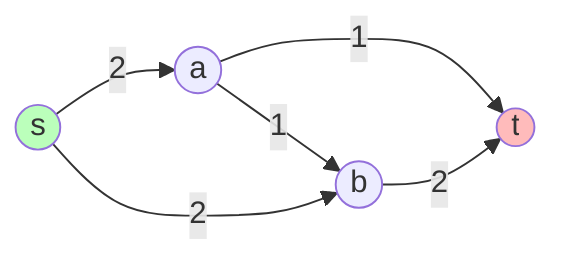

# 运筹学-网络流模型

> 所属阶段：[[🧭 阶段2-整数与网络优化|🕸️ 第2阶段：整数与网络优化]]

## 这个知识点解决什么问题？

**我们遇到的麻烦**：运输、配送、通信流量问题天然是"图上的流"——从源到汇经过中间节点，每条边有容量和成本。直接用通用 LP 可以解，但网络结构让问题有**专用快速算法**（比通用单纯形快几个数量级），且最优解自动是整数（约束矩阵全幺模）。本卡建立网络流模型：流守恒、残量网络、增广路径，覆盖最大流与最小费用流。

## 核心概念

### 1. 网络与流守恒

有向图 $G=(V,E)$，源 $s$、汇 $t$，边容量 $u_{ij}$，流 $f_{ij}$ 满足：

- **容量约束**：$0\le f_{ij}\le u_{ij}$；
- **流守恒**（中间节点）：$\sum_{j:(i,j)\in E}f_{ij}-\sum_{k:(k,i)\in E}f_{ki}=0$；
- **源/汇**：净流出量 = 净流入量 = 总流量 $F$。

最大流：在守恒约束下最大化 $F$。

### 2. 残量网络与增广路径

给定流，构造**残量网络**：边 $(i,j)$ 剩余容量 $u_{ij}-f_{ij}$（正向）；若 $f_{ij}>0$ 加反向边 $(j,i)$ 容量 $f_{ij}$（可"退货"）。

**增广路径**：残量网络中从 $s$ 到 $t$ 的正容量路径。沿路径推送流量（正向加、反向减）提升总流量。

### 3. 最大流最小割定理

最大流值 = 最小割容量（割：把 $s$ 与 $t$ 分开的边集）。**判定**：残量网络中不存在 $s$-$t$ 增广路径 ⇔ 流最优。算法：Ford-Fulkerson（增广）、Edmonds-Karp（BFS 找最短增广路，多项式）。

**示例网络图**（箭头旁数字 = 边容量；本例最大流 = 3，见下方手算）：



### 4. 最小费用流

加边单位费用 $c_{ij}$，目标 $\min\sum c_{ij}f_{ij}$ 同时满足需求 $b_i$（源 $b>0$，汇 $b<0$，中间 0）与容量。**负费用圈消除算法**：反复找残量网络中负费用圈并沿圈调整，直到无负圈。特例：最短路（费用=距离，容量无穷）、最大流（费用=0）、二分图匹配（费用=0/1）。

## 一个最小例子（手算）

网络：$s\to a$（容量 2）、$s\to b$（容量 2）、$a\to t$（容量 1）、$b\to t$（容量 2）、$a\to b$（容量 1）。

1. 增广 $s\to a\to t$：推 1（$a\to t$ 满）。当前流 1。
2. 残量：$s\to b\to t$：推 2。当前流 3。
3. 残量检查：$s\to a$ 剩 1、$a\to t$ 已满；$s\to b$、$b\to t$ 均已满。直觉上"再加不进去"了，但此时残量网络中还存在路径吗？——$s\to a$（剩 1）→ $a$ 处只有两条出边：$a\to t$（满）和 $a\to b$（剩 1）。走 $s\to a\to b$ 到达 $b$，但 $b\to t$ 已满 2，**推不动**。于是残量网络中不存在 $s$-$t$ 正容量路径 → 由最大流最小割定理，当前流 3 即最优。
4. 验证最小割：割 $\{s,a\}$ 到 $\{b,t\}$ 的跨割边为 $s\to b(2)$ 与 $a\to b(1)$，容量和 = 3 = 最大流值 ✓。**最大流 = 最小割 = 3**。

## 用 OR-Tools 验证（SimpleMaxFlow）

官方教程的 `ortools.graph.python.max_flow` 接口（9.x 为 snake_case），直接输入边容量、输出最大流与各边流量：

```python
from ortools.graph.python import max_flow
m = max_flow.SimpleMaxFlow()
# 节点：0=s, 1=a, 2=b, 3=t；每条边 (u, v, 容量)
for u, v, c in [(0,1,2), (0,2,2), (1,3,1), (2,3,2), (1,2,1)]:
    m.add_arc_with_capacity(u, v, c)
st = m.solve(0, 3)                     # Status.OPTIMAL
print("maxflow =", m.optimal_flow())   # 3
for i in range(m.num_arcs()):
    print(m.tail(i), "->", m.head(i), m.flow(i), "/", m.capacity(i))
```

输出：`maxflow = 3`，各边流量 $(s\to a:1,\ s\to b:2,\ a\to t:1,\ b\to t:2,\ a\to b:0)$ —— 与手算第 1/2 步的推流结果一致，并证实"无增广路径即最优"。**验证最小割**：删掉流量满的跨割边 $s\to b$ 与 $a\to b$（容量和 3）后 $s,t$ 断开，最小割容量 = 最大流值 3 ✓。

## 网络流问题家族对比

| 问题 | 目标 | 额外要素 | 算法 | 特例关系 |
|:---|:---|:---|:---|:---|
| 最大流 | 最大化 $s\to t$ 流量 | 容量 | Ford-Fulkerson / Edmonds-Karp | 费用流取费用 0 |
| 最小费用流 | 满足需求的最小费用 | 容量+费用+需求 $b_i$ | 负费用圈消除 / 网络单纯形 | 最大流/最短路/匹配都是特例 |
| 最短路 | 最小距离路径 | 费用=距离，容量无穷 | Dijkstra / Bellman-Ford | 单源单汇费用流 |
| 指派/二分匹配（[[运筹学-匹配与指派问题]]） | 最小总成本匹配 | 二部图结构 | 匈牙利 / 费用流 | 费用流特例 |

**关系**：四个问题共享"流守恒 + 容量"骨架，区别只在目标与附加要素；全幺模性保证所有最优解自动整数——这是网络流比通用 MIP 快且无需整数约束的根本原因。

## 常见误区

- **误区 1**：增广后忘记加反向边。反向边是"撤销"机制，没有它贪心会卡在次优。
- **误区 2**：把最大流当最小费用流。目标不同（量 vs 费用）；运输问题的"容量无限+费用"是费用流特例。
- **误区 3**：认为网络流只能解"流"问题。指派、二分匹配、项目调度（CPM）都能建模成网络流，全幺模性保证整数解。
- **误区 4**：手算推流时凭直觉"满了就不推"。必须检查**残量网络**（含反向边），否则会漏掉"退货再换路"的增广。

## 最小自测

- [#自测题/基础] 画出上例第三次增广尝试的残量网络，说明为什么 $s\to a\to b\to t$ 推不动。
- [#自测题/基础] 用最大流-最小割解释"瓶颈边"。
- [#自测题/中等] 用上面的代码把 $a\to t$ 容量改为 2，重新运行并解释最大流如何变化、最小割是否唯一。
- [#自测题/中等] 说明为什么网络流问题不需要显式整数约束（全幺模）。
- [#自测题/较难] 设计一个例子：不加反向边的贪心增广会停在次优解，而残量网络能修正——用代码验证。

## 学完后可以完成

```dataview
LIST
FROM "03-Projects"
WHERE contains(requires, this.file.link)
SORT assignment_level ASC, file.name ASC
```
