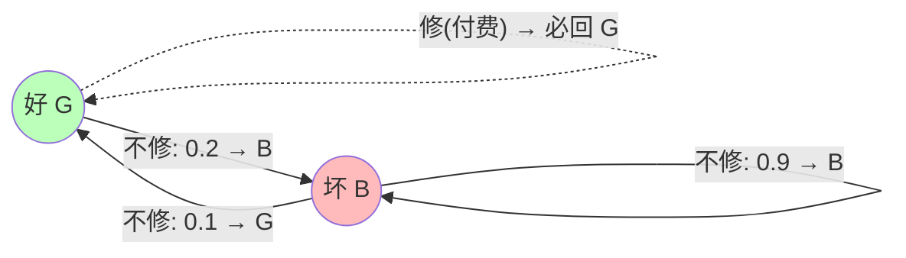

# 运筹学-Markov决策过程

> 所属阶段：[[🧭 阶段3-随机与动态决策|🧭 第3阶段：随机与动态决策]]

## 这个知识点解决什么问题？

**我们遇到的麻烦**：动态规划假设转移确定；现实中动作的**结果随机**（维修后设备可能仍坏、广告投放后需求不确定），且目标不是"一步收益"而是"长期累计收益"。**Markov 决策过程（MDP）**给"随机转移 + 长期目标下的序贯决策"一个标准框架：状态、动作、转移概率、回报、折扣，并给出**策略评估**与**策略迭代**求解算法。它是库存控制、设备更换、排队控制、以及强化学习（13-强化学习课程）的共同根基。

## MDP 五元组与贝尔曼方程

> 💡 **阅读引导**：本节公式多但思想只有一条——**"当前状态的价值 = 立即回报 + 折扣×(未来状态的期望价值)"**。先看下面的状态转移图建立直觉，再读公式，最后用"最小例子"验证。

**两状态维修问题示意图**（不修时 G→G 概率 0.8、B→B 概率 0.9；"修"强制回到 G）：



### 1. 五元组 $(S,A,P,R,\gamma)$

- $S$ 状态集、$A$ 动作集；
- $P(s'\mid s,a)$ 转移概率（**马尔可夫性**：只依赖当前状态动作）；
- $R(s,a,s')$ 即时回报；
- $\gamma\in[0,1)$ 折扣因子（无限期问题保证收敛；$\gamma=1$ 仅用于有限期）。

### 2. 价值函数

- **策略** $\pi:S\to A$（确定性）。状态价值：
$$V^\pi(s)=E_\pi\Big[\sum_{t=0}^\infty \gamma^t R(s_t,a_t,s_{t+1})\ \Big|\ s_0=s\Big].$$
- **贝尔曼方程**（自洽性，由全期望公式展开）：
$$V^\pi(s)=R(s,\pi(s))+\gamma\sum_{s'}P(s'\mid s,\pi(s))\,V^\pi(s').$$

### 3. 最优价值与贝尔曼最优性

$$V^*(s)=\max_a\Big[R(s,a)+\gamma\sum_{s'}P(s'\mid s,a)V^*(s')\Big].$$

最优策略 $\pi^*(s)=\arg\max_a\big[\cdots\big]$。MDP 必有确定性最优策略（线性规划或不动点理论保证）。

## 求解算法

### 1. 策略评估（Policy Evaluation）

固定 $\pi$，迭代更新：
$$V_{k+1}(s)=R(s,\pi(s))+\gamma\sum_{s'}P(s'\mid s,\pi(s))V_k(s'),$$
直到 $\lVert V_{k+1}-V_k\rVert$ 足够小（不动点迭代，线性收敛）。

### 2. 策略迭代（Policy Iteration）

- **评估**：对当前 $\pi$ 求 $V^\pi$（解线性方程组或迭代）；
- **改进**：$\pi'(s)=\arg\max_a\big[R(s,a)+\gamma\sum_{s'}P(s'\mid s,a)V^\pi(s')\big]$；
- 重复直到策略不再改变——**有限步收敛**（策略数有限且单调改进）。

### 3. 值迭代（Value Iteration）

跳过显式策略，直接迭代 $V_{k+1}(s)=\max_a[\cdots V_k]$ 直到收敛，再提取策略。策略迭代通常迭代次数少但每步贵（解方程组）；值迭代每步便宜但步数多。

## 一个最小例子（手算）

两状态维修问题：设备"好 G / 坏 B"。动作：修/不修（"修"→ 下期好，付 $c=5$；"不修"→ 好→好概率 0.8，坏→坏概率 0.9）。收益：状态好时赚 10，坏时赚 2。$\gamma=0.9$。

1. **策略 $\pi$=永远不修**，评估：$V(G)=10+0.9[0.8V(G)+0.2V(B)]$；$V(B)=2+0.9[0.1V(G)+0.9V(B)]$。整理为线性方程组 $0.28V(G)-0.18V(B)=10$、$-0.09V(G)+0.19V(B)=2$，解得 $V(G)\approx 61.1,\ V(B)\approx 39.5$（联立求解）。
2. **改进**：对 G 比较"不修（61.1）vs 修（$V'(G)=10-5+0.9V(G)=5+0.9\times61.1=60.0$）"——不修更优；对 B 比较"不修（39.5）vs 修（$V'(B)=2-5+0.9V(G)=-3+0.9\times61.1=52.0$）"——修更优 → 新策略：B 时修、G 时不修。
3. 重新评估新策略，直到收敛。**模式**：策略迭代交替"评估-改进"直到稳定。

## 常见误区

- **误区 1**：$V^\pi$ 与 $V^*$ 混淆。前者给定策略的价值，后者最优价值；贝尔曼方程与贝尔曼最优性方程是两回事。
- **误区 2**：$\gamma=1$ 无限期。无折扣时价值可能发散（需平均回报准则）；$\gamma<1$ 保证有界收敛。
- **误区 3**：策略迭代每轮都从零评估。可以只做一轮评估就改进（modified policy iteration），效率更高。

## 最小自测

- [ ] 写出 MDP 五元组与贝尔曼方程（给定策略版）。
- [ ] 手算两状态例子的策略评估（写出两个方程并求解）。
- [ ] 对比策略迭代与值迭代的每步成本与收敛行为。

## 与本课程的连接

- 强化学习视角（Q 学习、策略梯度）见 [[02-Knowledge/🧠 学习系统/13-强化学习/02-马尔可夫决策过程/MDP 与贝尔曼方程|13-强化学习 MDP 卡]]。
- 库存 $(s,S)$ 策略可由 MDP 视角理解（状态=库存量，动作=订货量）。

## 学完后可以完成

```dataview
LIST
FROM "03-Projects"
WHERE contains(requires, this.file.link)
SORT assignment_level ASC, file.name ASC
```
